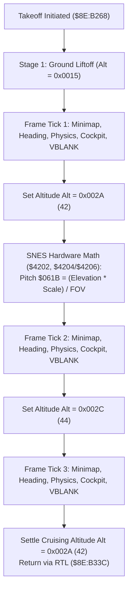

# Mode 7 Vehicle Takeoff & Stepped Altitude Transition Engine

> **ROM Bank**: `$8E` (Mode 7 Overworld Flight Engine)  
> **Source Routines**:
> - `mode7_vehicle_takeoff_altitude_stepper`: `$8E:B268` – `$8E:B33C`
> - `mode7_flight_horizon_perspective_math`: `$8E:B230` – `$8E:B267`
> - `mode7_flight_ascent_loop`: `$8E:B1E0` – `$8E:B22F`
> - `mode7_flight_pitch_heading_math`: `$8E:B33D` – `$8E:B3CD`
> - `mode7_vehicle_cockpit_overlay_sprites`: `$8F:C61E` – `$8F:C6C2`  
> **CPU State**: 16-bit A/X (`REP #$30`), Data Bank `$7E` / `$8E`  
> **Related Documents**: [`flight-horizon.md`](flight-horizon.md), [`mode7-flight.md`](mode7-flight.md)

---

## 1. Architectural Overview

When the player embarks aboard the Windwalker flying machine on the *Secret of Evermore* overworld map, the engine switches the SNES PPU from 4-layer metatile scrolling into Mode 7 affine transformation mode. The transition from ground takeoff to level cruising flight requires a smooth vertical ascent sequence:

1. **Multi-Stage Altitude Stepping (`$8E:B268` – `$8E:B33C`)**:
   - The vehicle does not jump instantaneously to flight altitude. Instead, the engine advances camera altitude `$7E:0619` through three distinct discrete staging plateaus:
     - **Stage 1 (Liftoff)**: Baseline elevation `$0015` (21 units).
     - **Stage 2 (Climb)**: Step up to `$002A` (42 units).
     - **Stage 3 (Apex Over-Rise)**: Dynamic crest at `$002C` (44 units).
     - **Cruising Settlement**: Settles smoothly into cruising altitude `$002A` (42 units).

2. **Hardware Perspective Pitch Recalculation**:
   - At each altitude plateau, the horizon vanishing point pitch angle (`$7E:061B`) must be recomputed to maintain optical vanishing line convergence.
   - The SNES hardware multiplier (`$4202`) and 16-cycle hardware divider (`$4204` / `$4206`) scale the elevation factor by field-of-view divisor parameters loaded from Direct Page pointer `$95`.

3. **Per-Stage Frame Synchronization Pass**:
   - Each elevation plateau executes an atomic frame processing pass that coordinates all visual and game state subsystems:
     - **Modal Dialogue / Ring Menu Check**: Inspects `$7E:05AB` bit 0. If modal, invokes sound queue callbacks `$90:80D2` for buffers `$0DEB` and `$0DDB`.
     - **Radar Minimap Refresh**: Invokes `$90:9876` to blit player position onto the Mode 7 minimap.
     - **Heading Vector Integration**: Invokes `$8E:B33D` to calculate forward velocity deltas from the 512-step trigonometric sine/cosine table at `$80:88A3`.
     - **Actor Physics Update (Pass 1)**: Invokes `$80:96BB` to move entities.
     - **Cockpit Occupant Overlays**: Invokes `$8F:C61E` to composite Boy and Dog cockpit sprites with cockpit dome glass banking.
     - **Actor Physics Update (Pass 2)**: Re-runs `$80:96BB` for secondary attachments.
     - **OAM Display List Finalization**: Invokes `$80:8FEE` to compile high/low OAM hardware tables.
     - **VBLANK Frame Await**: Invokes `$80:858C` to wait for NMI Vertical Blanking interrupt.

---

## 2. 65816 Assembly Implementation

> **Interactive 65816 Assembly**:
> Centralized comments infused at runtime.
> [View in VFS: soe://rom/code/8EB268](soe://rom/code/8EB268?asm=1&c=0)

---

## 3. Clean C Decompilation

> **Reconstructed C Decompilation**:
> Source moved to [`reconstructed-c/8E/8EB268_mode7_takeoff.c`](../../../reconstructed-c/8E/8EB268_mode7_takeoff.c).
> [View in VFS: soe://rom/code/8EB268](soe://rom/code/8EB268?c=1&asm=0)

---

## 4. Verification & Behavioral Equivalence

| Test Condition | Assembly Logic | C Implementation | Status |
|---|---|---|---|
| **Liftoff Tick** | Checks `$05AB`, runs `$90:9876`, `$8EB33D`, `$8096BB`, `$8FC61E`, `$808FEE`, `$80858C` | `mode7_flight_frame_tick(state)` with modal check & VBLANK sync | Matches |
| **Climb Step** | `LDA #$002A; STA $0619` | `state->camera_altitude = MODE7_ALTITUDE_STAGE_CLIMB` | Matches |
| **Perspective Pitch Math** | Hardware mult `$4202` & div `$4204`/`$4206`, result into `$061B` | `mode7_recalculate_pitch_math(state)` writes `state->camera_pitch` | Matches |
| **Crest Step** | `LDA #$002C; STA $0619`, executes frame tick | `state->camera_altitude = MODE7_ALTITUDE_STAGE_CREST` + tick | Matches |
| **Cruising Settle** | `LDA #$002A; STA $0619; RTL` | `state->camera_altitude = MODE7_ALTITUDE_CRUISING` | Matches |
