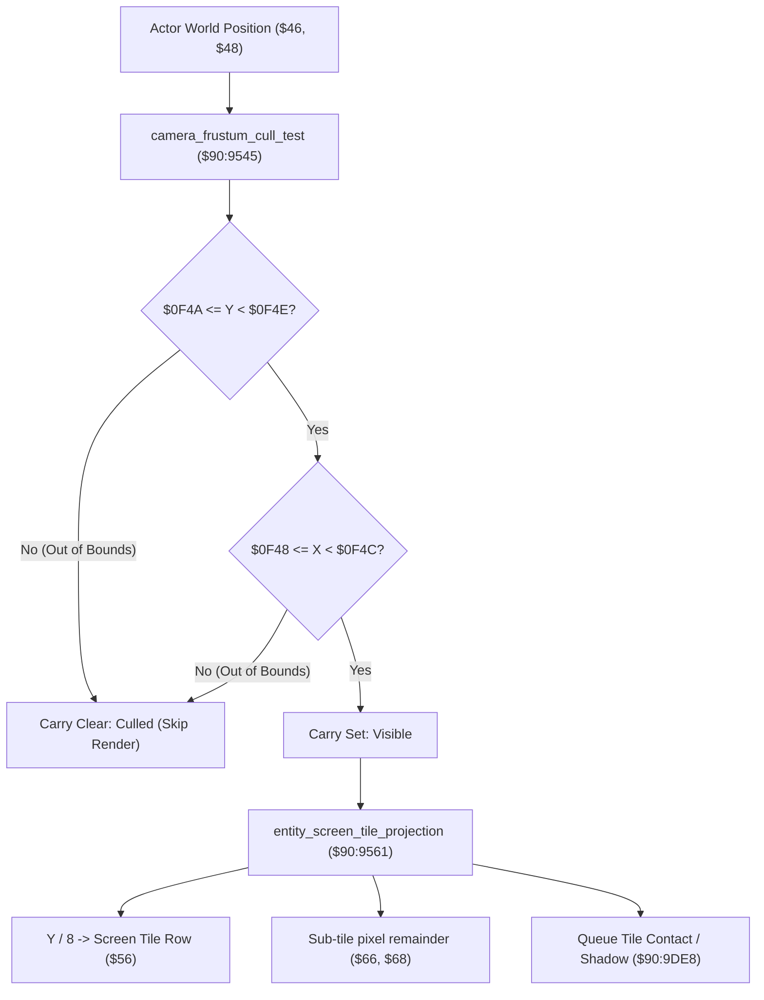

# Viewport Frustum Culling & Entity Screen Projection

- **ROM Locations**:
  - `camera_frustum_cull_test`: `$90:9545` – `$90:9560`
  - `entity_screen_tile_projection`: `$90:9561` – `$90:95CD`
- **CPU State**: 16-bit A/X (`REP #$30`), Data Bank `$90` / `$7E`
- **WRAM Core Addresses**:
  - `$7E:0F48`: Frustum visible bounding box left edge ($X_{min}$).
  - `$7E:0F4A`: Frustum visible bounding box top edge ($Y_{min}$).
  - `$7E:0F4C`: Frustum visible bounding box right edge ($X_{max}$).
  - `$7E:0F4E`: Frustum visible bounding box bottom edge ($Y_{max}$).
  - `$7E:08EE`: VRAM base tile row stride offset.
  - DP `$46` & DP `$48`: World coordinates (X, Y) of candidate entity.
  - DP `$66` & DP `$68`: Screen tile pixel relative coordinates.
  - DP `$56`: Computed screen buffer index into `$7F:0004`.

---

## 1. Architectural Architecture & Culling Pipeline

To optimize SNES PPU sprite slot usage and avoid rendering actors outside the active $256 \times 224$ display, the Secret of Evermore engine executes a strict rectangular frustum visibility test before queuing sprite animation frames or shadow projection.



### 1. Frustum Bounding Box
The camera system continuously updates the visible margin registers at `$7E:0F48`–`$7E:0F4E`:
- Left: $\text{Camera}_X - 16\text{px}$ margin
- Top: $\text{Camera}_Y - 16\text{px}$ margin
- Right: $\text{Camera}_X + 256 + 16\text{px}$ margin
- Bottom: $\text{Camera}_Y + 224 + 16\text{px}$ margin

### 2. Screen Tile Projection Math
When visible:
- Screen Row: $\lfloor (Y - \text{Anchor}_Y) / 8 \rfloor \times \text{Stride}$
- Screen Column: $\lfloor (X - \text{Anchor}_X) / 8 \rfloor$
- Buffer Offset: Row $+$ Column added to base screen buffer pointer in Bank `$7F` (`$7F:0004`).
- Pixel fractional offsets are retained in `$66` (X) and `$68` (Y) for sub-pixel sprite alignment and floor shadow contact rendering.

---

## 2. Disassembly & Annotations

### Part 1: Frustum Culling Test (`$90:9545`)
```assembly
; ==============================================================================
; camera_frustum_cull_test ($90:9545)
; Input:
;   DP $46 = Entity World X
;   DP $48 = Entity World Y
; Output:
;   Carry SET   = Entity is visible within camera frustum
;   Carry CLEAR = Entity is outside viewport (culled)
; ==============================================================================
$909545  A5 48       LDA $48           ; Entity Y coordinate
$909547  CD 4A 0F    CMP $0F4A         ; Compare against frustum top edge
$90954A  30 13       BMI $90955F       ; If Y < top edge -> CULLED
$90954C  CD 4E 0F    CMP $0F4E         ; Compare against frustum bottom edge
$90954F  10 0E       BPL $90955F       ; If Y >= bottom edge -> CULLED

$909551  A5 46       LDA $46           ; Entity X coordinate
$909553  CD 48 0F    CMP $0F48         ; Compare against frustum left edge
$909556  30 07       BMI $90955F       ; If X < left edge -> CULLED
$909558  CD 4C 0F    CMP $0F4C         ; Compare against frustum right edge
$90955B  10 02       BPL $90955F       ; If X >= right edge -> CULLED

$90955D  38          SEC               ; CARRY SET = VISIBLE
$90955E  6B          RTL

$90955F  18          CLC               ; CARRY CLEAR = CULLED
$909560  6B          RTL
```

### Part 2: Screen Tile Coordinate Projection (`$90:9561`)
```assembly
; ==============================================================================
; entity_screen_tile_projection ($90:9561)
; Input:
;   DP $4C = Entity pointer ($7E:xxxx)
;   DP $46 / $48 = Entity world position (X, Y)
; Output:
;   DP $56 = Screen tile buffer index
;   DP $66 / $68 = Tile-relative pixel remainder
; ==============================================================================
$909561  8B          PHB
$909562  4B          PHK
$909563  AB          PLB               ; Data Bank = $90
$909564  A4 4C       LDY $4C           ; Load entity pointer
$909566  A5 48       LDA $48           ; Entity Y
$909568  CD 4A 0F    CMP $0F4A         ; Double-check top bound
$90956B  30 23       BMI $909590       ; Culled
$90956D  CD 4E 0F    CMP $0F4E         ; Double-check bottom bound
$909570  10 1E       BPL $909590       ; Culled

; Compute Tile Row Offset:
$909572  38          SEC
$909573  E9 03 00    SBC $0003,Y       ; Subtract entity vertical origin
$909576  4A          LSR A
$909577  4A          LSR A
$909578  4A          LSR A             ; Y / 8 (tile row)
$909579  29 FE 00    AND #$00FE        ; Align to 2-byte word index
$90957C  EB          XBA
$90957D  0D EE 08    ORA $08EE         ; VRAM row stride lookup
$909580  8D 02 42    STA $4202         ; Hardware multiplication register

$909584  A5 46       LDA $46           ; Entity X
$909586  CD 48 0F    CMP $0F48
$909589  30 05       BMI $909590
$90958B  CD 4C 0F    CMP $0F4C
$90958E  30 03       BMI $909593

; Culled Exit:
$909590  AB          PLB
$909591  18          CLC
$909592  6B          RTL

; Compute Tile Column & Remainder:
$909593  4A          LSR A
$909594  4A          LSR A
$909595  4A          LSR A             ; X / 8 (tile column)
$909596  3A          DEC A
$909597  29 FE 00    AND #$00FE
$90959A  18          CLC
$90959B  6D 16 42    ADC $4216         ; Add row stride product
$90959E  85 56       STA $56           ; DP $56 = screen tile buffer offset

; Sub-Tile Pixel Offsets:
$9095A1  A5 48       LDA $48
$9095A3  38          SEC
$9095A4  E9 03 00    SBC $0003,Y
$9095A7  29 0F 00    AND #$000F        ; Remainder Y (0..15)
$9095AA  18          CLC
$9095AB  69 06 00    ADC #$0006
$9095AE  85 68       STA $68           ; DP $68 = pixel offset Y

$9095B0  A5 46       LDA $46
$9095B2  38          SEC
$9095B3  E9 08 00    SBC $0008,Y
$9095B6  29 0F 00    AND #$000F        ; Remainder X (0..15)
$9095B9  18          CLC
$9095BA  69 10 00    ADC #$0010
$9095BD  85 66       STA $66           ; DP $66 = pixel offset X

$9095BF  A5 56       LDA $56
$9095C1  AA          TAX
$9095C2  BF 04 00 7F LDA $7F0004,X     ; Read tile attribute from screen buffer
$9095C6  85 50       STA $50
$9095C8  22 E8 9D 90 JSL $909DE8       ; Dispatch tile shadow / contact hook
$9095CC  AB          PLB
$9095CD  6B          RTL
```

---

## 3. Reconstructed Clean C Implementation

```c
#include <stdint.h>
#include <stdbool.h>

typedef struct {
    int16_t min_x;   // $7E:0F48
    int16_t min_y;   // $7E:0F4A
    int16_t max_x;   // $7E:0F4C
    int16_t max_y;   // $7E:0F4E
} ViewportFrustum;

typedef struct {
    uint8_t  pad0[3];
    uint8_t  origin_y;       // +0x03
    uint8_t  pad1[4];
    uint8_t  origin_x;       // +0x08
} EntityAnchor;

typedef struct {
    uint16_t buffer_offset;  // DP $56
    uint16_t pixel_rem_x;    // DP $66
    uint16_t pixel_rem_y;    // DP $68
    uint16_t tile_attribute; // DP $50
} ProjectedScreenTile;

extern ViewportFrustum g_camera_frustum;      // $7E:0F48..0F4E
extern uint16_t g_vram_row_stride_base;       // $7E:08EE
extern const uint16_t g_screen_buffer_7f[];   // $7F:0004

extern void dispatch_tile_contact_shadow(ProjectedScreenTile *proj);

/**
 * Checks if entity world coordinates fall within camera viewport bounds.
 * Corresponds to $90:9545.
 * Returns true if visible, false if culled.
 */
bool camera_frustum_cull_test(int16_t world_x, int16_t world_y) {
    if (world_y < g_camera_frustum.min_y || world_y >= g_camera_frustum.max_y) {
        return false; // Vertical cull
    }
    if (world_x < g_camera_frustum.min_x || world_x >= g_camera_frustum.max_x) {
        return false; // Horizontal cull
    }
    return true; // Inside frustum
}

/**
 * Projects entity world coordinates into screen tile coordinates,
 * determines buffer offset into $7F:0004, and queues contact shadow.
 * Corresponds to $90:9561.
 */
bool entity_screen_tile_projection(EntityAnchor *entity, int16_t world_x, int16_t world_y, ProjectedScreenTile *out_proj) {
    // 1. Frustum visibility check
    if (!camera_frustum_cull_test(world_x, world_y)) {
        return false;
    }

    // 2. Tile row calculation
    int16_t rel_y = world_y - entity->origin_y;
    uint16_t tile_row = ((uint16_t)rel_y >> 3) & 0xFE;
    uint32_t row_stride = (tile_row << 8) | g_vram_row_stride_base;

    // 3. Tile column calculation
    int16_t rel_x = world_x - entity->origin_x;
    uint16_t tile_col = (((uint16_t)rel_x >> 3) - 1) & 0xFE;

    // 4. Screen buffer address ($7F:0004 + offset)
    uint16_t buffer_offset = (uint16_t)(row_stride + tile_col);
    out_proj->buffer_offset = buffer_offset;

    // 5. Pixel fine offsets (0..15 remainder)
    out_proj->pixel_rem_y = (rel_y & 0x0F) + 6;
    out_proj->pixel_rem_x = (rel_x & 0x0F) + 16;

    // 6. Read tile attribute and dispatch contact shadow hook
    out_proj->tile_attribute = g_screen_buffer_7f[buffer_offset >> 1];
    dispatch_tile_contact_shadow(out_proj);

    return true;
}
```
