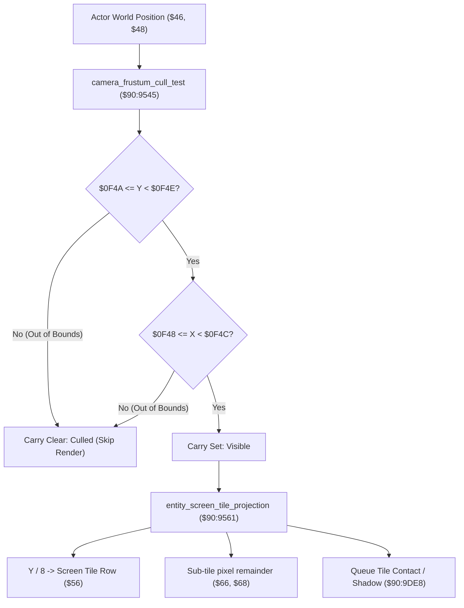

# Viewport Frustum Culling & Entity Screen Projection

- **ROM Locations**:
  - `camera_frustum_cull_test`: `$90:9545` – `$90:9560`
  - `entity_screen_tile_projection`: `$90:9561` – `$90:95CD`
- **CPU State**: 16-bit A/X (`REP #$30`), Data Bank `$90` / `$7E`
- **WRAM Core Addresses**:
  - `$7E:0F48`: Frustum visible bounding box left edge ($X_{min}$).
  - `$7E:0F4A`: Frustum visible bounding box top edge ($Y_{min}$).
  - `$7E:0F4C`: Frustum visible bounding box right edge ($X_{max}$).
  - `$7E:0F4E`: Frustum visible bounding box bottom edge ($Y_{max}$).
  - `$7E:08EE`: VRAM base tile row stride offset.
  - DP `$46` & DP `$48`: World coordinates (X, Y) of candidate entity.
  - DP `$66` & DP `$68`: Screen tile pixel relative coordinates.
  - DP `$56`: Computed screen buffer index into `$7F:0004`.

---

## 1. Architectural Architecture & Culling Pipeline

To optimize SNES PPU sprite slot usage and avoid rendering actors outside the active $256 \times 224$ display, the Secret of Evermore engine executes a strict rectangular frustum visibility test before queuing sprite animation frames or shadow projection.

### 1. Frustum Bounding Box
The camera system continuously updates the visible margin registers at `$7E:0F48`–`$7E:0F4E`:
- Left: $\text{Camera}_X - 16\text{px}$ margin
- Top: $\text{Camera}_Y - 16\text{px}$ margin
- Right: $\text{Camera}_X + 256 + 16\text{px}$ margin
- Bottom: $\text{Camera}_Y + 224 + 16\text{px}$ margin

### 2. Screen Tile Projection Math
When visible:
- Screen Row: $\lfloor (Y - \text{Anchor}_Y) / 8 \rfloor \times \text{Stride}$
- Screen Column: $\lfloor (X - \text{Anchor}_X) / 8 \rfloor$
- Buffer Offset: Row $+$ Column added to base screen buffer pointer in Bank `$7F` (`$7F:0004`).
- Pixel fractional offsets are retained in `$66` (X) and `$68` (Y) for sub-pixel sprite alignment and floor shadow contact rendering.

---

## 2. Disassembly & Annotations

### Part 1: Frustum Culling Test (`$90:9545`)
> **Interactive 65816 Assembly**:
> Centralized comments infused at runtime.
> [View in VFS: soe://rom/code/909545](soe://rom/code/909545?asm=1&c=0)

### Part 2: Screen Tile Coordinate Projection (`$90:9561`)
> **Interactive 65816 Assembly**:
> Centralized comments infused at runtime.
> [View in VFS: soe://rom/code/909545](soe://rom/code/909545?asm=1&c=0)

---

## 3. Reconstructed Clean C Implementation

> **Reconstructed C Decompilation**:
> Source moved to [`reconstructed-c/90/909545_viewport_culling.c`](../../../reconstructed-c/90/909545_viewport_culling.c).
> [View in VFS: soe://rom/code/909545](soe://rom/code/909545?c=1&asm=0)

