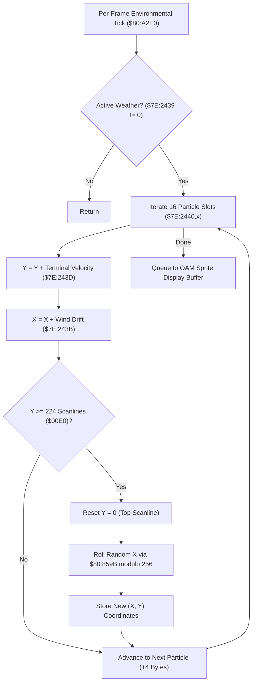

# Weather Precipitation Particle Physics & Boundary Wrapping Pipeline

- **ROM Locations**:
  - `weather_particle_simulation_loop`: `$80:A305` – `$80:A350`
- **CPU State**: 16-bit A/X (`REP #$30`), Data Bank `$7E` / `$80`
- **WRAM Core Addresses**:
  - `$7E:2440` – `$7E:247F`: Weather particle pool array (16 active particle slots, 4 bytes each: `[X, Y]`).
  - `$7E:2439`: Weather type indicator (0 = Clear, 1 = Rain, 2 = Embers/Ash, 3 = Snow).
  - `$7E:243B`: Ambient wind drift speed delta.
  - `$7E:243D`: Downward terminal velocity per frame (+4px for rain, +1px for snow).

---

## 1. Architectural Role & Particle Mechanics

Ambient precipitation in Secret of Evermore (the rain over Ebon Keep, snow flurries in Ivor Tower mountains, and volcanic ash embers in the Crater) is rendered via a dedicated 16-slot lightweight particle engine updated during the main frame tick:



### 1. Velocity Integration & Wind Drift
- Each particle slot maintains a 16-bit screen coordinate pair `[X, Y]`.
- Every frame, the engine adds downward velocity from `$7E:243D` (e.g. $+4\text{px}$ for rain) and applies sinusoidal or directional horizontal wind drift from `$7E:243B`.

### 2. Screen Boundary Wrapping & Random Regeneration
- Compares particle Y coordinate against screen height of 224 scanlines (`CMP #$00E0`).
- When a particle exits the bottom of the screen:
  - Resets Y coordinate to 0 (`STZ $2442,x`).
  - Draws a new horizontal screen position across 256 pixels using random number generator `$80:859B` (`AND #$00FF`).

---

## 2. Disassembly & Annotations

```assembly
; ==============================================================================
; weather_particle_simulation_loop ($80:A305)
; ==============================================================================
$80A305  AD 39 24    LDA $2439         ; Weather mode (0 = none)
$80A308  F0 46       BEQ $80A350       ; Clear weather -> exit
$80A30A  A2 00 00    LDX #$0000        ; Slot index = 0

; Loop across 16 particles:
$80A30D  BD 42 24    LDA $2442,x       ; Particle Y coordinate
$80A310  18          CLC
$80A311  6D 3D 24    ADC $243D         ; Add terminal downward velocity (+4px)
$80A314  C9 E0 00    CMP #$00E0        ; Exceeded 224 scanlines?
$80A317  90 0F       BCC $80A328       ; No -> keep within screen

; Particle wrapped past bottom edge:
$80A319  A9 00 00    LDA #$0000        ; Reset to top scanline (Y = 0)
$80A31C  9D 42 24    STA $2442,x
$80A31F  22 9B 85 80 JSL $80859B       ; Roll random X coordinate
$80A323  29 FF 00    AND #$00FF        ; Modulo 256
$80A326  80 0E       BRA $80A336

; Particle still on screen:
$80A328  9D 42 24    STA $2442,x       ; Store updated Y
$80A32B  BD 40 24    LDA $2440,x       ; Particle X coordinate
$80A32E  18          CLC
$80A32F  6D 3B 24    ADC $243B         ; Add wind drift
$80A332  29 FF 00    AND #$00FF        ; Screen wrap X 0..255
$80A335  9D 40 24    STA $2440,x       ; Store updated X

$80A338  E8          INX
$80A339  E8          INX
$80A33A  E8          INX
$80A33B  E8          INX               ; Next particle (+4 bytes)
$80A33C  E0 40 00    CPX #$0040        ; 16 particles * 4 = 64 bytes
$80A33F  90 CC       BCC $80A30D
$80A341  6B          RTL

$80A350  6B          RTL
```

---

## 3. Reconstructed Clean C Implementation

```c
#include <stdint.h>
#include <stdbool.h>

#define MAX_WEATHER_PARTICLES 16
#define SCREEN_HEIGHT_SCANLINES 224 // 0x00E0 SNES active display height
#define SCREEN_WIDTH_PIXELS 256     // 0x0100

typedef struct {
    uint16_t x;
    uint16_t y;
} WeatherParticle;

extern WeatherParticle g_weather_particles[MAX_WEATHER_PARTICLES]; // $7E:2440
extern uint16_t g_weather_mode;         // $7E:2439
extern int16_t  g_weather_wind_drift;   // $7E:243B
extern uint16_t g_weather_down_speed;   // $7E:243D

extern uint16_t get_random_number(void); // $80:859B

/**
 * Simulates falling weather particles (rain, embers, snow) and wraps across screen boundaries.
 * Corresponds to $80:A305.
 */
void weather_particle_simulation_loop(void) {
    if (g_weather_mode == 0) {
        return; // Clear weather
    }

    for (int i = 0; i < MAX_WEATHER_PARTICLES; i++) {
        WeatherParticle *p = &g_weather_particles[i];

        // Downward velocity integration
        uint16_t new_y = p->y + g_weather_down_speed;

        if (new_y >= SCREEN_HEIGHT_SCANLINES) {
            // Reached bottom of screen: wrap to top with randomized X coordinate
            p->y = 0;
            p->x = get_random_number() & 0x00FF;
        } else {
            // Integrate wind drift and update coordinates
            p->y = new_y;
            p->x = (p->x + g_weather_wind_drift) & 0x00FF;
        }
    }
}
```
