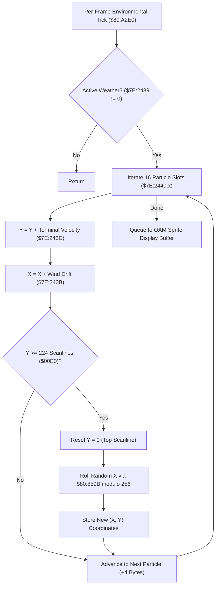

# Weather Precipitation Particle Physics & Boundary Wrapping Pipeline

- **ROM Locations**:
  - `weather_particle_simulation_loop`: `$80:A305` – `$80:A350`
- **CPU State**: 16-bit A/X (`REP #$30`), Data Bank `$7E` / `$80`
- **WRAM Core Addresses**:
  - `$7E:2440` – `$7E:247F`: Weather particle pool array (16 active particle slots, 4 bytes each: `[X, Y]`).
  - `$7E:2439`: Weather type indicator (0 = Clear, 1 = Rain, 2 = Embers/Ash, 3 = Snow).
  - `$7E:243B`: Ambient wind drift speed delta.
  - `$7E:243D`: Downward terminal velocity per frame (+4px for rain, +1px for snow).

---

## 1. Architectural Role & Particle Mechanics

Ambient precipitation in Secret of Evermore (the rain over Ebon Keep, snow flurries in Ivor Tower mountains, and volcanic ash embers in the Crater) is rendered via a dedicated 16-slot lightweight particle engine updated during the main frame tick:

### 1. Velocity Integration & Wind Drift
- Each particle slot maintains a 16-bit screen coordinate pair `[X, Y]`.
- Every frame, the engine adds downward velocity from `$7E:243D` (e.g. $+4\text{px}$ for rain) and applies sinusoidal or directional horizontal wind drift from `$7E:243B`.

### 2. Screen Boundary Wrapping & Random Regeneration
- Compares particle Y coordinate against screen height of 224 scanlines (`CMP #$00E0`).
- When a particle exits the bottom of the screen:
  - Resets Y coordinate to 0 (`STZ $2442,x`).
  - Draws a new horizontal screen position across 256 pixels using random number generator `$80:859B` (`AND #$00FF`).

---

## 2. Disassembly & Annotations

> **Interactive 65816 Assembly**:
> Centralized comments infused at runtime.
> [View in VFS: soe://rom/code/80A305](soe://rom/code/80A305?asm=1&c=0)

---

## 3. Reconstructed Clean C Implementation

> **Reconstructed C Decompilation**:
> Source moved to [`reconstructed-c/80/80A305_weather_particles.c`](../../../reconstructed-c/80/80A305_weather_particles.c).
> [View in VFS: soe://rom/code/80A305](soe://rom/code/80A305?c=1&asm=0)

