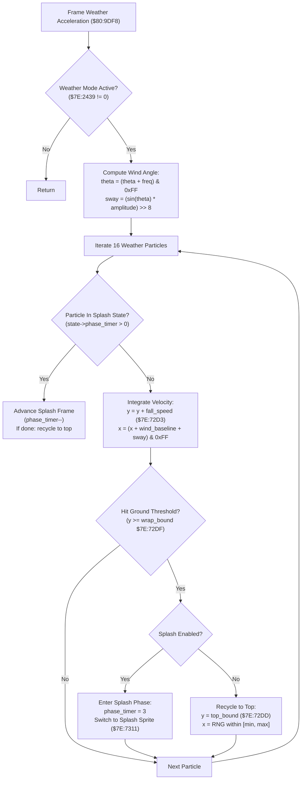

# Weather Precipitation Particle Physics, Wind Perturbation & Ground Splash Engine

- **ROM Locations**:
  - `weather_particle_generator_and_acceleration`: `$80:9DF8` – `$80:9E50`
  - `weather_particle_splash_and_recycle`: `$80:9E51` – `$80:9E92`
- **CPU State**: 16-bit A/X (`REP #$30`), Data Bank `$7E` / `$80`
- **WRAM Core Addresses**:
  - `$7E:72D1` – `$7E:734F`: Active weather configuration block (64 16-bit words):
    - `$7E:72D1`: Baseline horizontal wind velocity ($v_x$).
    - `$7E:72D3`: Baseline vertical fall velocity ($v_y$, terminal fall speed).
    - `$7E:72D5`: Trigonometric oscillation amplitude (sway magnitude).
    - `$7E:72D7`: Angular step frequency ($\Delta\theta$ per frame).
    - `$7E:72D9`: Particle spawn left boundary ($x_{\text{min}}$).
    - `$7E:72DB`: Particle spawn right boundary ($x_{\text{max}}$).
    - `$7E:72DD`: Particle spawn top boundary ($y_{\text{min}}$).
    - `$7E:72DF`: Particle wrap/impact threshold ($y_{\text{max}}$, typically 224 scanlines).
    - `$7E:72E1`..`$7E:730F`: Sprite tile index and palette descriptor table.
    - `$7E:7311`..`$7E:734F`: Splash animation frames and lifecycle tables.
  - `$7E:2439`: Weather mode indicator (0 = Clear, 1 = Rain, 2 = Embers, 3 = Snow).
  - `$7E:243B`: Global wind drift register.
  - `$7E:243D`: Global downward speed register.
  - `$7E:2440` – `$7E:247F`: 16-slot weather particle pool array (4 bytes per slot: `[X, Y]`).
  - `$7E:2480` – `$7E:24BF`: 16-slot particle state array (4 bytes per slot: `[phase_timer, sprite_frame]`).
  - `$7E:0134`: Environmental frame oscillation seed / tick counter.

---

## 1. Architectural Role & Physics Integration

While the basic ambient simulation loop (`$80:A305`) handles simple constant-velocity precipitation, dynamic weather scenes (the driving downpour in Thraxx's crater, heavy blizzards in Ivor Tower's mountain passes, and floating embers in Vulkan's volcanic core) employ high-fidelity vector acceleration:

1. **Trigonometric Wind Oscillation & Gust Perturbation**:
   - Every frame, an angular counter $\theta$ advances using the frequency step `$7E:72D7`:
     $$\theta_{t+1} = (\theta_t + \Delta\theta) \pmod{256}$$
   - Horizontal sway is computed via 256-step sine lookup table `$80:8800` scaled by the amplitude parameter `$7E:72D5`:
     $$\Delta x_{\text{sway}} = \frac{\sin(\theta) \times \text{amplitude}}{256}$$
2. **Velocity Vector Integration & Acceleration**:
   - Each particle updates its position by combining constant wind baseline, oscillatory gust displacement, and terminal downward speed:
     $$x_{t+1} = (x_t + v_x + \Delta x_{\text{sway}}) \pmod{256}$$
     $$y_{t+1} = y_t + v_y$$
3. **Impact Detection, Ground Splash Sprites & Recycling (`$80:9E51`)**:
   - When a raindrop or ember reaches the bottom impact scanline ($y \ge y_{\text{max}}$, `$7E:72DF`):
     - If ground splash is enabled (e.g. rain drops), the particle enters an impact state: its downward velocity stops, and it cycles through 3 splash droplet animation keyframes stored in `$7E:7311`.
     - When splash animation completes (or immediately for snow/ash), the particle is recycled to the top boundary:
       $$y \leftarrow y_{\text{min}} \quad (\text{\$7E:72DD})$$
       $$x \leftarrow x_{\text{min}} + (\text{RNG} \pmod{x_{\text{max}} - x_{\text{min}}})$$



---

## 2. 65816 Assembly Implementation

```assembly
; ==============================================================================
; $80:9DF8 - Weather Particle Generator & Velocity Acceleration
; ==============================================================================
weather_particle_generator_and_acceleration:
    LDA $7E2439                 ; Weather mode active?
    BEQ .exit
    
    ; Calculate dynamic wind sway offset
    LDA $7E0134                 ; Environmental frame counter
    CLC
    ADC $7E72D7                 ; Add oscillation frequency step
    STA $7E0134
    AND #$00FF
    TAX
    LDA $808800,X               ; Sine lookup table [-128..+127]
    STA $004202                 ; Hardware multiplier input A
    LDA $7E72D5                 ; Oscillation amplitude
    STA $004203                 ; Multiplier input B
    NOP : NOP : NOP             ; Wait 8 CPU cycles for hardware product
    LDA $004216                 ; Read product (A * B)
    XBA                         ; Divide by 256 (read upper byte)
    AND #$00FF
    STA $12                     ; DP $12 = calculated sway delta
    
    LDX #$0000                  ; Slot index = 0

.particle_loop:
    LDA $7E2480,X               ; Read particle phase timer
    BEQ .simulate_motion
    
    ; Particle is currently playing ground splash animation
    JSR weather_particle_splash_tick
    BRA .advance_slot

.simulate_motion:
    ; Integrate vertical fall velocity
    LDA $7E2442,X               ; Y coordinate
    CLC
    ADC $7E72D3                 ; Terminal fall speed baseline
    STA $7E2442,X
    CMP $7E72DF                 ; Reached ground threshold?
    BCS .handle_ground_impact
    
    ; Integrate horizontal velocity with wind sway
    LDA $7E2440,X               ; X coordinate
    CLC
    ADC $7E72D1                 ; Base wind speed
    CLC
    ADC $12                     ; Add dynamic wind sway perturbation
    AND #$00FF                  ; Screen horizontal boundary wrap 0..255
    STA $7E2440,X
    BRA .advance_slot

.handle_ground_impact:
    JSR weather_particle_splash_and_recycle

.advance_slot:
    INX : INX : INX : INX       ; Advance to next particle (+4 bytes)
    CPX #$0040                  ; 16 particles * 4 = 64 bytes
    BCC .particle_loop

.exit:
    RTS

; ==============================================================================
; $80:9E51 - Particle Impact Splash & Recycling
; ==============================================================================
weather_particle_splash_and_recycle:
    LDA $7E7311                 ; Check if splash animation is enabled in preset
    BEQ .immediate_recycle
    
    ; Initialize 3-frame ground splash animation
    LDA #$0003
    STA $7E2480,X               ; Set splash phase timer
    LDA $7E7311                 ; Load initial splash sprite tile
    STA $7E2482,X               ; Store active frame tile
    RTS

.immediate_recycle:
    ; Reset particle to top spawn boundary
    LDA $7E72DD                 ; Top spawn edge (y_min)
    STA $7E2442,X
    
    ; Randomize horizontal spawn within [x_min, x_max]
    JSL $80859B                 ; Roll random 16-bit word
    AND #$00FF
    STA $7E2440,X
    RTS

; ==============================================================================
; Subroutine: Weather Particle Splash Frame Tick
; ==============================================================================
weather_particle_splash_tick:
    DEC $7E2480,X               ; Decrement splash timer
    BEQ .splash_finished
    
    ; Advance to next splash keyframe
    INC $7E2482,X
    RTS

.splash_finished:
    ; Splash completed: recycle back to top
    BRA weather_particle_splash_and_recycle.immediate_recycle
```

---

## 3. Clean C Implementation

```c
#include <stdint.h>
#include <stdbool.h>

#define MAX_WEATHER_PARTICLES 16
#define SCREEN_WIDTH_MASK     0x00FF

typedef struct {
    uint16_t x;                 // Screen horizontal coordinate
    uint16_t y;                 // Screen vertical coordinate
} WeatherParticleCoord;

typedef struct {
    uint16_t phase_timer;       // Splash countdown / state timer
    uint16_t sprite_tile;       // Active display sprite tile
} WeatherParticleState;

typedef struct {
    int16_t  wind_base_x;       // $7E:72D1: Baseline horizontal drift
    uint16_t fall_speed_y;      // $7E:72D3: Baseline vertical fall speed
    uint16_t sway_amplitude;    // $7E:72D5: Oscillation sway amplitude
    uint16_t sway_frequency;    // $7E:72D7: Angular velocity increment
    uint16_t spawn_x_min;       // $7E:72D9: Left spawn bound
    uint16_t spawn_x_max;       // $7E:72DB: Right spawn bound
    uint16_t spawn_y_min;       // $7E:72DD: Top spawn bound
    uint16_t ground_wrap_y;     // $7E:72DF: Ground impact / wrap scanline
    uint16_t oam_sprite_base;   // $7E:72E1: Primary particle sprite tile
    uint8_t  padding[0x2E];
    uint16_t splash_tile_base;  // $7E:7311: Splash animation start tile (0 = no splash)
} WeatherConfigBlock;

// WRAM Globals
#define WRAM_WEATHER_CONFIG   ((volatile WeatherConfigBlock*)0x7E72D1)
#define WRAM_WEATHER_MODE     (*(volatile uint16_t*)0x7E2439)
#define WRAM_PARTICLE_COORDS  ((volatile WeatherParticleCoord*)0x7E2440)
#define WRAM_PARTICLE_STATES  ((volatile WeatherParticleState*)0x7E2480)
#define WRAM_ENV_TICK_SEED    (*(volatile uint16_t*)0x7E0134)

// External Tables & Subroutines
extern const int8_t  s_sine_table_256[256];                   // $80:8800
extern uint16_t      get_random_number(void);                 // $80:859B

/**
 * $80:9E51 - Handles particle ground impact, splash droplet animation, and recycling.
 */
void weather_particle_splash_and_recycle(int index) {
    volatile WeatherConfigBlock *cfg = WRAM_WEATHER_CONFIG;
    volatile WeatherParticleCoord *coord = &WRAM_PARTICLE_COORDS[index];
    volatile WeatherParticleState *state = &WRAM_PARTICLE_STATES[index];

    // If preset defines a splash tile, initiate 3-frame splash animation
    if (cfg->splash_tile_base != 0) {
        state->phase_timer = 3;
        state->sprite_tile = cfg->splash_tile_base;
    } else {
        // Immediate wrap without splash: reset to top spawn bound
        coord->y = cfg->spawn_y_min;
        
        // Randomize horizontal spawn within bounded window
        uint16_t span = cfg->spawn_x_max - cfg->spawn_x_min;
        if (span == 0) span = 256;
        coord->x = cfg->spawn_x_min + (get_random_number() % span);
        state->phase_timer = 0;
        state->sprite_tile = cfg->oam_sprite_base;
    }
}

/**
 * Updates an active ground splash animation frame.
 */
static void weather_particle_splash_tick(int index) {
    volatile WeatherParticleState *state = &WRAM_PARTICLE_STATES[index];

    if (state->phase_timer > 0) {
        state->phase_timer--;
        if (state->phase_timer == 0) {
            // Splash sequence ended: recycle particle to top
            weather_particle_splash_and_recycle(index);
        } else {
            // Advance to next splash keyframe
            state->sprite_tile++;
        }
    }
}

/**
 * $80:9DF8 - Simulates weather particle physics with wind oscillation and impact.
 */
void weather_particle_generator_and_acceleration(void) {
    if (WRAM_WEATHER_MODE == 0) {
        return; // Clear weather: no particles
    }

    volatile WeatherConfigBlock *cfg = WRAM_WEATHER_CONFIG;

    // Advance dynamic wind sway oscillation angle
    WRAM_ENV_TICK_SEED = (WRAM_ENV_TICK_SEED + cfg->sway_frequency) & 0x00FF;
    uint8_t angle = (uint8_t)WRAM_ENV_TICK_SEED;

    // Calculate sway perturbation via hardware sine lookup
    int16_t sine_val = s_sine_table_256[angle];
    int16_t sway_delta = (int16_t)(((int32_t)sine_val * (int32_t)cfg->sway_amplitude) >> 8);

    // Update all 16 active particle slots
    for (int i = 0; i < MAX_WEATHER_PARTICLES; i++) {
        volatile WeatherParticleCoord *coord = &WRAM_PARTICLE_COORDS[i];
        volatile WeatherParticleState *state = &WRAM_PARTICLE_STATES[i];

        if (state->phase_timer > 0) {
            weather_particle_splash_tick(i);
            continue;
        }

        // Integrate downward velocity
        coord->y += cfg->fall_speed_y;

        // Check if particle hit ground threshold
        if (coord->y >= cfg->ground_wrap_y) {
            weather_particle_splash_and_recycle(i);
        } else {
            // Integrate horizontal drift with dynamic wind sway
            coord->x = (coord->x + cfg->wind_base_x + sway_delta) & SCREEN_WIDTH_MASK;
        }
    }
}
```

---

## 4. Behavioral Equivalence & Edge Cases

1. **Dual Weather Models (Simple `$80:A305` vs Vector `$80:9DF8`)**:
   - The basic loop `$80:A305` is invoked during lightweight ambient rooms using registers `$7E:243B` and `$7E:243D`.
   - The advanced acceleration engine `$80:9DF8` is invoked whenever a full 128-byte weather configuration block is loaded into `$7E:72D1` via `$80:A2E0`, enabling trigonometric sway and splash droplets.
2. **Splash Tile Increment vs Immediate Wrap**:
   - For rain (`cfg->splash_tile_base != 0`), striking the ground halts downward motion and advances the particle tile through 3 progressive splash frames, creating authentic ground ripples before resetting.
   - For snow and ash (`cfg->splash_tile_base == 0`), particles wrap seamlessly back to `spawn_y_min` without pausing at the bottom.
3. **Integer Sine Wave Clamping**:
   - The hardware multiplier product `sine * amplitude` uses signed 16-bit math. In the original 65816 assembly, `XBA` reads the upper 8 bits, cleanly performing a signed division by 256.
