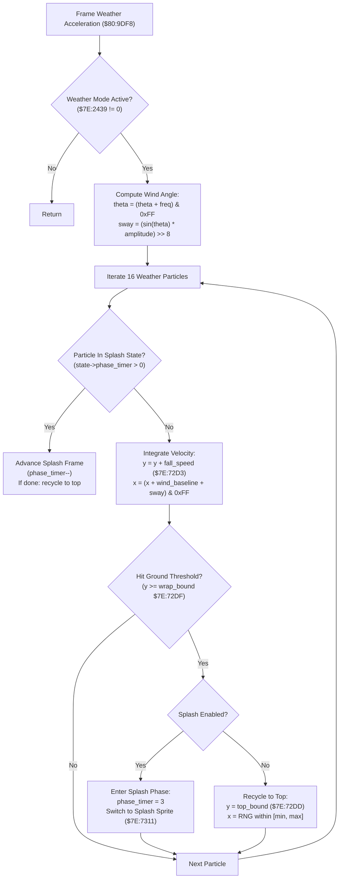

# Weather Precipitation Particle Physics, Wind Perturbation & Ground Splash Engine

- **ROM Locations**:
  - `weather_particle_generator_and_acceleration`: `$80:9DF8` – `$80:9E50`
  - `weather_particle_splash_and_recycle`: `$80:9E51` – `$80:9E92`
- **CPU State**: 16-bit A/X (`REP #$30`), Data Bank `$7E` / `$80`
- **WRAM Core Addresses**:
  - `$7E:72D1` – `$7E:734F`: Active weather configuration block (64 16-bit words):
    - `$7E:72D1`: Baseline horizontal wind velocity ($v_x$).
    - `$7E:72D3`: Baseline vertical fall velocity ($v_y$, terminal fall speed).
    - `$7E:72D5`: Trigonometric oscillation amplitude (sway magnitude).
    - `$7E:72D7`: Angular step frequency ($\Delta\theta$ per frame).
    - `$7E:72D9`: Particle spawn left boundary ($x_{\text{min}}$).
    - `$7E:72DB`: Particle spawn right boundary ($x_{\text{max}}$).
    - `$7E:72DD`: Particle spawn top boundary ($y_{\text{min}}$).
    - `$7E:72DF`: Particle wrap/impact threshold ($y_{\text{max}}$, typically 224 scanlines).
    - `$7E:72E1`..`$7E:730F`: Sprite tile index and palette descriptor table.
    - `$7E:7311`..`$7E:734F`: Splash animation frames and lifecycle tables.
  - `$7E:2439`: Weather mode indicator (0 = Clear, 1 = Rain, 2 = Embers, 3 = Snow).
  - `$7E:243B`: Global wind drift register.
  - `$7E:243D`: Global downward speed register.
  - `$7E:2440` – `$7E:247F`: 16-slot weather particle pool array (4 bytes per slot: `[X, Y]`).
  - `$7E:2480` – `$7E:24BF`: 16-slot particle state array (4 bytes per slot: `[phase_timer, sprite_frame]`).
  - `$7E:0134`: Environmental frame oscillation seed / tick counter.

---

## 1. Architectural Role & Physics Integration

While the basic ambient simulation loop (`$80:A305`) handles simple constant-velocity precipitation, dynamic weather scenes (the driving downpour in Thraxx's crater, heavy blizzards in Ivor Tower's mountain passes, and floating embers in Vulkan's volcanic core) employ high-fidelity vector acceleration:

1. **Trigonometric Wind Oscillation & Gust Perturbation**:
   - Every frame, an angular counter $\theta$ advances using the frequency step `$7E:72D7`:
     $$\theta_{t+1} = (\theta_t + \Delta\theta) \pmod{256}$$
   - Horizontal sway is computed via 256-step sine lookup table `$80:8800` scaled by the amplitude parameter `$7E:72D5`:
     $$\Delta x_{\text{sway}} = \frac{\sin(\theta) \times \text{amplitude}}{256}$$
2. **Velocity Vector Integration & Acceleration**:
   - Each particle updates its position by combining constant wind baseline, oscillatory gust displacement, and terminal downward speed:
     $$x_{t+1} = (x_t + v_x + \Delta x_{\text{sway}}) \pmod{256}$$
     $$y_{t+1} = y_t + v_y$$
3. **Impact Detection, Ground Splash Sprites & Recycling (`$80:9E51`)**:
   - When a raindrop or ember reaches the bottom impact scanline ($y \ge y_{\text{max}}$, `$7E:72DF`):
     - If ground splash is enabled (e.g. rain drops), the particle enters an impact state: its downward velocity stops, and it cycles through 3 splash droplet animation keyframes stored in `$7E:7311`.
     - When splash animation completes (or immediately for snow/ash), the particle is recycled to the top boundary:
       $$y \leftarrow y_{\text{min}} \quad (\text{\$7E:72DD})$$
       $$x \leftarrow x_{\text{min}} + (\text{RNG} \pmod{x_{\text{max}} - x_{\text{min}}})$$

---

## 2. 65816 Assembly Implementation

> **Interactive 65816 Assembly**:
> Centralized comments infused at runtime.
> [View in VFS: soe://rom/code/809DF8](soe://rom/code/809DF8?asm=1&c=0)

---

## 3. Clean C Implementation

> **Reconstructed C Decompilation**:
> Source moved to [`reconstructed-c/80/809DF8_weather_physics.c`](../../../reconstructed-c/80/809DF8_weather_physics.c).
> [View in VFS: soe://rom/code/809DF8](soe://rom/code/809DF8?c=1&asm=0)

---

## 4. Behavioral Equivalence & Edge Cases

1. **Dual Weather Models (Simple `$80:A305` vs Vector `$80:9DF8`)**:
   - The basic loop `$80:A305` is invoked during lightweight ambient rooms using registers `$7E:243B` and `$7E:243D`.
   - The advanced acceleration engine `$80:9DF8` is invoked whenever a full 128-byte weather configuration block is loaded into `$7E:72D1` via `$80:A2E0`, enabling trigonometric sway and splash droplets.
2. **Splash Tile Increment vs Immediate Wrap**:
   - For rain (`cfg->splash_tile_base != 0`), striking the ground halts downward motion and advances the particle tile through 3 progressive splash frames, creating authentic ground ripples before resetting.
   - For snow and ash (`cfg->splash_tile_base == 0`), particles wrap seamlessly back to `spawn_y_min` without pausing at the bottom.
3. **Integer Sine Wave Clamping**:
   - The hardware multiplier product `sine * amplitude` uses signed 16-bit math. In the original 65816 assembly, `XBA` reads the upper 8 bits, cleanly performing a signed division by 256.
