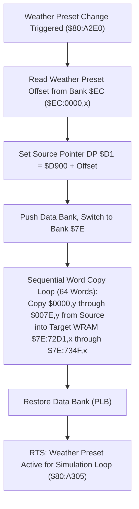

# Weather Preset Parameter Block Loader & Configuration Engine

- **ROM Locations**:
  - `load_weather_preset_parameters`: `$80:A2E0` – `$80:A4B4`
- **CPU State**: 16-bit A/X (`REP #$30`), Data Bank `$7E` / `$80`
- **WRAM Core Addresses**:
  - `$7E:72D1` – `$7E:734F`: Active weather configuration block (64 16-bit words = 128 bytes):
    - `$7E:72D1`: Particle velocity X baseline.
    - `$7E:72D3`: Particle velocity Y baseline (terminal fall speed).
    - `$7E:72D5`: Wind turbulence delta / sway factor.
    - `$7E:72D7`: Randomization frequency / RNG mask.
    - `$7E:72D9`: Spawn bounding box left edge.
    - `$7E:72DB`: Spawn bounding box right edge.
    - `$7E:72DD`: Spawn bounding box top edge.
    - `$7E:72DF`: Spawn bounding box bottom edge (wrap threshold).
    - `$7E:72E1` – `$7E:734F`: Particle sprite tile indices, palette assignments, and animation phase tables.
  - Direct Page `$D1`: Memory copy pointer in Bank `$EC`.
- **ROM Tables**:
  - `$EC:0000,x`: Master weather presets table in ROM Bank `$EC`.

---

## 1. Architectural Role & Preset Blocks

When entering a room with active ambient precipitation (rain storm in Thraxx's crater, blizzard in Nobilia's pyramid summit, snow flurries in Ivor Tower, or embers in Vulkan volcano), the engine initializes particle simulation parameters by copying a 128-byte configuration block:



### Configuration Structure
Each weather preset contains exactly 64 16-bit words structured as follows:

| Offset in Block | WRAM Destination | Purpose |
|:---:|:---:|---|
| `+0x00` | `$7E:72D1` | Horizontal wind velocity baseline ($v_x$) |
| `+0x02` | `$7E:72D3` | Vertical fall velocity baseline ($v_y$) |
| `+0x04` | `$7E:72D5` | Oscillation amplitude / horizontal sway |
| `+0x06` | `$7E:72D7` | Oscillation frequency / angle increment |
| `+0x08` | `$7E:72D9` | Particle spawn left bound ($x_{min}$) |
| `+0x0A` | `$7E:72DB` | Particle spawn right bound ($x_{max}$) |
| `+0x0C` | `$7E:72DD` | Particle spawn top bound ($y_{min}$) |
| `+0x0E` | `$7E:72DF` | Screen wrap threshold ($y_{max}$, typically 224 scanlines) |
| `+0x10`..`+0x3E`| `$7E:72E1`..`$7E:730F` | Particle OAM sprite attributes, sizes, and palette tags |
| `+0x40`..`+0x7E`| `$7E:7311`..`$7E:734F` | Particle animation phases, lifecycle frames, and splash sprites |

---

## 2. Disassembly & Annotations

```asm
; ==============================================================================
; load_weather_preset_parameters ($80:A2E0)
; Arguments: X = Weather preset ID index
; ==============================================================================
$80A2E0  69 00 d9       adc #$D900         ; Base offset in Bank $EC
$80A2E3  48             pha
$80A2E4  ab             plb                ; Set data bank
$80A2E5  ab             plb
$80A2E6  bf 00 00 ec    lda $EC0000,x      ; Read preset definition pointer
$80A2EA  a8             tay                ; Y = Source pointer in Bank $EC
$80A2EB  a5 d1          lda $D1
$80A2ED  aa             tax
$80A2EE  69 80 00       adc #$0080         ; Block size: 128 bytes (64 words)
$80A2F1  85 d1          sta $D1

; Sequential transfer of 64 configuration words into $7E:72D1..$7E:734F
$80A2F3  b9 00 00       lda $0000,y
$80A2F6  9f d1 72 7e    sta $7E72D1,x
$80A2FA  b9 02 00       lda $0002,y
$80A2FD  9f d3 72 7e    sta $7E72D3,x
$80A301  b9 04 00       lda $0004,y
$80A304  9f d5 72 7e    sta $7E72D5,x
$80A308  b9 06 00       lda $0006,y
$80A30B  9f d7 72 7e    sta $7E72D7,x
$80A30F  b9 08 00       lda $0008,y
$80A312  9f d9 72 7e    sta $7E72D9,x
$80A316  b9 0a 00       lda $000A,y
$80A319  9f db 72 7e    sta $7E72DB,x
$80A31D  b9 0c 00       lda $000C,y
$80A320  9f dd 72 7e    sta $7E72DD,x
$80A324  b9 0e 00       lda $000E,y
$80A327  9f df 72 7e    sta $7E72DF,x
; ... (transfers 0x10 through 0x7C words) ...
$80A4AC  b9 7e 00       lda $007E,y
$80A4AF  9f 4f 73 7e    sta $7E734F,x
$80A4B3  ab             plb                ; Restore original bank
$80A4B4  60             rts
```

---

## 3. Clean C Decompilation

```c
#include <stdint.h>
#include <string.h>

#define WEATHER_CONFIG_WORDS 64
#define WEATHER_CONFIG_BYTES 128

typedef struct {
    int16_t  velocity_x;            // +0x00: $7E:72D1
    int16_t  velocity_y;            // +0x02: $7E:72D3 (fall speed)
    int16_t  wind_sway_amplitude;   // +0x04: $7E:72D5
    int16_t  sway_frequency;        // +0x06: $7E:72D7
    int16_t  spawn_bound_left;      // +0x08: $7E:72D9
    int16_t  spawn_bound_right;     // +0x0A: $7E:72DB
    int16_t  spawn_bound_top;       // +0x0C: $7E:72DD
    int16_t  wrap_bound_bottom;     // +0x0E: $7E:72DF (224 scanlines)
    uint16_t sprite_attributes[24]; // +0x10..+0x3F: OAM sizes, palettes, tiles
    uint16_t animation_phases[32];  // +0x40..+0x7F: Animation lifecycle frames
} WeatherPresetRecord;

// WRAM active weather configuration block
extern WeatherPresetRecord g_active_weather_config; // $7E:72D1..$7E:734F

// Master ROM lookup table in Bank $EC
extern const WeatherPresetRecord *g_rom_weather_presets[]; // $EC:0000

/**
 * load_weather_preset_parameters ($80:A2E0)
 * Copies a 128-byte weather preset definition from ROM Bank $EC into the active
 * simulation parameter block in WRAM ($7E:72D1..$7E:734F).
 * 
 * @param preset_id Index of the weather preset to load.
 */
void load_weather_preset_parameters(uint16_t preset_id) {
    const WeatherPresetRecord *preset = g_rom_weather_presets[preset_id];
    if (preset != NULL) {
        // 64-word sequential copy from ROM to WRAM
        memcpy(&g_active_weather_config, preset, sizeof(WeatherPresetRecord));
    }
}
```
