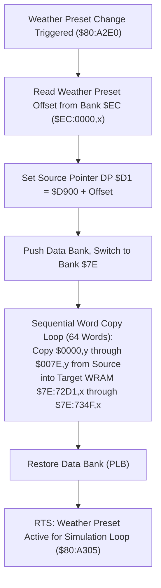

# Weather Preset Parameter Block Loader & Configuration Engine

- **ROM Locations**:
  - `load_weather_preset_parameters`: `$80:A2E0` – `$80:A4B4`
- **CPU State**: 16-bit A/X (`REP #$30`), Data Bank `$7E` / `$80`
- **WRAM Core Addresses**:
  - `$7E:72D1` – `$7E:734F`: Active weather configuration block (64 16-bit words = 128 bytes):
    - `$7E:72D1`: Particle velocity X baseline.
    - `$7E:72D3`: Particle velocity Y baseline (terminal fall speed).
    - `$7E:72D5`: Wind turbulence delta / sway factor.
    - `$7E:72D7`: Randomization frequency / RNG mask.
    - `$7E:72D9`: Spawn bounding box left edge.
    - `$7E:72DB`: Spawn bounding box right edge.
    - `$7E:72DD`: Spawn bounding box top edge.
    - `$7E:72DF`: Spawn bounding box bottom edge (wrap threshold).
    - `$7E:72E1` – `$7E:734F`: Particle sprite tile indices, palette assignments, and animation phase tables.
  - Direct Page `$D1`: Memory copy pointer in Bank `$EC`.
- **ROM Tables**:
  - `$EC:0000,x`: Master weather presets table in ROM Bank `$EC`.

---

## 1. Architectural Role & Preset Blocks

When entering a room with active ambient precipitation (rain storm in Thraxx's crater, blizzard in Nobilia's pyramid summit, snow flurries in Ivor Tower, or embers in Vulkan volcano), the engine initializes particle simulation parameters by copying a 128-byte configuration block:

### Configuration Structure
Each weather preset contains exactly 64 16-bit words structured as follows:

| Offset in Block | WRAM Destination | Purpose |
|:---:|:---:|---|
| `+0x00` | `$7E:72D1` | Horizontal wind velocity baseline ($v_x$) |
| `+0x02` | `$7E:72D3` | Vertical fall velocity baseline ($v_y$) |
| `+0x04` | `$7E:72D5` | Oscillation amplitude / horizontal sway |
| `+0x06` | `$7E:72D7` | Oscillation frequency / angle increment |
| `+0x08` | `$7E:72D9` | Particle spawn left bound ($x_{min}$) |
| `+0x0A` | `$7E:72DB` | Particle spawn right bound ($x_{max}$) |
| `+0x0C` | `$7E:72DD` | Particle spawn top bound ($y_{min}$) |
| `+0x0E` | `$7E:72DF` | Screen wrap threshold ($y_{max}$, typically 224 scanlines) |
| `+0x10`..`+0x3E`| `$7E:72E1`..`$7E:730F` | Particle OAM sprite attributes, sizes, and palette tags |
| `+0x40`..`+0x7E`| `$7E:7311`..`$7E:734F` | Particle animation phases, lifecycle frames, and splash sprites |

---

## 2. Disassembly & Annotations

> **Interactive 65816 Assembly**:
> Centralized comments infused at runtime.
> [View in VFS: soe://rom/code/80A2E0](soe://rom/code/80A2E0?asm=1&c=0)

---

## 3. Clean C Decompilation

> **Reconstructed C Decompilation**:
> Source moved to [`reconstructed-c/80/80A2E0_weather_preset.c`](../../../reconstructed-c/80/80A2E0_weather_preset.c).
> [View in VFS: soe://rom/code/80A2E0](soe://rom/code/80A2E0?c=1&asm=0)

