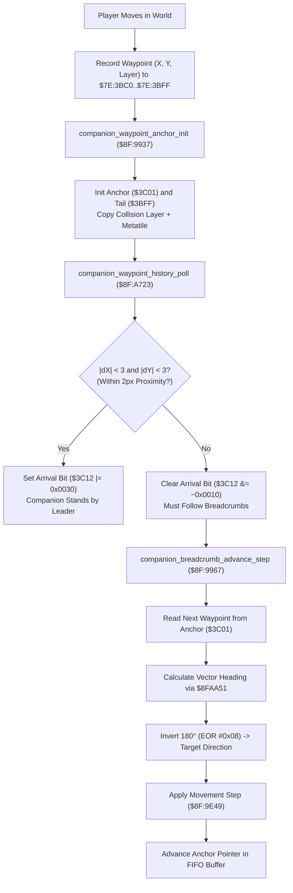

# Companion Dog Waypoint Pathfinding & Breadcrumb Navigation Engine

- **ROM Locations**:
  - `companion_waypoint_anchor_init`: `$8F:9937` – `$8F:9964`
  - `companion_waypoint_history_poll`: `$8F:A723` – `$8F:A773`
  - `companion_breadcrumb_advance_step`: `$8F:9967` – `$8F:9A08`
- **CPU State**: 16-bit A/X (`REP #$30`), Data Bank `$7E` / `$8F`
- **WRAM Core Addresses**:
  - `$7E:3BC7`: Follower active breadcrumb queue head pointer.
  - `$7E:3BC9,X`: Follower target metatile terrain property.
  - `$7E:3BCA,X`: Follower target collision layer plane.
  - `$7E:3BFC,X`: Latched obstacle collision descriptor (`$FFFF` = clear).
  - `$7E:3BFF,X`: Waypoint history ring buffer tail pointer.
  - `$7E:3C01,X`: Waypoint history ring buffer anchor pointer.
  - `$7E:3C03,X` / `$7E:3C05,X`: Next target waypoint coordinates (X, Y).
  - `$7E:3C06,X` / `$7E:3C08,X`: Intermediate interpolation coordinates.
  - `$7E:3C0C,X` / `$7E:3C0E,X`: Vector heading direction indices (0..15).
  - `$7E:3C10,X`: Pending waypoint step counter.
  - `$7E:3C12,X`: Follower navigation state flags (bit 4 arrival, bit 5 proximity latch, bit 12 sticky leash).
  - DP `$4C`: Pointer to leader entity structure (e.g. Boy `$7E:4E89`).
  - DP `$4E`: Pointer to follower companion entity structure (e.g. Dog `$7E:4F37`).

---

## 1. Architectural Architecture & Breadcrumb FIFO Queue

Secret of Evermore implements follower companion pathfinding through a continuous FIFO history ring buffer of player position breadcrumbs:

### 1. 16-Direction Angle Calculation & Heading Inversion
To steer towards a previous breadcrumb coordinate, the engine computes the directional angle between the companion's current world position and the target breadcrumb using `jsl $8FAA51`.
The resulting 16-direction angle is inverted by 180 degrees via `EOR #$08` (in a 16-step circle, $180^\circ = 8$ steps):
$$\text{Target Heading} = \text{angle\_between}(\text{current}, \text{target}) \oplus 8$$

### 2. Proximity Arrival Threshold ($\pm 2\text{px}$)
When the companion draws near the leader, the arrival condition checks:
$$\Delta X = \text{leader}_X - \text{companion}_X, \quad |\Delta X| \le 2$$
$$\Delta Y = \text{leader}_Y - \text{companion}_Y, \quad |\Delta Y| \le 2$$
If both dimensions are within 2 pixels, bits 4 and 5 of `$7E:3C12,x` are raised (`$3C12 |= 0x0030`), halting path traversal and snapping the follower into close companion idle mode.

---

## 2. Disassembly & Annotations

### Part 1: Navigation Anchor & Waypoint FIFO Init (`$8F:9937` – `$8F:9964`)
> **Interactive 65816 Assembly**:
> Centralized comments infused at runtime.
> [View in VFS: soe://rom/code/8F9937](soe://rom/code/8F9937?asm=1&c=0)

### Part 2: Proximity Polling & Arrival Detection (`$8F:A723` – `$8F:A773`)
> **Interactive 65816 Assembly**:
> Centralized comments infused at runtime.
> [View in VFS: soe://rom/code/8F9937](soe://rom/code/8F9937?asm=1&c=0)

### Part 3: Breadcrumb FIFO Advance Step (`$8F:9967` – `$8F:9A08`)
> **Interactive 65816 Assembly**:
> Centralized comments infused at runtime.
> [View in VFS: soe://rom/code/8F9937](soe://rom/code/8F9937?asm=1&c=0)

---

## 3. Reconstructed Clean C Implementation

> **Reconstructed C Decompilation**:
> Source moved to [`reconstructed-c/8F/8F9937_companion_navigation.c`](../../../reconstructed-c/8F/8F9937_companion_navigation.c).
> [View in VFS: soe://rom/code/8F9937](soe://rom/code/8F9937?c=1&asm=0)

---

## 4. Architectural Summary

1. **FIFO Ring Buffer Navigation**:
   Rather than performing expensive grid A* pathfinding on the 65816 CPU, the dog companion passively follows the player's footsteps by traversing a circular breadcrumb history buffer recorded frame-by-frame.
2. **180-Degree Vector Inversion**:
   Vector headings utilize `eor #$08` to flip between directional angles, ensuring consistent waypoint targeting.
3. **Proximity Clamping ($\pm 2\text{px}$)**:
   By establishing a 2-pixel bounding box around the player's world position, the engine prevents the companion from vibrating or constantly jostling against the player when stationary.
