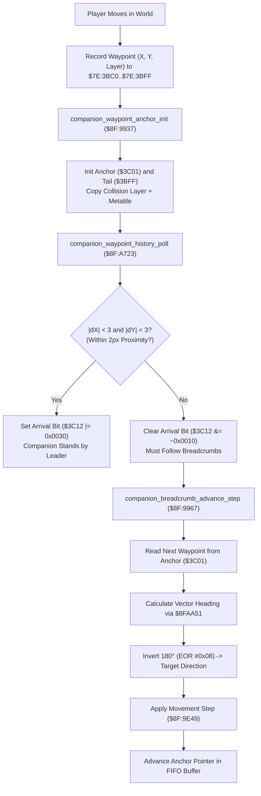

# Companion Dog Waypoint Pathfinding & Breadcrumb Navigation Engine

- **ROM Locations**:
  - `companion_waypoint_anchor_init`: `$8F:9937` – `$8F:9964`
  - `companion_waypoint_history_poll`: `$8F:A723` – `$8F:A773`
  - `companion_breadcrumb_advance_step`: `$8F:9967` – `$8F:9A08`
- **CPU State**: 16-bit A/X (`REP #$30`), Data Bank `$7E` / `$8F`
- **WRAM Core Addresses**:
  - `$7E:3BC7`: Follower active breadcrumb queue head pointer.
  - `$7E:3BC9,X`: Follower target metatile terrain property.
  - `$7E:3BCA,X`: Follower target collision layer plane.
  - `$7E:3BFC,X`: Latched obstacle collision descriptor (`$FFFF` = clear).
  - `$7E:3BFF,X`: Waypoint history ring buffer tail pointer.
  - `$7E:3C01,X`: Waypoint history ring buffer anchor pointer.
  - `$7E:3C03,X` / `$7E:3C05,X`: Next target waypoint coordinates (X, Y).
  - `$7E:3C06,X` / `$7E:3C08,X`: Intermediate interpolation coordinates.
  - `$7E:3C0C,X` / `$7E:3C0E,X`: Vector heading direction indices (0..15).
  - `$7E:3C10,X`: Pending waypoint step counter.
  - `$7E:3C12,X`: Follower navigation state flags (bit 4 arrival, bit 5 proximity latch, bit 12 sticky leash).
  - DP `$4C`: Pointer to leader entity structure (e.g. Boy `$7E:4E89`).
  - DP `$4E`: Pointer to follower companion entity structure (e.g. Dog `$7E:4F37`).

---

## 1. Architectural Architecture & Breadcrumb FIFO Queue

Secret of Evermore implements follower companion pathfinding through a continuous FIFO history ring buffer of player position breadcrumbs:



### 1. 16-Direction Angle Calculation & Heading Inversion
To steer towards a previous breadcrumb coordinate, the engine computes the directional angle between the companion's current world position and the target breadcrumb using `jsl $8FAA51`.
The resulting 16-direction angle is inverted by 180 degrees via `EOR #$08` (in a 16-step circle, $180^\circ = 8$ steps):
$$\text{Target Heading} = \text{angle\_between}(\text{current}, \text{target}) \oplus 8$$

### 2. Proximity Arrival Threshold ($\pm 2\text{px}$)
When the companion draws near the leader, the arrival condition checks:
$$\Delta X = \text{leader}_X - \text{companion}_X, \quad |\Delta X| \le 2$$
$$\Delta Y = \text{leader}_Y - \text{companion}_Y, \quad |\Delta Y| \le 2$$
If both dimensions are within 2 pixels, bits 4 and 5 of `$7E:3C12,x` are raised (`$3C12 |= 0x0030`), halting path traversal and snapping the follower into close companion idle mode.

---

## 2. Disassembly & Annotations

### Part 1: Navigation Anchor & Waypoint FIFO Init (`$8F:9937` – `$8F:9964`)
```assembly
; ==============================================================================
; companion_waypoint_anchor_init ($8F:9937)
; Initializes breadcrumb waypoint tracking, anchor pointers, and layer match.
; ==============================================================================
$8F9937  A6 4E       LDX $4E           ; X = Companion entity slot pointer
$8F9939  A4 4C       LDY $4C           ; Y = Leader entity slot pointer
$8F993B  8A          TXA
$8F993C  9D 01 3C    STA $3C01,X       ; Set waypoint history anchor pointer
$8F993F  18          CLC
$8F9940  69 03 00    ADC #$0003        ; Advance 3 bytes per waypoint (X, Y, Layer)
$8F9943  9D FF 3B    STA $3BFF,X       ; Set waypoint queue tail pointer
$8F9946  9E 10 3C    STZ $3C10,X       ; Reset pending waypoint step counter
$8F9949  B9 17 00    LDA $0017,Y       ; Read leader's active collision layer plane
$8F994C  9D CA 3B    STA $3BCA,X       ; Match follower target layer plane
$8F994F  B9 62 00    LDA $0062,Y       ; Read leader's current terrain metatile
$8F9952  9D C9 3B    STA $3BC9,X       ; Match follower target metatile
$8F9955  A9 FF FF    LDA #$FFFF
$8F9958  9D FC 3B    STA $3BFC,X       ; Clear latched leash obstacle
$8F995B  BD 12 3C    LDA $3C12,X
$8F995E  29 00 10    AND #$1000        ; Retain sticky leash flag (bit 12)
$8F9961  9D 12 3C    STA $3C12,X
$8F9964  4C 23 A7    JMP $A723         ; Jump to companion proximity polling
```

### Part 2: Proximity Polling & Arrival Detection (`$8F:A723` – `$8F:A773`)
```assembly
; ==============================================================================
; companion_waypoint_history_poll ($8F:A723)
; Evaluates distance between companion and leader; flags arrival if within 2px.
; ==============================================================================
$8FA723  5A          PHY               ; Save leader entity pointer
$8FA724  BC FF 3B    LDY $3BFF,X       ; Load waypoint history tail pointer
$8FA727  BD 12 3C    LDA $3C12,X
$8FA72A  89 00 10    BIT #$1000        ; Test sticky leash flag
$8FA72D  D0 1F       BNE $8FA74E       ; If sticky leash set, evaluate delta

$8FA72F  B9 C6 3B    LDA $3BC6,Y       ; Tail waypoint X
$8FA732  DD F9 3B    CMP $3BF9,X       ; Compare with companion current X
$8FA735  D0 08       BNE $8FA73F       ; Not aligned -> keep moving
$8FA737  B9 C7 3B    LDA $3BC7,Y       ; Tail waypoint Y
$8FA73A  DD FA 3B    CMP $3BFA,X       ; Compare with companion current Y
$8FA73D  F0 2A       BEQ $8FA769       ; Exactly aligned -> arrived!

; Far away: clear arrival bit (bit 4)
$8FA73F  BD 12 3C    LDA $3C12,X
$8FA742  29 EF FF    AND #$FFEF        ; Clear arrival status flag
$8FA745  9D 12 3C    STA $3C12,X
$8FA748  7A          PLY
$8FA749  6B          RTL

; Coordinate Delta & Proximity Evaluation:
$8FA74E  E2 21       SEP #$21          ; 8-bit Accumulator & set Carry
$8FA750  B9 C6 3B    LDA $3BC6,Y       ; Waypoint X
$8FA753  FD F9 3B    SBC $3BF9,X       ; Subtract companion X
$8FA756  1A          INC A             ; Bias by +1
$8FA757  C9 03       CMP #$03          ; Check if within 0..2 pixels
$8FA759  B0 EF       BCS $8FA74A       ; If >= 3 pixels, outside proximity window!
$8FA75B  B9 C7 3B    LDA $3BC7,Y       ; Waypoint Y
$8FA75E  38          SEC
$8FA75F  FD FA 3B    SBC $3BFA,X       ; Subtract companion Y
$8FA762  1A          INC A             ; Bias by +1
$8FA763  C9 03       CMP #$03          ; Check if within 0..2 pixels
$8FA765  C2 30       REP #$30          ; Restore 16-bit A/X
$8FA767  B0 D6       BCS $8FA73F       ; If >= 3 pixels, clear arrival and pursue!

; Close proximity reached: raise arrival and proximity latch bits
$8FA769  BD 12 3C    LDA $3C12,X
$8FA76C  09 30 00    ORA #$0030        ; Set arrival (bit 4) and proximity lock (bit 5)
$8FA76F  9D 12 3C    STA $3C12,X
$8FA772  7A          PLY
$8FA773  6B          RTL
```

### Part 3: Breadcrumb FIFO Advance Step (`$8F:9967` – `$8F:9A08`)
```assembly
; ==============================================================================
; companion_breadcrumb_advance_step ($8F:9967)
; Steps companion along recorded breadcrumbs, interpolating 16-direction headings.
; ==============================================================================
$8F9967  A6 4E       LDX $4E           ; Companion entity pointer
$8F9969  8A          TXA
$8F996A  18          CLC
$8F996B  69 03 00    ADC #$0003
$8F996E  DD 01 3C    CMP $3C01,X       ; Compare against history anchor
$8F9971  90 06       BCC $8F9979
$8F9973  69 02 00    ADC #$0002
$8F9976  9D 01 3C    STA $3C01,X       ; Advance anchor by 2 bytes

$8F9979  BD 01 3C    LDA $3C01,X
$8F997C  DD FF 3B    CMP $3BFF,X       ; Reached queue tail?
$8F997F  90 07       BCC $8F9988       ; More waypoints pending!
$8F9981  A9 FF FF    LDA #$FFFF
$8F9984  9D 10 3C    STA $3C10,X       ; Queue empty: set sentinel
$8F9987  6B          RTL

; Process Next Breadcrumb Waypoint:
$8F9988  A8          TAY
$8F9989  B9 C3 3B    LDA $3BC3,Y       ; Target waypoint X
$8F998C  9D 06 3C    STA $3C06,X       ; Intermediate target X
$8F998F  E2 21       SEP #$21          ; 8-bit A
$8F9991  F9 C6 3B    SBC $3BC6,Y       ; Delta X
$8F9994  EB          XBA
$8F9995  38          SEC
$8F9996  F9 C7 3B    SBC $3BC7,Y       ; Delta Y
$8F9999  EB          XBA
$8F999A  48          PHA               ; Push delta
$8F999B  B9 C5 3B    LDA $3BC5,Y       ; Target waypoint Y
$8F999E  9D 08 3C    STA $3C08,X       ; Intermediate target Y
$8F99A1  68          PLA
$8F99A2  22 51 AA 8F JSL $8FAA51       ; Compute 16-direction angle
$8F99A6  49 08       EOR #$08          ; Invert heading by 180°
$8F99A8  C2 20       REP #$20          ; 16-bit A
$8F99AA  9D 0E 3C    STA $3C0E,X       ; Set target heading direction
$8F99AD  EB          XBA
$8F99AE  D0 0E       BNE $8F99BE
$8F99B0  88          DEY
$8F99B1  88          DEY
$8F99B2  88          DEY
$8F99B3  98          TYA
$8F99B4  9D 01 3C    STA $3C01,X       ; Retract anchor 3 bytes
$8F99B7  22 49 9E 8F JSL $8F9E49       ; Integrate movement step
$8F99BB  4C 67 99    JMP $9967         ; Loop to next waypoint

; Sub-waypoint Interpolation:
$8F99BE  A5 4E       LDA $4E
$8F99C0  18          CLC
$8F99C1  69 06 00    ADC #$0006
$8F99C4  DD 01 3C    CMP $3C01,X
$8F99C7  90 05       BCC $8F99CE
$8F99C9  9E 0C 3C    STZ $3C0C,X
$8F99CC  80 3B       BRA $8F9A09

$8F99CE  B9 C0 3B    LDA $3BC0,Y       ; Sub-waypoint X
$8F99D1  9D 03 3C    STA $3C03,X
$8F99D4  E2 20       SEP #$20
$8F99D6  38          SEC
$8F99D7  F9 C3 3B    SBC $3BC3,Y
$8F99DA  EB          XBA
$8F99DB  38          SEC
$8F99DC  F9 C4 3B    SBC $3BC4,Y
$8F99DF  EB          XBA
$8F99E0  48          PHA
$8F99E1  B9 C2 3B    LDA $3BC2,Y       ; Sub-waypoint Y
$8F99E4  9D 05 3C    STA $3C05,X
$8F99E7  68          PLA
$8F99E8  22 51 AA 8F JSL $8FAA51       ; Compute sub-waypoint angle
$8F99EC  49 08       EOR #$08          ; Invert heading by 180°
$8F99EE  C2 20       REP #$20
$8F99F0  9D 0C 3C    STA $3C0C,X       ; Set sub-waypoint heading
$8F99F3  EB          XBA
$8F99F4  D0 13       BNE $8F9A09
$8F99F6  98          TYA
$8F99F7  38          SEC
$8F99F8  E9 03 00    SBC #$0003
$8F99FB  9D 01 3C    STA $3C01,X       ; Retract anchor
$8F99FE  E9 03 00    SBC #$0003
$8F9A01  A8          TAY
$8F9A02  22 49 9E 8F JSL $8F9E49       ; Integrate movement step
$8F9A06  4C 67 99    JMP $9967
```

---

## 3. Reconstructed Clean C Implementation

```c
#include <stdint.h>
#include <stdbool.h>
#include <stdlib.h>

#define WAYPOINT_STRIDE_BYTES   3
#define PROXIMITY_THRESHOLD_PX  2
#define WAYPOINT_QUEUE_SENTINEL 0xFFFF

typedef struct {
    int16_t  world_x;            // $7E:001A
    int16_t  world_y;            // $7E:001C
    uint16_t collision_layer;    // $7E:0017
    uint16_t metatile_prop;      // $7E:0062
} EntityState;

typedef struct {
    uint16_t waypoint_anchor;    // $7E:3C01,x
    uint16_t waypoint_tail;      // $7E:3BFF,x
    uint16_t waypoint_count;     // $7E:3C10,x
    uint16_t target_layer;       // $7E:3BCA,x
    uint16_t target_metatile;    // $7E:3BC9,x
    uint16_t latched_obstacle;   // $7E:3BFC,x
    uint16_t nav_flags;          // $7E:3C12,x (bit 4 arrival, bit 5 lock, bit 12 sticky)
    int16_t  target_x;           // $7E:3C06,x
    int16_t  target_y;           // $7E:3C08,x
    int16_t  sub_target_x;       // $7E:3C03,x
    int16_t  sub_target_y;       // $7E:3C05,x
    uint16_t heading_direction;  // $7E:3C0E,x
    uint16_t sub_heading;        // $7E:3C0C,x
} CompanionNavState;

typedef struct {
    int16_t  x;
    int16_t  y;
    uint8_t  layer;
} BreadcrumbWaypoint;

extern CompanionNavState g_companion_nav;
extern BreadcrumbWaypoint g_waypoint_history[256];

extern uint8_t entity_compute_angle_between(int16_t x1, int16_t y1, int16_t x2, int16_t y2); // $8F:AA51
extern void integrate_companion_velocity_step(void); // $8F:9E49

/**
 * Initializes follower navigation anchor, queue tail, and copies leader layer.
 * Corresponds to $8F:9937.
 */
void companion_waypoint_anchor_init(const EntityState *leader, uint16_t companion_slot) {
    g_companion_nav.waypoint_anchor = companion_slot;
    g_companion_nav.waypoint_tail = companion_slot + WAYPOINT_STRIDE_BYTES;
    g_companion_nav.waypoint_count = 0;

    // Synchronize terrain plane and metatile properties with leader
    g_companion_nav.target_layer = leader->collision_layer;
    g_companion_nav.target_metatile = leader->metatile_prop;

    // Clear obstacle descriptor
    g_companion_nav.latched_obstacle = WAYPOINT_QUEUE_SENTINEL;

    // Retain bit 12 (sticky leash mode), clear arrival/lock bits
    g_companion_nav.nav_flags &= 0x1000;

    // Poll proximity immediately
    companion_waypoint_history_poll(leader, companion_slot);
}

/**
 * Checks proximity delta between leader and companion.
 * If within +-2 pixels, flags arrival mode ($3C12 |= 0x0030).
 * Corresponds to $8F:A723.
 */
void companion_waypoint_history_poll(const EntityState *leader, uint16_t companion_slot) {
    uint16_t tail_idx = g_companion_nav.waypoint_tail / WAYPOINT_STRIDE_BYTES;
    BreadcrumbWaypoint target = g_waypoint_history[tail_idx];

    // Compute coordinate delta
    int16_t delta_x = leader->world_x - target.x;
    int16_t delta_y = leader->world_y - target.y;

    if (abs(delta_x) <= PROXIMITY_THRESHOLD_PX && abs(delta_y) <= PROXIMITY_THRESHOLD_PX) {
        // Within 2px proximity: flag arrival (bit 4) and proximity lock (bit 5)
        g_companion_nav.nav_flags |= 0x0030;
    } else {
        // Outside proximity: clear arrival flag, continue path following
        g_companion_nav.nav_flags &= ~0x0010;
    }
}

/**
 * Steps companion along recorded breadcrumbs, updating directional headings.
 * Corresponds to $8F:9967.
 */
void companion_breadcrumb_advance_step(EntityState *companion) {
    while (true) {
        // Check if queue has more waypoints
        if (g_companion_nav.waypoint_anchor >= g_companion_nav.waypoint_tail) {
            g_companion_nav.waypoint_count = WAYPOINT_QUEUE_SENTINEL;
            return; // All breadcrumbs consumed
        }

        uint16_t anchor_idx = g_companion_nav.waypoint_anchor / WAYPOINT_STRIDE_BYTES;
        BreadcrumbWaypoint wp = g_waypoint_history[anchor_idx];

        g_companion_nav.target_x = wp.x;
        g_companion_nav.target_y = wp.y;

        // Compute 16-direction angle from companion to waypoint
        uint8_t raw_angle = entity_compute_angle_between(companion->world_x, companion->world_y, wp.x, wp.y);

        // Invert heading by 180 degrees (8 steps in 16-direction system)
        g_companion_nav.heading_direction = (raw_angle ^ 0x08) & 0x0F;

        // Advance anchor in circular FIFO
        g_companion_nav.waypoint_anchor += WAYPOINT_STRIDE_BYTES;

        // Integrate movement physics step towards waypoint
        integrate_companion_velocity_step();

        // Check if companion reached waypoint
        if (abs(companion->world_x - wp.x) <= PROXIMITY_THRESHOLD_PX &&
            abs(companion->world_y - wp.y) <= PROXIMITY_THRESHOLD_PX) {
            break; // Proceed to next breadcrumb on subsequent frame
        }
    }
}
```

---

## 4. Architectural Summary

1. **FIFO Ring Buffer Navigation**:
   Rather than performing expensive grid A* pathfinding on the 65816 CPU, the dog companion passively follows the player's footsteps by traversing a circular breadcrumb history buffer recorded frame-by-frame.
2. **180-Degree Vector Inversion**:
   Vector headings utilize `eor #$08` to flip between directional angles, ensuring consistent waypoint targeting.
3. **Proximity Clamping ($\pm 2\text{px}$)**:
   By establishing a 2-pixel bounding box around the player's world position, the engine prevents the companion from vibrating or constantly jostling against the player when stationary.
