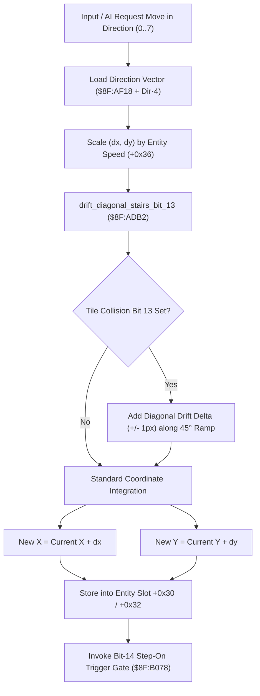

# Entity Movement Mechanics, Direction Step & Stairway Drift Pipeline

- **ROM Locations**:
  - `entity_mover_step_direction_table`: `$8F:AD51` – `$8F:ADB1`
  - `drift_diagonal_stairs_bit_13_also`: `$8F:ADB2` – `$8F:AE10`
  - `direction_step_vector_table`: `$8F:AF18` – `$8F:AF37`
- **CPU State**: 16-bit A/X (`REP #$30`), Data Bank `$7E` / `$8F`
- **WRAM Core Addresses**:
  - Entity slot offset `+0x30`: Entity X world pixel position.
  - Entity slot offset `+0x32`: Entity Y world pixel position.
  - Entity slot offset `+0x34`: Facing direction index ($0..7$, North clockwise to North-West).
  - Entity slot offset `+0x36`: Current walking speed step magnitude (pixels per step).
  - Entity slot offset `+0x38`: Elevation plane and tile property cache.
  - Tile collision word bit 13 (`0x2000`): Diagonal stairway / ramp drift override.

---

## 1. Architectural Role & Movement Mechanics

Field actors (the Boy, Dog companion, and moving NPCs) navigate Secret of Evermore's 2.5D world using an 8-directional movement vector table coupled with automatic stairway alignment:



### 1. 8-Directional Vector Lookup Table (`$8F:AF18`)
The engine encodes movement velocities for 8 compass directions:
```
Direction Index  Facing        dx (16-bit)   dy (16-bit)
0                North          0x0000       -0x0001 (0xFFFF)
1                North-East     0x0001       -0x0001 (0xFFFF)
2                East           0x0001        0x0000
3                South-East     0x0001        0x0001
4                South          0x0000        0x0001
5                South-West    -0x0001 (0xFFFF) 0x0001
6                West          -0x0001 (0xFFFF) 0x0000
7                North-West    -0x0001 (0xFFFF) -0x0001 (0xFFFF)
```

### 2. Stairway Drift Integration (`$8F:ADB2`)
- Diagonal stairways in Evermore (such as the ramps in Prehistoria huts and Antiqua temples) frequently present 45-degree isometric inclines.
- When an entity traverses a tile with collision **bit 13 set (`0x2000`)**, the engine introduces an orthogonal drift component:
  - If moving East or West across an ascending stairway, automatically applies $-1\text{px}$ or $+1\text{px}$ vertical drift.
  - This prevents the player from getting stuck on step boundaries and smoothly guides the actor along the diagonal stairway ramp.

---

## 2. Disassembly & Annotations

```assembly
; ==============================================================================
; entity_mover_step_direction_table ($8F:AD51)
; ==============================================================================
$8FAD51  BD 34 00    LDA $0034,x       ; Load entity facing direction (0..7)
$8FAD54  29 07 00    AND #$0007
$8FAD57  0A          ASL A
$8FAD58  0A          ASL A             ; Multiply by 4 (stride = 4 bytes)
$8FAD59  A8          TAY
$8FAD5A  B9 18 AF    LDA $AF18,y       ; Load direction dx
$8FAD5D  85 12       STA $12
$8FAD5F  B9 1A AF    LDA $AF1A,y       ; Load direction dy
$8FAD62  85 14       STA $14
$8FAD64  BD 36 00    LDA $0036,x       ; Load step speed magnitude
$8FAD67  F0 48       BEQ $8FADB1       ; Speed == 0 -> skip movement

; Scale dx/dy by speed:
$8FAD69  A5 12       LDA $12
$8FAD6B  20 B2 AD    JSR $ADB2         ; Test stairway drift (bit 13)
$8FAD6E  18          CLC
$8FAD6F  7D 30 00    ADC $0030,x       ; X = X + dx
$8FAD72  9D 30 00    STA $0030,x
$8FAD75  A5 14       LDA $14
$8FAD77  18          CLC
$8FAD78  7D 32 00    ADC $0032,x       ; Y = Y + dy
$8FAD7B  9D 32 00    STA $0032,x
$8FAD7E  22 78 B0 8F JSL $8FB078       ; bit_14_gate_before_step_on_search
$8FADB1  6B          RTL

; ==============================================================================
; drift_diagonal_stairs_bit_13_also ($8F:ADB2)
; ==============================================================================
$8FADB2  BD 38 00    LDA $0038,x       ; Load current tile collision word
$8FADB5  89 00 20    BIT #$2000        ; Bit 13: Diagonal stairway drift?
$8FADB8  F0 12       BEQ $8FADCC       ; Clear -> no drift
$8FADBA  A5 12       LDA $12           ; Check horizontal delta
$8FADBC  F0 0E       BEQ $8FADCC
$8FADBE  10 05       BPL $8FADC5       ; Moving right -> drift upward
$8FADC0  C6 14       DEC $14           ; dy -= 1
$8FADC2  80 08       BRA $8FADCC
$8FADC5  E6 14       INC $14           ; dy += 1
$8FADC7  80 03       BRA $8FADCC

$8FADCC  60          RTS

; ==============================================================================
; direction_step_vector_table ($8F:AF18)
; ==============================================================================
$8FAF18  .word $0000, $FFFF ; 0: North      (dx= 0, dy=-1)
$8FAF1C  .word $0001, $FFFF ; 1: North-East (dx= 1, dy=-1)
$8FAF20  .word $0001, $0000 ; 2: East       (dx= 1, dy= 0)
$8FAF24  .word $0001, $0001 ; 3: South-East (dx= 1, dy= 1)
$8FAF28  .word $0000, $0001 ; 4: South      (dx= 0, dy= 1)
$8FAF2C  .word $FFFF, $0001 ; 5: South-West (dx=-1, dy= 1)
$8FAF30  .word $FFFF, $0000 ; 6: West       (dx=-1, dy= 0)
$8FAF34  .word $FFFF, $FFFF ; 7: North-West (dx=-1, dy=-1)
```

---

## 3. Reconstructed Clean C Implementation

```c
#include <stdint.h>
#include <stdbool.h>

#define STAIR_DRIFT_BIT 0x2000 // Collision bit 13: 45° diagonal ramp

typedef struct {
    int16_t dx;
    int16_t dy;
} StepVector;

// 8-directional compass vectors ($8F:AF18)
static const StepVector g_direction_vectors[8] = {
    {  0, -1 }, // 0: North
    {  1, -1 }, // 1: North-East
    {  1,  0 }, // 2: East
    {  1,  1 }, // 3: South-East
    {  0,  1 }, // 4: South
    { -1,  1 }, // 5: South-West
    { -1,  0 }, // 6: West
    { -1, -1 }, // 7: North-West
};

typedef struct {
    uint8_t  padding_1[0x30];
    int16_t  x;                 // +0x30: World X
    int16_t  y;                 // +0x32: World Y
    uint16_t facing_direction;  // +0x34: 0..7
    uint16_t speed;             // +0x36: Pixels per step
    uint16_t tile_collision;    // +0x38: Current tile attributes
} MovingActor;

extern void bit_14_gate_before_step_on_search(uint16_t flags, uint16_t x, uint16_t y); // $8F:B078

/**
 * Applies diagonal stairway drift if walking across a 45° ramp tile (bit 13).
 * Corresponds to $8F:ADB2.
 */
static inline void apply_diagonal_stair_drift(const MovingActor *actor, int16_t dx, int16_t *dy) {
    if ((actor->tile_collision & STAIR_DRIFT_BIT) == 0) {
        return; // Normal flat ground
    }

    if (dx < 0) {
        *dy -= 1; // Moving West up diagonal stairs -> drift upward
    } else if (dx > 0) {
        *dy += 1; // Moving East down diagonal stairs -> drift downward
    }
}

/**
 * Moves an actor forward according to facing direction, speed, and terrain ramps.
 * Corresponds to $8F:AD51.
 */
void entity_mover_step_direction(MovingActor *actor) {
    if (actor->speed == 0) {
        return;
    }

    uint8_t dir = actor->facing_direction & 7;
    int16_t dx = g_direction_vectors[dir].dx * actor->speed;
    int16_t dy = g_direction_vectors[dir].dy * actor->speed;

    // Evaluate diagonal ramp collision bit 13
    apply_diagonal_stair_drift(actor, dx, &dy);

    actor->x += dx;
    actor->y += dy;

    // Check step-on trigger entry
    bit_14_gate_before_step_on_search(0, (uint16_t)actor->x, (uint16_t)actor->y);
}
```
