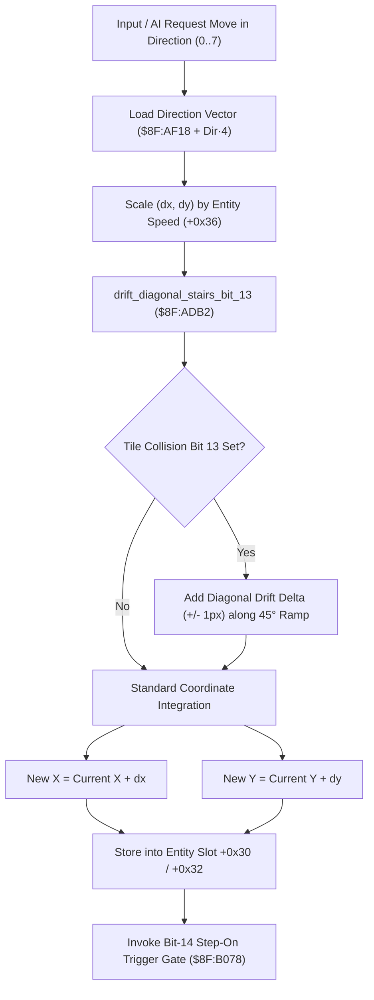

# Entity Movement Mechanics, Direction Step & Stairway Drift Pipeline

- **ROM Locations**:
  - `entity_mover_step_direction_table`: `$8F:AD51` – `$8F:ADB1`
  - `drift_diagonal_stairs_bit_13_also`: `$8F:ADB2` – `$8F:AE10`
  - `direction_step_vector_table`: `$8F:AF18` – `$8F:AF37`
- **CPU State**: 16-bit A/X (`REP #$30`), Data Bank `$7E` / `$8F`
- **WRAM Core Addresses**:
  - Entity slot offset `+0x30`: Entity X world pixel position.
  - Entity slot offset `+0x32`: Entity Y world pixel position.
  - Entity slot offset `+0x34`: Facing direction index ($0..7$, North clockwise to North-West).
  - Entity slot offset `+0x36`: Current walking speed step magnitude (pixels per step).
  - Entity slot offset `+0x38`: Elevation plane and tile property cache.
  - Tile collision word bit 13 (`0x2000`): Diagonal stairway / ramp drift override.

---

## 1. Architectural Role & Movement Mechanics

Field actors (the Boy, Dog companion, and moving NPCs) navigate Secret of Evermore's 2.5D world using an 8-directional movement vector table coupled with automatic stairway alignment:



### 1. 8-Directional Vector Lookup Table (`$8F:AF18`)
The engine encodes movement velocities for 8 compass directions:
```
Direction Index  Facing        dx (16-bit)   dy (16-bit)
0                North          0x0000       -0x0001 (0xFFFF)
1                North-East     0x0001       -0x0001 (0xFFFF)
2                East           0x0001        0x0000
3                South-East     0x0001        0x0001
4                South          0x0000        0x0001
5                South-West    -0x0001 (0xFFFF) 0x0001
6                West          -0x0001 (0xFFFF) 0x0000
7                North-West    -0x0001 (0xFFFF) -0x0001 (0xFFFF)
```

### 2. Stairway Drift Integration (`$8F:ADB2`)
- Diagonal stairways in Evermore (such as the ramps in Prehistoria huts and Antiqua temples) frequently present 45-degree isometric inclines.
- When an entity traverses a tile with collision **bit 13 set (`0x2000`)**, the engine introduces an orthogonal drift component:
  - If moving East or West across an ascending stairway, automatically applies $-1\text{px}$ or $+1\text{px}$ vertical drift.
  - This prevents the player from getting stuck on step boundaries and smoothly guides the actor along the diagonal stairway ramp.

---

## 2. Disassembly & Annotations

> **Interactive 65816 Assembly**:
> Centralized comments infused at runtime.
> [View in VFS: soe://rom/code/8FAD51](soe://rom/code/8FAD51?asm=1&c=0)


---

## 3. Reconstructed Clean C Implementation

> **Reconstructed C Decompilation**:
> Source moved to [`reconstructed-c/8F/8FAD51_entity_movement.c`](../../../reconstructed-c/8F/8FAD51_entity_movement.c).
> [View in VFS: soe://rom/code/8FAD51](soe://rom/code/8FAD51?c=1&asm=0)

