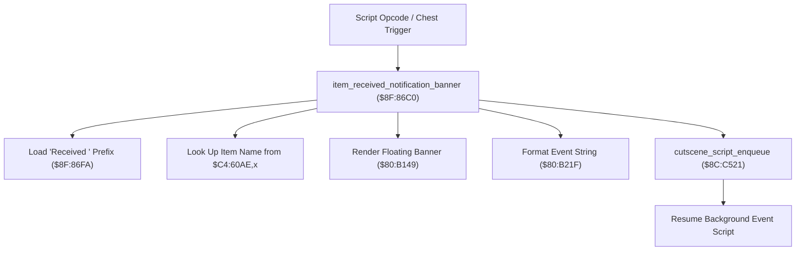

# Item Reward Presentation & Script VM Event Notification

- **ROM Locations**:
  - `item_received_notification_banner`: `$8F:86C0` – `$8F:86F9`
  - `item_received_prefix_string`: `$8F:86FA` ("Received " string)
  - `item_name_pointer_table`: `$C4:60AE`
- **CPU State**: 16-bit A/X (`REP #$30`), Data Bank `$7E` / `$8F`
- **WRAM Core Addresses**:
  - DP `$22`: Character anchor world position and formatted string buffer.
  - DP `$26`–`$28`: 24-bit pointer to item name string.
  - `$7E:2348`: Active character index.

---

## 1. Architectural Architecture & Event Dispatch

When the party receives an item reward (from treasure chests, NPC gifts, or boss drops), the engine renders an on-screen popup notification and posts an asynchronous event token back to the script VM.

### 1. String Concatenation & Banner Display
- Loads string prefix `$8F:86FA` (`"Received "`).
- Indexes master item name table `$C4:60AE,X` using item category identifier.
- Invokes `$80:B149` to render the floating banner text above the character's head.

### 2. Script VM Event Synchronization (`$8C:C521`)
After triggering the visual banner, the routine pulls the saved script callback address from stack (`PLA`, `STA $22`) and calls `cutscene_script_enqueue` (`$8C:C521`). This seamlessly returns control to the script thread that initiated the reward without stalling actor physics or field frame ticks.

---

## 2. Disassembly & Annotations

> **Interactive 65816 Assembly**:
> Centralized comments infused at runtime.
> [View in VFS: soe://rom/code/8F86C0](soe://rom/code/8F86C0?asm=1&c=0)

---

## 3. Reconstructed Clean C Implementation

> **Reconstructed C Decompilation**:
> Source moved to [`reconstructed-c/8F/8F86C0_item_notifications.c`](../../../reconstructed-c/8F/8F86C0_item_notifications.c).
> [View in VFS: soe://rom/code/8F86C0](soe://rom/code/8F86C0?c=1&asm=0)

