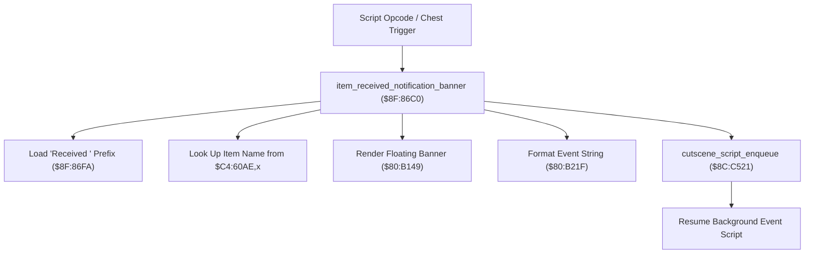

# Item Reward Presentation & Script VM Event Notification

- **ROM Locations**:
  - `item_received_notification_banner`: `$8F:86C0` – `$8F:86F9`
  - `item_received_prefix_string`: `$8F:86FA` ("Received " string)
  - `item_name_pointer_table`: `$C4:60AE`
- **CPU State**: 16-bit A/X (`REP #$30`), Data Bank `$7E` / `$8F`
- **WRAM Core Addresses**:
  - DP `$22`: Character anchor world position and formatted string buffer.
  - DP `$26`–`$28`: 24-bit pointer to item name string.
  - `$7E:2348`: Active character index.

---

## 1. Architectural Architecture & Event Dispatch

When the party receives an item reward (from treasure chests, NPC gifts, or boss drops), the engine renders an on-screen popup notification and posts an asynchronous event token back to the script VM.



### 1. String Concatenation & Banner Display
- Loads string prefix `$8F:86FA` (`"Received "`).
- Indexes master item name table `$C4:60AE,X` using item category identifier.
- Invokes `$80:B149` to render the floating banner text above the character's head.

### 2. Script VM Event Synchronization (`$8C:C521`)
After triggering the visual banner, the routine pulls the saved script callback address from stack (`PLA`, `STA $22`) and calls `cutscene_script_enqueue` (`$8C:C521`). This seamlessly returns control to the script thread that initiated the reward without stalling actor physics or field frame ticks.

---

## 2. Disassembly & Annotations

```assembly
; ==============================================================================
; item_received_notification_banner ($8F:86C0)
; Input:
;   DP $22 = Character world coordinate anchor
;   Stack = Return script pointer callback
; ==============================================================================
$8F86C0  85 28       STA $28           ; Bank byte
$8F86C2  22 49 B1 80 JSL $80B149       ; Display text banner
$8F86C6  98          TYA
$8F86C7  18          CLC
$8F86C8  65 22       ADC $22           ; Compute anchor offset
$8F86CA  85 22       STA $22
$8F86CC  22 1F B2 80 JSL $80B21F       ; Format string into buffer

$8F86D0  A9 20 00    LDA #$0020
$8F86D3  85 22       STA $22
$8F86D5  98          TYA
$8F86D6  1A          INC A
$8F86D7  18          CLC
$8F86D8  65 22       ADC $22
$8F86DA  85 22       STA $22

$8F86DC  AF 48 23 7E LDA $7E2348       ; Load active character index
$8F86E0  29 FF 00    AND #$00FF
$8F86E3  AA          TAX
$8F86E4  A9 FA 86    LDA #$86FA        ; "Received " string key
$8F86E7  85 26       STA $26
$8F86E9  A9 8F 00    LDA #$008F        ; Bank $8F
$8F86EC  85 28       STA $28
$8F86EE  22 49 B1 80 JSL $80B149       ; Display "Received " prefix

; Resume Event Script VM:
$8F86F2  68          PLA               ; Pull script address from stack
$8F86F3  85 22       STA $22
$8F86F5  22 21 C5 8C JSL $8CC521       ; cutscene_script_enqueue: return to script
$8F86F9  6B          RTL
```

---

## 3. Reconstructed Clean C Implementation

```c
#include <stdint.h>
#include <stdbool.h>

extern void render_floating_banner(uint32_t string_key, uint16_t anchor);
extern void format_notification_string(uint16_t anchor_offset);
extern void cutscene_script_enqueue(uint32_t script_address);

/**
 * Renders the "Received <item>" floating banner above character
 * and enqueues event callback back into the script VM.
 * Corresponds to $8F:86C0.
 */
void item_received_notification_banner(uint16_t anchor_pos, uint32_t return_script_addr) {
    // 1. Render primary item name banner
    render_floating_banner(0x8F86FA, anchor_pos);

    // 2. Format notification string in WRAM buffer
    format_notification_string(anchor_pos);

    // 3. Render "Received " prefix banner
    render_floating_banner(0x8F86FA, anchor_pos + 0x0020);

    // 4. Return to calling script thread via circular FIFO
    cutscene_script_enqueue(return_script_addr);
}
```
