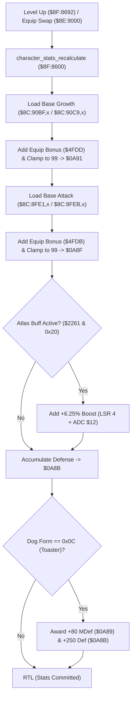

# Character Level Growth, Stat Recalculation & Form Scaling

- **ROM Locations**:
  - `character_stats_recalculate`: `$8F:8600` – `$8F:8688`
  - `base_growth_table_boy`: `$8C:90BF`
  - `base_growth_table_dog`: `$8C:90C9`
  - `base_attack_table_boy`: `$8C:8FE1`
  - `base_attack_table_dog`: `$8C:8FEB`
  - `weapon_modifier_table`: `$C4:0000`
- **CPU State**: 16-bit A/X (`REP #$30`), Data Bank `$7E` / `$8F`
- **WRAM Core Addresses**:
  - `$7E:0A91`: Current character level stat (clamped 1..99).
  - `$7E:0A8F`: Base attack power stat (clamped 1..99).
  - `$7E:0A8B`: Total physical defense stat.
  - `$7E:0A89`: Total magic defense (MDef) stat.
  - `$7E:2261`: Character status condition bitmask (bit 5: Atlas attack buff active).
  - `$7E:2363`: Companion Dog transformation form (`0x000C` = Toaster Dog).
  - DP `$12`: Temporary scaled attack power buffer.
  - `$7E:4FDB` / `$7E:4FDD`: Equipment bonus stats applied to attack and level.

---

## 1. Architectural Architecture & Stat Pipeline

Whenever a party member advances in level or changes equipment, the engine executes `character_stats_recalculate` to rebuild the active combat stat block.



### 1. Level & Base Attack Clamping (1..99)
- Base level stat is retrieved from character master tables `$8C:90BF` (Boy) or `$8C:90C9` (Dog).
- Adds equipment bonus from `$4FDD` (`ADC $4FDD`).
- Compares with 99 (`CMP #$0063`): clamped to 99 if exceeded, written into `$7E:0A91`.
- Base attack power is retrieved from `$8C:8FE1` (Boy) or `$8C:8FEB` (Dog), added with equipment bonus `$4FDB`, clamped to 99, and written into `$7E:0A8F`.

### 2. Atlas Spell Attack Multiplier
- Checks status affliction bitmask `$7E:2261` bit 5.
- When active, the routine performs a 4-bit logical shift right (`LSR A` $\times 4$) on weapon damage modifier `$12`, adding the fractional $+6.25\%$ increase back into `$12` (`ADC $12`).

### 3. Toaster Dog Transformation Bonus (`0x000C`)
- Secret of Evermore features distinct Dog forms across the 4 eras: Wolf (Prehistoria), Greyhound (Antiqua), Poodle (Gothica), and Toaster Dog (Omnitopia).
- Inspects register `$7E:2363`: if form equals `0x000C` (Toaster Dog), awards fixed defensive buffs:
  - Magic Defense (`$7E:0A89`): $+80$ points (`ADC #$0050`).
  - Physical Defense (`$7E:0A8B`): $+250$ points (`ADC #$00FA`).

---

## 2. Disassembly & Annotations

```assembly
; ==============================================================================
; character_stats_recalculate ($8F:8600)
; Input:
;   X = Character index (0 = Boy, 2 = Dog)
; ==============================================================================
$8F8600  89 01 00    BIT #$0001        ; Test Boy vs Dog character flag
$8F8603  F0 06       BEQ $8F860B
$8F8605  BF C9 90 8C LDA $8C90C9,x     ; Dog base level growth table
$8F8609  80 04       BRA $8F860F
$8F860B  BF BF 90 8C LDA $8C90BF,x     ; Boy base level growth table
$8F860F  18          CLC
$8F8610  6D DD 4F    ADC $4FDD         ; Add bonus equipment level
$8F8613  C9 63 00    CMP #$0063        ; Level cap = 99
$8F8616  30 03       BMI $8F861B
$8F8618  A9 63 00    LDA #$0063        ; Clamp to max level 99
$8F861B  8D 91 0A    STA $0A91         ; Store active character level

; Calculate Attack Power:
$8F861E  AF 63 22 7E LDA $7E2263       ; Character archetype flags
$8F8622  89 02 00    BIT #$0002
$8F8625  F0 06       BEQ $8F862D
$8F8627  BF EB 8F 8C LDA $8C8FEB,x     ; Dog base attack table
$8F862B  80 04       BRA $8F8631
$8F862D  BF E1 8F 8C LDA $8C8FE1,x     ; Boy base attack table
$8F8631  18          CLC
$8F8632  6D DB 4F    ADC $4FDB         ; Add equipment attack power
$8F8635  C9 63 00    CMP #$0063        ; Attack power cap = 99
$8F8638  30 03       BMI $8F863D
$8F863A  A9 63 00    LDA #$0063        ; Clamp attack to 99
$8F863D  8D 8F 0A    STA $0A8F         ; Store active attack power

; Weapon Modifier & Atlas Buff:
$8F8640  A9 00 00    LDA #$0000
$8F8643  AE BE 0A    LDX $0ABE         ; Equipped weapon index
$8F8646  F0 1C       BEQ $8F8664
$8F8648  18          CLC
$8F8649  7F 00 00 C4 ADC $C40000,x     ; Load weapon damage modifier
$8F864D  85 12       STA $12
$8F864F  AD 61 22    LDA $2261         ; Load status condition bitmask
$8F8652  89 20 00    BIT #$0020        ; Bit 5: Atlas strength buff active?
$8F8655  F0 0B       BEQ $8F8662
$8F8657  A5 12       LDA $12           ; Divide modifier by 16 (+6.25%)
$8F8659  4A          LSR A
$8F865A  4A          LSR A
$8F865B  4A          LSR A
$8F865C  4A          LSR A
$8F865D  18          CLC
$8F865E  65 12       ADC $12           ; Add scaled boost back to weapon damage
$8F8660  80 02       BRA $8F8664
$8F8662  A5 12       LDA $12
$8F8664  18          CLC
$8F8665  6D 8B 0A    ADC $0A8B         ; Accumulate total defense
$8F8668  8D 8B 0A    STA $0A8B

; Companion Dog Transformation Form Check:
$8F866B  AE 63 23    LDX $2363         ; Dog era form ID
$8F866E  E0 0C 00    CPX #$000C        ; Form 0x000C = Toaster Dog?
$8F8671  D0 14       BNE $8F8687
$8F8673  A9 50 00    LDA #$0050        ; +80 Magic Defense bonus
$8F8676  18          CLC
$8F8677  6D 89 0A    ADC $0A89
$8F867A  8D 89 0A    STA $0A89         ; Commit MDef
$8F867D  A9 FA 00    LDA #$00FA        ; +250 Physical Defense bonus
$8F8680  18          CLC
$8F8681  6D 8B 0A    ADC $0A8B
$8F8684  8D 8B 0A    STA $0A8B         ; Commit Defense
$8F8687  AB          PLB
$8F8688  6B          RTL
```

---

## 3. Reconstructed Clean C Implementation

```c
#include <stdint.h>
#include <stdbool.h>

#define MAX_STAT_CAP 99
#define DOG_FORM_TOASTER 0x000C

extern const uint16_t g_base_growth_boy[32];   // $8C:90BF
extern const uint16_t g_base_growth_dog[32];   // $8C:90C9
extern const uint16_t g_base_attack_boy[32];   // $8C:8FE1
extern const uint16_t g_base_attack_dog[32];   // $8C:8FEB
extern const uint16_t g_weapon_modifiers[256]; // $C4:0000

extern uint16_t g_char_level;                  // $7E:0A91
extern uint16_t g_char_attack;                 // $7E:0A8F
extern uint16_t g_char_defense;                // $7E:0A8B
extern uint16_t g_char_magic_defense;          // $7E:0A89
extern uint16_t g_status_buff_flags;           // $7E:2261
extern uint16_t g_companion_dog_form;          // $7E:2363
extern uint16_t g_equipped_weapon_id;          // $7E:0ABE
extern uint16_t g_equip_bonus_level;           // $7E:4FDD
extern uint16_t g_equip_bonus_attack;          // $7E:4FDB

/**
 * Recalculates party character combat stats, applying level curves,
 * stat caps, weapon scaling, Atlas buffs, and dog form transformations.
 * Corresponds to $8F:8600.
 */
void character_stats_recalculate(bool is_dog, uint8_t char_index) {
    // 1. Compute Base Level with cap at 99
    uint16_t base_lvl = is_dog ? g_base_growth_dog[char_index] : g_base_growth_boy[char_index];
    uint16_t total_lvl = base_lvl + g_equip_bonus_level;
    g_char_level = (total_lvl > MAX_STAT_CAP) ? MAX_STAT_CAP : total_lvl;

    // 2. Compute Base Attack Power with cap at 99
    uint16_t base_atk = is_dog ? g_base_attack_dog[char_index] : g_base_attack_boy[char_index];
    uint16_t total_atk = base_atk + g_equip_bonus_attack;
    g_char_attack = (total_atk > MAX_STAT_CAP) ? MAX_STAT_CAP : total_atk;

    // 3. Compute Weapon Modifier & Atlas Buff (+6.25%)
    uint16_t weapon_mod = 0;
    if (g_equipped_weapon_id != 0) {
        weapon_mod = g_weapon_modifiers[g_equipped_weapon_id];
        if (g_status_buff_flags & 0x0020) { // Atlas buff bit
            weapon_mod += (weapon_mod >> 4);
        }
    }
    g_char_defense += weapon_mod;

    // 4. Toaster Dog Era Transformation Bonus
    if (g_companion_dog_form == DOG_FORM_TOASTER) {
        g_char_magic_defense += 80;  // +0x50 MDef
        g_char_defense       += 250; // +0xFA Defense
    }
}
```
