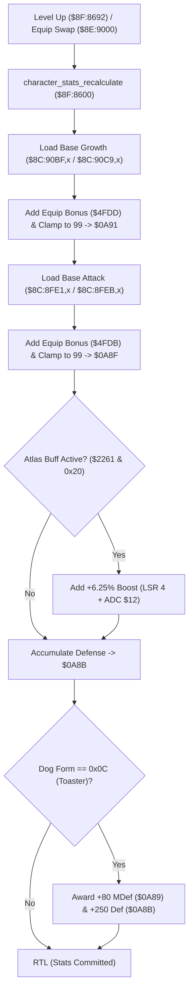

# Character Level Growth, Stat Recalculation & Form Scaling

- **ROM Locations**:
  - `character_stats_recalculate`: `$8F:8600` – `$8F:8688`
  - `base_growth_table_boy`: `$8C:90BF`
  - `base_growth_table_dog`: `$8C:90C9`
  - `base_attack_table_boy`: `$8C:8FE1`
  - `base_attack_table_dog`: `$8C:8FEB`
  - `weapon_modifier_table`: `$C4:0000`
- **CPU State**: 16-bit A/X (`REP #$30`), Data Bank `$7E` / `$8F`
- **WRAM Core Addresses**:
  - `$7E:0A91`: Current character level stat (clamped 1..99).
  - `$7E:0A8F`: Base attack power stat (clamped 1..99).
  - `$7E:0A8B`: Total physical defense stat.
  - `$7E:0A89`: Total magic defense (MDef) stat.
  - `$7E:2261`: Character status condition bitmask (bit 5: Atlas attack buff active).
  - `$7E:2363`: Companion Dog transformation form (`0x000C` = Toaster Dog).
  - DP `$12`: Temporary scaled attack power buffer.
  - `$7E:4FDB` / `$7E:4FDD`: Equipment bonus stats applied to attack and level.

---

## 1. Architectural Architecture & Stat Pipeline

Whenever a party member advances in level or changes equipment, the engine executes `character_stats_recalculate` to rebuild the active combat stat block.

### 1. Level & Base Attack Clamping (1..99)
- Base level stat is retrieved from character master tables `$8C:90BF` (Boy) or `$8C:90C9` (Dog).
- Adds equipment bonus from `$4FDD` (`ADC $4FDD`).
- Compares with 99 (`CMP #$0063`): clamped to 99 if exceeded, written into `$7E:0A91`.
- Base attack power is retrieved from `$8C:8FE1` (Boy) or `$8C:8FEB` (Dog), added with equipment bonus `$4FDB`, clamped to 99, and written into `$7E:0A8F`.

### 2. Atlas Spell Attack Multiplier
- Checks status affliction bitmask `$7E:2261` bit 5.
- When active, the routine performs a 4-bit logical shift right (`LSR A` $\times 4$) on weapon damage modifier `$12`, adding the fractional $+6.25\%$ increase back into `$12` (`ADC $12`).

### 3. Toaster Dog Transformation Bonus (`0x000C`)
- Secret of Evermore features distinct Dog forms across the 4 eras: Wolf (Prehistoria), Greyhound (Antiqua), Poodle (Gothica), and Toaster Dog (Omnitopia).
- Inspects register `$7E:2363`: if form equals `0x000C` (Toaster Dog), awards fixed defensive buffs:
  - Magic Defense (`$7E:0A89`): $+80$ points (`ADC #$0050`).
  - Physical Defense (`$7E:0A8B`): $+250$ points (`ADC #$00FA`).

---

## 2. Disassembly & Annotations

> **Interactive 65816 Assembly**:
> Centralized comments infused at runtime.
> [View in VFS: soe://rom/code/8F8600](soe://rom/code/8F8600?asm=1&c=0)

---

## 3. Reconstructed Clean C Implementation

> **Reconstructed C Decompilation**:
> Source moved to [`reconstructed-c/8F/8F8600_level_growth.c`](../../../reconstructed-c/8F/8F8600_level_growth.c).
> [View in VFS: soe://rom/code/8F8600](soe://rom/code/8F8600?c=1&asm=0)

