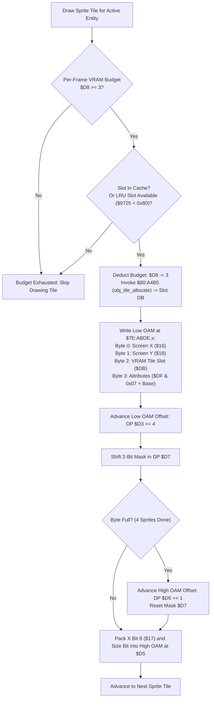

# Sprite Drawer & Hardware OAM Buffer Generator ($80:919E – $80:9200)

- **ROM Locations**:
  - `oam_sprite_entry_emit`: `$80:919E` – `$80:9200`
- **CPU State**: Mixed 8-bit/16-bit A/X (`REP #$30` / `SEP #$20`), Data Bank `$7E` / `$80`
- **WRAM Core Addresses**:
  - `$7E:ABDE`: Low OAM buffer base (512 bytes: 128 sprites × 4 bytes).
  - `$7E:ABDE + 512`: High OAM bit table base (32 bytes: 128 sprites × 2 bits).
  - DP `$D3`: Low OAM buffer write offset ($0..508$, step $+4$).
  - DP `$D5`: High OAM bit table write offset ($0..31$, step $+1$ every 4 sprites).
  - DP `$D7`: Current high OAM 2-bit packing shift mask.
  - DP `$D8`: Per-frame VRAM tile streaming budget (starts at $\approx 18$; decremented by 3 per cache miss).
  - DP `$16`: Screen coordinate X (low 8 bits).
  - DP `$17`: Screen coordinate X bit 8 and offscreen clip flag.
  - DP `$18`: Screen coordinate Y.
  - DP `$DB`: VRAM pattern table slot index allocated for this sprite tile.
  - DP `$DF`: Sprite attribute byte (palette index, priority, H/V flips).
- **Downstream Engine Routines**:
  - `$80:A4B5`: Dynamic VRAM OBJ tile LRU allocator (`obj_tile_allocate`).

---

## 1. Architectural Role & SNES OAM Layout

The SNES PPU sprite engine reads a 544-byte Object Attribute Memory (OAM) table during active scanlines:
- **Low OAM (512 bytes)**: 128 4-byte entries:
  - Byte 0: X position ($0..255$)
  - Byte 1: Y position ($0..223$)
  - Byte 2: Starting tile index ($0..255$)
  - Byte 3: Attributes (`vhoopppc`: v-flip, h-flip, priority $0..3$, palette $0..7$, tile high bit)
- **High OAM (32 bytes)**: 128 2-bit pairs (4 sprites packed into each byte):
  - Bit 0: X position bit 8 (for positions $256..511$ or offscreen negative $[-256..-1]$)
  - Bit 1: Sprite size flag ($0 = 8\times 8$, $1 = 16\times 16$)

---

## 2. Disassembly & Annotations

> **Interactive 65816 Assembly**:
> Centralized comments infused at runtime.
> [View in VFS: soe://rom/code/80919E](soe://rom/code/80919E?asm=1&c=0)

---

## 3. Clean C Decompilation

> **Reconstructed C Decompilation**:
> Source moved to [`reconstructed-c/80/80919E_oam_builder.c`](../../../reconstructed-c/80/80919E_oam_builder.c).
> [View in VFS: soe://rom/code/80919E](soe://rom/code/80919E?c=1&asm=0)

