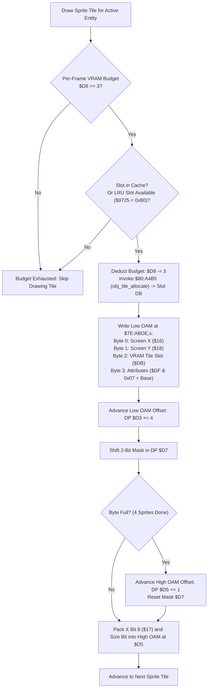

# Sprite Drawer & Hardware OAM Buffer Generator ($80:919E – $80:9200)

- **ROM Locations**:
  - `oam_sprite_entry_emit`: `$80:919E` – `$80:9200`
- **CPU State**: Mixed 8-bit/16-bit A/X (`REP #$30` / `SEP #$20`), Data Bank `$7E` / `$80`
- **WRAM Core Addresses**:
  - `$7E:ABDE`: Low OAM buffer base (512 bytes: 128 sprites × 4 bytes).
  - `$7E:ABDE + 512`: High OAM bit table base (32 bytes: 128 sprites × 2 bits).
  - DP `$D3`: Low OAM buffer write offset ($0..508$, step $+4$).
  - DP `$D5`: High OAM bit table write offset ($0..31$, step $+1$ every 4 sprites).
  - DP `$D7`: Current high OAM 2-bit packing shift mask.
  - DP `$D8`: Per-frame VRAM tile streaming budget (starts at $\approx 18$; decremented by 3 per cache miss).
  - DP `$16`: Screen coordinate X (low 8 bits).
  - DP `$17`: Screen coordinate X bit 8 and offscreen clip flag.
  - DP `$18`: Screen coordinate Y.
  - DP `$DB`: VRAM pattern table slot index allocated for this sprite tile.
  - DP `$DF`: Sprite attribute byte (palette index, priority, H/V flips).
- **Downstream Engine Routines**:
  - `$80:A4B5`: Dynamic VRAM OBJ tile LRU allocator (`obj_tile_allocate`).

---

## 1. Architectural Role & SNES OAM Layout

The SNES PPU sprite engine reads a 544-byte Object Attribute Memory (OAM) table during active scanlines:
- **Low OAM (512 bytes)**: 128 4-byte entries:
  - Byte 0: X position ($0..255$)
  - Byte 1: Y position ($0..223$)
  - Byte 2: Starting tile index ($0..255$)
  - Byte 3: Attributes (`vhoopppc`: v-flip, h-flip, priority $0..3$, palette $0..7$, tile high bit)
- **High OAM (32 bytes)**: 128 2-bit pairs (4 sprites packed into each byte):
  - Bit 0: X position bit 8 (for positions $256..511$ or offscreen negative $[-256..-1]$)
  - Bit 1: Sprite size flag ($0 = 8\times 8$, $1 = 16\times 16$)



---

## 2. Disassembly & Annotations

```asm
; ==============================================================================
; oam_sprite_entry_emit ($80:919E – $80:9200)
; ==============================================================================
; Check per-frame upload budget
$80919E  e2 31          sep #$31           ; 8-bit A/X, Carry Set
$8091A0  a5 d8          lda $D8            ; Current upload budget
$8091A2  e9 03          sbc #$03           ; Subtract 3
$8091A4  90 f5          bcc $80919B        ; If underflow (< 3): skip upload
$8091A6  ac 25 97       ldy $9725          ; Read LRU slot index
$8091A9  c0 80          cpy #$80           ; Cache full limit
$8091AB  f0 ee          beq $80919B        ; If 0x80: skip
$8091AD  85 d8          sta $D8            ; Commit new budget
$8091AF  84 db          sty $DB            ; Target slot in DP $DB
$8091B1  20 b5 a4       jsr $80A4B5        ; Invoke obj_tile_allocate
$8091B4  e2 20          sep #$20

; ------------------------------------------------------------------------------
; Emit Low OAM 4-Byte Record
; ------------------------------------------------------------------------------
$8091B6  a6 d3          ldx $D3            ; X = Low OAM write pointer
$8091B8  a5 16          lda $16            ; Screen coordinate X
$8091BA  9d de ab       sta $ABDE,x        ; OAM Byte 0: X
$8091BD  a5 18          lda $18            ; Screen coordinate Y
$8091BF  9d df ab       sta $ABDF,x        ; OAM Byte 1: Y
$8091C2  a5 db          lda $DB            ; VRAM tile index
$8091C4  9d e0 ab       sta $ABE0,x        ; OAM Byte 2: Tile
$8091C7  a5 df          lda $DF            ; Sprite attribute flags
$8091C9  25 07          and $07            ; Palette bits
$8091CB  18             clc
$8091CC  65 06          adc $06            ; Add base palette/priority
$8091CE  9d e1 ab       sta $ABE1,x        ; OAM Byte 3: Attributes
$8091D1  e8             inx
$8091D2  e8             inx
$8091D3  e8             inx
$8091D4  e8             inx                ; Low OAM pointer += 4
$8091D5  86 d3          stx $D3

; ------------------------------------------------------------------------------
; Pack High OAM 2-Bit Entry (X bit 8 & Sprite Size)
; ------------------------------------------------------------------------------
$8091D7  a6 d5          ldx $D5            ; X = High OAM write pointer
$8091D9  a5 d7          lda $D7            ; Shift mask
$8091DB  0a             asl a
$8091DC  30 10          bmi $8091EE        ; If byte full (4 sprites packed): advance
$8091DE  0a             asl a
$8091DF  85 d7          sta $D7            ; Update shift mask
$8091E1  24 17          bit $17            ; Test X coordinate bit 8
$8091E3  10 15          bpl $8091FA        ; If bit 8 == 0: no extra bit
$8091E5  1d de ab       ora $ABDE,x        ; OR into high OAM table
$8091E8  9d de ab       sta $ABDE,x
$8091EB  4c 01 91       jmp $809101        ; Next sprite

$8091EE  e8             inx                ; High OAM offset += 1
$8091EF  86 d5          stx $D5
; (Continues high OAM initialization and advances loop)
```

---

## 3. Clean C Decompilation

```c
#include <stdint.h>
#include <stdbool.h>

#define OAM_LOW_TABLE_BASE   0xABDE
#define OAM_HIGH_TABLE_BASE  (0xABDE + 512)
#define VRAM_TILE_BUDGET_COST 3

// Direct page registers
extern uint8_t  g_oam_screen_x;            // DP $16
extern uint8_t  g_oam_x_bit8_and_size;     // DP $17 (bit 7 = X bit 8, bit 6 = 16x16 size)
extern uint8_t  g_oam_screen_y;            // DP $18
extern uint8_t  g_oam_tile_slot;           // DP $DB
extern uint8_t  g_oam_attr_flags;          // DP $DF
extern uint8_t  g_oam_palette_base;        // DP $06
extern uint16_t g_oam_low_write_offset;    // DP $D3
extern uint16_t g_oam_high_write_offset;   // DP $D5
extern uint8_t  g_oam_high_pack_mask;      // DP $D7
extern uint8_t  g_vram_upload_budget;      // DP $D8

// WRAM buffers
extern uint8_t  g_oam_low_buffer[512];     // $7E:ABDE
extern uint8_t  g_oam_high_buffer[32];     // $7E:ABDE + 512
extern uint8_t  g_lru_candidate_slot;      // $7E:9725

// Dynamic tile allocator routine
extern uint16_t obj_tile_allocate(uint8_t lru_slot, uint16_t tile_id); // $80:A4B5

/**
 * oam_sprite_entry_emit ($80:919E)
 * Validates the per-frame VRAM streaming budget, allocates or updates dynamic
 * OBJ tile cache, emits a 4-byte record to low OAM, and packs the high 2 bits.
 * 
 * @param tile_id Global sprite tile ID being drawn.
 * @return True if sprite entry was successfully emitted, false if dropped.
 */
bool oam_sprite_entry_emit(uint16_t tile_id) {
    // 1. Check per-frame upload budget
    if (g_vram_upload_budget < VRAM_TILE_BUDGET_COST) {
        return false; // Budget exhausted: drop tile to prevent frame lag
    }

    uint8_t lru_slot = g_lru_candidate_slot;
    if (lru_slot >= 0x80) {
        return false; // Cache table full
    }

    // Deduct cost from per-frame budget
    g_vram_upload_budget -= VRAM_TILE_BUDGET_COST;
    g_oam_tile_slot = lru_slot;

    // Allocate / stream tile into VRAM staging buffer
    obj_tile_allocate(lru_slot, tile_id);

    // 2. Emit 4-byte low OAM record
    uint16_t low_idx = g_oam_low_write_offset;
    g_oam_low_buffer[low_idx + 0] = g_oam_screen_x;
    g_oam_low_buffer[low_idx + 1] = g_oam_screen_y;
    g_oam_low_buffer[low_idx + 2] = g_oam_tile_slot;
    g_oam_low_buffer[low_idx + 3] = (g_oam_attr_flags & 0x07) + g_oam_palette_base;

    // Advance low OAM offset by 4 bytes
    g_oam_low_write_offset += 4;

    // 3. Pack 2-bit high OAM bits (X bit 8 and size flag)
    uint8_t shift_mask = g_oam_high_pack_mask << 2;
    if (shift_mask == 0) {
        // Advanced to next byte in high OAM
        g_oam_high_write_offset += 1;
        shift_mask = 0x01;
    }
    g_oam_high_pack_mask = shift_mask;

    // If coordinate X has bit 8 set, assert bit in high OAM
    if (g_oam_x_bit8_and_size & 0x80) {
        g_oam_high_buffer[g_oam_high_write_offset] |= shift_mask;
    }

    // If sprite size is 16x16, assert size bit (shift_mask << 1)
    if (g_oam_x_bit8_and_size & 0x40) {
        g_oam_high_buffer[g_oam_high_write_offset] |= (shift_mask << 1);
    }

    return true;
}
```
