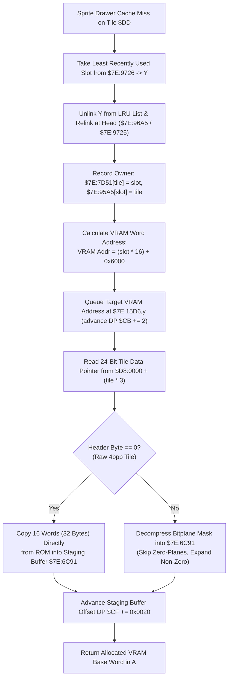

# Dynamic VRAM OBJ Tile Allocator & Bitplane Decompressor ($80:A4B5 – `$80:A590`)

- **ROM Locations**:
  - `obj_tile_allocate`: `$80:A4B5` – `$80:A517`
  - `obj_tile_copy_raw`: `$80:A518` – `$80:A55D`
  - `obj_tile_decompress_4bpp`: `$80:A55E` – `$80:A5AA`
- **CPU State**: Mixed 8-bit/16-bit A/X (`REP #$30` / `SEP #$20`), Data Bank `$7E` / `$D8`
- **WRAM Core Addresses**:
  - `$7E:96A5`: LRU linked list forward pointers (indexed by slot index `Y`).
  - `$7E:9725`: LRU linked list backward pointers / queue state.
  - `$7E:9726` / `$7E:9727`: LRU list head / tail pointers.
  - `$7E:7D51,x`: Forward tile slot owner table (indexed by tile ID).
  - `$7E:95A5,x`: Reverse tile slot owner table (indexed by slot * 2).
  - `$7E:15D6,y`: VRAM upload queue target address buffer (`slot * 16 + 0x6000`).
  - `$7E:6C91,x`: Staged VRAM tile DMA buffer (32 bytes per 4bpp tile).
  - DP `$CB`: VRAM upload queue write pointer.
  - DP `$CF`: DMA staging buffer write offset.
  - DP `$DD`: Tile ID being allocated.
- **ROM Data Tables**:
  - `$D8:0000,x`: 24-bit pointer table to compressed/raw sprite graphics tiles (3 bytes per entry).

---

## 1. Architectural Role & VRAM OBJ Cache Management

The SNES PPU OBJ pattern tables (stored at VRAM `$6000` in Evermore) have limited space for active entity sprites. To render diverse enemies, NPCs, and dynamic spell effects, Evermore uses a dynamic Least Recently Used (LRU) tile cache:



### VRAM Addressing Geometry
Each 4bpp tile on the SNES consists of 32 bytes (8×8 pixels, 4 bits per pixel). In 16-bit VRAM word addressing:
$$\text{VRAM Word Offset} = \text{Slot Index} \times 16 + 0x6000$$

When the frame finishes rendering, the engine triggers a DMA transfer from `$7E:6C91` into VRAM at the destination queued in `$7E:15D6`.

---

## 2. Disassembly & Annotations

### Slot Allocation & LRU Relinking (`$80:A4B5` – `$80:A4F4`)
```asm
; ==============================================================================
; obj_tile_allocate ($80:A4B5)
; Inputs: Y = LRU candidate slot index, DP $DD = Tile ID
; ==============================================================================
$80A4B5  be a5 96       ldx $96A5,y        ; X = next slot pointer in LRU table
$80A4B8  8e 25 97       stx $9725          ; Store into LRU state
$80A4BB  a9 80 9d       lda #$9D80
$80A4BE  27 97          and $97
$80A4C0  ad 26 97       lda $9726          ; Read head pointer
$80A4C3  99 a5 96       sta $96A5,y        ; Link current slot to head
$80A4C6  aa             tax
$80A4C7  98             tya
$80A4C8  9d 27 97       sta $9727,x        ; Update backward link
$80A4CB  8d 26 97       sta $9726          ; Slot becomes new head
$80A4CE  a9 81 99       lda #$9981
$80A4D1  27 97          and $97

$80A4D3  c2 10          rep #$10           ; 16-bit X/Y
$80A4D5  a6 dd          ldx $DD            ; X = Tile ID
$80A4D7  98             tya                ; A = Slot index
$80A4D8  9d 51 7d       sta $7D51,x        ; Record forward owner: tile -> slot
$80A4DB  c2 30          rep #$30           ; 16-bit A/X
$80A4DD  98             tya
$80A4DE  0a             asl a              ; Slot * 2
$80A4DF  aa             tax
$80A4E0  a5 dd          lda $DD            ; Tile ID
$80A4E2  9d a5 95       sta $95A5,x        ; Record reverse owner: slot -> tile

; Calculate VRAM Target Word Address: (slot * 16) + 0x6000
$80A4E5  8a             txa                ; A = slot * 2
$80A4E6  0a             asl a              ; * 4
$80A4E7  0a             asl a              ; * 8
$80A4E8  0a             asl a              ; * 16
$80A4E9  69 00 60       adc #$6000         ; Add VRAM OBJ base address $6000
$80A4EC  a4 cb          ldy $CB            ; Y = VRAM queue offset
$80A4EE  99 d6 15       sta $15D6,y        ; Queue VRAM address
$80A4F1  c8             iny
$80A4F2  c8             iny                ; Advance queue offset +2
$80A4F3  84 cb          sty $CB
```

### Tile Data Lookup & Raw/Compressed Branch (`$80:A4F5` – `$80:A55D`)
```asm
; Resolve 24-bit pointer from table at $D8:0000 + (tile * 3)
$80A4F5  a5 dd          lda $DD            ; Tile ID
$80A4F7  0a             asl a
$80A4F8  65 dd          adc $DD            ; A = Tile ID * 3
$80A4FA  aa             tax
$80A4FB  8b             phb
$80A4FC  bf 01 00 d8    lda $D80001,x      ; Read bank and high address
$80A500  30 03          bmi $80A505
$80A502  4c fa a7       jmp $80A7FA        ; Alternate bank handler
$80A505  69 00 51       adc #$5100
$80A508  48             pha
$80A509  ab             plb
$80A50A  ab             plb                ; Set data bank
$80A50B  bf 00 00 d8    lda $D80000,x      ; Read low 16-bit address
$80A50F  a8             tay                ; Y = Tile data pointer in ROM
$80A510  a5 cf          lda $CF            ; A = Staging buffer offset
$80A512  aa             tax
$80A513  69 20 00       adc #$0020         ; +32 bytes (1 tile)
$80A516  85 cf          sta $CF            ; Advance staging buffer offset

; Test compression header byte
$80A518  b9 00 00       lda $0000,y        ; Check first byte
$80A51B  d0 41          bne $80A55E        ; If != 0, decompress compressed 4bpp

; Raw uncompressed 4bpp tile copy (16 words = 32 bytes)
$80A51D  b9 01 00       lda $0001,y
$80A520  9f 91 6c 7e    sta $7E6C91,x      ; Word 0
$80A524  b9 03 00       lda $0003,y
$80A527  9f 93 6c 7e    sta $7E6C93,x      ; Word 1
$80A52B  b9 05 00       lda $0005,y
$80A52E  9f 95 6c 7e    sta $7E6C95,x      ; Word 2
$80A532  b9 07 00       lda $0007,y
$80A535  9f 97 6c 7e    sta $7E6C97,x      ; Word 3
$80A539  b9 09 00       lda $0009,y
$80A53C  9f 99 6c 7e    sta $7E6C99,x      ; Word 4
$80A540  b9 0b 00       lda $000B,y
$80A543  9f 9b 6c 7e    sta $7E6C9B,x      ; Word 5
$80A547  b9 0d 00       lda $000D,y
$80A54A  9f 9d 6c 7e    sta $7E6C9D,x      ; Word 6
$80A54E  b9 0f 00       lda $000F,y
$80A551  9f 9f 6c 7e    sta $7E6C9F,x      ; Word 7..15
; (Continues through all 16 words, then restores bank and returns)
```

---

## 3. Clean C Decompilation

```c
#include <stdint.h>
#include <stdbool.h>

#define VRAM_OBJ_BASE_WORD 0x6000
#define TILE_4BPP_BYTES    32
#define TILE_4BPP_WORDS    16

// WRAM Global State
extern uint16_t g_lru_next_slot[128];       // $7E:96A5
extern uint16_t g_lru_prev_slot[128];       // $7E:9725
extern uint16_t g_lru_head_slot;            // $7E:9726
extern uint16_t g_lru_tail_slot;            // $7E:9727
extern uint8_t  g_tile_owner_slot[1024];    // $7E:7D51 (tile_id -> slot)
extern uint16_t g_slot_owner_tile[128];     // $7E:95A5 (slot -> tile_id)

extern uint16_t g_vram_queue_words[128];    // $7E:15D6
extern uint16_t g_vram_queue_offset;        // DP $CB

extern uint8_t  g_vram_staging_dma[2048];   // $7E:6C91
extern uint16_t g_vram_staging_offset;      // DP $CF

// ROM Tables
typedef struct {
    uint8_t low;
    uint8_t mid;
    uint8_t bank;
} RomFarPointer24;

extern const RomFarPointer24 g_sprite_tile_ptrs[]; // $D8:0000

/**
 * Decompresses a 4bpp sprite tile by expanding compressed zero bitplanes.
 */
extern void decompress_4bpp_tile(const uint8_t *src, uint8_t *dst); // $80:A55E

/**
 * obj_tile_allocate ($80:A4B5)
 * Allocates a dynamic OBJ VRAM slot for a requested sprite tile, queues its
 * VRAM destination address, and copies or decompresses its graphic data.
 * 
 * @param lru_slot LRU candidate slot index chosen by sprite cache manager.
 * @param tile_id Global sprite tile graphic ID to load.
 * @return Target VRAM word address for rendering OAM tiles.
 */
uint16_t obj_tile_allocate(uint8_t lru_slot, uint16_t tile_id) {
    // 1. Relink slot to the head of the LRU cache list
    uint16_t prev_head = g_lru_head_slot;
    g_lru_next_slot[lru_slot] = prev_head;
    g_lru_prev_slot[prev_head] = lru_slot;
    g_lru_head_slot = lru_slot;

    // 2. Update forward and reverse owner lookup mappings
    g_tile_owner_slot[tile_id] = lru_slot;
    g_slot_owner_tile[lru_slot] = tile_id;

    // 3. Compute VRAM destination word address: slot * 16 + 0x6000
    uint16_t vram_dest = (lru_slot * TILE_4BPP_WORDS) + VRAM_OBJ_BASE_WORD;

    // 4. Queue VRAM destination address for vertical blank DMA transfer
    g_vram_queue_words[g_vram_queue_offset >> 1] = vram_dest;
    g_vram_queue_offset += 2;

    // 5. Locate tile graphic data in ROM
    RomFarPointer24 far_ptr = g_sprite_tile_ptrs[tile_id];
    uint32_t rom_addr = ((uint32_t)far_ptr.bank << 16) |
                        ((uint32_t)far_ptr.mid << 8) |
                        far_ptr.low;
    const uint8_t *tile_data = (const uint8_t *)(uintptr_t)rom_addr;

    // 6. Allocate 32 bytes in VRAM DMA staging buffer
    uint8_t *staging_dest = &g_vram_staging_dma[g_vram_staging_offset];
    g_vram_staging_offset += TILE_4BPP_BYTES;

    // 7. Check compression header
    uint8_t header = tile_data[0];
    if (header == 0) {
        // Raw uncompressed 4bpp tile: 32 bytes copy (words 0..15)
        for (int i = 0; i < TILE_4BPP_BYTES; i++) {
            staging_dest[i] = tile_data[1 + i];
        }
    } else {
        // Compressed 4bpp tile: expand bitplane mask
        decompress_4bpp_tile(tile_data, staging_dest);
    }

    return vram_dest;
}
```
