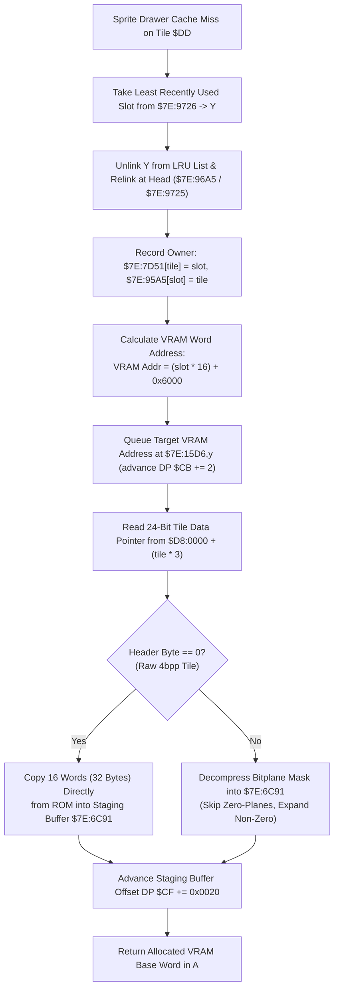

# Dynamic VRAM OBJ Tile Allocator & Bitplane Decompressor ($80:A4B5 – `$80:A590`)

- **ROM Locations**:
  - `obj_tile_allocate`: `$80:A4B5` – `$80:A517`
  - `obj_tile_copy_raw`: `$80:A518` – `$80:A55D`
  - `obj_tile_decompress_4bpp`: `$80:A55E` – `$80:A5AA`
- **CPU State**: Mixed 8-bit/16-bit A/X (`REP #$30` / `SEP #$20`), Data Bank `$7E` / `$D8`
- **WRAM Core Addresses**:
  - `$7E:96A5`: LRU linked list forward pointers (indexed by slot index `Y`).
  - `$7E:9725`: LRU linked list backward pointers / queue state.
  - `$7E:9726` / `$7E:9727`: LRU list head / tail pointers.
  - `$7E:7D51,x`: Forward tile slot owner table (indexed by tile ID).
  - `$7E:95A5,x`: Reverse tile slot owner table (indexed by slot * 2).
  - `$7E:15D6,y`: VRAM upload queue target address buffer (`slot * 16 + 0x6000`).
  - `$7E:6C91,x`: Staged VRAM tile DMA buffer (32 bytes per 4bpp tile).
  - DP `$CB`: VRAM upload queue write pointer.
  - DP `$CF`: DMA staging buffer write offset.
  - DP `$DD`: Tile ID being allocated.
- **ROM Data Tables**:
  - `$D8:0000,x`: 24-bit pointer table to compressed/raw sprite graphics tiles (3 bytes per entry).

---

## 1. Architectural Role & VRAM OBJ Cache Management

The SNES PPU OBJ pattern tables (stored at VRAM `$6000` in Evermore) have limited space for active entity sprites. To render diverse enemies, NPCs, and dynamic spell effects, Evermore uses a dynamic Least Recently Used (LRU) tile cache:

### VRAM Addressing Geometry
Each 4bpp tile on the SNES consists of 32 bytes (8×8 pixels, 4 bits per pixel). In 16-bit VRAM word addressing:
$$\text{VRAM Word Offset} = \text{Slot Index} \times 16 + 0x6000$$

When the frame finishes rendering, the engine triggers a DMA transfer from `$7E:6C91` into VRAM at the destination queued in `$7E:15D6`.

---

## 2. Disassembly & Annotations

### Slot Allocation & LRU Relinking (`$80:A4B5` – `$80:A4F4`)
> **Interactive 65816 Assembly**:
> Centralized comments infused at runtime.
> [View in VFS: soe://rom/code/80A4B5](soe://rom/code/80A4B5?asm=1&c=0)

### Tile Data Lookup & Raw/Compressed Branch (`$80:A4F5` – `$80:A55D`)
> **Interactive 65816 Assembly**:
> Centralized comments infused at runtime.
> [View in VFS: soe://rom/code/80A4B5](soe://rom/code/80A4B5?asm=1&c=0)

---

## 3. Clean C Decompilation

> **Reconstructed C Decompilation**:
> Source moved to [`reconstructed-c/80/80A4B5_obj_tile_allocator.c`](../../../reconstructed-c/80/80A4B5_obj_tile_allocator.c).
> [View in VFS: soe://rom/code/80A4B5](soe://rom/code/80A4B5?c=1&asm=0)

