# Cuttable Grass Map Cell Tile Swapping & Metatile Mutation Engine

- **ROM Locations**:
  - `cuttable_grass_drain_pending_swaps`: `$90:A6EF` – `$90:A738`
  - `cuttable_grass_slot_terminate`: `$90:A734` – `$90:A738`
  - `cuttable_grass_apply_metatile_mutation`: `$90:A739` – `$90:A7EA`
- **CPU State**: 16-bit A/X (`REP #$30`), Data Bank `$7E` / `$90`
- **WRAM Core Addresses**:
  - `$7E:0FD0`: Round-robin batch cursor index (0x0000..0x002E; wraps at 0x0030 = 48 bytes = 24 slots).
  - `$7E:0FD2,X`: Pending swap cursor (byte offset into room blob `[$8B]` pointing to current sequence word; `0x0000` = slot free).
  - `$7E:1002,X`: Destination byte offset in live WRAM metatile grid `$7F:0000` (`(Y * width + X) * 2`).
  - `$7E:1032,X`: Packed tile coordinate (low byte = tile X, high byte = tile Y).
  - `$7E:0F8C`: Layer 1 visible viewport top boundary ($Y_{\text{min}}$).
  - `$7E:0F8E`: Layer 1 visible viewport bottom boundary ($Y_{\text{max}}$).
  - `$7E:0F90`: Layer 1 visible viewport left boundary ($X_{\text{min}}$).
  - `$7E:0F92`: Layer 1 visible viewport right boundary ($X_{\text{max}}$).
  - `$7E:0F94`: Layer 2 visible viewport top boundary ($Y_{\text{min}}$).
  - `$7E:0F96`: Layer 2 visible viewport bottom boundary ($Y_{\text{max}}$).
  - `$7E:0F98`: Layer 2 visible viewport left boundary ($X_{\text{min}}$).
  - `$7E:0F9A`: Layer 2 visible viewport right boundary ($X_{\text{max}}$).
  - `$7E:1170`: VRAM DMA tile update staging buffer byte cursor (0x0000..0x007E; wraps at 0x0080 = 128 bytes = 64 entries).
  - `$7E:1174,Y`: Staged VRAM tile word buffer (written to VRAM during VBLANK).
  - `$7E:11F4,Y`: Staged VRAM destination tilemap address buffer (`((Y & 0x1F) << 5) | (X & 0x1F)` for L1; `| 0x0400` for L2).
  - `$7F:0000`: Field map metatile grid and definition arrays.
- **Direct Page Scratch Variables**:
  - `$02`: Replacement metatile ID word fetched from room sequence.
  - `$04`: Destination metatile grid byte offset.
  - `$12`: Layer 1 VRAM tile word (old / new).
  - `$14`: Layer 2 VRAM tile word (old / new).
  - `$42`: Loop counter for current batch (fixed at 4 slots per frame).
  - `$46`: Current tile coordinate X.
  - `$48`: Current tile coordinate Y.
  - `[$8B]`: Long pointer to current room blob payload base in ROM (e.g., `$9E:8000`).

---

## 1. Architectural Architecture & Mutation Pipeline

When a hero swings a weapon (such as the Laser Lance) across cuttable foliage, the weapon collision routine populates a 24-slot pending-swap FIFO queue located at `$7E:0FD2`–`$7E:1001`. Rather than mutating terrain synchronously, Secret of Evermore uses an asynchronous amortized queue processor that advances animations smoothly across frames.

```mermaid
flowchart TD
    subgraph Queue_Processor["Drain Pending Swaps ($90:A6EF)"]
        LoadCursor["Load Batch Cursor from $7E:0FD0"] --> InitBatch["Set Batch Counter $42 = 4"]
        InitBatch --> CheckSlot{"Slot $0FD2,X != 0?"}
        CheckSlot -->|"No (Empty)"| AdvanceSlot["X += 2, Dec $42"]
        CheckSlot -->|"Yes (Active)"| ReadSeq["Read Next Word: [$8B],Y"]
        ReadSeq --> EndSeq{"Word == 0x0000?"}
        EndSeq -->|"Yes (Terminator)"| FreeSlot["STZ $0FD2,X (Free Slot)"] --> AdvanceSlot
        EndSeq -->|"No (Valid Tile)"| SaveSeq["Store New Tile to DP $02<br/>Advance Cursor Y += 2 -> $0FD2,X"]
        SaveSeq --> UnpackCoords["Load Grid Offset -> DP $04<br/>Extract X -> DP $46, Y -> DP $48"]
        UnpackCoords --> CallMutation["JSR $A739 (Apply Mutation)"]
        CallMutation --> AdvanceSlot
        AdvanceSlot --> CheckBatch{"$42 == 0?"}
        CheckBatch -->|"No"| CheckSlot
        CheckBatch -->|"Yes"| WrapCursor["If X >= 0x30: X = 0<br/>Save X -> $7E:0FD0"]
    end

    subgraph Tile_Mutation["Apply Metatile Mutation ($90:A739)"]
        ReadOld["Read Old Metatile at $7F0000,X<br/>Extract Old L1 ($12) & Old L2 ($14)"] --> WriteNew["Write New Metatile ID to $7F0000,X"]
        WriteNew --> CheckL1{"New L1 != Old L1?"}
        CheckL1 -->|"No Change"| CheckL2
        CheckL1 -->|"Changed"| TestL1Bounds{"Inside L1 Viewport?<br/>$0F90 <= X < $0F92<br/>$0F8C <= Y < $0F8E"}
        TestL1Bounds -->|"Outside"| CheckL2
        TestL1Bounds -->|"Inside"| StageL1["Encode L1 VRAM Coord:<br/>((Y & 0x1F) << 5) | (X & 0x1F)<br/>Commit to $11F4,Y & $1174,Y"]
        StageL1 --> CheckL2{"New L2 != Old L2?"}
        CheckL2 -->|"No Change"| Done["RTS"]
        CheckL2 -->|"Changed"| TestL2Bounds{"Inside L2 Viewport?<br/>$0F98 <= X < $0F9A<br/>$0F94 <= Y < $0F96"}
        TestL2Bounds -->|"Outside"| Done
        TestL2Bounds -->|"Inside"| StageL2["Encode L2 VRAM Coord:<br/>((Y & 0x1F) << 5) | (X & 0x1F) | 0x0400<br/>Commit to $11F4,Y & $1174,Y"]
        StageL2 --> Done
    end
```

### 1.1 Slot Pacing & Amortization
- The queue has 24 entries (`24 * 2 = 48` bytes, indices `0x00` through `0x2E`).
- Each frame, exactly 4 slots are processed (`$42 = 4`).
- After completing a batch, the round-robin cursor `$7E:0FD0` is updated with `X`.
- When `X == 0x30`, the cursor wraps back to `0x0000`.
- Thus, every active slot is inspected once every 6 frames ($24 / 4 = 6$ frames $\approx 100$ ms at 60 fps), producing the cadence of foliage cutting animations observed in engine traces.

### 1.2 Invariant: Zero Collision Rewrites
Crucially, cutting grass **never modifies collision RAM**.
In Secret of Evermore:
- Every metatile ID is directly its byte offset in `$7F:0000`.
- `$7F:0000 + ID + 0`: Layer 1 tilemap word.
- `$7F:0000 + ID + 2`: Layer 2 tilemap word.
- `$7F:0000 + ID + 4`: Collision attributes word.
Because the engine only stamps the new metatile ID into the live grid cell `$7F:0000,X`, all subsequent collision checks automatically read the new collision definition without requiring any writes to collision tables.

---

## 2. Annotated 65816 Disassembly

> **Interactive 65816 Assembly**:
> Centralized comments infused at runtime.
> [View in VFS: soe://rom/code/90A6EF](soe://rom/code/90A6EF?asm=1&c=0)

---

## 3. Clean C Implementation

> **Reconstructed C Decompilation**:
> Source moved to [`reconstructed-c/90/90A6EF_cuttable_grass.c`](../../../reconstructed-c/90/90A6EF_cuttable_grass.c).
> [View in VFS: soe://rom/code/90A6EF](soe://rom/code/90A6EF?c=1&asm=0)

---

## 4. Verification & Behavioral Equivalence

| Test Condition | Observed Trace (`Mesen2`) | C Implementation Output | Status |
|---|---|---|---|
| **Round-Robin Batch Pacing** | Advances 4 slots per call; wraps at offset `0x30` (`cpx #$0030`). | Processes 4 slots, wraps at `CUTTABLE_GRASS_MAX_SLOTS` (24). | ✅ Verified |
| **Animation Step Timing** | 24 slots / 4 per frame = advances 1 step every 6 frames (~100 ms). | Identical mathematical frame distribution. | ✅ Verified |
| **Grid Byte Offset Mapping** | `metatile_id` written directly to `$7F:0000 + (y*width+x)*2`. | Stamped into `engine->metatile_wram_base[grid_idx]`. | ✅ Verified |
| **Collision Word Immutability** | No writes to collision RAM during any frame of the cut trace. | Zero writes to collision structures; uses metatile definition. | ✅ Verified |
| **L1/L2 Viewport Culling** | Window checks against `$0F90/$0F92` and `$0F8C/$0F8E`. | Direct `x_min <= X < x_max` and `y_min <= Y < y_max` gating. | ✅ Verified |
| **VRAM Ring Buffer Staging** | 128-byte buffer at `$7E:1174` and `$7E:11F4`; wraps at `0x0080`. | Ring buffer capacity 64 words (128 bytes); wraps cursor to 0. | ✅ Verified |
| **Layer 2 Base Offset** | Bit 10 (`0x0400`) OR'd into target address for Layer 2. | `vram_offset |= VRAM_LAYER_2_OFFSET_BIT` (0x0400). | ✅ Verified |
