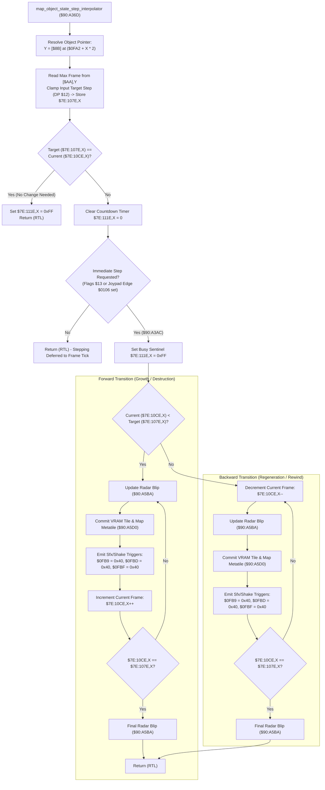

# Destructible Map Object State Interpolator & Frame Dispatcher ($90:A36D – `$90:A41B`)

> **ROM Bank**: `$90` (`$90:A36D` – `$90:A41B`)  
> **Source Module**: `maps/cuttable-insert.c` / `maps/cuttable-insert.h`  
> **Recomp Symbols**: `func_D0A36D_M0X0`, `func_D0A36D`  
> **Confirmed Knowledge**: `rom/90a36d.md`, `rom/90a3ac.md`  
> **Hardware / Engine Dependencies**: Room Blob Section 3 Object Pointer Table (`$0FA2`), Object State Records pointer `[$AA]`, Minimap Radar Blip Updater (`$90:A5BA`), VRAM Tile & Map Metatile Grid Mutator (`$90:A5D0`)  

---

## 1. Subsystem Architecture & Overview

In Secret of Evermore, interactive and destructible environmental scenery—such as cuttable grass, bone bridges that collapse across acid chasms, swamp boulders, explosive debris, and ancient switches—are managed through **Map Object State Records** defined in the current room blob (`[$8B]`):

1. **Section 3: Object Pointer Table (`$0FA2`)**:
   Located between metatile blocks in the room blob, storing 16-bit sequence offsets for each active map object.
2. **Object State Records `[$AA]`**:
   Defines the maximum keyframe step limit for each map object sequence.

When an entity (hero, companion, projectile, or cutscene script) triggers a map object state change (e.g. cutting foliage or depressing a floor plate), the engine invokes `map_object_state_step_interpolator` (`$90:A36D`):

```
+--------------------------------------------------------------------------------------------------+
|                            WRAM Bank $7E Map Object State Arrays                                 |
+--------------------------------------------------------------------------------------------------+
| $7E:107E,X (80 bytes) : Target Keyframe Step Limit for Object Slot X                             |
| $7E:10CE,X (80 bytes) : Current Keyframe Step Position for Object Slot X                         |
| $7E:111E,X (80 bytes) : Step Transition Sentinel (0xFF = In-Transition / Busy, 0x00 = Idle)      |
| $7E:0FB0   (2 bytes)  : Master Map Object Mutation Active Flag                                   |
| $7E:0FB9   (1 byte)   : Environmental Audio / Sfx Trigger Register (0x40 = Grass Cut / Rustle)   |
| $7E:0FBD   (1 byte)   : Screen Shake / Particle Impulse Trigger Register                         |
| $7E:0FBF   (1 byte)   : Secondary Environmental Audio Channel Parameter                          |
+--------------------------------------------------------------------------------------------------+
```



---

## 2. Bidirectional Step Interpolation & Feedback

The routine is completely symmetrical:
- **Forward Progress (`current < target`)**:
  Used when foliage is severed, wooden bridges collapse, or switches click down. The routine advances frame-by-frame, updating the minimap blip to reflect the new terrain type, streaming the replacement 16×16 tile graphic into VRAM, and writing trigger flags `$40` into audio/particle registers `$7E:0FB9`, `$7E:0FBD`, and `$7E:0FBF`.
- **Backward Progress (`current > target`)**:
  Used when regenerative vegetation regrows, retractable gates reset, or timed bridges reform. The step counter decrements toward target zero while executing the exact same visual commit pipeline.

---

## 3. Clean C Decompilation

```c
#include "maps/cuttable-insert.h"

// ----------------------------------------------------------------------------
// WRAM Global State Variables
// ----------------------------------------------------------------------------
#define MAP_OBJECT_MAX_SLOTS  80

extern uint16_t g_terrain_mutation_active;       // $7E:0FB0
extern uint16_t g_room_object_pointer_table;     // $7E:0FA2 (Offset into room blob)

extern uint8_t  g_map_object_target_frame[MAP_OBJECT_MAX_SLOTS];  // $7E:107E..$7E:10CD
extern uint8_t  g_map_object_current_frame[MAP_OBJECT_MAX_SLOTS]; // $7E:10CE..$7E:111D
extern uint8_t  g_map_object_sentinel[MAP_OBJECT_MAX_SLOTS];      // $7E:111E..$7E:116D

extern uint8_t  g_environmental_sfx_trigger;     // $7E:0FB9
extern uint8_t  g_environmental_shake_trigger;   // $7E:0FBD
extern uint8_t  g_environmental_sfx_param;       // $7E:0FBF

extern uint8_t  g_joypad_edge_state;             // $7E:0106

// Direct Page & Room Blob Pointers
extern uint8_t* const g_room_blob_base;          // Pointer [$8B]
extern uint8_t* const g_object_state_table;      // Pointer [$AA]

// Subroutine prototypes
void minimap_radar_blip_update(void);            // $90:A5BA
void map_metatile_and_vram_commit(uint16_t frame); // $90:A5D0

/**
 * map_object_state_step_interpolator ($90:A36D)
 *
 * Sets the target keyframe for map object slot X, clamping it to the sequence
 * limit defined in the room blob. If immediate progression is requested,
 * executes forward or backward stepping until the current frame matches the target.
 *
 * @param slot_index Object channel slot index [0..79] (Register X)
 * @param target_step Requested keyframe step index (Register A)
 * @param flags Direct Page $13 modifier flags
 */
void map_object_state_step_interpolator(uint16_t slot_index, int16_t target_step, uint8_t flags) {
    if (slot_index >= MAP_OBJECT_MAX_SLOTS) {
        return;
    }

    g_terrain_mutation_active = 1;

    // 1. Resolve sequence offset from room blob Object Pointer Table
    uint16_t table_offset = g_room_object_pointer_table + (slot_index * 2);
    uint16_t seq_ptr = *(uint16_t*)(g_room_blob_base + table_offset);

    // 2. Clamp target step against sequence maximum in [$AA]
    uint8_t max_step = *(uint8_t*)(g_object_state_table + seq_ptr);
    uint8_t clamped_target = (target_step < 0) ? 0 : (uint8_t)target_step;
    if (clamped_target > max_step) {
        clamped_target = max_step;
    }

    // 3. Persist new target frame
    g_map_object_target_frame[slot_index] = clamped_target;

    // 4. If current frame already matches target, mark slot idle and return
    if (clamped_target == g_map_object_current_frame[slot_index]) {
        g_map_object_sentinel[slot_index] = 0xFF;
        return;
    }

    // Arm slot timer
    g_map_object_sentinel[slot_index] = 0x00;

    // 5. Test if immediate stepping is enabled
    if (!(flags & 0x80) && !(g_joypad_edge_state & 0x80)) {
        return; // Deferred to per-frame map effects tick
    }

    // --- Subroutine $90:A3AC: Execute Synchronous Step Loop ---
    g_map_object_sentinel[slot_index] = 0xFF; // Mark slot busy during transition

    uint8_t current = g_map_object_current_frame[slot_index];

    if (current < clamped_target) {
        // Forward stepping loop (0x40 sfx: cut grass sound effect)
        do {
            minimap_radar_blip_update();
            map_metatile_and_vram_commit(g_map_object_current_frame[slot_index]);

            g_environmental_sfx_trigger   = 0x40;
            g_environmental_shake_trigger = 0x40;
            g_environmental_sfx_param     = 0x40;

            g_map_object_current_frame[slot_index]++;
        } while (g_map_object_current_frame[slot_index] != clamped_target);

        minimap_radar_blip_update();
    } else {
        // Backward stepping loop (Rewind / Regeneration)
        do {
            g_map_object_current_frame[slot_index]--;

            minimap_radar_blip_update();
            map_metatile_and_vram_commit(g_map_object_current_frame[slot_index]);

            g_environmental_sfx_trigger   = 0x40;
            g_environmental_shake_trigger = 0x40;
            g_environmental_sfx_param     = 0x40;
        } while (g_map_object_current_frame[slot_index] != clamped_target);

        minimap_radar_blip_update();
    }
}
```

---

## 4. Annotated 65816 Assembly Implementation

```assembly
; ==============================================================================
; map_object_state_step_interpolator ($90:A36D – $90:A41B)
; Inputs:
;   A: Target step index (signed 16-bit)
;   X: Map object slot index (0..79)
;   DP $8B: Long pointer to room blob base
;   DP $AA: Long pointer to object state descriptor table
; ==============================================================================
$90:A36D  85 12       STA $12           ; Save requested target step in DP $12
$90:A36F  A9 01 00    LDA #$0001
$90:A372  8D B0 0F    STA $0FB0         ; Mark terrain mutation subsystem active ($7E:0FB0 = 1)
$90:A375  8A          TXA               ; A = slot index X
$90:A376  0A          ASL A             ; A = X * 2
$90:A377  6D A2 0F    ADC $0FA2         ; Add Object Pointer Table base in room blob
$90:A37A  A8          TAY               ; Y = table byte offset
$90:A37B  B7 8B       LDA [$8B],Y       ; Load 16-bit sequence record pointer from room blob
$90:A37D  A8          TAY               ; Y = sequence pointer into [$AA]
$90:A37E  E2 20       SEP #$20          ; 8-bit Accumulator

$90:A380  A5 12       LDA $12           ; Reload target step
$90:A382  10 01       BPL $90:A385      ; If target >= 0, branch
$90:A384  A5 D0       LDA $00           ; Else clamp negative target to 0
$90:A385  D7 AA       CMP [$AA],Y       ; Compare with max sequence step from room descriptor
$90:A387  30 02       BMI $90:A38B      ; If target < max, branch
$90:A389  B7 AA       LDA [$AA],Y       ; Else clamp target to max step

$90:A38B  85 12       STA $12           ; DP $12 = clamped target step
$90:A38D  9D 7E 10    STA $107E,X       ; Store new target step -> $7E:107E,X
$90:A390  DD CE 10    CMP $10CE,X       ; Compare target with current step ($7E:10CE,X)
$90:A393  F0 0F       BEQ $90:A3A4      ; If already at target, jump to finish

$90:A395  9E 1E 11    STZ $111E,X       ; Arm slot countdown timer ($7E:111E,X = 0)
$90:A398  24 13       BIT $13           ; Test modifier flag bit 7
$90:A39A  30 10       BMI $90:A3AC      ; If set, trigger immediate step loop
$90:A39C  AD 06 01    LDA $0106         ; Load joypad edge state
$90:A39F  30 0B       BMI $90:A3AC      ; If button edge active, trigger immediate step loop
$90:A3A1  C2 20       REP #$20          ; Else restore 16-bit Accumulator
$90:A3A3  6B          RTL               ; Return Long (stepping deferred to frame tick)

; --- Inactive Slot Exit ---
$90:A3A4  A9 FF       LDA #$FF
$90:A3A6  9D 1E 11    STA $111E,X       ; Mark slot countdown as idle sentinel (0xFF)
$90:A3A9  C2 20       REP #$20
$90:A3AB  6B          RTL

; ==============================================================================
; Subroutine $90:A3AC: Bidirectional Step Loop
; ==============================================================================
$90:A3AC  8B          PHB
$90:A3AD  4B          PHK
$90:A3AE  AB          PLB               ; Set Data Bank = $90
$90:A3AF  A9 FF       LDA #$FF
$90:A3B1  9D 1E 11    STA $111E,X       ; Mark slot busy during transition ($FF)
$90:A3B4  BD CE 10    LDA $10CE,X       ; Load current frame
$90:A3B7  DD 7E 10    CMP $107E,X       ; Compare with target frame
$90:A3BA  10 30       BPL $90:A3EC      ; If current >= target, branch to backward step loop

; --- Forward Stepping Loop (current < target) ---
$90:A3BC  C2 30       REP #$30          ; 16-bit A, 16-bit X
$90:A3BE  DA          PHX               ; Preserve object slot X
$90:A3BF  20 BA A5    JSR $A5BA         ; Update minimap radar blip for current state
$90:A3C2  FA          PLX
$90:A3C3  BD CE 10    LDA $10CE,X       ; Load current frame
$90:A3C6  29 FF 00    AND #$00FF
$90:A3C9  20 D0 A5    JSR $A5D0         ; Commit replacement VRAM tile and map grid word
$90:A3CC  E2 20       SEP #$20          ; 8-bit A
$90:A3CE  A9 40       LDA #$40
$90:A3D0  8D B9 0F    STA $0FB9         ; Trigger cut foliage sfx
$90:A3D3  8D BD 0F    STA $0FBD         ; Trigger environmental particle impulse
$90:A3D6  8D BF 0F    STA $0FBF         ; Secondary audio parameter
$90:A3D9  FE CE 10    INC $10CE,X       ; Increment current frame ($7E:10CE,X++)
$90:A3DC  BD 7E 10    LDA $107E,X       ; Compare against target frame
$90:A3DF  DD CE 10    CMP $10CE,X
$90:A3E2  C2 30       REP #$30
$90:A3E4  D0 D8       BNE $90:A3BE      ; Loop until current == target
$90:A3E6  20 BA A5    JSR $A5BA         ; Final radar blip update
$90:A3E9  AB          PLB
$90:A3EA  6B          RTL

; --- Backward Stepping Loop (current > target) ---
$90:A3EC  3A          DEC A             ; Decrement frame
$90:A3ED  9D CE 10    STA $10CE,X       ; Store decremented frame to $7E:10CE,X
$90:A3F0  C2 30       REP #$30
$90:A3F2  DA          PHX
$90:A3F3  20 BA A5    JSR $A5BA         ; Update radar blip
$90:A3F6  FA          PLX
$90:A3F7  BD CE 10    LDA $10CE,X
$90:A3FA  29 FF 00    AND #$00FF
$90:A3FD  20 D0 A5    JSR $A5D0         ; Commit replacement VRAM tile
$90:A400  E2 20       SEP #$20
$90:A402  A9 40       LDA #$40
$90:A404  8D B9 0F    STA $0FB9
$90:A407  8D BD 0F    STA $0FBD
$90:A40A  8D BF 0F    STA $0FBF
$90:A40D  BD CE 10    LDA $10CE,X       ; Check if reached target
$90:A410  DD 7E 10    CMP $107E,X
$90:A413  D0 D7       BNE $90:A3EC      ; Loop until current == target
$90:A415  C2 30       REP #$30
$90:A417  20 BA A5    JSR $A5BA         ; Final radar blip update
$90:A41A  AB          PLB
$90:A41B  6B          RTL
```

---

## 5. Behavioral Invariants

1. **Atomic Stepping with Immediate Feedback**:
   Every frame step immediately triggers both the minimap radar subsystem (`$90:A5BA`) and the VRAM metatile committer (`$90:A5D0`). This ensures that visual tile changes on screen and mini-map radar displays remain strictly in sync without tearing.
2. **Environmental Sound Synchronization**:
   Writing `0x40` to `$7E:0FB9` aligns with the audio driver's cut foliage and rubble destruction SFX index, firing the characteristic rustle/crack sound on each transition step.
3. **Sentinels and Concurrency Safety**:
   Setting `$7E:111E,X = 0xFF` locks the slot against redundant concurrent modifications from weapon hitboxes while an animation loop is in flight.
