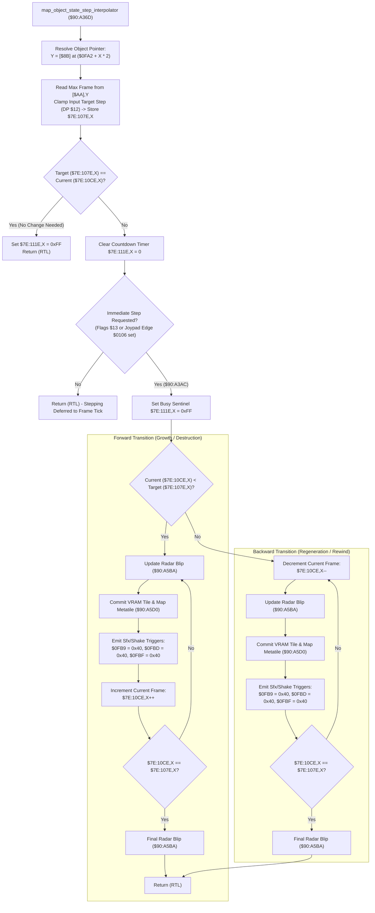

# Destructible Map Object State Interpolator & Frame Dispatcher ($90:A36D – `$90:A41B`)

> **ROM Bank**: `$90` (`$90:A36D` – `$90:A41B`)  
> **Source Module**: `maps/cuttable-insert.c` / `maps/cuttable-insert.h`  
> **Recomp Symbols**: `func_D0A36D_M0X0`, `func_D0A36D`  
> **Confirmed Knowledge**: `rom/90a36d.md`, `rom/90a3ac.md`  
> **Hardware / Engine Dependencies**: Room Blob Section 3 Object Pointer Table (`$0FA2`), Object State Records pointer `[$AA]`, Minimap Radar Blip Updater (`$90:A5BA`), VRAM Tile & Map Metatile Grid Mutator (`$90:A5D0`)  

---

## 1. Subsystem Architecture & Overview

In Secret of Evermore, interactive and destructible environmental scenery—such as cuttable grass, bone bridges that collapse across acid chasms, swamp boulders, explosive debris, and ancient switches—are managed through **Map Object State Records** defined in the current room blob (`[$8B]`):

1. **Section 3: Object Pointer Table (`$0FA2`)**:
   Located between metatile blocks in the room blob, storing 16-bit sequence offsets for each active map object.
2. **Object State Records `[$AA]`**:
   Defines the maximum keyframe step limit for each map object sequence.

When an entity (hero, companion, projectile, or cutscene script) triggers a map object state change (e.g. cutting foliage or depressing a floor plate), the engine invokes `map_object_state_step_interpolator` (`$90:A36D`):

```
+--------------------------------------------------------------------------------------------------+
|                            WRAM Bank $7E Map Object State Arrays                                 |
+--------------------------------------------------------------------------------------------------+
| $7E:107E,X (80 bytes) : Target Keyframe Step Limit for Object Slot X                             |
| $7E:10CE,X (80 bytes) : Current Keyframe Step Position for Object Slot X                         |
| $7E:111E,X (80 bytes) : Step Transition Sentinel (0xFF = In-Transition / Busy, 0x00 = Idle)      |
| $7E:0FB0   (2 bytes)  : Master Map Object Mutation Active Flag                                   |
| $7E:0FB9   (1 byte)   : Environmental Audio / Sfx Trigger Register (0x40 = Grass Cut / Rustle)   |
| $7E:0FBD   (1 byte)   : Screen Shake / Particle Impulse Trigger Register                         |
| $7E:0FBF   (1 byte)   : Secondary Environmental Audio Channel Parameter                          |
+--------------------------------------------------------------------------------------------------+
```



---

## 2. Bidirectional Step Interpolation & Feedback

The routine is completely symmetrical:
- **Forward Progress (`current < target`)**:
  Used when foliage is severed, wooden bridges collapse, or switches click down. The routine advances frame-by-frame, updating the minimap blip to reflect the new terrain type, streaming the replacement 16×16 tile graphic into VRAM, and writing trigger flags `$40` into audio/particle registers `$7E:0FB9`, `$7E:0FBD`, and `$7E:0FBF`.
- **Backward Progress (`current > target`)**:
  Used when regenerative vegetation regrows, retractable gates reset, or timed bridges reform. The step counter decrements toward target zero while executing the exact same visual commit pipeline.

---

## 3. Clean C Decompilation

> **Reconstructed C Decompilation**:
> Source moved to [`reconstructed-c/90/90A36D_cuttable_insert.c`](../../../reconstructed-c/90/90A36D_cuttable_insert.c).
> [View in VFS: soe://rom/code/90A36D](soe://rom/code/90A36D?c=1&asm=0)


---

## 4. Annotated 65816 Assembly Implementation

> **Interactive 65816 Assembly**:
> Centralized comments infused at runtime.
> [View in VFS: soe://rom/code/90A36D](soe://rom/code/90A36D?asm=1&c=0)


---

## 5. Behavioral Invariants

1. **Atomic Stepping with Immediate Feedback**:
   Every frame step immediately triggers both the minimap radar subsystem (`$90:A5BA`) and the VRAM metatile committer (`$90:A5D0`). This ensures that visual tile changes on screen and mini-map radar displays remain strictly in sync without tearing.
2. **Environmental Sound Synchronization**:
   Writing `0x40` to `$7E:0FB9` aligns with the audio driver's cut foliage and rubble destruction SFX index, firing the characteristic rustle/crack sound on each transition step.
3. **Sentinels and Concurrency Safety**:
   Setting `$7E:111E,X = 0xFF` locks the slot against redundant concurrent modifications from weapon hitboxes while an animation loop is in flight.
