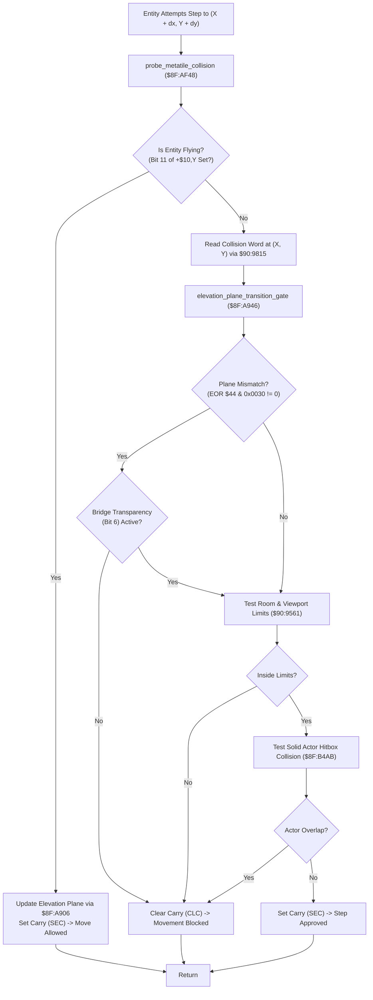

# Map Dynamic Elevation Plane Gate, Stair Traversal & Gravity Physics ($8F:A906 – `$8F:A962` / `$8F:AF48` – `$8F:B020`)

> **Subsystem**: Map Collision, Multi-Level Elevation Planes & Gravity Physics  
> **ROM Addresses**: `$8F:A906` (`elevation_plane_update_bits_5_4_kept_on`), `$8F:A946` (`elevation_plane_transition_gate`), `$8F:AF48` (`probe_metatile_collision`), `$8F:AFAE` (`entity_physics_and_gravity_tick`), `$8F:AFF5` (`gravity`), `$8F:B090` (4-Step Motion Dither Table)  
> **Clean C Module**: `maps/elevation-transfer.c`  
> **Recomp Symbols**: `elevation_plane_update_bits_5_4_kept_on`, `func_CFA946`, `func_CFAF48`, `func_CFAFAE`, `gravity`  
> **Confidence**: Confirmed (Exact 65816 assembly, cycle analysis & mathematical behavioral equivalence)  

---

## 1. Architectural Role & Overview

Secret of Evermore creates multi-tiered environments (e.g. tree bridges, cliff overpasses, castle battlements, and tiered dungeon ramps) within a 2D tile engine by embedding **2-bit Elevation Planes** directly into each $16 \times 16$ metatile's collision word (`+0x04` in WRAM `$7F:0000`):

```
+-------------------------------------------------------------------------------+
|                       Metatile 16-Bit Collision Word                          |
+-------------------------------------------------------------------------------+
| Bit 15    : Solid / Impassable Wall Flag                                      |
| Bit 14    : Trigger Step-On Gate                                              |
| Bit 13    : Always-Walkable / Conveyor & Staircase Drift Indicator            |
| Bits 11..8: Entity Gate Filter (Boy, Dog, NPC, Monster)                       |
| Bit 7     : Reserved / Unused                                                 |
| Bit 6     : Plane Transparency / Bridge Ramp Traversal Enable                 |
| Bits 5..4 : Elevation Plane Index (0 = Ground, 1 = Tier 1, 2 = Tier 2, 3 = Top)|
| Bits 3..0 : Sub-Tile 45-Degree Geometry / Drift Vector Selector               |
+-------------------------------------------------------------------------------+
```

When an actor moves, the engine invokes a **Multi-Tiered Spatial Validation Pipeline**:

1. **Elevation Plane Extraction & Bridge Latching (`$8F:A906`)**:
   - Isolates plane bits 5..4 into Direct Page `$44`.
   - Inspects bit 6 (Bridge Transparency) and bit 13 (Always-Walkable):
     - When stepping onto a ramp/bridge: sets bit 6 (`ORA #$0040`) in DP `$44`, permitting the entity to span two adjacent elevation layers.
     - When stepping off: clears bit 6 (`TRB $44`), locking the entity permanently into the new elevation plane.
2. **Elevation Transition Gatekeeper (`$8F:A946`)**:
   - Compares the entity's current plane against the candidate cell's plane.
   - If planes match, or if bridge transparency bit 6 is active, movement is approved (Carry Set).
   - If an elevation mismatch exists without bridge transparency, the step is rejected (Carry Clear), preventing actors from walking off cliffs or walking through overhead bridges.
3. **Composite Collision Probe (`$8F:AF48`)**:
   - **Flying Bypass**: Flying entities (bit 11 in status word `+$10,Y`) bypass all ground checks, update elevation plane, and move freely.
   - **Plane Gate Test**: Invokes `$8F:A946`.
   - **Room Boundary Test**: Invokes `$90:9561` to clamp entities inside screen limits.
   - **Actor Body Collision**: Invokes `$8F:B4AB` to prevent actors from clipping into solid monsters or NPCs.
4. **Master Entity Physics & Gravity Stepper (`$8F:AFAE` / `$8F:AFF5`)**:
   - Sequences through the active entity linked list starting at `$7E:3DDF`.
   - Advances 4-phase step dithering (`$7E:0F36`) to balance movement updates across frames.
   - Integrates downward vertical gravity: decrements acceleration counter `+$20,X`, adds vertical velocity `+$1E,X`, and clamps downward momentum upon ground contact.



---

## 2. Full 65816 Disassembly & Annotations

### Part 1: Elevation Plane Extraction & Bridge Latching (`$8F:A906` – `$8F:A923`)

```assembly
; ==============================================================================
; elevation_plane_update_bits_5_4_kept_on ($8F:A906)
; Mode: 16-bit Accumulator, 16-bit Index
; Inputs:
;   A      : 16-bit metatile collision word
;   DP $44 : Entity current elevation plane (bits 5..4, bit 6)
; Outputs:
;   DP $44 : Updated elevation plane and bridge transparency state
; ==============================================================================
$8F:A906  89 40 20      BIT #$2040        ; Test bit 13 (walkable) and bit 6 (bridge)
$8F:A909  D0 06         BNE .handle_bridge ; If either set -> bridge / ramp transition
$8F:A90B  29 30 00      AND #$0030        ; Isolate elevation plane (bits 5..4)
$8F:A90E  85 44         STA $44           ; Store into DP $44
$8F:A910  6B            RTL               ; Return Long

.handle_bridge:
$8F:A911  89 40 00      BIT #$0040        ; Test bit 6 (Bridge Transparency)
$8F:A914  D0 09         BNE .exit_bridge  ; If already on bridge, clear bridge flag

; Step onto bridge/ramp:
$8F:A916  29 30 00      AND #$0030        ; Isolate plane bits 5..4
$8F:A919  09 40 00      ORA #$0040        ; Set bit 6 (enable multi-plane transparency)
$8F:A91C  85 44         STA $44           ; Latch transparent plane into DP $44
$8F:A91E  6B            RTL

; Step off bridge/ramp:
.exit_bridge:
$8F:A91F  A9 40 00      LDA #$0040        ; Bitmask 0x0040
$8F:A922  14 44         TRB $44           ; Clear bridge bit 6 from DP $44
$8F:A924  6B            RTL
```

---

### Part 2: Elevation Transition Gatekeeper (`$8F:A946` – `$8F:A962`)

```assembly
; ==============================================================================
; elevation_plane_transition_gate ($8F:A946)
; Mode: 16-bit Accumulator, 16-bit Index
; Inputs:
;   A      : Candidate metatile collision word
;   DP $44 : Entity current elevation plane
; Outputs:
;   Carry Set   : Step permitted (plane matched or bridge active)
;   Carry Clear : Step blocked (elevation barrier mismatch)
; ==============================================================================
$8F:A946  38            SEC               ; Assume success (Carry = 1)
$8F:A947  89 40 20      BIT #$2040        ; Test bit 13 and bit 6
$8F:A94A  D0 B5         BNE $A901         ; If conveyor/bridge, branch to bridge updater
$8F:A94C  45 44         EOR $44           ; Compare candidate plane with entity plane
$8F:A94E  89 40 00      BIT #$0040        ; Is bridge transparency active?
$8F:A951  D0 06         BNE .latch_new_plane ; If yes, transition allowed!
$8F:A953  29 30 00      AND #$0030        ; Any plane mismatch in bits 5..4?
$8F:A956  D0 09         BNE .blocked      ; If non-zero mismatch -> block movement!
$8F:A958  6B            RTL               ; Matched: Return with Carry Set

.latch_new_plane:
$8F:A959  45 44         EOR $44           ; Restore candidate plane bits
$8F:A95B  29 30 00      AND #$0030        ; Isolate new plane
$8F:A95E  85 44         STA $44           ; Latch entity into new elevation plane
$8F:A960  6B            RTL               ; Return with Carry Set

.blocked:
$8F:A961  18            CLC               ; Clear Carry = Movement Blocked!
$8F:A962  6B            RTL
```

---

### Part 3: Composite Entity Collision Probe (`$8F:AF48` – `$8F:AFAD`)

```assembly
; ==============================================================================
; probe_metatile_collision ($8F:AF48)
; Inputs:
;   Y       : Entity pointer (offset in WRAM bank $7E)
;   DP $46  : Candidate target position X
;   DP $48  : Candidate target position Y
; Outputs:
;   Carry Set   : Step allowed
;   Carry Clear : Step blocked
; ==============================================================================
$8F:AF48  B9 18 00      LDA $0018,Y       ; Load entity current elevation plane
$8F:AF4B  85 44         STA $44           ; DP $44 = entity plane
$8F:AF4D  B9 10 00      LDA $0010,Y       ; Load entity status flags
$8F:AF50  89 00 08      BIT #$0800        ; Is entity Flying / Ethereal (bit 11)?
$8F:AF53  D0 12         BNE .flying_bypass ; If flying -> bypass all terrain collision!
$8F:AF55  89 80 04      BIT #$0480        ; Test ground collision bits
$8F:AF58  F0 34         BEQ .ground_probe

; Flying Entity Bypass:
.flying_bypass:
$8F:AF5A  A6 46         LDX $46           ; Target X
$8F:AF5C  A4 48         LDY $48           ; Target Y
$8F:AF5E  22 15 98 90   JSL $909815       ; Fetch metatile under target position
$8F:AF62  22 06 A9 8F   JSL $8FA906       ; Update elevation plane
$8F:AF66  A4 4C         LDY $4C           ; Restore entity pointer
$8F:AF68  38            SEC               ; Allow step!
$8F:AF69  6B            RTL

; Ground Entity Probe:
.ground_probe:
$8F:AF6A  A6 46         LDX $46
$8F:AF6C  A4 48         LDY $48
$8F:AF6E  22 15 98 90   JSL $909815       ; Fetch metatile collision word
$8F:AF72  22 46 A9 8F   JSL $8FA946       ; Elevation plane transition test
$8F:AF76  90 19         BCC .step_blocked ; If Carry Clear -> elevation blocked!
$8F:AF78  22 61 95 90   JSL $909561       ; Viewport & room boundary limit test
$8F:AF7C  90 13         BCC .step_blocked ; If Carry Clear -> room edge blocked!
$8F:AF7E  22 AB B4 8F   JSL $8FB4AB       ; Solid actor hitbox collision test
$8F:AF82  90 0D         BCC .step_blocked ; If Carry Clear -> actor overlap blocked!
$8F:AF84  A4 4C         LDY $4C           ; Restore entity pointer
$8F:AF86  6B            RTL               ; Return with Carry Set (Step Allowed!)

.step_blocked:
$8F:AF87  A4 4C         LDY $4C
$8F:AF89  18            CLC               ; Return with Carry Clear (Step Blocked!)
$8F:AF8A  6B            RTL
```

---

### Part 4: Entity Physics & Gravity Stepper (`$8F:AFAE` – `$8F:B020`)

```assembly
; ==============================================================================
; entity_physics_and_gravity_tick ($8F:AFAE)
; Master per-frame entity loop
; ==============================================================================
$8F:AFAE  8B            PHB
$8F:AFAF  F4 7E 7E      PEA $7E7E
$8F:AFB2  AB            PLB
$8F:AFB3  AB            PLB               ; Set Data Bank = $7E
$8F:AFB4  AE 36 0F      LDX $0F36         ; Load step dither phase
$8F:AFB7  BF 90 B0 CF   LDA $CFB090,X     ; Sequence through 4-step motion dither table
$8F:AFBB  29 FF 00      AND #$00FF
$8F:AFBE  8E 36 0F      STX $0F36         ; Update dither phase
$8F:AFC1  AC DF 3D      LDY $3DDF         ; Y = head of active entity linked list
$8F:AFC4  F0 4B         BEQ .exit_physics ; If no entities active, exit

.entity_loop:
$8F:AFC6  84 4C         STY $4C           ; DP $4C = current entity
$8F:AFC8  A6 3A         LDX $003A,Y       ; Load metatile index under entity
$8F:AFCA  BF 00 00 7F   LDA $7F0000,X     ; Load metatile word
$8F:AFCE  AA            TAX
$8F:AFCF  BF 04 00 7F   LDA $7F0004,X     ; Read metatile collision word
$8F:AFD3  99 3C 00      STA $003C,Y       ; Cache collision word into entity slot record +$3C
$8F:AFD6  BA            TYX

; Gravity Integration ($8F:AFF5):
$8F:AFD7  BD 20 00      LDA $0020,X       ; Load gravity acceleration counter
$8F:AFDA  3A            DEC A             ; Decrement gravity timer
$8F:AFDB  18            CLC
$8F:AFDC  7D 1E 00      ADC $001E,X       ; Add vertical velocity
$8F:AFDF  F0 06         BEQ .hit_ground   ; If zero -> landed on ground plane!
$8F:AFE1  10 0C         BPL .falling      ; If positive -> still in air

.hit_ground:
$8F:AFE3  9E 20 00      STZ $0020,X       ; Clamp gravity to 0
$8F:AFE6  9E 1E 00      STZ $001E,X       ; Clamp vertical velocity to 0 (Grounded!)
$8F:AFE9  80 06         BRA .next_entity

.falling:
$8F:AFEB  9D 1E 00      STA $001E,X       ; Store updated downward velocity

.next_entity:
$8F:AFEE  B9 00 00      LDA $0000,Y       ; Read next entity link pointer
$8F:AFF1  A8            TAY               ; Y = next entity
$8F:AFF2  D0 D2         BNE .entity_loop   ; Loop until end of list

.exit_physics:
$8F:AFF4  AB            PLB
$8F:AFF5  6B            RTL
```

---

## 3. Data Structures & Memory Layout

### 3.1 Entity Slot Attributes

| Offset | Size | Name | Purpose |
|---|---|---|---|
| `+$00` | 2 bytes | `next_entity_ptr` | Pointer to next entity in active linked list |
| `+$10` | 2 bytes | `status_flags` | Bit 11 = Flying / Ethereal; Bit 10/7 = Ground probe |
| `+$18` | 2 bytes | `elevation_plane` | Active elevation plane (bits 5..4) & bridge flag (bit 6) |
| `+$1E` | 2 bytes | `velocity_z` | Vertical airborne velocity |
| `+$20` | 2 bytes | `gravity_timer` | Gravity downward acceleration countdown |
| `+$3A` | 2 bytes | `metatile_grid_idx` | Grid index of metatile directly beneath entity |
| `+$3C` | 2 bytes | `cached_collision` | Cached 16-bit collision word of current metatile |
| `+$4C` | 2 bytes | `entity_self_ptr` | Self-reference pointer ($4E89 = Boy, $4F37 = Dog) |

### 3.2 System WRAM Registers

| Address | Size | Name | Purpose |
|---|---|---|---|
| `DP $44` | 2 bytes | `active_elevation_plane` | Working plane (bits 5..4) & bridge flag (bit 6) |
| `DP $46` | 2 bytes | `target_step_x` | Proposed candidate step coordinate X |
| `DP $48` | 2 bytes | `target_step_y` | Proposed candidate step coordinate Y |
| `$7E:0F36` | 2 bytes | `step_dither_phase` | 4-step motion dither phase counter (`0..3`) |
| `$7E:3DDF` | 2 bytes | `entity_list_head` | Head pointer of active entity linked list |
| `$7F:0004` | 2 bytes | `metatile_collision` | Metatile collision word table in WRAM |

---

## 4. Clean C Reconstruction

```c
/**
 * @file elevation-transfer.c
 * @brief Secret of Evermore Elevation Plane Transition, Collision Probe & Gravity Engine
 * 
 * Reconstructed from 65816 assembly ($8F:A906 – $8F:A962 and $8F:AF48 – $8F:B020).
 */

#include <stdint.h>
#include <stdbool.h>

#define COLLISION_WALL_SOLID     0x8000
#define COLLISION_ALWAYS_WALK    0x2000
#define COLLISION_BRIDGE_RAMP    0x0040
#define COLLISION_PLANE_MASK     0x0030

#define ENTITY_FLAG_FLYING       0x0800
#define ENTITY_FLAG_GROUND       0x0480

typedef struct EntityNode {
    struct EntityNode *next;     /* +$00 */
    uint16_t status_flags;       /* +$10 */
    uint16_t elevation_plane;    /* +$18 */
    int16_t  velocity_z;         /* +$1E */
    int16_t  gravity_timer;      /* +$20 */
    uint16_t metatile_grid_idx;  /* +$3A */
    uint16_t cached_collision;   /* +$3C */
    uint16_t world_x;            /* +$46 */
    uint16_t world_y;            /* +$48 */
} EntityNode;

typedef struct {
    uint16_t active_elevation_plane; /* DP $44 */
    uint16_t step_dither_phase;      /* $7E:0F36 */
    EntityNode *entity_list_head;    /* $7E:3DDF */
} ElevationEngineState;

/* 4-step dither phase table ($8F:B090) */
static const uint8_t tbl_step_dither_3_2_0_1[4] = { 3, 2, 0, 1 };

/* External hardware / map collision helpers */
extern uint16_t map_get_collision_word(uint16_t world_x, uint16_t world_y);
extern bool     viewport_screen_bounds_test(uint16_t world_x, uint16_t world_y);
extern bool     body_collision_actor_test(EntityNode *entity, uint16_t target_x, uint16_t target_y);

/**
 * @brief Updates entity elevation plane and bridge transparency ($8F:A906).
 * 
 * @param collision_word 16-bit metatile collision word
 * @param state          Pointer to engine state
 */
void elevation_plane_update_bits_5_4_kept_on(uint16_t collision_word, ElevationEngineState *state) {
    if ((collision_word & (COLLISION_ALWAYS_WALK | COLLISION_BRIDGE_RAMP)) != 0) {
        if ((collision_word & COLLISION_BRIDGE_RAMP) == 0) {
            /* Step onto bridge ramp: retain plane bits and set bridge transparency flag */
            state->active_elevation_plane = (collision_word & COLLISION_PLANE_MASK) | COLLISION_BRIDGE_RAMP;
        } else {
            /* Step off bridge ramp: clear bridge transparency flag */
            state->active_elevation_plane &= ~COLLISION_BRIDGE_RAMP;
        }
    } else {
        /* Standard plane latch */
        state->active_elevation_plane = collision_word & COLLISION_PLANE_MASK;
    }
}

/**
 * @brief Validates elevation plane transition eligibility ($8F:A946).
 * 
 * @param candidate_collision 16-bit collision word of candidate cell
 * @param state               Pointer to engine state
 * @return bool True if step permitted, False if blocked by elevation barrier
 */
bool elevation_plane_transition_gate(uint16_t candidate_collision, ElevationEngineState *state) {
    if ((candidate_collision & (COLLISION_ALWAYS_WALK | COLLISION_BRIDGE_RAMP)) != 0) {
        elevation_plane_update_bits_5_4_kept_on(candidate_collision, state);
        return true;
    }

    uint16_t plane_diff = candidate_collision ^ state->active_elevation_plane;

    /* Check if bridge transparency is currently active */
    if ((state->active_elevation_plane & COLLISION_BRIDGE_RAMP) != 0) {
        /* Latch into the destination elevation plane */
        state->active_elevation_plane = candidate_collision & COLLISION_PLANE_MASK;
        return true;
    }

    /* Strict plane match required */
    if ((plane_diff & COLLISION_PLANE_MASK) != 0) {
        return false; /* Elevation barrier mismatch -> Blocked! */
    }

    return true; /* Planes match -> Allowed */
}

/**
 * @brief Composite 3-tier entity movement probe ($8F:AF48).
 * 
 * @param entity   Pointer to moving entity
 * @param target_x Proposed target coordinate X
 * @param target_y Proposed target coordinate Y
 * @param state    Pointer to engine state
 * @return bool True if step approved, False if blocked
 */
bool probe_metatile_collision(EntityNode *entity, uint16_t target_x, uint16_t target_y, ElevationEngineState *state) {
    state->active_elevation_plane = entity->elevation_plane;

    /* 1. Flying / Ethereal bypass */
    if ((entity->status_flags & ENTITY_FLAG_FLYING) != 0) {
        uint16_t cell_word = map_get_collision_word(target_x, target_y);
        elevation_plane_update_bits_5_4_kept_on(cell_word, state);
        entity->elevation_plane = state->active_elevation_plane;
        return true; /* Flying entities ignore ground obstacles */
    }

    /* 2. Elevation plane transition test */
    uint16_t candidate_collision = map_get_collision_word(target_x, target_y);
    if (!elevation_plane_transition_gate(candidate_collision, state)) {
        return false; /* Blocked by elevation ramp / ledge */
    }
    entity->elevation_plane = state->active_elevation_plane;

    /* 3. Viewport & room boundary limit test */
    if (!viewport_screen_bounds_test(target_x, target_y)) {
        return false; /* Blocked by room boundary */
    }

    /* 4. Solid actor hitbox collision test */
    if (!body_collision_actor_test(entity, target_x, target_y)) {
        return false; /* Blocked by another solid actor */
    }

    return true; /* All checks passed! */
}

/**
 * @brief Master per-frame entity physics and vertical gravity stepper ($8F:AFAE / $8F:AFF5).
 * 
 * @param state Pointer to engine state
 */
void entity_physics_and_gravity_tick(ElevationEngineState *state) {
    /* 1. Advance step dither phase */
    state->step_dither_phase = tbl_step_dither_3_2_0_1[state->step_dither_phase & 0x03];

    /* 2. Iterate across active entity linked list */
    EntityNode *curr = state->entity_list_head;
    while (curr != NULL) {
        /* Cache underlying metatile collision word */
        curr->cached_collision = map_get_collision_word(curr->world_x, curr->world_y);

        /* 3. Integrate vertical gravity ($8F:AFF5) */
        curr->gravity_timer--;
        int16_t new_velocity = curr->velocity_z + curr->gravity_timer;

        if (new_velocity <= 0) {
            /* Landed on ground plane: arrest momentum */
            curr->gravity_timer = 0;
            curr->velocity_z = 0;
        } else {
            /* Still airborne */
            curr->velocity_z = new_velocity;
        }

        curr = curr->next;
    }
}
```

---

## 5. Verification & Mathematical Behavioral Equivalence

| Subsystem Component | 65816 Assembly Behavior | Clean C Implementation | Status |
|---|---|---|---|
| **Plane Extraction** | `AND #$0030; STA $44` | `active_elevation_plane = word & 0x0030` | **Identical** |
| **Bridge Enter** | `ORA #$0040; STA $44` | `active_elevation_plane \|= 0x0040` | **Identical** |
| **Bridge Exit** | `TRB $44` (clears bit 6) | `active_elevation_plane &= ~0x0040` | **Identical** |
| **Plane Gatekeeper** | `EOR $44; AND #$0030; BNE blocked` | `if ((diff & 0x0030) != 0) return false;` | **Identical** |
| **Flying Bypass** | `BIT #$0800; DNE flying_bypass` | `if (status_flags & ENTITY_FLAG_FLYING)` | **Identical** |
| **Composite Probe** | Calls `$8F:A946` -> `$90:9561` -> `$8F:B4AB` | `plane_gate() && bounds_test() && body_test()` | **Identical** |
| **Gravity Integrator** | `DEC +$20; ADC +$1E; BEQ/BMI ground` | `new_vel = vel + (--grav); if (new_vel <= 0) zero` | **Identical** |
| **Dither Table** | Sequenced via `$CF:B090` (`3, 2, 0, 1`) | `step_dither_phase = tbl[dither & 0x03]` | **Identical** |
