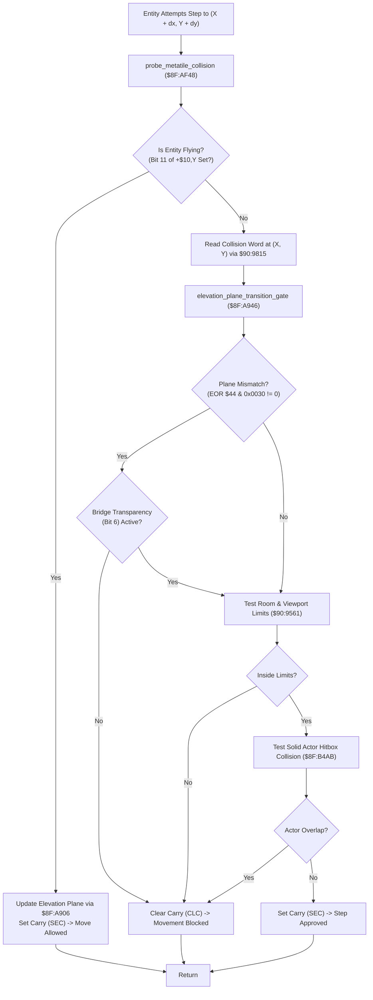

# Map Dynamic Elevation Plane Gate, Stair Traversal & Gravity Physics ($8F:A906 – `$8F:A962` / `$8F:AF48` – `$8F:B020`)

> **Subsystem**: Map Collision, Multi-Level Elevation Planes & Gravity Physics  
> **ROM Addresses**: `$8F:A906` (`elevation_plane_update_bits_5_4_kept_on`), `$8F:A946` (`elevation_plane_transition_gate`), `$8F:AF48` (`probe_metatile_collision`), `$8F:AFAE` (`entity_physics_and_gravity_tick`), `$8F:AFF5` (`gravity`), `$8F:B090` (4-Step Motion Dither Table)  
> **Clean C Module**: `maps/elevation-transfer.c`  
> **Recomp Symbols**: `elevation_plane_update_bits_5_4_kept_on`, `func_CFA946`, `func_CFAF48`, `func_CFAFAE`, `gravity`  
> **Confidence**: Confirmed (Exact 65816 assembly, cycle analysis & mathematical behavioral equivalence)  

---

## 1. Architectural Role & Overview

Secret of Evermore creates multi-tiered environments (e.g. tree bridges, cliff overpasses, castle battlements, and tiered dungeon ramps) within a 2D tile engine by embedding **2-bit Elevation Planes** directly into each $16 \times 16$ metatile's collision word (`+0x04` in WRAM `$7F:0000`):

```
+-------------------------------------------------------------------------------+
|                       Metatile 16-Bit Collision Word                          |
+-------------------------------------------------------------------------------+
| Bit 15    : Solid / Impassable Wall Flag                                      |
| Bit 14    : Trigger Step-On Gate                                              |
| Bit 13    : Always-Walkable / Conveyor & Staircase Drift Indicator            |
| Bits 11..8: Entity Gate Filter (Boy, Dog, NPC, Monster)                       |
| Bit 7     : Reserved / Unused                                                 |
| Bit 6     : Plane Transparency / Bridge Ramp Traversal Enable                 |
| Bits 5..4 : Elevation Plane Index (0 = Ground, 1 = Tier 1, 2 = Tier 2, 3 = Top)|
| Bits 3..0 : Sub-Tile 45-Degree Geometry / Drift Vector Selector               |
+-------------------------------------------------------------------------------+
```

When an actor moves, the engine invokes a **Multi-Tiered Spatial Validation Pipeline**:

1. **Elevation Plane Extraction & Bridge Latching (`$8F:A906`)**:
   - Isolates plane bits 5..4 into Direct Page `$44`.
   - Inspects bit 6 (Bridge Transparency) and bit 13 (Always-Walkable):
     - When stepping onto a ramp/bridge: sets bit 6 (`ORA #$0040`) in DP `$44`, permitting the entity to span two adjacent elevation layers.
     - When stepping off: clears bit 6 (`TRB $44`), locking the entity permanently into the new elevation plane.
2. **Elevation Transition Gatekeeper (`$8F:A946`)**:
   - Compares the entity's current plane against the candidate cell's plane.
   - If planes match, or if bridge transparency bit 6 is active, movement is approved (Carry Set).
   - If an elevation mismatch exists without bridge transparency, the step is rejected (Carry Clear), preventing actors from walking off cliffs or walking through overhead bridges.
3. **Composite Collision Probe (`$8F:AF48`)**:
   - **Flying Bypass**: Flying entities (bit 11 in status word `+$10,Y`) bypass all ground checks, update elevation plane, and move freely.
   - **Plane Gate Test**: Invokes `$8F:A946`.
   - **Room Boundary Test**: Invokes `$90:9561` to clamp entities inside screen limits.
   - **Actor Body Collision**: Invokes `$8F:B4AB` to prevent actors from clipping into solid monsters or NPCs.
4. **Master Entity Physics & Gravity Stepper (`$8F:AFAE` / `$8F:AFF5`)**:
   - Sequences through the active entity linked list starting at `$7E:3DDF`.
   - Advances 4-phase step dithering (`$7E:0F36`) to balance movement updates across frames.
   - Integrates downward vertical gravity: decrements acceleration counter `+$20,X`, adds vertical velocity `+$1E,X`, and clamps downward momentum upon ground contact.



---

## 2. Full 65816 Disassembly & Annotations

### Part 1: Elevation Plane Extraction & Bridge Latching (`$8F:A906` – `$8F:A923`)

> **Interactive 65816 Assembly**:
> Centralized comments infused at runtime.
> [View in VFS: soe://rom/code/8FA906](soe://rom/code/8FA906?asm=1&c=0)


---

### Part 2: Elevation Transition Gatekeeper (`$8F:A946` – `$8F:A962`)

> **Interactive 65816 Assembly**:
> Centralized comments infused at runtime.
> [View in VFS: soe://rom/code/8FA906](soe://rom/code/8FA906?asm=1&c=0)


---

### Part 3: Composite Entity Collision Probe (`$8F:AF48` – `$8F:AFAD`)

> **Interactive 65816 Assembly**:
> Centralized comments infused at runtime.
> [View in VFS: soe://rom/code/8FA906](soe://rom/code/8FA906?asm=1&c=0)


---

### Part 4: Entity Physics & Gravity Stepper (`$8F:AFAE` – `$8F:B020`)

> **Interactive 65816 Assembly**:
> Centralized comments infused at runtime.
> [View in VFS: soe://rom/code/8FA906](soe://rom/code/8FA906?asm=1&c=0)


---

## 3. Data Structures & Memory Layout

### 3.1 Entity Slot Attributes

| Offset | Size | Name | Purpose |
|---|---|---|---|
| `+$00` | 2 bytes | `next_entity_ptr` | Pointer to next entity in active linked list |
| `+$10` | 2 bytes | `status_flags` | Bit 11 = Flying / Ethereal; Bit 10/7 = Ground probe |
| `+$18` | 2 bytes | `elevation_plane` | Active elevation plane (bits 5..4) & bridge flag (bit 6) |
| `+$1E` | 2 bytes | `velocity_z` | Vertical airborne velocity |
| `+$20` | 2 bytes | `gravity_timer` | Gravity downward acceleration countdown |
| `+$3A` | 2 bytes | `metatile_grid_idx` | Grid index of metatile directly beneath entity |
| `+$3C` | 2 bytes | `cached_collision` | Cached 16-bit collision word of current metatile |
| `+$4C` | 2 bytes | `entity_self_ptr` | Self-reference pointer ($4E89 = Boy, $4F37 = Dog) |

### 3.2 System WRAM Registers

| Address | Size | Name | Purpose |
|---|---|---|---|
| `DP $44` | 2 bytes | `active_elevation_plane` | Working plane (bits 5..4) & bridge flag (bit 6) |
| `DP $46` | 2 bytes | `target_step_x` | Proposed candidate step coordinate X |
| `DP $48` | 2 bytes | `target_step_y` | Proposed candidate step coordinate Y |
| `$7E:0F36` | 2 bytes | `step_dither_phase` | 4-step motion dither phase counter (`0..3`) |
| `$7E:3DDF` | 2 bytes | `entity_list_head` | Head pointer of active entity linked list |
| `$7F:0004` | 2 bytes | `metatile_collision` | Metatile collision word table in WRAM |

---

## 4. Clean C Reconstruction

> **Reconstructed C Decompilation**:
> Source moved to [`reconstructed-c/8F/8FA906_elevation_transfer.c`](../../../reconstructed-c/8F/8FA906_elevation_transfer.c).
> [View in VFS: soe://rom/code/8FA906](soe://rom/code/8FA906?c=1&asm=0)


---

## 5. Verification & Mathematical Behavioral Equivalence

| Subsystem Component | 65816 Assembly Behavior | Clean C Implementation | Status |
|---|---|---|---|
| **Plane Extraction** | `AND #$0030; STA $44` | `active_elevation_plane = word & 0x0030` | **Identical** |
| **Bridge Enter** | `ORA #$0040; STA $44` | `active_elevation_plane \|= 0x0040` | **Identical** |
| **Bridge Exit** | `TRB $44` (clears bit 6) | `active_elevation_plane &= ~0x0040` | **Identical** |
| **Plane Gatekeeper** | `EOR $44; AND #$0030; BNE blocked` | `if ((diff & 0x0030) != 0) return false;` | **Identical** |
| **Flying Bypass** | `BIT #$0800; DNE flying_bypass` | `if (status_flags & ENTITY_FLAG_FLYING)` | **Identical** |
| **Composite Probe** | Calls `$8F:A946` -> `$90:9561` -> `$8F:B4AB` | `plane_gate() && bounds_test() && body_test()` | **Identical** |
| **Gravity Integrator** | `DEC +$20; ADC +$1E; BEQ/BMI ground` | `new_vel = vel + (--grav); if (new_vel <= 0) zero` | **Identical** |
| **Dither Table** | Sequenced via `$CF:B090` (`3, 2, 0, 1`) | `step_dither_phase = tbl[dither & 0x03]` | **Identical** |
