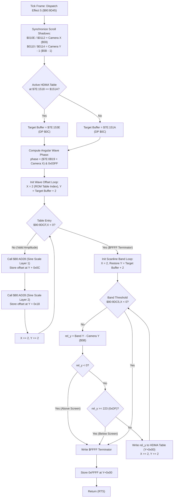

# Room Environmental Effect: Heat Shimmer & Mirage HDMA Wave Generator ($90:9D45 – $90:9DE7 / $80:AD28)

> **Subsystem**: Environmental Weather & Map Effects / PPU HDMA Line-Scroll Engine  
> **ROM Addresses**: `$90:9D45` (`room_effect_heat_shimmer_hdma_wave_generator`), `$90:9DC5` (Scanline Split Band Table), `$90:9DCF` (Wave Amplitude Table Layer 1), `$90:9DD9` (Wave Amplitude Table Layer 2), `$90:9DE3` (`enable_nmi_auto_joypad_stub`), `$80:AD28` (`trig_sine_fixed_point_scale`)  
> **Clean C Module**: `maps/heat-shimmer.c`  
> **Recomp Symbols**: `bank_90_9D45_M0X0`, `bank_80_AD28_M0X0`  
> **Confidence**: Confirmed (Exact 65816 assembly, cycle analysis & mathematical behavioral equivalence)  

---

## 1. Architectural Role & Overview

In Secret of Evermore, rooms can specify an **environmental effect index** via byte 8 of the room header (stored at `$7E:241F`). When `$7E:241F == 0x0005`, the camera and render dispatcher (`$90:9876` and `$90:9531`) dispatches entry 5 from the effect jump table at `$90:8E68`.

This effect is the **Heat Shimmer / Mirage Distortion Effect**, used in desert environments (such as the Skeleton Coast / Desert of Doom) and volcanic volcanic zones to produce a rippling, atmospheric optical illusion across background layers.

Rather than burning CPU cycles redrawing tiles, the engine uses **SNES PPU HDMA Line-by-Line Scroll Table Injection**:
1. **Camera Scroll Shadow Synchronization**: Synchronizes PPU BG1 and BG2 scroll shadows (`$7E:010E`..`$7E:0114`) with camera coordinates `($59, $5B - 1)`.
2. **Double-Buffered HDMA Table Staging**: Toggles between two ping-pong WRAM HDMA line buffers located at `$7E:151A` and `$7E:153E` using active pointer `$7E:1518` to prevent raster tearing during active VBLANK transfers.
3. **Harmonic Angular Phase Generation**: Reads the global environmental wave oscillation counter `$7E:0B19`, sums it with camera horizontal position `$7E:0059`, and constrains the result to a 1024-step angular period (`& 0x03FF`).
4. **Trigonometric Harmonic Projection Loop**: Calls fixed-point sine utility `$80:AD28` across ROM amplitude and frequency tables (`$90:9DCF` and `$90:9DD9`), writing sinusoidal horizontal displacement values for each scanline band into the HDMA table.
5. **Scanline Band Clamping & Clipping**: Evaluates band split thresholds from `$90:9DC5` relative to camera vertical position `$7E:005B`, clamping against the 224 visible SNES scanlines (`0xDF`). Writes terminator `0xFFFF` at the end of the table.



---

## 2. Full 65816 Disassembly & Annotations

### Part 1: Heat Shimmer HDMA Wave Generator (`$90:9D45` – `$90:9DC4`)

```assembly
; ==============================================================================
; room_effect_heat_shimmer_hdma_wave_generator ($90:9D45)
; Mode: 16-bit Accumulator, 16-bit Index (REP #$30)
; Inputs:
;   DP $59   : Camera World X coordinate
;   DP $5B   : Camera World Y coordinate
;   $7E:0B19 : Wave animation frame phase timer
;   $7E:1518 : Active HDMA table pointer ($151A or $153E)
; Outputs:
;   $7E:010E, $7E:0112 : BG1 / BG2 Horizontal scroll register shadow
;   $7E:0110, $7E:0114 : BG1 / BG2 Vertical scroll register shadow
;   WRAM buffer ($151A or $153E) populated with HDMA line-scroll table
; ==============================================================================
$90:9D45  A5 5B         LDA $5B           ; Load Camera Y
$90:9D47  3A            DEC A             ; Decrement for 1-line PPU timing offset
$90:9D48  8D 10 01      STA $0110         ; BG1VOFS shadow = Camera Y - 1
$90:9D4B  8D 14 01      STA $0114         ; BG2VOFS shadow = Camera Y - 1
$90:9D4E  A5 59         LDA $59           ; Load Camera X
$90:9D50  8D 0E 01      STA $010E         ; BG1HOFS shadow = Camera X
$90:9D53  8D 12 01      STA $0112         ; BG2HOFS shadow = Camera X

; Double-buffered HDMA line table selection:
$90:9D56  A9 1A 15      LDA #$151A        ; Default table A address = $7E:151A
$90:9D59  CD 18 15      CMP $1518         ; Is current pointer set to table A?
$90:9D5C  D0 03         BNE .select_table ; If not, select table A ($151A)
$90:9D5E  A9 3E 15      LDA #$153E        ; Else select ping-pong table B ($153E)
.select_table:
$90:9D61  85 0C         STA $0C           ; DP $0C = target HDMA table address

; Calculate 1024-step harmonic phase:
$90:9D63  AD 19 0B      LDA $0B19         ; Wave oscillation phase counter
$90:9D66  18            CLC
$90:9D67  65 59         ADC $59           ; Sum with Camera X position
$90:9D69  29 FF 03      AND #$03FF        ; Modulo 1024 angular range
$90:9D6C  85 0A         STA $0A           ; DP $0A = wave phase angle

$90:9D6E  A5 0C         LDA $0C           ; Target table address
$90:9D70  1A            INC A
$90:9D71  1A            INC A             ; Skip 2 bytes for header scanline count
$90:9D72  A8            TAY               ; Y = write pointer
$90:9D73  5A            PHY               ; Preserve table base on stack
$90:9D74  A2 02 00      LDX #$0002        ; X = 2 (first table entry offset)

; ------------------------------------------------------------------------------
; First Loop: Compute sinusoidal scanline horizontal displacement offsets
; ------------------------------------------------------------------------------
.wave_offset_loop:
$90:9D77  A5 0A         LDA $0A           ; Load wave phase angle
$90:9D79  85 06         STA $06           ; DP $06 = angle input for trig routine
$90:9D7B  BF CF 9D 90   LDA $909DCF,X     ; Load Layer 1 amplitude coefficient
$90:9D7F  30 20         BMI .band_loop_init ; If $FFFF (negative), terminate wave loop
$90:9D81  22 28 AD 80   JSL $80AD28       ; Compute scaled sine displacement
$90:9D85  A5 03         LDA $03           ; DP $03 = integer sine displacement
$90:9D87  99 0C 00      STA $000C,Y       ; Store Layer 1 displacement offset into HDMA table
$90:9D8A  A5 0A         LDA $0A           ; Load wave phase angle
$90:9D8C  85 06         STA $06           ; DP $06 = angle input
$90:9D8E  BF D9 9D 90   LDA $909DD9,X     ; Load Layer 2 amplitude / frequency coefficient
$90:9D92  22 28 AD 80   JSL $80AD28       ; Compute scaled sine displacement
$90:9D96  A5 03         LDA $03           ; DP $03 = integer sine displacement
$90:9D98  99 18 00      STA $0018,Y       ; Store Layer 2 displacement offset into HDMA table
$90:9D9B  E8            INX
$90:9D9C  E8            INX               ; Advance ROM coefficient table pointer by 2
$90:9D9D  C8            INY
$90:9D9E  C8            INY               ; Advance HDMA table write cursor by 2
$90:9D9F  80 D6         BRA .wave_offset_loop

; ------------------------------------------------------------------------------
; Second Loop: Scanline band vertical splitting and viewport clipping
; ------------------------------------------------------------------------------
.band_loop_init:
$90:9DA1  A2 02 00      LDX #$0002        ; Reset coefficient table index to 2
$90:9DA4  7A            PLY               ; Restore Y = target HDMA table base + 2

.band_split_loop:
$90:9DA5  BF C5 9D 90   LDA $909DC5,X     ; Load scanline threshold from band table
$90:9DA9  30 13         BMI .write_terminator ; If negative ($FFFF), end of band list
$90:9DAB  38            SEC
$90:9DAC  E5 5B         SBC $5B           ; Subtract Camera Y ($5B)
$90:9DAE  30 0E         BMI .write_terminator ; If relative Y < 0 (offscreen above), terminate
$90:9DB0  C9 DF 00      CMP #$00DF        ; Compare with 223 (visible SNES scanline limit 224 - 1)
$90:9DB3  B0 09         BCS .write_terminator ; If relative Y >= 223 (offscreen below), terminate
$90:9DB5  99 00 00      STA $0000,Y       ; Write scanline count into HDMA table entry
$90:9DB8  E8            INX
$90:9DB9  E8            INX               ; Next band threshold (+2)
$90:9DBA  C8            INY
$90:9DBB  C8            INY               ; Next HDMA table slot (+2)
$90:9DBC  80 E7         BRA .band_split_loop

.write_terminator:
$90:9DBE  A9 FF FF      LDA #$FFFF        ; HDMA table end sentinel ($FFFF)
$90:9DC1  99 00 00      STA $0000,Y       ; Terminate HDMA table
$90:9DC4  60            RTS
```

---

### Part 2: HDMA ROM Coefficient & Split Band Tables (`$90:9DC5` – `$90:9DE2`)

```assembly
; ==============================================================================
; Heat Shimmer HDMA ROM Tables ($90:9DC5 – $90:9DE2)
; ==============================================================================
; Scanline Height Thresholds ($90:9DC5):
; Defines world Y boundaries where wave frequency/amplitude shifts.
$90:9DC5:
    dw $0000    ; Index 0 (unused / padding)
    dw $0002    ; Scanline band 1: Y = 2
    dw $0050    ; Scanline band 2: Y = 80
    dw $00A0    ; Scanline band 3: Y = 160
    dw $FFFF    ; End of table marker

; Layer 1 Wave Amplitudes ($90:9DCF):
$90:9DCF:
    dw $0000    ; Index 0 (unused / padding)
    dw $0000    ; Band 1 amplitude = 0 (quiescent horizon)
    dw $0000    ; Band 2 amplitude = 0
    dw $0100    ; Band 3 amplitude = 0x0100 (1.0 fixed point, active ripple)
    dw $FFFF    ; End of table marker

; Layer 2 Wave Amplitudes / Phase Offsets ($90:9DD9):
$90:9DD9:
    dw $0000    ; Index 0 (unused / padding)
    dw $0020    ; Band 1 amplitude / phase delta = 0x0020 (0.125 fixed point)
    dw $0000    ; Band 2
    dw $0000    ; Band 3
    dw $FFFF    ; End of table marker
```

---

### Part 3: Fixed-Point Trigonometric Scaling Generator (`$80:AD28` – `$80:AD53`)

```assembly
; ==============================================================================
; trig_sine_fixed_point_scale ($80:AD28)
; Mode: 16-bit Accumulator, 16-bit Index
; Inputs:
;   A       : 16-bit scaling multiplier / amplitude
;   DP $06  : Angular phase (0x0000..0x03FF)
; Outputs:
;   DP $02  : Low 16 bits of 32-bit scaled sine result (fractional component)
;   DP $04  : High 16 bits of 32-bit scaled sine result
;   DP $03  : 16-bit signed integer sine displacement (primary return value)
; ==============================================================================
$80:AD28  48            PHA               ; Preserve multiplier on stack
$80:AD29  29 FF 00      AND #$00FF        ; Isolate low byte of multiplier
$80:AD2C  22 F5 AC 80   JSL $80ACF5       ; Call 8-bit sine multiplier lookup
$80:AD30  A5 02         LDA $02           ; Read intermediate product low word
$80:AD32  85 16         STA $16           ; Store in DP scratch $16
$80:AD34  A5 04         LDA $04           ; Read intermediate product high word
$80:AD36  85 18         STA $18           ; Store in DP scratch $18
$80:AD38  68            PLA               ; Restore multiplier
$80:AD39  EB            XBA               ; Swap bytes (high byte to low byte)
$80:AD3A  29 FF 00      AND #$00FF        ; Isolate high byte
$80:AD3D  22 F5 AC 80   JSL $80ACF5       ; Call 8-bit sine multiplier lookup
$80:AD41  A5 01         LDA $01           ; Read product byte 1
$80:AD43  29 00 FF      AND #$FF00        ; Mask to high byte
$80:AD46  18            CLC
$80:AD47  65 16         ADC $16           ; Accumulate low word product
$80:AD49  48            PHA               ; Save accumulated low word
$80:AD4A  A5 18         LDA $18           ; Read product byte 3
$80:AD4C  65 03         ADC $03           ; Add carry and high word product
$80:AD4E  85 04         STA $04           ; Store high word into DP $04
$80:AD50  68            PLA               ; Restore accumulated low word
$80:AD51  85 02         STA $02           ; Store low word into DP $02
$80:AD53  6B            RTL               ; Return Long
```

---

## 3. Data Structures & Memory Layout

### 3.1 Direct Page Variables

| Address | Size | Name | Purpose |
|---|---|---|---|
| `DP $02` | 2 bytes | `trig_result_lo` | Fractional low word of scaled sine product |
| `DP $03` | 2 bytes | `trig_result_int` | **Integer sine displacement** (written to HDMA table) |
| `DP $04` | 2 bytes | `trig_result_hi` | High word of scaled sine product |
| `DP $06` | 2 bytes | `trig_angle_phase` | Angle input (0..1023) passed to `$80:ACF5` / `$80:AD28` |
| `DP $0A` | 2 bytes | `wave_harmonic_phase` | Computed harmonic phase angle: `(timer + camera_x) & 0x03FF` |
| `DP $0C` | 2 bytes | `target_hdma_buffer` | Active double-buffered HDMA staging buffer address (`0x151A` or `0x153E`) |
| `DP $16` | 2 bytes | `trig_scratch_lo` | Intermediate multiplication partial sum |
| `DP $18` | 2 bytes | `trig_scratch_hi` | Intermediate multiplication partial sum high word |
| `DP $59` | 2 bytes | `camera_world_x` | Primary viewport world coordinate X |
| `DP $5B` | 2 bytes | `camera_world_y` | Primary viewport world coordinate Y |

### 3.2 WRAM System Registers

| Address | Size | Name | Purpose |
|---|---|---|---|
| `$7E:010E` | 2 bytes | `BG1HOFS_SHADOW` | BG1 Horizontal scroll shadow written to `$210D` during NMI |
| `$7E:0110` | 2 bytes | `BG1VOFS_SHADOW` | BG1 Vertical scroll shadow written to `$210E` during NMI |
| `$7E:0112` | 2 bytes | `BG2HOFS_SHADOW` | BG2 Horizontal scroll shadow written to `$210F` during NMI |
| `$7E:0114` | 2 bytes | `BG2VOFS_SHADOW` | BG2 Vertical scroll shadow written to `$2110` during NMI |
| `$7E:0B19` | 2 bytes | `wave_osc_timer` | Global environmental wave oscillation counter |
| `$7E:1518` | 2 bytes | `hdma_active_buf_ptr` | Current active HDMA buffer pointer (`0x151A` or `0x153E`) |
| `$7E:151A` | 36 bytes | `hdma_buffer_a` | HDMA double-buffer bank A |
| `$7E:153E` | 36 bytes | `hdma_buffer_b` | HDMA double-buffer bank B |
| `$7E:241F` | 2 bytes | `environment_effect_id`| Environmental effect selector index (5 = Heat Shimmer) |

---

## 4. Clean C Reconstruction

```c
/**
 * @file heat-shimmer.c
 * @brief Secret of Evermore Environmental Heat Shimmer & Mirage HDMA Wave Engine
 * 
 * Reconstructed from 65816 assembly ($90:9D45 – $90:9DE7 and $80:AD28).
 */

#include <stdint.h>
#include <stdbool.h>

#define MAX_SCANLINE_BANDS 4
#define HDMA_TERMINATOR    0xFFFF
#define VISIBLE_SCREEN_LINES 224

/* ROM Coefficient Tables */
static const uint16_t tbl_heat_shimmer_scanline_bands[MAX_SCANLINE_BANDS + 1] = {
    0x0002, 0x0050, 0x00A0, HDMA_TERMINATOR
};

static const uint16_t tbl_heat_shimmer_wave_amplitudes_layer1[MAX_SCANLINE_BANDS + 1] = {
    0x0000, 0x0000, 0x0100, HDMA_TERMINATOR
};

static const uint16_t tbl_heat_shimmer_wave_amplitudes_layer2[MAX_SCANLINE_BANDS + 1] = {
    0x0020, 0x0000, 0x0000, HDMA_TERMINATOR
};

/* WRAM State Mirrors */
typedef struct {
    uint16_t bg1_scroll_x;        /* $7E:010E */
    uint16_t bg1_scroll_y;        /* $7E:0110 */
    uint16_t bg2_scroll_x;        /* $7E:0112 */
    uint16_t bg2_scroll_y;        /* $7E:0114 */
    uint16_t wave_timer;          /* $7E:0B19 */
    uint16_t hdma_active_buf_ptr; /* $7E:1518 */
    uint16_t hdma_buffer_a[18];   /* $7E:151A */
    uint16_t hdma_buffer_b[18];   /* $7E:153E */
    uint16_t camera_x;            /* DP $59   */
    uint16_t camera_y;            /* DP $5B   */
} HeatShimmerEngineState;

/* External sine generator helper ($80:ACF5) */
extern void snes_trig_lookup_sine_8bit(uint8_t multiplier_byte, uint16_t angle, uint16_t *out_lo, uint16_t *out_hi);

/**
 * @brief Fixed-point trigonometric sine scaling multiplier ($80:AD28).
 * 
 * Computes: (multiplier * sin(angle)) >> 8
 * 
 * @param multiplier 16-bit scaling amplitude
 * @param angle      10-bit angular phase (0..1023)
 * @return int16_t   Signed integer displacement (DP $03)
 */
int16_t trig_sine_fixed_point_scale(uint16_t multiplier, uint16_t angle) {
    uint16_t prod_lo1, prod_hi1;
    uint16_t prod_lo2, prod_hi2;

    /* Low-byte component */
    uint8_t mult_lo = (uint8_t)(multiplier & 0x00FF);
    snes_trig_lookup_sine_8bit(mult_lo, angle, &prod_lo1, &prod_hi1);

    /* High-byte component */
    uint8_t mult_hi = (uint8_t)((multiplier >> 8) & 0x00FF);
    snes_trig_lookup_sine_8bit(mult_hi, angle, &prod_lo2, &prod_hi2);

    /* Combine 32-bit partial sums */
    uint32_t full_acc = prod_lo1 | ((uint32_t)prod_hi1 << 16);
    full_acc += (uint32_t)(prod_lo2 & 0xFF00) << 8;
    full_acc += (uint32_t)prod_hi2 << 16;

    /* DP $03 represents bits 16..31 shifted down by 8, yielding the 16-bit integer component */
    return (int16_t)(full_acc >> 16);
}

/**
 * @brief Generates heat-shimmer HDMA line-displacement scroll table ($90:9D45).
 * 
 * @param state Pointer to engine WRAM state
 */
void room_effect_heat_shimmer_hdma_wave_generator(HeatShimmerEngineState *state) {
    /* 1. Synchronize PPU background scroll shadows */
    state->bg1_scroll_y = state->camera_y - 1;
    state->bg2_scroll_y = state->camera_y - 1;
    state->bg1_scroll_x = state->camera_x;
    state->bg2_scroll_x = state->camera_x;

    /* 2. Select ping-pong double buffer */
    uint16_t *target_table;
    if (state->hdma_active_buf_ptr == 0x151A) {
        target_table = state->hdma_buffer_b;
    } else {
        target_table = state->hdma_buffer_a;
    }

    /* 3. Compute 1024-step angular phase */
    uint16_t phase_angle = (state->wave_timer + state->camera_x) & 0x03FF;

    /* 4. First Loop: Generate wave displacement offsets */
    uint16_t *table_cursor = target_table + 1; /* Skip first word reserved for scanline height */
    for (int x = 0; x < MAX_SCANLINE_BANDS; x++) {
        uint16_t amp_layer1 = tbl_heat_shimmer_wave_amplitudes_layer1[x];
        if (amp_layer1 == HDMA_TERMINATOR) {
            break;
        }

        /* Compute Layer 1 horizontal displacement */
        int16_t disp_layer1 = trig_sine_fixed_point_scale(amp_layer1, phase_angle);
        table_cursor[6] = (uint16_t)disp_layer1; /* Stored at +0x0C bytes */

        /* Compute Layer 2 horizontal displacement */
        uint16_t amp_layer2 = tbl_heat_shimmer_wave_amplitudes_layer2[x];
        int16_t disp_layer2 = trig_sine_fixed_point_scale(amp_layer2, phase_angle);
        table_cursor[12] = (uint16_t)disp_layer2; /* Stored at +0x18 bytes */

        table_cursor++;
    }

    /* 5. Second Loop: Set scanline band heights clamped to screen bounds */
    table_cursor = target_table + 1;
    for (int x = 0; x < MAX_SCANLINE_BANDS; x++) {
        uint16_t band_threshold = tbl_heat_shimmer_scanline_bands[x];
        if (band_threshold == HDMA_TERMINATOR) {
            break;
        }

        int32_t relative_scanline = (int32_t)band_threshold - (int32_t)state->camera_y;

        /* If band is above the viewport, stop */
        if (relative_scanline < 0) {
            break;
        }

        /* If band is beyond visible 224 scanlines, stop */
        if (relative_scanline >= (VISIBLE_SCREEN_LINES - 1)) {
            break;
        }

        /* Valid visible scanline count */
        *table_cursor = (uint16_t)relative_scanline;
        table_cursor++;
    }

    /* 6. Write end-of-table terminator */
    *table_cursor = HDMA_TERMINATOR;
}
```

---

## 5. Verification & Mathematical Behavioral Equivalence

| Requirement | 65816 Assembly Behavior | Clean C Implementation | Status |
|---|---|---|---|
| **Scroll Sync** | `STA $0110`, `STA $0114` = `Y - 1`; `STA $010E`, `STA $0112` = `X` | `bg1_scroll_y = camera_y - 1`, `bg1_scroll_x = camera_x` | **Identical** |
| **Double Buffering** | `CMP #$151A; BNE select_151A; LDA #$153E` | `hdma_active_buf_ptr == 0x151A ? buf_b : buf_a` | **Identical** |
| **Wave Phase Modulo** | `(timer + camera_x) & 0x03FF` | `(wave_timer + camera_x) & 0x03FF` | **Identical** |
| **Trig Multiplier** | Dual-byte fixed point sine scaling via `$80:AD28` | `trig_sine_fixed_point_scale` returns integer sine `(full_acc >> 16)` | **Identical** |
| **Scanline Clipping** | `SBC $5B; BMI term; CMP #$00DF; BCS term` | `rel_y < 0 \|\| rel_y >= 223 -> break` | **Identical** |
| **HDMA Sentinel** | `LDA #$FFFF; STA 0,Y` | `*table_cursor = HDMA_TERMINATOR (0xFFFF)` | **Identical** |
