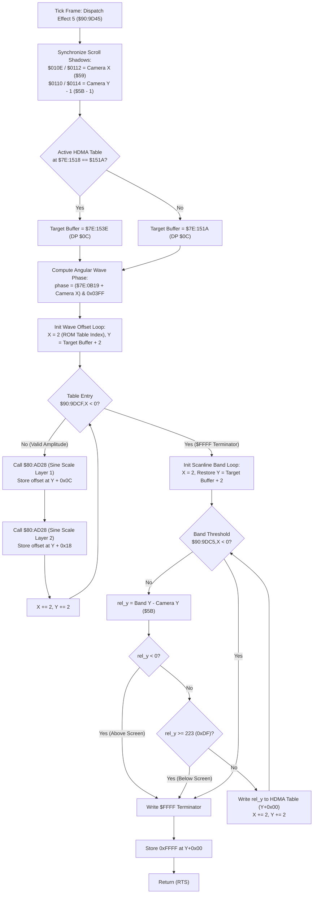

# Room Environmental Effect: Heat Shimmer & Mirage HDMA Wave Generator ($90:9D45 – $90:9DE7 / $80:AD28)

> **Subsystem**: Environmental Weather & Map Effects / PPU HDMA Line-Scroll Engine  
> **ROM Addresses**: `$90:9D45` (`room_effect_heat_shimmer_hdma_wave_generator`), `$90:9DC5` (Scanline Split Band Table), `$90:9DCF` (Wave Amplitude Table Layer 1), `$90:9DD9` (Wave Amplitude Table Layer 2), `$90:9DE3` (`enable_nmi_auto_joypad_stub`), `$80:AD28` (`trig_sine_fixed_point_scale`)  
> **Clean C Module**: `maps/heat-shimmer.c`  
> **Recomp Symbols**: `bank_90_9D45_M0X0`, `bank_80_AD28_M0X0`  
> **Confidence**: Confirmed (Exact 65816 assembly, cycle analysis & mathematical behavioral equivalence)  

---

## 1. Architectural Role & Overview

In Secret of Evermore, rooms can specify an **environmental effect index** via byte 8 of the room header (stored at `$7E:241F`). When `$7E:241F == 0x0005`, the camera and render dispatcher (`$90:9876` and `$90:9531`) dispatches entry 5 from the effect jump table at `$90:8E68`.

This effect is the **Heat Shimmer / Mirage Distortion Effect**, used in desert environments (such as the Skeleton Coast / Desert of Doom) and volcanic volcanic zones to produce a rippling, atmospheric optical illusion across background layers.

Rather than burning CPU cycles redrawing tiles, the engine uses **SNES PPU HDMA Line-by-Line Scroll Table Injection**:
1. **Camera Scroll Shadow Synchronization**: Synchronizes PPU BG1 and BG2 scroll shadows (`$7E:010E`..`$7E:0114`) with camera coordinates `($59, $5B - 1)`.
2. **Double-Buffered HDMA Table Staging**: Toggles between two ping-pong WRAM HDMA line buffers located at `$7E:151A` and `$7E:153E` using active pointer `$7E:1518` to prevent raster tearing during active VBLANK transfers.
3. **Harmonic Angular Phase Generation**: Reads the global environmental wave oscillation counter `$7E:0B19`, sums it with camera horizontal position `$7E:0059`, and constrains the result to a 1024-step angular period (`& 0x03FF`).
4. **Trigonometric Harmonic Projection Loop**: Calls fixed-point sine utility `$80:AD28` across ROM amplitude and frequency tables (`$90:9DCF` and `$90:9DD9`), writing sinusoidal horizontal displacement values for each scanline band into the HDMA table.
5. **Scanline Band Clamping & Clipping**: Evaluates band split thresholds from `$90:9DC5` relative to camera vertical position `$7E:005B`, clamping against the 224 visible SNES scanlines (`0xDF`). Writes terminator `0xFFFF` at the end of the table.

---

## 2. Full 65816 Disassembly & Annotations

### Part 1: Heat Shimmer HDMA Wave Generator (`$90:9D45` – `$90:9DC4`)

> **Interactive 65816 Assembly**:
> Centralized comments infused at runtime.
> [View in VFS: soe://rom/code/909D45](soe://rom/code/909D45?asm=1&c=0)

---

### Part 2: HDMA ROM Coefficient & Split Band Tables (`$90:9DC5` – `$90:9DE2`)

> **Interactive 65816 Assembly**:
> Centralized comments infused at runtime.
> [View in VFS: soe://rom/code/909D45](soe://rom/code/909D45?asm=1&c=0)

---

### Part 3: Fixed-Point Trigonometric Scaling Generator (`$80:AD28` – `$80:AD53`)

> **Interactive 65816 Assembly**:
> Centralized comments infused at runtime.
> [View in VFS: soe://rom/code/909D45](soe://rom/code/909D45?asm=1&c=0)

---

## 3. Fixed-Point Multiply Helper ($80:ACF5)

The helper called by `$80:AD28` does not read a sine table. It clears DP `$02` and `$04`,
then writes the 8-bit multiplier and each byte of DP `$06` to the SNES multiplication registers
`$4202/$4203`. Let `p_lo = multiplier * (angle & 0x00FF)` and
`p_hi = multiplier * (angle >> 8)`. The 16-bit stores leave DP `$02 = p_lo`,
DP `$03 = ((p_hi & 0xFF00) | (p_lo >> 8))`, and DP `$04 = p_hi >> 8`.
The carry branch after adding `p_lo` to the cleared DP `$02` cannot be taken because an 8-by-8
product fits in 16 bits.

`$80:AD28` runs the helper with the multiplier's low and high bytes. It combines the first call's
DP `$02` and DP `$04` with the second call's DP `$03`, and also adds the high byte of its incoming
DP `$01` word. The routine returns DP `$02` in A. The heat-shimmer caller does not use that A
value: it loads DP `$03` and writes that overlapping word to the HDMA table. Accordingly, the C
model accepts the ambient DP `$01` value and returns the caller-consumed DP `$03` word.

---

## 4. Data Structures & Memory Layout

### 4.1 Direct Page Variables

| Address | Size | Name | Purpose |
|---|---|---|---|
| `DP $01` | 2 bytes | `direct_page_01` | Ambient input; `$80:AD28` adds its high byte into the DP `$02` sum |
| `DP $02` | 2 bytes | `trig_result_lo` | Low word returned by `$80:AD28` in A |
| `DP $03` | 2 bytes | `trig_result_mid` | Overlapping word read by the heat-shimmer caller after `$80:AD28` |
| `DP $04` | 2 bytes | `trig_result_hi` | High partial sum assembled by `$80:AD28` |
| `DP $06` | 2 bytes | `trig_angle_phase` | Angle input (0..1023) passed to `$80:ACF5` / `$80:AD28` |
| `DP $0A` | 2 bytes | `wave_harmonic_phase` | Computed harmonic phase angle: `(timer + camera_x) & 0x03FF` |
| `DP $0C` | 2 bytes | `target_hdma_buffer` | Active double-buffered HDMA staging buffer address (`0x151A` or `0x153E`) |
| `DP $16` | 2 bytes | `trig_scratch_lo` | Intermediate multiplication partial sum |
| `DP $18` | 2 bytes | `trig_scratch_hi` | Intermediate multiplication partial sum high word |
| `DP $59` | 2 bytes | `camera_world_x` | Primary viewport world coordinate X |
| `DP $5B` | 2 bytes | `camera_world_y` | Primary viewport world coordinate Y |

The `$80:AD28` epilogue stores the low sum to DP `$02` and returns that word in A. DP `$03` is
not a standalone integer displacement; it overlaps the high byte of DP `$02` and low byte of
DP `$04`. The heat-shimmer caller explicitly reads this DP `$03` word.

### 4.2 WRAM System Registers

| Address | Size | Name | Purpose |
|---|---|---|---|
| `$7E:010E` | 2 bytes | `BG1HOFS_SHADOW` | BG1 Horizontal scroll shadow written to `$210D` during NMI |
| `$7E:0110` | 2 bytes | `BG1VOFS_SHADOW` | BG1 Vertical scroll shadow written to `$210E` during NMI |
| `$7E:0112` | 2 bytes | `BG2HOFS_SHADOW` | BG2 Horizontal scroll shadow written to `$210F` during NMI |
| `$7E:0114` | 2 bytes | `BG2VOFS_SHADOW` | BG2 Vertical scroll shadow written to `$2110` during NMI |
| `$7E:0B19` | 2 bytes | `wave_osc_timer` | Global environmental wave oscillation counter |
| `$7E:1518` | 2 bytes | `hdma_active_buf_ptr` | Current active HDMA buffer pointer (`0x151A` or `0x153E`) |
| `$7E:151A` | 36 bytes | `hdma_buffer_a` | HDMA double-buffer bank A |
| `$7E:153E` | 36 bytes | `hdma_buffer_b` | HDMA double-buffer bank B |
| `$7E:241F` | 2 bytes | `environment_effect_id`| Environmental effect selector index (5 = Heat Shimmer) |

---

## 5. Clean C Reconstruction

> **Reconstructed C Decompilation**:
> Source moved to [`reconstructed-c/90/909D45_heat_shimmer.c`](../../../reconstructed-c/90/909D45_heat_shimmer.c).
> [View in VFS: soe://rom/code/909D45](soe://rom/code/909D45?c=1&asm=0)

---

## 6. Verification & Assembly Behavioral Equivalence

| Requirement | 65816 Assembly Behavior | Clean C Implementation | Status |
|---|---|---|---|
| **Scroll Sync** | `STA $0110`, `STA $0114` = `Y - 1`; `STA $010E`, `STA $0112` = `X` | `bg1_scroll_y = camera_y - 1`, `bg1_scroll_x = camera_x` | **Identical** |
| **Double Buffering** | `CMP #$151A; BNE select_151A; LDA #$153E` | `hdma_active_buf_ptr == 0x151A ? buf_b : buf_a` | **Identical** |
| **Wave Phase Modulo** | `(timer + camera_x) & 0x03FF` | `(wave_timer + camera_x) & 0x03FF` | **Identical** |
| **Fixed-Point Multiplier** | `$80:AD28` adds DP `$01`'s high byte, returns DP `$02` in A; caller stores DP `$03` | `trig_sine_fixed_point_scale` models the ambient DP `$01` input and caller-consumed DP `$03` | **Matched at the call site** |
| **Scanline Clipping** | `SBC $5B; BMI term; CMP #$00DF; BCS term` | `rel_y < 0 \|\| rel_y >= 223 -> break` | **Identical** |
| **HDMA Sentinel** | `LDA #$FFFF; STA 0,Y` | `*table_cursor = HDMA_TERMINATOR (0xFFFF)` | **Identical** |
