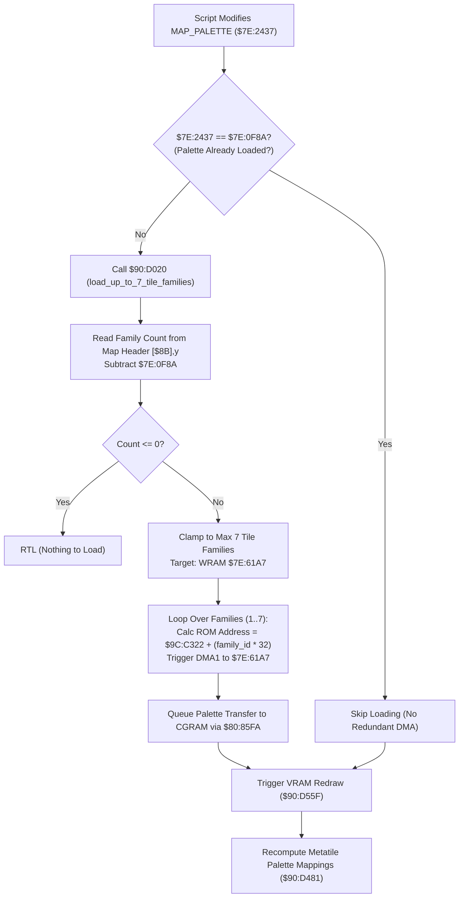

# Map Palette Families Loader & Dynamic Script Swapping

- **ROM Locations**:
  - `load_up_to_7_tile_families_from_map_palette`: `$90:D020` – `$90:D0A3`
  - `reload_families_when_a_script_changes_map_palett`: `$90:CBB3` – `$90:CBC7`
- **CPU State**: 16-bit A/X (`REP #$20` / `REP #$30`), Data Bank `$7E` / `$90`
- **WRAM Core Addresses**:
  - `$7E:2437`: Current script-selected map palette ID (`MAP_PALETTE`).
  - `$7E:0F8A`: Active/loaded palette index currently resident in VRAM/CGRAM.
  - `$7E:0F9C`: Offset in map metadata header to tile families definition list.
  - `$7E:61A7`: WRAM transfer buffer for tile families lookup table.
  - Direct Page `$8B`: 24-bit pointer to active map room definition header.
- **SNES Hardware Registers**:
  - `$2181` / `$2183`: WRAM address register (`WMADDL` / `WMADDM` / `WMADDH`).
  - `$4310` – `$4315`: DMA Channel 1 control, destination (`$2180` WMDATA), source address, and byte counter.
  - `$420B`: DMA enable register (`MDMAEN`, bit 1 for DMA Channel 1).
- **ROM Tables**:
  - `$9C:C322`: Master 16-color tile family graphics palette table (each family is 32 bytes: 16 colors × 2 bytes/color).

---

## 1. Architectural Role & Map Tile Families

Evermore's background layers use up to 8 tile families (each family representing a set of metatiles with distinct graphics palettes). While Family 0 is reserved for standard UI/static tiles, Families 1 through 7 are loaded dynamically from the room's palette table:

### Key Subsystem Invariants
1. **Deduplication Gate (`$90:CBB3`)**:
   - Compares `$7E:2437` with `$7E:0F8A`. If a script writes the same palette value, the expensive DMA transfers and palette reloads are bypassed completely.
2. **DMA Channel 1 Configuration**:
   - `4310 = 0x8000`: CPU to WRAM via `$2180`.
   - `4312 = base + family_id * 32`: Source address in ROM Bank `$9C`.
   - `4314 = 0x9C`: Source bank.
   - `4315 = 0x0020`: 32 bytes per family (16 colors × 2 bytes ka-format).
   - `420B = 0x02`: Fire DMA Channel 1.
3. **Palette Queue Synchronization**:
   - After writing to WRAM, `$90:D09E` calls `$80:85FA` with parameter `0x0010` in `$2E` to queue the CGRAM transfer for the next VBLANK.

---

## 2. Disassembly & Annotations

### Map Palette Invalidation Check (`$90:CBB3` – `$90:CBC7`)
> **Interactive 65816 Assembly**:
> Centralized comments infused at runtime.
> [View in VFS: soe://rom/code/90D020](soe://rom/code/90D020?asm=1&c=0)

### Tile Families Loader (`$90:D020` – `$90:D0A3`)
> **Interactive 65816 Assembly**:
> Centralized comments infused at runtime.
> [View in VFS: soe://rom/code/90D020](soe://rom/code/90D020?asm=1&c=0)

---

## 3. Clean C Decompilation

> **Reconstructed C Decompilation**:
> Source moved to [`reconstructed-c/90/90D020_palette_families.c`](../../../reconstructed-c/90/90D020_palette_families.c).
> [View in VFS: soe://rom/code/90D020](soe://rom/code/90D020?c=1&asm=0)

