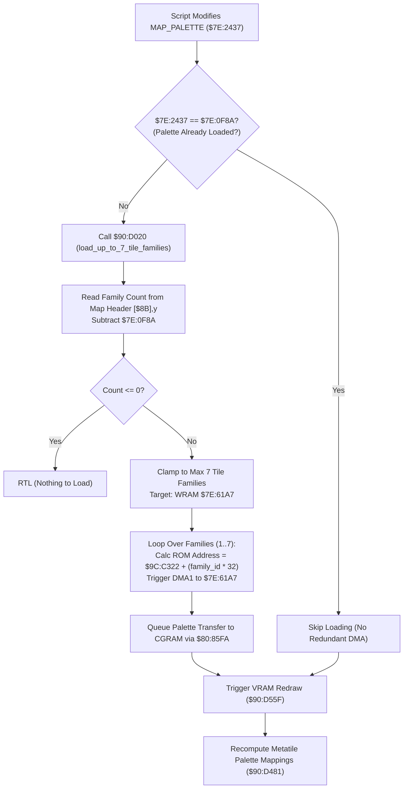

# Map Palette Families Loader & Dynamic Script Swapping

- **ROM Locations**:
  - `load_up_to_7_tile_families_from_map_palette`: `$90:D020` – `$90:D0A3`
  - `reload_families_when_a_script_changes_map_palett`: `$90:CBB3` – `$90:CBC7`
- **CPU State**: 16-bit A/X (`REP #$20` / `REP #$30`), Data Bank `$7E` / `$90`
- **WRAM Core Addresses**:
  - `$7E:2437`: Current script-selected map palette ID (`MAP_PALETTE`).
  - `$7E:0F8A`: Active/loaded palette index currently resident in VRAM/CGRAM.
  - `$7E:0F9C`: Offset in map metadata header to tile families definition list.
  - `$7E:61A7`: WRAM transfer buffer for tile families lookup table.
  - Direct Page `$8B`: 24-bit pointer to active map room definition header.
- **SNES Hardware Registers**:
  - `$2181` / `$2183`: WRAM address register (`WMADDL` / `WMADDM` / `WMADDH`).
  - `$4310` – `$4315`: DMA Channel 1 control, destination (`$2180` WMDATA), source address, and byte counter.
  - `$420B`: DMA enable register (`MDMAEN`, bit 1 for DMA Channel 1).
- **ROM Tables**:
  - `$9C:C322`: Master 16-color tile family graphics palette table (each family is 32 bytes: 16 colors × 2 bytes/color).

---

## 1. Architectural Role & Map Tile Families

Evermore's background layers use up to 8 tile families (each family representing a set of metatiles with distinct graphics palettes). While Family 0 is reserved for standard UI/static tiles, Families 1 through 7 are loaded dynamically from the room's palette table:



### Key Subsystem Invariants
1. **Deduplication Gate (`$90:CBB3`)**:
   - Compares `$7E:2437` with `$7E:0F8A`. If a script writes the same palette value, the expensive DMA transfers and palette reloads are bypassed completely.
2. **DMA Channel 1 Configuration**:
   - `4310 = 0x8000`: CPU to WRAM via `$2180`.
   - `4312 = base + family_id * 32`: Source address in ROM Bank `$9C`.
   - `4314 = 0x9C`: Source bank.
   - `4315 = 0x0020`: 32 bytes per family (16 colors × 2 bytes ka-format).
   - `420B = 0x02`: Fire DMA Channel 1.
3. **Palette Queue Synchronization**:
   - After writing to WRAM, `$90:D09E` calls `$80:85FA` with parameter `0x0010` in `$2E` to queue the CGRAM transfer for the next VBLANK.

---

## 2. Disassembly & Annotations

### Map Palette Invalidation Check (`$90:CBB3` – `$90:CBC7`)
```asm
; ==============================================================================
; reload_families_when_a_script_changes_map_palett ($90:CBB3)
; ==============================================================================
$90CBB3  af 37 24 7e    lda $7E2437        ; Current script MAP_PALETTE ID
$90CBB7  cd 8a 0f       cmp $0F8A          ; Loaded map palette ID
$90CBBA  f0 04          beq $90CBC0        ; If identical: skip loading families!
$90CBBC  22 20 d0 90    jsl $90D020        ; load_up_to_7_tile_families_from_map_palette

$90CBC0  22 5f d5 90    jsl $90D55F        ; Trigger tile family VRAM DMA refresh
$90CBC4  20 81 d4       jsr $D481          ; Recompute tile palette associations
$90CBC7  6b             rtl
```

### Tile Families Loader (`$90:D020` – `$90:D0A3`)
```asm
; ==============================================================================
; load_up_to_7_tile_families_from_map_palette ($90:D020)
; ==============================================================================
$90D020  af 37 24 7e    lda $7E2437        ; MAP_PALETTE ID
$90D024  8d 8a 0f       sta $0F8A          ; Cache active palette index
$90D027  ac 9c 0f       ldy $0F9C          ; Offset to tile families in room header
$90D02A  b7 8b          lda [$8B],y        ; Read total families in palette
$90D02C  29 ff 00       and #$00FF
$90D02F  38             sec
$90D030  ed 8a 0f       sbc $0F8A          ; Calculate remaining count
$90D033  f0 6e          beq $90D0A3        ; If 0: nothing to load, exit
$90D035  30 6c          bmi $90D0A3        ; If negative: exit
$90D037  c9 08 00       cmp #$0008         ; More than 7?
$90D03A  30 03          bmi $90D03F
$90D03C  a9 07 00       lda #$0007         ; Clamp to 7 families max
$90D03F  aa             tax                ; X = family loop counter

$90D040  ad 8a 0f       lda $0F8A
$90D043  0a             asl a              ; 2 bytes per family pointer
$90D044  38             sec
$90D045  6d 9c 0f       adc $0F9C
$90D048  a8             tay                ; Y = source offset in map header

$90D049  a9 a7 61       lda #$61A7         ; WRAM buffer destination $7E:61A7
$90D04C  8d 81 21       sta $2181          ; WMADDL/WMADDM
$90D04F  85 26          sta $26
$90D051  e2 20          sep #$20           ; 8-bit A
$90D053  a9 7e          lda #$7E           ; WRAM bank $7E
$90D055  8d 83 21       sta $2183          ; WMADDH
$90D058  85 28          sta $28
$90D05A  c2 20          rep #$20           ; 16-bit A

; Transfer loop: load each family via DMA1 from bank $9C
$90D05C  b7 8b          lda [$8B],y        ; Read 16-bit Family ID
$90D05E  c8             iny
$90D05F  c8             iny
$90D060  0a 0a 0a 0a 0a asl a (x5)         ; Multiply by 32 (32 bytes per family)
$90D065  69 22 c3       adc #$C322         ; Add base table address in Bank $9C
$90D068  8d 12 43       sta $4312          ; DMA1 source address
$90D06B  a9 20 00       lda #$0020         ; Size = 32 bytes
$90D06E  8d 15 43       sta $4315          ; DMA1 size
$90D071  a9 00 80       lda #$8000         ; Mode = write to WRAM via $2180
$90D074  8d 10 43       sta $4310          ; DMA1 control
$90D077  e2 20          sep #$20
$90D079  a9 9c          lda #$9C           ; Source bank $9C
$90D07B  8d 14 43       sta $4314          ; DMA1 source bank
$90D07E  a9 02          lda #$02           ; Channel 1 enable
$90D080  8d 0b 42       sta $420B          ; Trigger DMA1!
$90D083  c2 20          rep #$20
$90D085  ca             dex                ; Next family
$90D086  d0 d4          bne $90D05C

; Queue CGRAM palette update
$90D088  5a             phy
$90D089  ac 9c 0f       ldy $0F9C
$90D08C  b7 8b          lda [$8B],y        ; Header count
$90D08E  29 ff 00       and #$00FF
$90D091  0a 0a 0a 0a    asl a (x4)         ; Count * 16
$90D095  a8             tay
$90D096  98             tya
$90D097  0a             asl a              ; Multiply by 2 -> word offset
$90D098  aa             tax
$90D099  a9 10 00       lda #$0010
$90D09C  85 2e          sta $2E            ; Palette queue parameter
$90D09E  22 fa 85 80    jsl $8085FA        ; Queue palette transfer in CGRAM buffer
$90D0A2  7a             ply
$90D0A3  6b             rtl
```

---

## 3. Clean C Decompilation

```c
#include <stdint.h>
#include <stdbool.h>

#define MAX_TILE_FAMILIES        7
#define BYTES_PER_TILE_FAMILY   32
#define TILE_FAMILY_ROM_BASE    0xC322
#define TILE_FAMILY_ROM_BANK    0x9C

// WRAM state
extern uint16_t g_map_palette_id;        // $7E:2437 (MAP_PALETTE)
extern uint16_t g_loaded_map_palette_id; // $7E:0F8A
extern uint16_t g_tile_families_offset;  // $7E:0F9C
extern const uint8_t *g_current_room_header; // DP [$8B]
extern uint8_t g_tile_family_buffer[];   // $7E:61A7

// Subsystem functions
extern void dma_copy_rom_to_wram(uint8_t bank, uint16_t src, void *dst, uint16_t size);
extern void cgram_queue_palette_update(uint16_t offset, uint16_t param); // $80:85FA
extern void vram_refresh_tile_families(void);                             // $90:D55F
extern void map_recompute_tile_palettes(void);                           // $90:D481

/**
 * load_up_to_7_tile_families_from_map_palette ($90:D020)
 * Copies up to 7 tile families (32 bytes each) from ROM bank $9C into WRAM $7E:61A7,
 * and queues the corresponding CGRAM palette upload for the next VBLANK.
 */
void load_up_to_7_tile_families_from_map_palette(void) {
    // 1. Cache the new map palette ID
    g_loaded_map_palette_id = g_map_palette_id;

    // 2. Read number of tile families defined in room header
    uint16_t header_offset = g_tile_families_offset;
    uint16_t total_families = g_current_room_header[header_offset];

    if (total_families <= g_loaded_map_palette_id) {
        return; // No remaining families to load
    }

    int16_t remaining = total_families - g_loaded_map_palette_id;
    if (remaining <= 0) {
        return;
    }

    // Clamp to maximum 7 families
    uint16_t count = (remaining < MAX_TILE_FAMILIES) ? (uint16_t)remaining : MAX_TILE_FAMILIES;

    // 3. Setup source offset in room header
    const uint16_t *family_ids = (const uint16_t *)&g_current_room_header[header_offset + (g_loaded_map_palette_id * 2) + 1];
    uint8_t *dest = g_tile_family_buffer;

    // 4. DMA transfer each tile family from ROM Bank $9C into WRAM $7E:61A7
    for (uint16_t i = 0; i < count; i++) {
        uint16_t family_id = family_ids[i];
        uint16_t rom_source = TILE_FAMILY_ROM_BASE + (family_id * BYTES_PER_TILE_FAMILY);

        dma_copy_rom_to_wram(TILE_FAMILY_ROM_BANK, rom_source, dest, BYTES_PER_TILE_FAMILY);
        dest += BYTES_PER_TILE_FAMILY;
    }

    // 5. Queue CGRAM palette update
    uint16_t cgram_offset = (total_families * 16) * 2;
    cgram_queue_palette_update(cgram_offset, 0x0010);
}

/**
 * reload_families_when_a_script_changes_map_palett ($90:CBB3)
 * Checks if the script modified the MAP_PALETTE index, and reloads
 * families and graphics associations if changed.
 */
void reload_families_when_a_script_changes_map_palett(void) {
    // Only reload if the script actually selected a different palette
    if (g_map_palette_id != g_loaded_map_palette_id) {
        load_up_to_7_tile_families_from_map_palette();
    }

    // Refresh VRAM tile families and metatile palette mappings
    vram_refresh_tile_families();
    map_recompute_tile_palettes();
}
```
