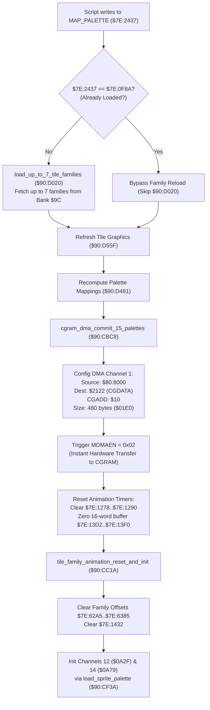

# Map Palette Family Reload Trigger & Script Palette Swapping Engine

- **ROM Locations**:
  - `reload_families_when_a_script_changes_map_palett`: `$90:CBB3` – `$90:CBC7`
  - `cgram_dma_commit_15_palettes`: `$90:CBC8` – `$90:CC19`
  - `tile_family_animation_reset_and_init`: `$90:CC1A` – `$90:CC68`
- **CPU State**: 16-bit A/X (`REP #$30`), Data Bank `$7E` / `$90`
- **WRAM Core Addresses**:
  - `$7E:2437`: Current script-selected map palette ID (`MAP_PALETTE`).
  - `$7E:0F8A`: Active/loaded palette index currently resident in VRAM/CGRAM.
  - `$80:8000`: Primary CGRAM color staging buffer (source for 480-byte DMA).
  - `$7E:128E` / `$7E:1290`: Palette animation channel 0 and 1 timers.
  - `$7E:1278`..`$7E:1286`: Animated palette cycle state and step registers.
  - `$7E:13D2`..`$7E:13F0`: 16-word animated palette channel state buffers.
  - `$7E:62A5`..`$7E:6385`: Tile family animation offsets for families 0 through 7.
  - `$7E:1432`: Animation frame hold timer.
  - `$7E:0A2F`: Character palette pointer for channel 12.
  - `$7E:0A79`: Character palette pointer for channel 14.
- **SNES Hardware Registers**:
  - `$2121`: `CGADD` (CGRAM Word Address register, written `$10`).
  - `$2122`: `CGDATA` (CGRAM Data write register).
  - `$4310`: `DMAP1` (DMA Channel 1 control parameters, mode `$08`).
  - `$4311`: `BBAD1` (DMA Channel 1 destination register, `$22` for `CGDATA`).
  - `$4312`: `A1T1L` (DMA Channel 1 source address low/high, `$8000`).
  - `$4314`: `A1B1` (DMA Channel 1 source bank, `$80`).
  - `$4315`: `DAS1L` (DMA Channel 1 transfer size, `$01E0` = 480 bytes).
  - `$420B`: `MDMAEN` (DMA enable register, written `$02` to trigger Channel 1).

---

## 1. Architectural Architecture & Subsystem Invariants

When Everscript opcodes or cutscene sequences mutate `MAP_PALETTE` (`$7E:2437`), the Secret of Evermore engine executes an atomic hardware palette reload and animation resynchronization pipeline:

### 1. Palette Deduplication & Avoidance
The engine guards against redundant hardware transfers:
$$\text{Skip Reload} \iff \text{MAP\_PALETTE} == \text{Loaded Palette Index} \ (\$7E:0F8A)$$
If equal, the expensive ROM Bank `$9C` transfer is skipped, advancing directly to VRAM and metatile palette reassignment.

### 2. 480-Byte Atomic CGRAM DMA Transfer
Palettes 1 through 15 are committed in a single hardware DMA Channel 1 operation:
$$\text{Transfer Size} = 15 \ \text{palettes} \times 16 \ \text{colors} \times 2 \ \text{bytes/color} = 480 \ \text{bytes} \ (0x01E0)$$
Palette 0 is reserved for standard UI/system backdrop and is preserved intact.

### 3. Animation Phase Alignment
A palette swap invalidates existing color animation states. The engine zeroes all animated cycle timers and resets the 8 tile family offsets (`$7E:62A5`..`$7E:6385`), before re-initializing channels 12 and 14 with party character palettes from `$0A2F` and `$0A79`.

---

## 2. Disassembly & Annotations

### Part 1: Map Palette Family Reload Trigger (`$90:CBB3` – `$90:CBC7`)
> **Interactive 65816 Assembly**:
> Centralized comments infused at runtime.
> [View in VFS: soe://rom/code/90CBB3](soe://rom/code/90CBB3?asm=1&c=0)

### Part 2: CGRAM DMA Commit & Animation Reset (`$90:CBC8` – `$90:CC19`)
> **Interactive 65816 Assembly**:
> Centralized comments infused at runtime.
> [View in VFS: soe://rom/code/90CBB3](soe://rom/code/90CBB3?asm=1&c=0)

### Part 3: Tile Family Animation Reset & Channel Initialization (`$90:CC1A` – `$90:CC68`)
> **Interactive 65816 Assembly**:
> Centralized comments infused at runtime.
> [View in VFS: soe://rom/code/90CBB3](soe://rom/code/90CBB3?asm=1&c=0)

---

## 3. Reconstructed Clean C Implementation

> **Reconstructed C Decompilation**:
> Source moved to [`reconstructed-c/90/90CBB3_palette_swap.c`](../../../reconstructed-c/90/90CBB3_palette_swap.c).
> [View in VFS: soe://rom/code/90CBB3](soe://rom/code/90CBB3?c=1&asm=0)

---

## 4. Architectural Summary

1. **Hardware DMA Specialization**:
   The routine configures SNES DMA Channel 1 for write-twice mode (`$08`), automatically streaming 16-bit color words (5 bits Red, 5 bits Green, 5 bits Blue) into PPU register `$2122` (`CGDATA`) across 15 complete palette rows (480 bytes) without CPU intervention.
2. **Channel Slot Isolation**:
   Animation channels 12 and 14 are dedicated to the player characters (Boy and Dog), ensuring party recolorations (e.g. low-HP flashing, status aura changes) are preserved even when environmental room palettes swap.
3. **Multi-Family Architecture**:
   Zeroing `$7E:62A5`..`$7E:6385` resets the phase alignment of all 8 background metatile families simultaneously, preventing visual tearing when transitioning between day/night or outdoor/indoor scenes.
