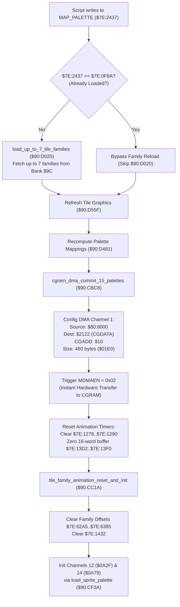

# Map Palette Family Reload Trigger & Script Palette Swapping Engine

- **ROM Locations**:
  - `reload_families_when_a_script_changes_map_palett`: `$90:CBB3` – `$90:CBC7`
  - `cgram_dma_commit_15_palettes`: `$90:CBC8` – `$90:CC19`
  - `tile_family_animation_reset_and_init`: `$90:CC1A` – `$90:CC68`
- **CPU State**: 16-bit A/X (`REP #$30`), Data Bank `$7E` / `$90`
- **WRAM Core Addresses**:
  - `$7E:2437`: Current script-selected map palette ID (`MAP_PALETTE`).
  - `$7E:0F8A`: Active/loaded palette index currently resident in VRAM/CGRAM.
  - `$80:8000`: Primary CGRAM color staging buffer (source for 480-byte DMA).
  - `$7E:128E` / `$7E:1290`: Palette animation channel 0 and 1 timers.
  - `$7E:1278`..`$7E:1286`: Animated palette cycle state and step registers.
  - `$7E:13D2`..`$7E:13F0`: 16-word animated palette channel state buffers.
  - `$7E:62A5`..`$7E:6385`: Tile family animation offsets for families 0 through 7.
  - `$7E:1432`: Animation frame hold timer.
  - `$7E:0A2F`: Character palette pointer for channel 12.
  - `$7E:0A79`: Character palette pointer for channel 14.
- **SNES Hardware Registers**:
  - `$2121`: `CGADD` (CGRAM Word Address register, written `$10`).
  - `$2122`: `CGDATA` (CGRAM Data write register).
  - `$4310`: `DMAP1` (DMA Channel 1 control parameters, mode `$08`).
  - `$4311`: `BBAD1` (DMA Channel 1 destination register, `$22` for `CGDATA`).
  - `$4312`: `A1T1L` (DMA Channel 1 source address low/high, `$8000`).
  - `$4314`: `A1B1` (DMA Channel 1 source bank, `$80`).
  - `$4315`: `DAS1L` (DMA Channel 1 transfer size, `$01E0` = 480 bytes).
  - `$420B`: `MDMAEN` (DMA enable register, written `$02` to trigger Channel 1).

---

## 1. Architectural Architecture & Subsystem Invariants

When Everscript opcodes or cutscene sequences mutate `MAP_PALETTE` (`$7E:2437`), the Secret of Evermore engine executes an atomic hardware palette reload and animation resynchronization pipeline:



### 1. Palette Deduplication & Avoidance
The engine guards against redundant hardware transfers:
$$\text{Skip Reload} \iff \text{MAP\_PALETTE} == \text{Loaded Palette Index} \ (\$7E:0F8A)$$
If equal, the expensive ROM Bank `$9C` transfer is skipped, advancing directly to VRAM and metatile palette reassignment.

### 2. 480-Byte Atomic CGRAM DMA Transfer
Palettes 1 through 15 are committed in a single hardware DMA Channel 1 operation:
$$\text{Transfer Size} = 15 \ \text{palettes} \times 16 \ \text{colors} \times 2 \ \text{bytes/color} = 480 \ \text{bytes} \ (0x01E0)$$
Palette 0 is reserved for standard UI/system backdrop and is preserved intact.

### 3. Animation Phase Alignment
A palette swap invalidates existing color animation states. The engine zeroes all animated cycle timers and resets the 8 tile family offsets (`$7E:62A5`..`$7E:6385`), before re-initializing channels 12 and 14 with party character palettes from `$0A2F` and `$0A79`.

---

## 2. Disassembly & Annotations

### Part 1: Map Palette Family Reload Trigger (`$90:CBB3` – `$90:CBC7`)
```assembly
; ==============================================================================
; reload_families_when_a_script_changes_map_palett ($90:CBB3)
; Compares MAP_PALETTE against loaded index and reloads graphics families if changed.
; ==============================================================================
$90CBB3  AF 37 24 7E LDA $7E2437       ; Current MAP_PALETTE requested by script
$90CBB7  CD 8A 0F    CMP $0F8A         ; Compare with currently resident palette index
$90CBBA  F0 04       BEQ $90CBC0       ; If matching, bypass tile family reload!
$90CBBC  22 20 D0 90 JSL $90D020       ; load_up_to_7_tile_families_from_map_palette
$90CBC0  22 5F D5 90 JSL $90D55F       ; Refresh VRAM tile family graphics
$90CBC4  20 81 D4    JSR $D481         ; Recompute metatile palette assignments
$90CBC7  6B          RTL
```

### Part 2: CGRAM DMA Commit & Animation Reset (`$90:CBC8` – `$90:CC19`)
```assembly
; ==============================================================================
; cgram_dma_commit_15_palettes ($90:CBC8)
; Transmits 480 bytes to CGRAM via DMA Channel 1 and resets animated palette timers.
; ==============================================================================
$90CBC8  E2 10       SEP #$10          ; 8-bit index registers (X/Y)
$90CBCA  A9 00 80    LDA #$8000        ; Source buffer offset $8000
$90CBCD  8D 12 43    STA $4312         ; Set DMA1 source address low/high
$90CBD0  A2 80       LDX #$80          ; Source bank $80
$90CBD2  8E 14 43    STX $4314         ; Set DMA1 source bank
$90CBD5  A2 10       LDX #$10          ; CGRAM word address $10 (Palette 1 Color 0)
$90CBD7  8E 21 21    STX $2121         ; CGADD: CGRAM destination address
$90CBDA  A2 22       LDX #$22          ; Target PPU register $2122 (CGDATA)
$90CBDC  8E 11 43    STX $4311         ; Set DMA1 destination register
$90CBDF  A9 E0 01    LDA #$01E0        ; 480 bytes (15 palettes * 32 bytes)
$90CBE2  8D 15 43    STA $4315         ; Set DMA1 transfer size
$90CBE5  A2 08       LDX #$08          ; DMA Mode: 1 register, write twice (low then high)
$90CBE7  8E 10 43    STX $4310         ; Set DMA1 control parameters
$90CBEA  A2 02       LDX #$02          ; Channel 1 enable bit
$90CBEC  8E 0B 42    STX $420B         ; MDMAEN: Fire DMA transfer immediately!

; Restore 16-bit mode and clear animation timers
$90CBEF  C2 30       REP #$30          ; 16-bit A/X
$90CBF1  9C 8E 12    STZ $128E         ; Clear palette animation channel 0 timer
$90CBF4  9C 90 12    STZ $1290         ; Clear palette animation channel 1 timer
$90CBF7  9C 78 12    STZ $1278         ; Clear animated palette cycle state
$90CBFA  9C 7A 12    STZ $127A         ; Clear animated palette step index
$90CBFD  9C 7C 12    STZ $127C
$90CC00  9C 7E 12    STZ $127E
$90CC03  9C 82 12    STZ $1282
$90CC06  9C 80 12    STZ $1280
$90CC09  9C 84 12    STZ $1284
$90CC0C  9C 86 12    STZ $1286

; Clear 16-word animated palette channel state buffers ($13D2..$13F0)
$90CC0F  A2 1E 00    LDX #$001E        ; 16 words (30 bytes)
$90CC12  9E D2 13    STZ $13D2,X       ; Clear channel state buffer entry
$90CC15  CA          DEX
$90CC16  CA          DEX
$90CC17  10 F9       BPL $90CC12       ; Loop until entire table is zeroed
$90CC19  6B          RTL
```

### Part 3: Tile Family Animation Reset & Channel Initialization (`$90:CC1A` – `$90:CC68`)
```assembly
; ==============================================================================
; tile_family_animation_reset_and_init ($90:CC1A)
; Resets tile family animation offsets and initializes sprite palette channels.
; ==============================================================================
$90CC1A  8B          PHB
$90CC1B  F4 7E 7E    PEA $7E7E
$90CC1E  AB          PLB
$90CC1F  AB          PLB               ; Data Bank = $7E

; Clear tile family animation offsets for families 0 through 7
$90CC20  9C A5 62    STZ $62A5         ; Family 0 offset
$90CC23  9C C5 62    STZ $62C5         ; Family 1 offset
$90CC26  9C E5 62    STZ $62E5         ; Family 2 offset
$90CC29  9C 05 63    STZ $6305         ; Family 3 offset
$90CC2C  9C 25 63    STZ $6325         ; Family 4 offset
$90CC2F  9C 45 63    STZ $6345         ; Family 5 offset
$90CC32  9C 65 63    STZ $6365         ; Family 6 offset
$90CC35  9C 85 63    STZ $6385         ; Family 7 offset
$90CC38  9C 32 14    STZ $1432         ; Clear animation frame hold timer

; Clear animated palette step pointers
$90CC3B  9C 78 12    STZ $1278
$90CC3E  9C 7A 12    STZ $127A
$90CC41  9C 7C 12    STZ $127C
$90CC44  9C 7E 12    STZ $127E
$90CC47  9C 82 12    STZ $1282
$90CC4A  9C 80 12    STZ $1280

; Initialize Animation Channel 12 (Boy palette)
$90CC4D  AD 2F 0A    LDA $0A2F         ; Character 0 palette descriptor pointer
$90CC50  A2 0C 00    LDX #$000C        ; Channel 12 index
$90CC53  8D 84 12    STA $1284         ; Store channel 12 pointer
$90CC56  22 3A CF 90 JSL $90CF3A       ; load_sprite_palette

; Initialize Animation Channel 14 (Dog palette)
$90CC5A  AD 79 0A    LDA $0A79         ; Character 1 palette descriptor pointer
$90CC5D  A2 0E 00    LDX #$000E        ; Channel 14 index
$90CC60  8D 86 12    STA $1286         ; Store channel 14 pointer
$90CC63  22 3A CF 90 JSL $90CF3A       ; load_sprite_palette

$90CC67  AB          PLB               ; Restore Data Bank
$90CC68  6B          RTL
```

---

## 3. Reconstructed Clean C Implementation

```c
#include <stdint.h>
#include <stdbool.h>

#define CGRAM_DMA_BYTES           480 // 15 palettes * 16 colors * 2 bytes
#define CGRAM_PALETTE_1_OFFSET    0x10 // CGADD address for Palette 1 Color 0
#define NUM_TILE_FAMILIES         8
#define ANIM_CHANNEL_BUFFER_WORDS 16

typedef struct {
    uint16_t map_palette_req;       // $7E:2437 (MAP_PALETTE)
    uint16_t loaded_palette_id;     // $7E:0F8A
    uint16_t anim_channel_timer_0;  // $7E:128E
    uint16_t anim_channel_timer_1;  // $7E:1290
    uint16_t anim_cycle_state;      // $7E:1278
    uint16_t anim_cycle_step;       // $7E:127A
    uint16_t anim_registers[6];     // $7E:127C..$7E:1286
    uint16_t anim_channel_state[ANIM_CHANNEL_BUFFER_WORDS]; // $7E:13D2..$7E:13F0
    uint16_t family_anim_offsets[NUM_TILE_FAMILIES];        // $7E:62A5..$7E:6385
    uint16_t frame_hold_timer;      // $7E:1432
    uint16_t char_palette_ptr_0;    // $7E:0A2F
    uint16_t char_palette_ptr_1;    // $7E:0A79
} PaletteSubsystemState;

extern PaletteSubsystemState g_palette_subsystem;
extern const uint8_t g_cgram_staging_buffer[512]; // Bank $80:$8000

extern void load_up_to_7_tile_families_from_map_palette(void); // $90:D020
extern void refresh_vram_tile_family_graphics(void);           // $90:D55F
extern void recompute_metatile_palette_mappings(void);         // $90:D481
extern void load_sprite_palette(uint16_t channel_idx, uint16_t palette_addr); // $90:CF3A
extern void snes_dma1_transfer_to_cgram(const void *src, uint8_t cgadd, uint16_t size);

/**
 * Triggers tile family reload and metatile reassignment if MAP_PALETTE changed.
 * Corresponds to $90:CBB3.
 */
void reload_families_when_a_script_changes_map_palette(void) {
    if (g_palette_subsystem.map_palette_req != g_palette_subsystem.loaded_palette_id) {
        // Load up to 7 tile families from Bank $9C
        load_up_to_7_tile_families_from_map_palette();
    }

    // Refresh VRAM graphics and recompute metatile palette assignments
    refresh_vram_tile_family_graphics();
    recompute_metatile_palette_mappings();
}

/**
 * Commits 15 palettes (480 bytes) from $80:8000 into CGRAM via DMA1
 * and resets all palette animation timers and channel state buffers.
 * Corresponds to $90:CBC8.
 */
void cgram_dma_commit_15_palettes(void) {
    // 1. Perform 480-byte hardware DMA Channel 1 transfer into CGRAM ($2122)
    snes_dma1_transfer_to_cgram(&g_cgram_staging_buffer[0], CGRAM_PALETTE_1_OFFSET, CGRAM_DMA_BYTES);

    // 2. Clear palette animation timers
    g_palette_subsystem.anim_channel_timer_0 = 0;
    g_palette_subsystem.anim_channel_timer_1 = 0;
    g_palette_subsystem.anim_cycle_state = 0;
    g_palette_subsystem.anim_cycle_step = 0;

    for (int i = 0; i < 6; i++) {
        g_palette_subsystem.anim_registers[i] = 0;
    }

    // 3. Clear 16-word channel state buffers ($7E:13D2..$7E:13F0)
    for (int w = 0; w < ANIM_CHANNEL_BUFFER_WORDS; w++) {
        g_palette_subsystem.anim_channel_state[w] = 0;
    }
}

/**
 * Clears tile family animation offsets and re-initializes sprite palette channels.
 * Corresponds to $90:CC1A.
 */
void tile_family_animation_reset_and_init(void) {
    // 1. Reset tile family animation offsets for families 0..7
    for (int f = 0; f < NUM_TILE_FAMILIES; f++) {
        g_palette_subsystem.family_anim_offsets[f] = 0;
    }
    g_palette_subsystem.frame_hold_timer = 0;

    // 2. Clear cycle step pointers
    g_palette_subsystem.anim_cycle_state = 0;
    g_palette_subsystem.anim_cycle_step = 0;
    for (int i = 0; i < 4; i++) {
        g_palette_subsystem.anim_registers[i] = 0;
    }

    // 3. Re-initialize Channel 12 (Boy palette) and Channel 14 (Dog palette)
    g_palette_subsystem.anim_registers[4] = g_palette_subsystem.char_palette_ptr_0;
    load_sprite_palette(0x0C, g_palette_subsystem.char_palette_ptr_0);

    g_palette_subsystem.anim_registers[5] = g_palette_subsystem.char_palette_ptr_1;
    load_sprite_palette(0x0E, g_palette_subsystem.char_palette_ptr_1);
}
```

---

## 4. Architectural Summary

1. **Hardware DMA Specialization**:
   The routine configures SNES DMA Channel 1 for write-twice mode (`$08`), automatically streaming 16-bit color words (5 bits Red, 5 bits Green, 5 bits Blue) into PPU register `$2122` (`CGDATA`) across 15 complete palette rows (480 bytes) without CPU intervention.
2. **Channel Slot Isolation**:
   Animation channels 12 and 14 are dedicated to the player characters (Boy and Dog), ensuring party recolorations (e.g. low-HP flashing, status aura changes) are preserved even when environmental room palettes swap.
3. **Multi-Family Architecture**:
   Zeroing `$7E:62A5`..`$7E:6385` resets the phase alignment of all 8 background metatile families simultaneously, preventing visual tearing when transitioning between day/night or outdoor/indoor scenes.
