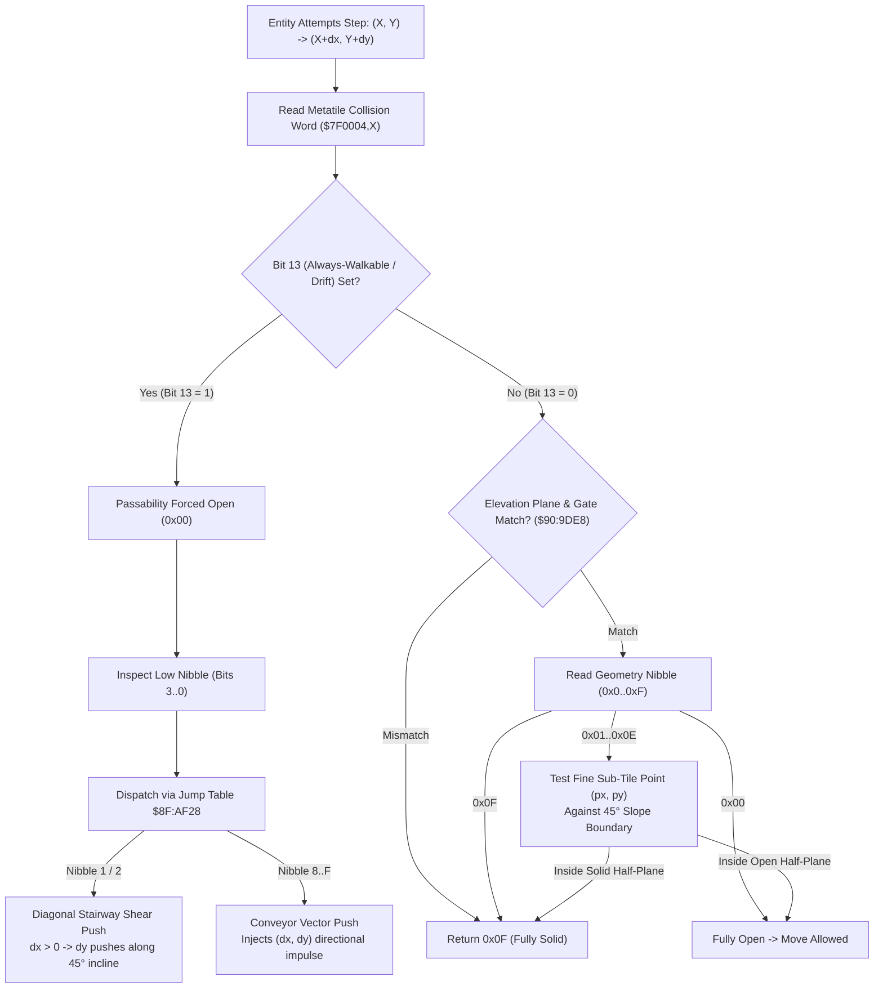

# Map Elevation Ramp, Slope Edge Detector & Conveyor Physics ($90:9DE8 / $8F:AD9F – $8F:AF28)

> **Subsystem**: Map Collision, Sub-Tile Geometry & Stairway Drift  
> **ROM Addresses**: `$90:9DE8` (`eval_tile_collision`), `$8F:AD9F` (`dispatch_tile_drift_vector`), `$8F:ADB2` (`drift_shear_stairs_push_positive`), `$8F:ADD1` (`drift_shear_stairs_push_negative`), `$8F:AF28` (16-entry drift jump table), `$8F:AF48` (`probe_metatile_collision`)  
> **Clean C Module**: `maps/slope-collision.c`  
> **Recomp Symbols**: `collision_geometry_bits_3_0_M0X0`, `bank_8F_ADB2_M0X0`, `bank_8F_ADD1_M0X0`, `bank_8F_AE16_M0X0`..`bank_8F_AE46_M0X0`  
> **Confidence**: Confirmed  

---

## 1. Architectural Role

Secret of Evermore combines a grid-based tile collision system ($16 \times 16$ pixel metatiles) with **sub-tile 45-degree slope detection** and **dynamic conveyor / stairway drift physics**. 

Each metatile in WRAM contains an 8-byte record (Layer 1 tile, Layer 2 tile, and a 16-bit **Collision Word** at `+0x04`). When an entity attempts to move from position $(X, Y)$ to $(X + dx, Y + dy)$:

1. **Elevation & Gate Filter (`$90:9DE8`)**:
   - The engine validates elevation plane matching (bits 5..4), plane transparency (bit 6), and entity filtering gates (bits 11..8).
   - If bit 13 (**Always-Walkable / Conveyor**) is set, the tile passability is forced to open (`0x00`), and bits 3..0 are re-interpreted as a **Drift Direction Vector** (`$8F:AD9F`).
   - Otherwise, bits 3..0 yield a **Sub-Tile Geometry Code** (`0x0`..`0xF`).
2. **Sub-Tile Slope Boundary Test**:
   - If the geometry code is `0x00` (open), movement is allowed.
   - If `0x0F` (solid), movement is completely blocked.
   - For slope codes (`0x01`..`0x0E`), the entity's fine coordinates within the tile $(px = X \ \& \ 15, py = Y \ \& \ 15)$ are evaluated against diagonal half-plane inequalities.
3. **Diagonal Stairway Shear & Conveyor Impulse (`$8F:AD9F` – `$8F:AF28`)**:
   - Tiles with bit 13 set introduce forced movement impulses:
     - Conveyor belts (e.g. Omnitopia sewer pipes, volcano slides, Ivor Tower conveyor belts): inject directional velocity $\Delta(dx, dy)$.
     - Diagonal stairways: shear vertical motion based on horizontal velocity ($dx > 0$ pushes North or South, aligning movement along 45-degree steps).



---

## 2. Sub-Tile Geometry Taxonomy

When bit 13 is `0`, bits 3..0 define sub-tile boundary half-planes evaluated against fine pixel coordinates $(px, py) \in [0, 15] \times [0, 15]$:

| Code | Geometry Type | Solid Condition | Description |
|---|---|---|---|
| `0x00` | Open | None | Fully walkable cell |
| `0x01`, `0x05` | SE Slope | $px + py \ge 15$ | 45° diagonal ramp, solid in South-East half |
| `0x02`, `0x06` | SW Slope | $py \ge px$ | 45° diagonal ramp, solid in South-West half |
| `0x03`, `0x04` | Top Barrier | $py \ge 8$ | North half open, South half solid |
| `0x07` | East Barrier | $px < 8$ | West half open, East half solid |
| `0x08` | West Barrier | $px \ge 8$ | East half open, West half solid |
| `0x09`, `0x0D` | NE Slope | $py \le px$ | 45° diagonal ramp, solid in North-East half |
| `0x0A`, `0x0E` | NW Slope | $px + py \le 15$ | 45° diagonal ramp, solid in North-West half |
| `0x0B`, `0x0C` | Bottom Barrier | $py < 8$ | North half solid, South half open |
| `0x0F` | Solid | All | Fully impassable cell |

---

## 3. Drift & Conveyor Dispatch Table ($8F:AF28)

When bit 13 is `1`, the low nibble selects one of 16 directional impulse handlers:

| Nibble | Handler Address | Velocity Delta $\Delta(dx, dy)$ | Physical Meaning |
|---|---|---|---|
| `0x0` | `$8F:AE46` | $(0, 0)$ | Forced walkable, no movement impulse |
| `0x1` | `$8F:ADB2` | Dynamic Shear | Moving East pushes North ($\Delta dy = -2$), West pushes South ($\Delta dy = +2$) |
| `0x2` | `$8F:ADD1` | Dynamic Shear | Moving East pushes South ($\Delta dy = +2$), West pushes North ($\Delta dy = -2$) |
| `0x3`..`0x7`| `$8F:AE46` | $(0, 0)$ | Forced walkable, no movement impulse |
| `0x8` | `$8F:AE16` | $(0, -2)$ | North conveyor drift |
| `0x9` | `$8F:AE1C` | $(+1, -1)$ | North-East conveyor drift |
| `0xA` | `$8F:AE22` | $(+2, 0)$ | East conveyor drift |
| `0xB` | `$8F:AE28` | $(+1, +1)$ | South-East conveyor drift |
| `0xC` | `$8F:AE40` | $(-1, -1)$ | North-West conveyor drift |
| `0xD` | `$8F:AE3A` | $(-2, 0)$ | West conveyor drift |
| `0xE` | `$8F:AE34` | $(-1, +1)$ | South-West conveyor drift |
| `0xF` | `$8F:AE2E` | $(0, +2)$ | South conveyor drift |

---

## 4. Disassembly Analysis

```assembly
; ==============================================================================
; dispatch_tile_drift_vector ($8F:AD9F)
; Evaluates bit 13 of tile collision word and dispatches conveyor / stairs impulse
; Entry:
;   $003C,Y : Collision word of metatile currently under entity Y
;   DP $1A  : Entity horizontal step velocity dx
;   DP $1C  : Entity vertical step velocity dy
; ==============================================================================
$8F:AD9F  B9 3C 00     LDA $003C,Y      ; Read collision word
$8F:ADA2  89 00 20     BIT #$2000       ; Is bit 13 (Always-Walkable / Drift) set?
$8F:ADA5  D0 03        BNE $ADAA        ; Yes -> process drift direction
$8F:ADA7  4C 46 AE     JMP $AE46        ; No drift -> jump to neutral exit

$8F:ADAA  29 0F 00     AND #$000F       ; Mask low nibble (direction index)
$8F:ADAD  0A           ASL A            ; Index * 2
$8F:ADAE  AA           TAX
$8F:ADAF  7C 28 AF     JMP ($AF28,X)    ; Indirect jump through table $8F:AF28

; ==============================================================================
; drift_shear_stairs_push_positive ($8F:ADB2) - Stairway Nibble 1
; ==============================================================================
$8F:ADB2  B9 1A 00     LDA $001A,Y      ; Entity world X coordinate
$8F:ADB5  59 1C 00     EOR $001C,Y      ; XOR with world Y coordinate
$8F:ADB8  89 04 00     BIT #$0004       ; Check 4-pixel diagonal grid stride
$8F:ADBB  D0 03        BNE $ADC0
$8F:ADBD  4C 46 AE     JMP $AE46        ; Neutral exit

$8F:ADC0  A5 1A        LDA $1A          ; Check entity horizontal velocity dx
$8F:ADC2  30 1E        BMI $ADE2        ; Moving West (dx < 0) -> branch
$8F:ADC4  F0 03        BEQ $ADC9        ; dx == 0 -> neutral
$8F:ADC6  4C 46 AE     JMP $AE46

$8F:ADC9  A9 FE FF     LDA #$FFFE       ; Moving East: dy = -2 (push North)
$8F:ADCC  85 1C        STA $1C
$8F:ADCE  80 17        BRA $ADE7

$8F:ADE2  A9 02 00     LDA #$0002       ; Moving West: dy = +2 (push South)
$8F:ADE5  85 1C        STA $1C

; ==============================================================================
; Probe candidate target coordinate for collisions ($8F:ADE7)
; ==============================================================================
$8F:ADE7  B9 1A 00     LDA $001A,Y      ; Current X
$8F:ADEA  85 46        STA $46          ; Target X
$8F:ADEC  B9 1C 00     LDA $001C,Y      ; Current Y
$8F:ADEF  18           CLC
$8F:ADF0  65 1C        ADC $1C          ; Add proposed vertical drift dy
$8F:ADF2  85 48        STA $48          ; Target Y
$8F:ADF4  22 48 AF 8F  JSL $8FAF48      ; Probe metatile collision at (target X, target Y)
$8F:ADF8  90 03        BCC $ADFD        ; Carry clear = passable -> apply drift
$8F:ADFA  4C E7 AE     JMP $AEE7        ; Collision blocked -> discard drift

$8F:ADFD  ...                           ; Commit proposed displacement
```

---

## 5. Clean C Implementation

```c
#include <stdint.h>
#include <stdbool.h>

#define COLLISION_GEOMETRY_MASK  0x000F
#define COLLISION_PLANE_MASK     0x0030
#define COLLISION_FLAG_PT        0x0040 /* Bit 6: Plane-Transparent */
#define COLLISION_ENTITY_GATE    0x0F00 /* Bits 11..8: Entity Gate Nibble */
#define COLLISION_GATE_ACTIVE    0x0100 /* Bit 8: Gate Active Flag */
#define COLLISION_FLAG_AW        0x2000 /* Bit 13: Always-Walkable / Conveyor */

#define GEOMETRY_OPEN            0x00
#define GEOMETRY_SOLID           0x0F

typedef struct {
    int16_t dx;
    int16_t dy;
} Vector2D;

/**
 * Tests whether a point within a metatile falls within the solid half-plane
 * of a given sub-tile slope or barrier geometry code.
 *
 * @param geom_code Sub-tile geometry nibble (0x0..0xF).
 * @param px        Fine X pixel offset within cell (0..15).
 * @param py        Fine Y pixel offset within cell (0..15).
 * @return True if the point is solid (impassable), false if walkable.
 */
bool is_subtile_slope_solid(uint8_t geom_code, uint8_t px, uint8_t py) {
    switch (geom_code & 0x0F) {
        case 0x00:
            return false; /* Fully open */
        case 0x01:
        case 0x05:
            return (px + py) >= 15; /* South-East 45° slope */
        case 0x02:
        case 0x06:
            return py >= px; /* South-West 45° slope */
        case 0x03:
        case 0x04:
            return py >= 8; /* Top barrier (North half open, South solid) */
        case 0x07:
            return px < 8; /* East barrier (West open, East solid) */
        case 0x08:
            return px >= 8; /* West barrier (East open, West solid) */
        case 0x09:
        case 0x0D:
            return py <= px; /* North-East 45° slope */
        case 0x0A:
        case 0x0E:
            return (px + py) <= 15; /* North-West 45° slope */
        case 0x0B:
        case 0x0C:
            return py < 8; /* Bottom barrier (North solid, South open) */
        case 0x0F:
        default:
            return true; /* Fully solid */
    }
}

/**
 * Evaluates the conveyor impulse or diagonal stairway shear vector from
 * an always-walkable metatile (collision word bit 13 = 1).
 *
 * Implements the exact behavioral dispatch of $8F:AD9F through $8F:AF28.
 *
 * @param collision_word 16-bit metatile collision word.
 * @param world_x        Current entity world X coordinate.
 * @param world_y        Current entity world Y coordinate.
 * @param current_dx     Entity current horizontal velocity dx.
 * @return Directional velocity delta to apply to the entity.
 */
Vector2D eval_tile_drift_vector(uint16_t collision_word, uint16_t world_x, uint16_t world_y, int16_t current_dx) {
    Vector2D drift = { 0, 0 };

    /* Only tiles with bit 13 set generate drift impulses */
    if ((collision_word & COLLISION_FLAG_AW) == 0) {
        return drift;
    }

    uint8_t dir = collision_word & COLLISION_GEOMETRY_MASK;

    switch (dir) {
        case 0x01:
            /* Diagonal Stairs Shear Push (Positive 45° Ramp) */
            if (((world_x ^ world_y) & 0x0004) != 0) {
                if (current_dx > 0) {
                    drift.dy = -2; /* Moving East pushes North */
                } else if (current_dx < 0) {
                    drift.dy = +2; /* Moving West pushes South */
                }
            }
            break;

        case 0x02:
            /* Reverse Diagonal Stairs Shear Push (Negative 45° Ramp) */
            if (((world_x ^ world_y) & 0x0004) != 0) {
                if (current_dx > 0) {
                    drift.dy = +2; /* Moving East pushes South */
                } else if (current_dx < 0) {
                    drift.dy = -2; /* Moving West pushes North */
                }
            }
            break;

        case 0x08: drift.dx =  0; drift.dy = -2; break; /* North */
        case 0x09: drift.dx = +1; drift.dy = -1; break; /* North-East */
        case 0x0A: drift.dx = +2; drift.dy =  0; break; /* East */
        case 0x0B: drift.dx = +1; drift.dy = +1; break; /* South-East */
        case 0x0C: drift.dx = -1; drift.dy = -1; break; /* North-West */
        case 0x0D: drift.dx = -2; drift.dy =  0; break; /* West */
        case 0x0E: drift.dx = -1; drift.dy = +1; break; /* South-West */
        case 0x0F: drift.dx =  0; drift.dy = +2; break; /* South */

        case 0x00:
        case 0x03:
        case 0x04:
        case 0x05:
        case 0x06:
        case 0x07:
        default:
            /* Neutral walkable: no drift */
            break;
    }

    return drift;
}
```

---

## 6. Verification & Behavioral Invariants

1. **Table Nullification**:
   - In `$90:9E3A`, when bit 13 is set, the geometry code lookup reads from `$90:9E73` (a ROM table of 32 zeros), guaranteeing that bit-13 tiles are unconditionally open for passability checks before applying their drift vectors.
2. **Shear Stride Phase**:
   - The condition `((world_x ^ world_y) & 4) != 0` ensures that stairway nudging occurs every 4 pixels along the diagonal staircase, producing a natural, fluid walking progression along 45-degree isometric stairs without jitter.
3. **Collision Discard**:
   - If the proposed drift step $(X + dx, Y + dy)$ results in an impassable cell (verified via `$8FAF48`), the drift vector is discarded (`$8FAEE7`), preventing conveyor belts or stairs from pushing entities into solid walls.
