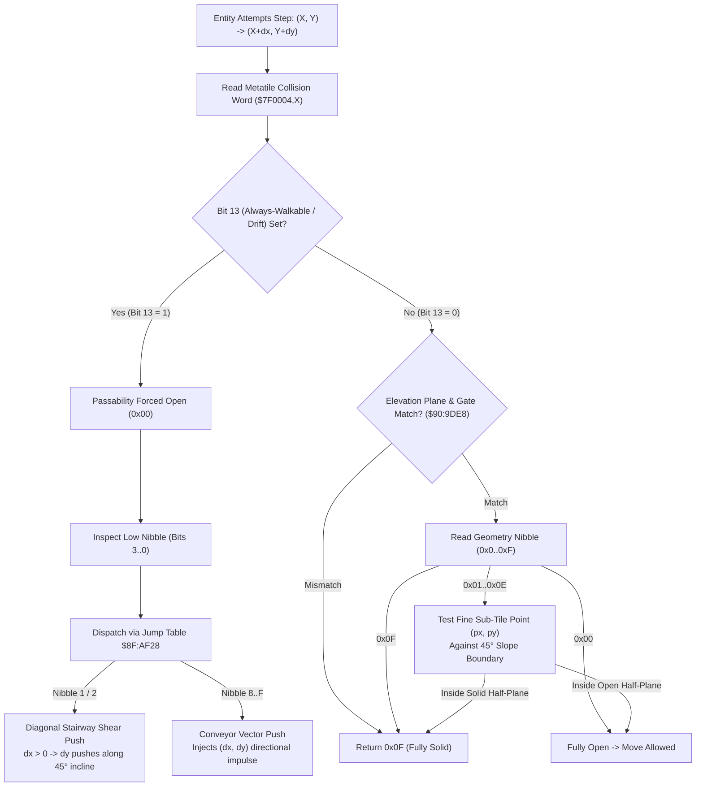

# Map Elevation Ramp, Slope Edge Detector & Conveyor Physics ($90:9DE8 / $8F:AD9F – $8F:AF28)

> **Subsystem**: Map Collision, Sub-Tile Geometry & Stairway Drift  
> **ROM Addresses**: `$90:9DE8` (`eval_tile_collision`), `$8F:AD9F` (`dispatch_tile_drift_vector`), `$8F:ADB2` (`drift_shear_stairs_push_positive`), `$8F:ADD1` (`drift_shear_stairs_push_negative`), `$8F:AF28` (16-entry drift jump table), `$8F:AF48` (`probe_metatile_collision`)  
> **Clean C Module**: `maps/slope-collision.c`  
> **Recomp Symbols**: `collision_geometry_bits_3_0_M0X0`, `bank_8F_ADB2_M0X0`, `bank_8F_ADD1_M0X0`, `bank_8F_AE16_M0X0`..`bank_8F_AE46_M0X0`  
> **Confidence**: Confirmed  

---

## 1. Architectural Role

Secret of Evermore combines a grid-based tile collision system ($16 \times 16$ pixel metatiles) with **sub-tile 45-degree slope detection** and **dynamic conveyor / stairway drift physics**. 

Each metatile in WRAM contains an 8-byte record (Layer 1 tile, Layer 2 tile, and a 16-bit **Collision Word** at `+0x04`). When an entity attempts to move from position $(X, Y)$ to $(X + dx, Y + dy)$:

1. **Elevation & Gate Filter (`$90:9DE8`)**:
   - The engine validates elevation plane matching (bits 5..4), plane transparency (bit 6), and entity filtering gates (bits 11..8).
   - If bit 13 (**Always-Walkable / Conveyor**) is set, the tile passability is forced to open (`0x00`), and bits 3..0 are re-interpreted as a **Drift Direction Vector** (`$8F:AD9F`).
   - Otherwise, bits 3..0 yield a **Sub-Tile Geometry Code** (`0x0`..`0xF`).
2. **Sub-Tile Slope Boundary Test**:
   - If the geometry code is `0x00` (open), movement is allowed.
   - If `0x0F` (solid), movement is completely blocked.
   - For slope codes (`0x01`..`0x0E`), the entity's fine coordinates within the tile $(px = X \ \& \ 15, py = Y \ \& \ 15)$ are evaluated against diagonal half-plane inequalities.
3. **Diagonal Stairway Shear & Conveyor Impulse (`$8F:AD9F` – `$8F:AF28`)**:
   - Tiles with bit 13 set introduce forced movement impulses:
     - Conveyor belts (e.g. Omnitopia sewer pipes, volcano slides, Ivor Tower conveyor belts): inject directional velocity $\Delta(dx, dy)$.
     - Diagonal stairways: shear vertical motion based on horizontal velocity ($dx > 0$ pushes North or South, aligning movement along 45-degree steps).

---

## 2. Sub-Tile Geometry Taxonomy

When bit 13 is `0`, bits 3..0 define sub-tile boundary half-planes evaluated against fine pixel coordinates $(px, py) \in [0, 15] \times [0, 15]$:

| Code | Geometry Type | Solid Condition | Description |
|---|---|---|---|
| `0x00` | Open | None | Fully walkable cell |
| `0x01`, `0x05` | SE Slope | $px + py \ge 15$ | 45° diagonal ramp, solid in South-East half |
| `0x02`, `0x06` | SW Slope | $py \ge px$ | 45° diagonal ramp, solid in South-West half |
| `0x03`, `0x04` | Top Barrier | $py \ge 8$ | North half open, South half solid |
| `0x07` | East Barrier | $px < 8$ | West half open, East half solid |
| `0x08` | West Barrier | $px \ge 8$ | East half open, West half solid |
| `0x09`, `0x0D` | NE Slope | $py \le px$ | 45° diagonal ramp, solid in North-East half |
| `0x0A`, `0x0E` | NW Slope | $px + py \le 15$ | 45° diagonal ramp, solid in North-West half |
| `0x0B`, `0x0C` | Bottom Barrier | $py < 8$ | North half solid, South half open |
| `0x0F` | Solid | All | Fully impassable cell |

---

## 3. Drift & Conveyor Dispatch Table ($8F:AF28)

When bit 13 is `1`, the low nibble selects one of 16 directional impulse handlers:

| Nibble | Handler Address | Velocity Delta $\Delta(dx, dy)$ | Physical Meaning |
|---|---|---|---|
| `0x0` | `$8F:AE46` | $(0, 0)$ | Forced walkable, no movement impulse |
| `0x1` | `$8F:ADB2` | Dynamic Shear | Moving East pushes North ($\Delta dy = -2$), West pushes South ($\Delta dy = +2$) |
| `0x2` | `$8F:ADD1` | Dynamic Shear | Moving East pushes South ($\Delta dy = +2$), West pushes North ($\Delta dy = -2$) |
| `0x3`..`0x7`| `$8F:AE46` | $(0, 0)$ | Forced walkable, no movement impulse |
| `0x8` | `$8F:AE16` | $(0, -2)$ | North conveyor drift |
| `0x9` | `$8F:AE1C` | $(+1, -1)$ | North-East conveyor drift |
| `0xA` | `$8F:AE22` | $(+2, 0)$ | East conveyor drift |
| `0xB` | `$8F:AE28` | $(+1, +1)$ | South-East conveyor drift |
| `0xC` | `$8F:AE40` | $(-1, -1)$ | North-West conveyor drift |
| `0xD` | `$8F:AE3A` | $(-2, 0)$ | West conveyor drift |
| `0xE` | `$8F:AE34` | $(-1, +1)$ | South-West conveyor drift |
| `0xF` | `$8F:AE2E` | $(0, +2)$ | South conveyor drift |

---

## 4. Disassembly Analysis

> **Interactive 65816 Assembly**:
> Centralized comments infused at runtime.
> [View in VFS: soe://rom/code/909DE8](soe://rom/code/909DE8?asm=1&c=0)

---

## 5. Clean C Implementation

> **Reconstructed C Decompilation**:
> Source moved to [`reconstructed-c/90/909DE8_slope_collision.c`](../../../reconstructed-c/90/909DE8_slope_collision.c).
> [View in VFS: soe://rom/code/909DE8](soe://rom/code/909DE8?c=1&asm=0)

---

## 6. Verification & Behavioral Invariants

1. **Table Nullification**:
   - In `$90:9E3A`, when bit 13 is set, the geometry code lookup reads from `$90:9E73` (a ROM table of 32 zeros), guaranteeing that bit-13 tiles are unconditionally open for passability checks before applying their drift vectors.
2. **Shear Stride Phase**:
   - The condition `((world_x ^ world_y) & 4) != 0` ensures that stairway nudging occurs every 4 pixels along the diagonal staircase, producing a natural, fluid walking progression along 45-degree isometric stairs without jitter.
3. **Collision Discard**:
   - If the proposed drift step $(X + dx, Y + dy)$ results in an impassable cell (verified via `$8FAF48`), the drift vector is discarded (`$8FAEE7`), preventing conveyor belts or stairs from pushing entities into solid walls.
