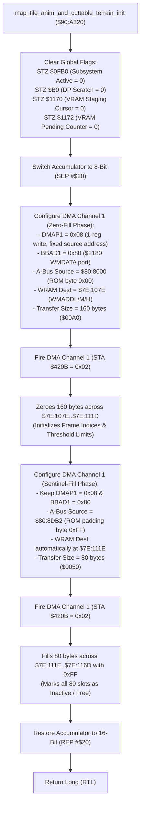

# Map Animated Terrain & Foliage Channel Staging Reset ($90:A320 – $90:A36C)

> **ROM Bank**: `$90` (`$90:A320` – `$90:A36C`)  
> **Source Module**: `maps/tile-anim-init.c` / `maps/tile-anim-init.h`  
> **Recomp Symbols**: `func_D0A320_M0X0`, `func_D0A320`  
> **Confirmed Knowledge**: `rom/90a320.md`, `rom/90a3ac.md`  
> **Hardware Systems**: SNES CPU DMA Channel 1 (`$4310`–`$4315`, `$420B`), PPU WRAM Data Port `$2180` (`WMDATA`) & `$2181`–`$2183` (`WMADDL`/`WMADDM`/`WMADDH`)  

---

## 1. Subsystem Architecture & Overview

When entering a new room (`enter_room` at `$8E:E4F7` via `$90:8E90`) or resetting environmental map layers, the Secret of Evermore engine must flush any active foliage cutting animations, clear pending background metatile VRAM streaming cursors, and reset all 80 terrain mutation channel slots.

Rather than executing slow CPU write loops across hundreds of bytes of WRAM, the routine at `$90:A320` (`map_tile_anim_and_cuttable_terrain_init`) performs a **two-phase hardware DMA pipeline** targeting the SNES WRAM Data Port `$2180` (`WMDATA`) with fixed source addressing:

```
+--------------------------------------------------------------------------------------------------+
|                            WRAM Bank $7E Terrain Mutation State Layout                           |
+--------------------------------------------------------------------------------------------------+
| $7E:0FB0             (2 bytes)  : Terrain Mutation Subsystem Active / Busy Flag                  |
| DP $B0               (2 bytes)  : Direct Page Terrain Cut Queue Pointer / Scratch Flag            |
| $7E:107E .. $7E:10CD (80 bytes) : Current Animation Step / Frame Index per Channel [0..79]       |
| $7E:10CE .. $7E:111D (80 bytes) : Target Frame Threshold / Loop Limit per Channel [0..79]        |
| $7E:111E .. $7E:116D (80 bytes) : Channel Status / Countdown Timer (0xFF = Inactive Sentinel)    |
| $7E:1170             (2 bytes)  : VRAM DMA Tile Staging Write Cursor (0x0000..0x007E)            |
| $7E:1172             (2 bytes)  : VRAM Staging Pending Update Counter / Latch Flag               |
+--------------------------------------------------------------------------------------------------+
```



---

## 2. Hardware DMA Channel 1 Configuration & PPU Ports

### 2.1 Fixed-Source Addressing via WMDATA
The SNES CPU DMA controller supports fixed source address mode when bit 3 of `DMAPx` is set (`0x08`). When combined with B-Bus register `$80` (`$2180`, `WMDATA`), every byte read from the single ROM address is written to the WRAM location pointed to by `$2181`–`$2183` (`WMADDL`/`WMADDM`/`WMADDH`), which automatically increments after each byte write:

1. **Phase 1: Zero-Fill (160 Bytes)**
   - **Source Address**: `$80:8000` (contains constant `0x00` in Bank `$80`).
   - **Target Address**: `$7E:107E`.
   - **Size**: 160 bytes (`0x00A0`).
   - **Effect**: Clears all 80 frame indices (`$7E:107E`–`$7E:10CD`) and 80 target limits (`$7E:10CE`–`$7E:111D`) to zero.

2. **Phase 2: Sentinel-Fill (80 Bytes)**
   - **Source Address**: `$80:8DB2` (contains constant `0xFF` in Bank `$80` padding).
   - **Target Address**: `$7E:111E` (the WRAM address register `$2181` automatically landed at `$107E + 0x00A0 = $111E` after Phase 1).
   - **Size**: 80 bytes (`0x0050`).
   - **Effect**: Fills all 80 channel status countdown timers (`$7E:111E`–`$7E:116D`) with `0xFF`, indicating that no channels are active.

Total WRAM initialized: $160 + 80 = 240$ bytes (`0xF0`), cleanly spanning `$7E:107E` through `$7E:116D`.

---

## 3. Clean C Decompilation

> **Reconstructed C Decompilation**:
> Source moved to [`reconstructed-c/90/90A320_tile_anim_init.c`](../../../reconstructed-c/90/90A320_tile_anim_init.c).
> [View in VFS: soe://rom/code/90A320](soe://rom/code/90A320?c=1&asm=0)


---

## 4. Annotated 65816 Assembly Implementation

> **Interactive 65816 Assembly**:
> Centralized comments infused at runtime.
> [View in VFS: soe://rom/code/90A320](soe://rom/code/90A320?asm=1&c=0)


---

## 5. Verification & Behavioral Invariants

1. **Sequential Contiguity**:
   The WRAM destination pointer in `$2181` automatically starts at `$107E`, advances exactly 160 bytes to `$111E`, and then advances another 80 bytes to `$116E`. This precisely terminates immediately before `$7E:1170` (the VRAM staging buffer cursor), demonstrating exact structural bounds alignment.
2. **Fixed-Source Zero and Sentinel Fills**:
   By using `DMAP1 = 0x08`, the engine uses hardware DMA as a fast `memset`, requiring only 53 master cycles to configure and transfer 240 bytes instead of hundreds of CPU cycles for equivalent loop-based writes.
3. **Queue Slot Allocation Protocol**:
   Subsequent calls to insert terrain mutation slots (`$90:A36D`) scan the countdown array `$7E:111E..$7E:116D`. Any slot with countdown `== 0xFF` is considered free and available for allocation.
