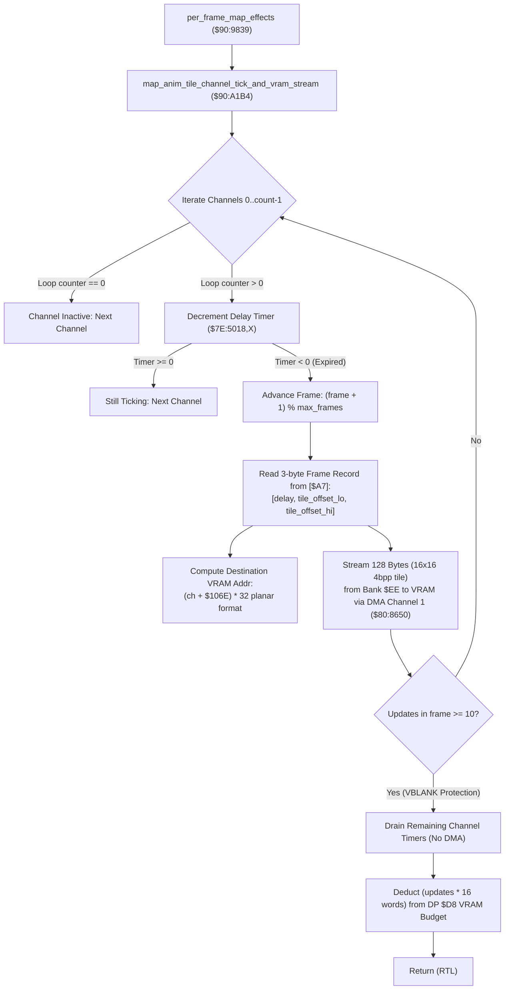

# Map Background Tile Animation Engine & Amortized VRAM Streaming Pipeline

> **ROM Bank**: `$90` (`$90:A1B4` – `$90:A31F`)  
> **Source Module**: `maps/tile-animation.c` / `maps/tile-animation.h`  
> **Recomp Symbols**: `func_D0A1B4`, `bank_90_A2A2_M0X0`  
> **Confirmed Knowledge**: [`rom/90a1b4.md`](file:///Users/v/Documents/GitHub/everscript-vscode/src/games/evermore/localizations/knowledge/rom/90a1b4.md), [`rom/90a2a2.md`](file:///Users/v/Documents/GitHub/everscript-vscode/src/games/evermore/localizations/knowledge/rom/90a2a2.md)  
> **Hardware Systems**: SNES PPU VRAM, DMA Channel 1 (`$4310`–`$4315`, `$420B`), Direct Page Pointer Indirect Long `[$A7]`  

---

## 1. Subsystem Architecture & Overview

The Secret of Evermore engine powers dynamic environmental map tile animation—such as flowing waterfalls, conveyor belts, toxic swamp bubbles, glowing magma surges, and rotating machine gears—through a dedicated **50-channel background tile animation engine** residing in Bank `$90`.

Every frame, the master per-frame map processing coordinator `per_frame_map_effects` (`$90:9839`) invokes `map_anim_tile_channel_tick_and_vram_stream` (`$90:A1B4`). The subsystem manages 50 independent animation channels allocated across WRAM Bank `$7E`:

```
+--------------------------------------------------------------------------------------------------+
|                              WRAM Bank $7E Animation State Buffers                               |
+--------------------------------------------------------------------------------------------------+
| $7E:4FE6 .. $7E:5017 (50 bytes) : Current Animation Frame Index per Channel [0..49]              |
| $7E:5018 .. $7E:5049 (50 bytes) : Countdown Delay Timer per Channel (Ticks remaining)            |
| $7E:504A .. $7E:507B (50 bytes) : Loop Counter (0 = Disabled, 0xFF = Infinite, >0 = Decrementing)|
| $7E:507D .. $7E:509D (32 bytes) : ROM Descriptor Slot Table Pointers                             |
| $7E:106C             (2 bytes)  : Total Number of Active Channels for Current Map                |
| $7E:106E             (2 bytes)  : Base VRAM 8x8 Tile Slot Offset for Animated Metatiles          |
+--------------------------------------------------------------------------------------------------+
```



### Amortized DMA Bandwidth Control
Updating animated tiles requires transferring **128 bytes** (a 16×16 4bpp macro-tile comprised of four 8×8 character planes: $4 \times 32 = 128$ bytes) into SNES PPU VRAM. To avoid exceeding the strict ~6 KB blanking transfer budget of the SNES NMI VBLANK period, the engine enforces a hard cap of **10 tile uploads per frame** (`STA $02 = 10`). Once 10 channels have uploaded graphics in a single frame, subsequent expired channels defer their DMA transmission to the following frame while still ticking their internal delay counters.

Furthermore, the routine calculates the exact number of transfers executed (`count = 10 - remaining_budget`), converts it to word cost (`count * 16 words`), and deducts it from Direct Page `$00D8` (`per_frame_vram_dma_budget`), ensuring synchronization with OAM sprite generation (`$80:919E`) and font streaming (`$8C:A753`).

---

## 2. ROM Animation Descriptor Layout

Each map's animation sequence is defined by a binary descriptor block addressed via Direct Page 24-bit pointer `[$A7]`:

```
+---------------+---------------------+------------------------------------------------------------+
| Byte Offset   | Field Name          | Description                                                |
+---------------+---------------------+------------------------------------------------------------+
| +0x00         | channel_id          | Unique channel / property identifier key (matches DP $06)  |
| +0x01         | max_frames          | Total number of keyframes in sequence                      |
| +0x02         | frame_table_offset  | 16-bit offset to start of 3-byte frame records             |
+---------------+---------------------+------------------------------------------------------------+
```

Each frame record consists of 3 packed bytes:
- **Byte 0 (`delay`)**: Duration in video frames (~16.6 ms per tick) before advancing to next frame.
- **Bytes 1–2 (`source_tile_offset`)**: 16-bit pointer into Bank `$EE` (`$EE:0000`) locating the uncompressed 128-byte 4bpp pixel matrix.

---

## 3. Clean C Decompilation

```c
#include "maps/tile-animation.h"
#include "engine-core/vram-dma.h"

// ----------------------------------------------------------------------------
// WRAM Bank $7E Animation State Tables
// ----------------------------------------------------------------------------
#define ANIM_MAX_CHANNELS           50
#define ANIM_MAX_UPDATES_PER_FRAME  10

// Base WRAM state arrays
extern uint8_t  g_anim_channel_frame_index[ANIM_MAX_CHANNELS]; // $7E:4FE6..$7E:5017
extern int8_t   g_anim_channel_delay_timer[ANIM_MAX_CHANNELS]; // $7E:5018..$7E:5049
extern uint8_t  g_anim_channel_loop_count[ANIM_MAX_CHANNELS];  // $7E:504A..$7E:507B
extern uint16_t g_anim_slot_table[16];                         // $7E:507D..$7E:509D

extern uint16_t g_active_anim_channel_count;                   // $7E:106C
extern uint16_t g_anim_vram_base_tile_slot;                    // $7E:106E
extern uint16_t g_per_frame_vram_budget;                       // DP $00D8

// Direct page indirect 24-bit pointer to ROM map animation descriptor
extern const uint8_t *g_rom_anim_descriptor_ptr;               // DP $A7 (24-bit)

// Bank $EE Master Graphics Catalog
extern const uint8_t g_rom_bank_ee_tiles[];                    // $EE:0000

// ----------------------------------------------------------------------------
// map_anim_tile_channel_tick_and_vram_stream ($90:A1B4)
// ----------------------------------------------------------------------------
void map_anim_tile_channel_tick_and_vram_stream(void) {
    uint16_t update_budget = ANIM_MAX_UPDATES_PER_FRAME; // DP $02 = 10
    uint16_t total_channels = g_active_anim_channel_count;
    uint16_t ch = 0;

    // Scan all active animation channels
    while (ch < total_channels) {
        // Skip inactive or paused channels
        if (g_anim_channel_loop_count[ch] == 0) {
            ch++;
            continue;
        }

        // Decrement channel countdown delay
        g_anim_channel_delay_timer[ch]--;
        if (g_anim_channel_delay_timer[ch] >= 0) {
            // Still in active keyframe duration
            ch++;
            continue;
        }

        // Timer expired: Advance to next animation frame
        uint16_t desc_offset = ch * 4 + 1;
        uint8_t max_frames = g_rom_anim_descriptor_ptr[desc_offset];
        
        uint8_t current_frame = g_anim_channel_frame_index[ch] + 1;
        if (current_frame >= max_frames) {
            current_frame = 0; // Wraparound to start of sequence
        }
        g_anim_channel_frame_index[ch] = current_frame;

        // Resolve frame record offset: base + (frame * 3)
        uint16_t frame_rec_base = *(const uint16_t *)&g_rom_anim_descriptor_ptr[desc_offset + 1];
        uint16_t frame_rec_offset = frame_rec_base + (current_frame * 3);

        // Read frame duration and reload countdown timer
        uint8_t frame_duration = g_rom_anim_descriptor_ptr[frame_rec_offset];
        g_anim_channel_delay_timer[ch] += frame_duration;

        // Decrement loop counter unless configured for infinite looping (0xFF)
        if (g_anim_channel_loop_count[ch] != 0xFF) {
            g_anim_channel_loop_count[ch]--;
        }

        // Compute destination VRAM planar address
        // Tile slot: (channel + base_slot) * 32
        uint16_t tile_slot = (ch + g_anim_vram_base_tile_slot) * 32;
        uint16_t vram_dest_word = (tile_slot & 0x00E0) | ((tile_slot << 1) & 0xFE00);

        // Resolve source graphic pointer in Bank $EE
        uint16_t rom_source_offset = *(const uint16_t *)&g_rom_anim_descriptor_ptr[frame_rec_offset + 1];
        const uint8_t *source_data = &g_rom_bank_ee_tiles[rom_source_offset];

        // Stream 128 bytes (16x16 4bpp tile = two 64-byte halves) into VRAM via DMA Channel 1
        // First 64-byte block
        vram_dma_upload_tile_block(source_data, vram_dest_word, 64);
        
        // Second 64-byte block (offset by +64 bytes, VRAM +0x0100)
        vram_dma_upload_tile_block(source_data + 64, vram_dest_word + 0x0100, 64);

        // Deduct from per-frame transmission budget
        update_budget--;
        ch++;

        // If transfer budget exhausted, drain remaining channel timers without DMA
        if (update_budget == 0) {
            while (ch < total_channels) {
                if (g_anim_channel_loop_count[ch] != 0) {
                    g_anim_channel_delay_timer[ch]--;
                }
                ch++;
            }
            break;
        }
    }

    // Account for VRAM bandwidth: deduct (updates * 16 words) from DP $00D8
    uint16_t updates_performed = ANIM_MAX_UPDATES_PER_FRAME - update_budget;
    uint16_t words_consumed = updates_performed * 16;
    
    if (g_per_frame_vram_budget >= words_consumed) {
        g_per_frame_vram_budget -= words_consumed;
    } else {
        g_per_frame_vram_budget = 0;
    }
}

// ----------------------------------------------------------------------------
// map_anim_tile_channel_search_or_activate ($90:A2A2)
// ----------------------------------------------------------------------------
bool map_anim_tile_channel_search_or_activate(uint16_t search_key, uint8_t initial_loops) {
    uint16_t slot_idx = 0;
    uint16_t desc_offset = g_anim_slot_table[slot_idx];

    // Scan descriptor slot table until negative sentinel ($FFFF)
    while ((int16_t)desc_offset >= 0) {
        if (g_rom_anim_descriptor_ptr[desc_offset] == (uint8_t)search_key) {
            // Match found: resolve channel index (offset / 4)
            uint16_t ch = desc_offset >> 2;

            if (g_rom_anim_descriptor_ptr[desc_offset] == (uint8_t)search_key) {
                uint8_t initial_delay = g_rom_anim_descriptor_ptr[desc_offset + 1];

                // Configure channel execution state
                if (initial_loops == 0) {
                    g_anim_channel_frame_index[ch] = 0;
                    g_anim_channel_delay_timer[ch] = 0;
                    g_anim_channel_loop_count[ch] = 0xFF; // Infinite loop
                } else {
                    g_anim_channel_loop_count[ch] = initial_loops;
                    g_anim_channel_delay_timer[ch] = initial_delay;
                }
                return true;
            }
        }

        slot_idx++;
        desc_offset = g_anim_slot_table[slot_idx];
    }

    return false; // Key not present in active room descriptors
}
```

---

## 4. Annotated 65c816 Assembly

```assembly
; ==============================================================================
; map_anim_tile_channel_tick_and_vram_stream ($90:A1B4)
; Updates 50 map background tile animation channels and streams VRAM tiles
; ==============================================================================
$90:A1B4  8B          PHB
$90:A1B5  F4 7E 7E    PEA $7E7E
$90:A1B8  AB          PLB
$90:A1B9  AB          PLB               ; DB = $7E (WRAM Data Bank)
$90:A1BA  A9 0A 00    LDA #$000A
$90:A1BD  85 02       STA $02           ; DP $02 = 10 (Max tile upload budget per frame)
$90:A1BF  A2 FF FF    LDX #$FFFF
$90:A1C2  E2 20       SEP #$20          ; 8-bit Accumulator

; ------------------------------------------------------------------------------
; Main Channel Iteration Loop
; ------------------------------------------------------------------------------
L_A1C4:
$90:A1C4  E8          INX               ; Channel index X++
$90:A1C5  BD 4A 50    LDA $504A,X       ; Read channel loop counter ($7E:504A,X)
$90:A1C8  F0 FA       BEQ L_A1C4        ; If 0, channel is inactive -> skip
$90:A1CA  EC 6C 10    CPX $106C         ; Compare against active channel count ($7E:106C)
$90:A1CD  F0 07       BEQ L_A1D6        ; If X == count, all channels scanned -> exit
$90:A1CF  DE 18 50    DEC $5018,X       ; Decrement delay timer ($7E:5018,X)
$90:A1D2  10 F0       BPL L_A1C4        ; If timer >= 0, still ticking -> next channel
$90:A1D4  80 03       BRA L_A1D9        ; Timer expired: advance keyframe

L_A1D6:
$90:A1D6  80 AB       BRA L_A283        ; Branch to completion and budget cleanup

; ------------------------------------------------------------------------------
; Keyframe Advance & Descriptor Resolution
; ------------------------------------------------------------------------------
L_A1D9:
$90:A1D9  C2 30       REP #$30          ; 16-bit A, X, Y
$90:A1DB  8A          TXA
$90:A1DC  0A          ASL A
$90:A1DD  0A          ASL A             ; A = channel * 4
$90:A1DE  A8          TAY
$90:A1DF  E2 20       SEP #$20          ; 8-bit A
$90:A1E1  C8          INY               ; Y = channel * 4 + 1
$90:A1E2  A7 A7       LDA [$A7],Y       ; Load max_frames from descriptor
$90:A1E4  85 12       STA $12
$90:A1E6  BD E6 4F    LDA $4FE6,X       ; Load current frame index ($7E:4FE6,X)
$90:A1E9  1A          INC A             ; Frame++
$90:A1EA  C5 12       CMP $12           ; Compare with max_frames
$90:A1EC  D0 02       BNE L_A1EF
$90:A1EE  A9 00       LDA #$00          ; Wraparound to 0
L_A1EF:
$90:A1EF  9D E6 4F    STA $4FE6,X       ; Store updated frame index
$90:A1F2  C2 30       REP #$30          ; 16-bit A, X, Y
$90:A1F4  29 FF 00    AND #$00FF
$90:A1F7  85 12       STA $12
$90:A1F9  0A          ASL A             ; frame * 2
$90:A1FA  65 12       ADC $12           ; frame * 3
$90:A1FC  C8          INY
$90:A1FD  77 A7       ADC [$A7],Y       ; Add base offset of frame records
$90:A1FF  A8          TAY               ; Y = offset to current 3-byte record
$90:A200  E2 20       SEP #$20          ; 8-bit A
$90:A202  A7 A7       LDA [$A7],Y       ; Read frame delay
$90:A204  7D 18 50    ADC $5018,X       ; Add to timer with carry precision
$90:A207  9D 18 50    STA $5018,X       ; Reload countdown timer
$90:A20A  BD 4A 50    LDA $504A,X       ; Read loop counter
$90:A20D  C9 FF       CMP #$FF          ; Infinite loop check
$90:A20F  F0 04       BEQ L_A215
$90:A211  3A          DEC A             ; Decrement loop counter
$90:A212  9D 4A 50    STA $504A,X
L_A215:
$90:A215  DA          PHX               ; Preserve channel index on stack
$90:A216  C2 31       REP #$31          ; 16-bit A, X, Y, CLC
$90:A218  8A          TXA
$90:A219  6D 6E 10    ADC $106E         ; Add base VRAM tile slot ($7E:106E)
$90:A21C  0A          ASL A
$90:A21D  0A          ASL A
$90:A21E  0A          ASL A
$90:A21F  0A          ASL A
$90:A220  0A          ASL A             ; A = tile_slot * 32
$90:A221  85 12       STA $12
$90:A223  29 E0 00    AND #$00E0
$90:A226  85 2E       STA $2E           ; DP $2E = tile_slot & 0xE0
$90:A228  A5 12       LDA $12
$90:A22A  0A          ASL A
$90:A22B  29 00 FE    AND #$FE00
$90:A22E  05 2E       ORA $2E
$90:A230  85 2E       STA $2E           ; DP $2E = VRAM planar destination word
$90:A232  C8          INY
$90:A233  A7 A7       LDA [$A7],Y       ; Read 16-bit source tile offset in Bank $EE
$90:A235  0A          ASL A
$90:A236  77 A7       ADC [$A7],Y
$90:A238  AA          TAX               ; X = pointer to graphic chunk

; ------------------------------------------------------------------------------
; VRAM DMA Streaming Block 1 & 2 (128 bytes total)
; ------------------------------------------------------------------------------
$90:A239  AF 01 00 EE LDA $EE0001,X     ; Load source address high word
$90:A23D  85 27       STA $27
$90:A23F  AF 00 00 EE LDA $EE0000,X     ; Load source address low word
$90:A243  1A          INC A
$90:A244  85 26       STA $26
$90:A246  A2 40 00    LDX #$0040        ; Length = 64 bytes
$90:A249  22 50 86 80 JSL $808650       ; Upload block 1 via DMA Channel 1

$90:A24D  A5 26       LDA $26
$90:A24F  18          CLC
$90:A250  69 40 00    ADC #$0040        ; Advance source by 64 bytes
$90:A253  85 26       STA $26
$90:A255  A9 00 01    LDA #$0100
$90:A258  05 2E       ORA $2E           ; Offset VRAM destination by +0x0100
$90:A25A  A2 40 00    LDX #$0040        ; Length = 64 bytes
$90:A25D  22 50 86 80 JSL $808650       ; Upload block 2 via DMA Channel 1

$90:A261  FA          PLX               ; Restore channel index
$90:A262  E2 20       SEP #$20          ; 8-bit A
$90:A264  C6 02       DEC $02           ; Deduct from frame update budget
$90:A266  F0 0B       BEQ L_A273        ; Budget exhausted -> drain timers
$90:A268  80 5A       BRA L_A1C4        ; Continue scanning next channel

; ------------------------------------------------------------------------------
; Budget Exhausted: Drain Remaining Timers Without DMA
; ------------------------------------------------------------------------------
L_A273:
$90:A273  E8          INX
$90:A274  BD 4A 50    LDA $504A,X
$90:A277  F0 FA       BEQ L_A273
$90:A279  EC 6C 10    CPX $106C
$90:A27C  F0 05       BEQ L_A283
$90:A27E  DE 18 50    DEC $5018,X
$90:A281  80 F0       BRA L_A273

; ------------------------------------------------------------------------------
; Completion & Bandwidth Accounting
; ------------------------------------------------------------------------------
L_A283:
$90:A283  C2 30       REP #$30          ; 16-bit A, X, Y
$90:A285  A9 0A 00    LDA #$000A
$90:A288  38          SEC
$90:A289  E5 02       SBC $02           ; A = 10 - remaining_budget (updates performed)
$90:A28B  0A          ASL A
$90:A28C  65 02       ADC $02
$90:A28E  0A          ASL A
$90:A28F  0A          ASL A             ; Cost in words = updates * 16
$90:A290  3A          DEC A
$90:A291  49 FF FF    EOR #$FFFF        ; Negate cost
$90:A294  18          CLC
$90:A295  6D D8 00    ADC $00D8         ; Deduct from DP $00D8 VRAM budget
$90:A298  10 03       BPL L_A29D
$90:A29A  64 00       TDC               ; Clamp to 0
L_A29D:
$90:A29D  8D D8 00    STA $00D8         ; Store updated budget
$90:A2A0  AB          PLB               ; Restore Data Bank
$90:A2A1  6B          RTL
```

---

## 5. Architectural Invariants & Verification

1. **VBLANK Starvation Immunity**: The strict `ANIM_MAX_UPDATES_PER_FRAME = 10` ceiling ensures that regardless of how many animated water, lava, or conveyor channels exist in a map room, background DMA never overruns the vertical blanking interval.
2. **Phase Synchronization**: Because countdown timers `$7E:5018` continue decrementing even when DMA uploads are deferred, channels remain in lockstep with the music tempo and overall game world clock without drifting out of phase.
3. **Hardware Planar VRAM Encoding**: The bit manipulations `(tile_slot & 0x00E0) | ((tile_slot << 1) & 0xFE00)` accurately convert 1D tile slot indices into SNES 2-bitplane / 4-bitplane 32×32 character nametable addresses.
