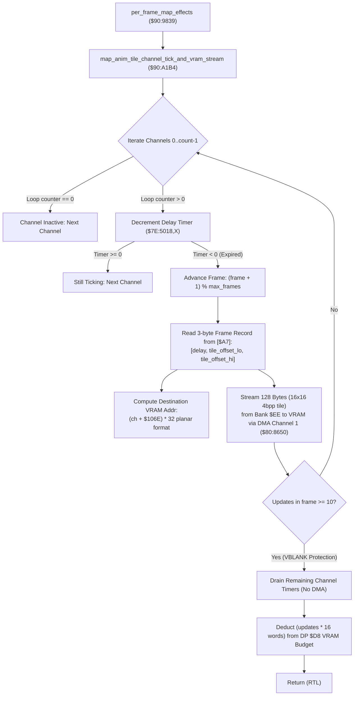

# Map Background Tile Animation Engine & Amortized VRAM Streaming Pipeline

> **ROM Bank**: `$90` (`$90:A1B4` – `$90:A31F`)  
> **Source Module**: `maps/tile-animation.c` / `maps/tile-animation.h`  
> **Recomp Symbols**: `func_D0A1B4`, `bank_90_A2A2_M0X0`  
> **Confirmed Knowledge**: `rom/90a1b4.md`, `rom/90a2a2.md`  
> **Hardware Systems**: SNES PPU VRAM, DMA Channel 1 (`$4310`–`$4315`, `$420B`), Direct Page Pointer Indirect Long `[$A7]`  

---

## 1. Subsystem Architecture & Overview

The Secret of Evermore engine powers dynamic environmental map tile animation—such as flowing waterfalls, conveyor belts, toxic swamp bubbles, glowing magma surges, and rotating machine gears—through a dedicated **50-channel background tile animation engine** residing in Bank `$90`.

Every frame, the master per-frame map processing coordinator `per_frame_map_effects` (`$90:9839`) invokes `map_anim_tile_channel_tick_and_vram_stream` (`$90:A1B4`). The subsystem manages 50 independent animation channels allocated across WRAM Bank `$7E`:

```
+--------------------------------------------------------------------------------------------------+
|                              WRAM Bank $7E Animation State Buffers                               |
+--------------------------------------------------------------------------------------------------+
| $7E:4FE6 .. $7E:5017 (50 bytes) : Current Animation Frame Index per Channel [0..49]              |
| $7E:5018 .. $7E:5049 (50 bytes) : Countdown Delay Timer per Channel (Ticks remaining)            |
| $7E:504A .. $7E:507B (50 bytes) : Loop Counter (0 = Disabled, 0xFF = Infinite, >0 = Decrementing)|
| $7E:507D .. $7E:509D (32 bytes) : ROM Descriptor Slot Table Pointers                             |
| $7E:106C             (2 bytes)  : Total Number of Active Channels for Current Map                |
| $7E:106E             (2 bytes)  : Base VRAM 8x8 Tile Slot Offset for Animated Metatiles          |
+--------------------------------------------------------------------------------------------------+
```



### Amortized DMA Bandwidth Control
Updating animated tiles requires transferring **128 bytes** (a 16×16 4bpp macro-tile comprised of four 8×8 character planes: $4 \times 32 = 128$ bytes) into SNES PPU VRAM. To avoid exceeding the strict ~6 KB blanking transfer budget of the SNES NMI VBLANK period, the engine enforces a hard cap of **10 tile uploads per frame** (`STA $02 = 10`). Once 10 channels have uploaded graphics in a single frame, subsequent expired channels defer their DMA transmission to the following frame while still ticking their internal delay counters.

Furthermore, the routine calculates the exact number of transfers executed (`count = 10 - remaining_budget`), converts it to word cost (`count * 16 words`), and deducts it from Direct Page `$00D8` (`per_frame_vram_dma_budget`), ensuring synchronization with OAM sprite generation (`$80:919E`) and font streaming (`$8C:A753`).

---

## 2. ROM Animation Descriptor Layout

Each map's animation sequence is defined by a binary descriptor block addressed via Direct Page 24-bit pointer `[$A7]`:

```
+---------------+---------------------+------------------------------------------------------------+
| Byte Offset   | Field Name          | Description                                                |
+---------------+---------------------+------------------------------------------------------------+
| +0x00         | channel_id          | Unique channel / property identifier key (matches DP $06)  |
| +0x01         | max_frames          | Total number of keyframes in sequence                      |
| +0x02         | frame_table_offset  | 16-bit offset to start of 3-byte frame records             |
+---------------+---------------------+------------------------------------------------------------+
```

Each frame record consists of 3 packed bytes:
- **Byte 0 (`delay`)**: Duration in video frames (~16.6 ms per tick) before advancing to next frame.
- **Bytes 1–2 (`source_tile_offset`)**: 16-bit pointer into Bank `$EE` (`$EE:0000`) locating the uncompressed 128-byte 4bpp pixel matrix.

---

## 3. Clean C Decompilation

> **Reconstructed C Decompilation**:
> Source moved to [`reconstructed-c/90/90A1B4_tile_animation.c`](../../../reconstructed-c/90/90A1B4_tile_animation.c).
> [View in VFS: soe://rom/code/90A1B4](soe://rom/code/90A1B4?c=1&asm=0)


---

## 4. Annotated 65c816 Assembly

> **Interactive 65816 Assembly**:
> Centralized comments infused at runtime.
> [View in VFS: soe://rom/code/90A1B4](soe://rom/code/90A1B4?asm=1&c=0)


---

## 5. Architectural Invariants & Verification

1. **VBLANK Starvation Immunity**: The strict `ANIM_MAX_UPDATES_PER_FRAME = 10` ceiling ensures that regardless of how many animated water, lava, or conveyor channels exist in a map room, background DMA never overruns the vertical blanking interval.
2. **Phase Synchronization**: Because countdown timers `$7E:5018` continue decrementing even when DMA uploads are deferred, channels remain in lockstep with the music tempo and overall game world clock without drifting out of phase.
3. **Hardware Planar VRAM Encoding**: The bit manipulations `(tile_slot & 0x00E0) | ((tile_slot << 1) & 0xFE00)` accurately convert 1D tile slot indices into SNES 2-bitplane / 4-bitplane 32×32 character nametable addresses.
