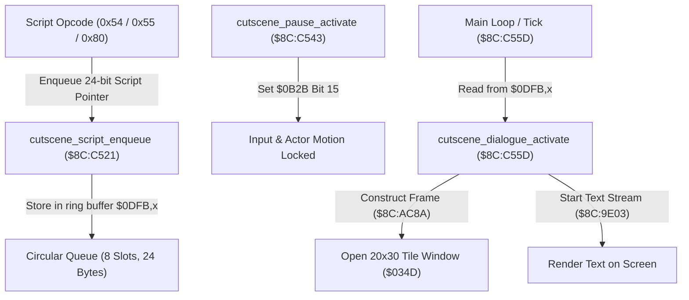

# Event Cutscene Queue & Text Box Dispatcher

- **ROM Locations**:
  - `cutscene_dialogue_queue_reset`: `$8C:C4F6` – `$8C:C520`
  - `cutscene_script_enqueue`: `$8C:C521` – `$8C:C542`
  - `cutscene_pause_activate`: `$8C:C543` – `$8C:C55C`
  - `cutscene_dialogue_activate`: `$8C:C55D` – `$8C:C5E1`
  - `cutscene_pause_and_step`: `$8C:C5E2` – `$8C:C5EE`
- **CPU State**: 16-bit A/X (`REP #$30`), Data Bank `$8C` / `$7E`
- **WRAM Core Addresses**:
  - `$7E:0B2B`: Cutscene master status flag (Bit 15 = pause guard / input lock).
  - `$7E:0B2F`: Dialogue script circular queue read/tail index.
  - `$7E:0B31`: Dialogue script circular queue write/head index.
  - `$7E:0DFB`..`$7E:0E12`: 8-entry circular script buffer (3 bytes per entry = 24 bytes).
  - `$7E:034D`: Primary dialogue window layout descriptor record.
  - `$7E:035F`: Window active status bitmask (Bit 4 = window open / visible).

---

## 1. Architectural Architecture & Queue Flow

Secret of Evermore decouples background script execution from front-end text rendering through an asynchronous 8-slot circular FIFO buffer.



### 1. The Circular Queue Protocol
- The queue occupies `$7E:0DFB` through `$7E:0E12` (24 bytes).
- Each entry stores a 24-bit address (`uint16_t pc_low`, `uint8_t bank`).
- `$7E:0B31` tracks the head write pointer; `$7E:0B2F` tracks the tail read pointer.
- Advance step is $+3$ bytes; wrapping occurs at offset `0x18` (24 bytes = 8 entries).

### 2. Dialogue Box Geometry Record (`$7E:034D`)
When `$8C:C55D` activates the default window, it populates the struct at `$7E:034D`:
- `+0x0A` (`$0357`): Screen X origin (`0`)
- `+0x0C` (`$0359`): Screen Y origin (`0`)
- `+0x04` (`$0351`): Margin left / padding (`4`)
- `+0x06` (`$0353`): Top margin (`1`)
- `+0x14` (`$0361`): Column width (`20` tiles / 160 pixels)
- `+0x1C` (`$0369`): Row height (`30` tiles / 240 pixels)
- `+0x1E` (`$036B`): Text color palette index (`2`)
- `+0x20` (`$036D`): Text speed / glyph delay (`16`)
- `+0x26` (`$0373`): Window background border tile VRAM index (`0x1924`)
- `+0x2A` (`$0377`): Active state mode (`1`)

---

## 2. Disassembly & Annotations

### Part 1: Enqueue Script Pointer (`$8C:C521`)
```assembly
$8CC521  8B          PHB
$8CC522  4B          PHK
$8CC523  AB          PLB               ; Data Bank = $8C
$8CC524  AD 31 0B    LDA $0B31         ; Load queue write pointer
$8CC527  AA          TAX
$8CC528  C9 18 00    CMP #$0018        ; Reached ring buffer boundary (8 slots * 3)?
$8CC52B  D0 03       BNE $8CC530
$8CC52D  7B          TDC               ; Wrap to 0
$8CC52E  80 04       BRA $8CC534
$8CC530  18          CLC
$8CC531  69 03 00    ADC #$0003        ; Advance write pointer by 3 bytes
$8CC534  8D 31 0B    STA $0B31         ; Update write pointer
$8CC537  A5 22       LDA $22           ; Script pointer low word
$8CC539  9D FB 0D    STA $0DFB,X       ; Store to queue
$8CC53C  A5 23       LDA $23           ; Script pointer bank byte
$8CC53E  9D FC 0D    STA $0DFC,X
$8CC541  AB          PLB
$8CC542  6B          RTL
```

### Part 2: Cutscene Pause Guard (`$8C:C543`)
```assembly
$8CC543  AD 2B 0B    LDA $0B2B         ; Check current dialogue/cutscene flags
$8CC546  29 FF 7F    AND #$7FFF
$8CC549  F0 0B       BEQ $8CC556       ; If no pending dialogue, skip window clear
$8CC54B  8B          PHB
$8CC54C  4B          PHK
$8CC54D  AB          PLB
$8CC54E  A0 4D 03    LDY #$034D         ; Window descriptor struct
$8CC551  22 E5 AD 8C JSL $8CADE5       ; Clear active text window
$8CC555  AB          PLB
$8CC556  A9 00 80    LDA #$8000
$8CC559  0C 2B 0B    TSB $0B2B         ; Set Bit 15: cutscene pause guard enabled
$8CC55C  6B          RTL
```

### Part 3: Text Box Activation (`$8C:C55D`)
```assembly
$8CC55D  AD 2B 0B    LDA $0B2B
$8CC560  29 FF 7F    AND #$7FFF
$8CC563  8D 2B 0B    STA $0B2B         ; Clear pause bit 15
$8CC566  F0 79       BEQ $8CC5E1       ; Nothing pending -> exit
$8CC568  8B          PHB
$8CC569  F4 80 80    PEA $8080
$8CC56C  AB          PLB
$8CC56D  AB          PLB
$8CC56E  AE 2F 0B    LDX $0B2F         ; Read queue tail pointer
$8CC571  BD FB 0D    LDA $0DFB,X       ; Load queued script address low
$8CC574  85 22       STA $22
$8CC576  BD FC 0D    LDA $0DFC,X       ; Load queued script bank
$8CC578  85 23       STA $23

; Initialize 20x30 Window Layout:
$8CC57B  A9 00 00    LDA #$0000
$8CC57E  8D 57 03    STA $0357         ; Origin X = 0
$8CC581  A9 00 00    LDA #$0000
$8CC584  8D 59 03    STA $0359         ; Origin Y = 0
$8CC587  A9 04 00    LDA #$0004
$8CC58A  8D 51 03    STA $0351         ; Margin = 4
$8CC58D  A9 01 00    LDA #$0001
$8CC590  8D 53 03    STA $0353
$8CC593  A9 00 00    LDA #$0000
$8CC596  8D 55 03    STA $0355
$8CC599  A9 01 00    LDA #$0001
$8CC59C  8D 63 03    STA $0363
$8CC59F  A9 14 00    LDA #$0014
$8CC5A2  8D 61 03    STA $0361         ; Width = 20 columns
$8CC5A5  A9 1E 00    LDA #$001E
$8CC5A8  8D 69 03    STA $0369         ; Height = 30 rows
$8CC5AB  A9 02 00    LDA #$0002
$8CC5AE  8D 6B 03    STA $036B         ; Palette = 2
$8CC5B1  A9 10 00    LDA #$0010
$8CC5B4  8D 6D 03    STA $036D         ; Glyph delay = 16
$8CC5B7  A9 00 00    LDA #$0000
$8CC5BA  8D 71 03    STA $0371
$8CC5BD  A9 00 00    LDA #$0000
$8CC5C0  8D 75 03    STA $0375
$8CC5C3  A9 24 19    LDA #$1924
$8CC5C6  8D 73 03    STA $0373         ; Frame tile = 0x1924
$8CC5C9  A9 01 00    LDA #$0001
$8CC5CC  8D 77 03    STA $0377         ; Mode = 1
$8CC5CF  A0 4D 03    LDY #$034D
$8CC5D2  22 8A AC 8C JSL $8CAC8A       ; Construct window border in VRAM
$8CC5D6  A9 10 00    LDA #$0010
$8CC5D9  0C 5F 03    TSB $035F         ; Set bit 4: window active
$8CC5DC  22 03 9E 8C JSL $8C9E03       ; Launch text streaming engine
$8CC5E0  AB          PLB
$8CC5E1  6B          RTL
```

---

## 3. Reconstructed Clean C Implementation

```c
#include <stdint.h>
#include <stdbool.h>

#define CUTSCENE_QUEUE_CAPACITY 8
#define CUTSCENE_STRIDE         3
#define CUTSCENE_QUEUE_BYTES    (CUTSCENE_QUEUE_CAPACITY * CUTSCENE_STRIDE)

#define PAUSE_GUARD_BIT         0x8000
#define WINDOW_ACTIVE_BIT       0x0010

typedef struct {
    uint8_t  pc_low;
    uint8_t  pc_mid;
    uint8_t  bank;
} ScriptPointerEntry;

typedef struct {
    uint16_t pad0[2];
    uint16_t margin_x;       // +0x04 ($0351)
    uint16_t margin_y;       // +0x06 ($0353)
    uint16_t pad1;           // +0x08 ($0355)
    uint16_t origin_x;       // +0x0A ($0357)
    uint16_t origin_y;       // +0x0C ($0359)
    uint16_t pad2[2];
    uint16_t width_tiles;    // +0x14 ($0361) = 20
    uint16_t pad3;           // +0x16 ($0363)
    uint16_t pad4[2];
    uint16_t height_tiles;   // +0x1C ($0369) = 30
    uint16_t palette;        // +0x1E ($036B) = 2
    uint16_t glyph_delay;    // +0x20 ($036D) = 16
    uint16_t pad5;           // +0x22 ($036F)
    uint16_t pad6;           // +0x24 ($0371)
    uint16_t tile_pattern;   // +0x26 ($0373) = 0x1924
    uint16_t pad7;           // +0x28 ($0375)
    uint16_t mode;           // +0x2A ($0377) = 1
} TextWindowDescriptor;

extern uint16_t g_cutscene_flags;        // $7E:0B2B
extern uint16_t g_queue_read_idx;        // $7E:0B2F
extern uint16_t g_queue_write_idx;       // $7E:0B31
extern uint8_t  g_script_queue[24];      // $7E:0DFB..$7E:0E12
extern TextWindowDescriptor g_window_0;  // $7E:034D
extern uint16_t g_window_active_mask;    // $7E:035F

extern void window_frame_construct(TextWindowDescriptor *win);
extern void window_clear(TextWindowDescriptor *win);
extern void text_stream_start(uint32_t script_address);

/**
 * Enqueues a 24-bit script instruction pointer into circular buffer.
 * Corresponds to $8C:C521.
 */
void cutscene_script_enqueue(uint32_t script_address) {
    uint16_t write_idx = g_queue_write_idx;

    // Wrap-around boundary check
    uint16_t next_idx = write_idx + CUTSCENE_STRIDE;
    if (next_idx >= CUTSCENE_QUEUE_BYTES) {
        next_idx = 0;
    }
    g_queue_write_idx = next_idx;

    // Store 24-bit pointer
    g_script_queue[write_idx + 0] = (uint8_t)(script_address & 0xFF);
    g_script_queue[write_idx + 1] = (uint8_t)((script_address >> 8) & 0xFF);
    g_script_queue[write_idx + 2] = (uint8_t)((script_address >> 16) & 0xFF);
}

/**
 * Activates cutscene pause lock and clears any open dialogue boxes.
 * Corresponds to $8C:C543.
 */
void cutscene_pause_activate(void) {
    if ((g_cutscene_flags & ~PAUSE_GUARD_BIT) != 0) {
        window_clear(&g_window_0);
    }
    g_cutscene_flags |= PAUSE_GUARD_BIT;
}

/**
 * Resets circular dialogue queue indices.
 * Corresponds to $8C:C4F6.
 */
void cutscene_dialogue_queue_reset(void) {
    if ((g_cutscene_flags & ~PAUSE_GUARD_BIT) != 0) {
        window_clear(&g_window_0);
    }
    g_queue_read_idx = 0;
    g_queue_write_idx = 0;
    g_cutscene_flags &= PAUSE_GUARD_BIT;
}

/**
 * Dequeues pending script and initializes full 20x30 text box.
 * Corresponds to $8C:C55D.
 */
void cutscene_dialogue_activate(void) {
    uint16_t flags = g_cutscene_flags & ~PAUSE_GUARD_BIT;
    g_cutscene_flags = flags;
    if (flags == 0) {
        return; // Nothing pending
    }

    uint16_t read_idx = g_queue_read_idx;
    uint32_t script_addr = (uint32_t)g_script_queue[read_idx + 0] |
                           ((uint32_t)g_script_queue[read_idx + 1] << 8) |
                           ((uint32_t)g_script_queue[read_idx + 2] << 16);

    // Initialize 20x30 standard dialogue layout
    g_window_0.origin_x     = 0;
    g_window_0.origin_y     = 0;
    g_window_0.margin_x     = 4;
    g_window_0.margin_y     = 1;
    g_window_0.width_tiles  = 20;
    g_window_0.height_tiles = 30;
    g_window_0.palette      = 2;
    g_window_0.glyph_delay  = 16;
    g_window_0.tile_pattern = 0x1924;
    g_window_0.mode         = 1;

    window_frame_construct(&g_window_0);
    g_window_active_mask |= WINDOW_ACTIVE_BIT;
    text_stream_start(script_addr);
}
```
