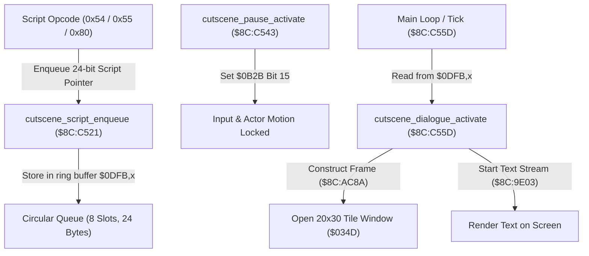

# Event Cutscene Queue & Text Box Dispatcher

- **ROM Locations**:
  - `cutscene_dialogue_queue_reset`: `$8C:C4F6` – `$8C:C520`
  - `cutscene_script_enqueue`: `$8C:C521` – `$8C:C542`
  - `cutscene_pause_activate`: `$8C:C543` – `$8C:C55C`
  - `cutscene_dialogue_activate`: `$8C:C55D` – `$8C:C5E1`
  - `cutscene_pause_and_step`: `$8C:C5E2` – `$8C:C5EE`
- **CPU State**: 16-bit A/X (`REP #$30`), Data Bank `$8C` / `$7E`
- **WRAM Core Addresses**:
  - `$7E:0B2B`: Cutscene master status flag (Bit 15 = pause guard / input lock).
  - `$7E:0B2F`: Dialogue script circular queue read/tail index.
  - `$7E:0B31`: Dialogue script circular queue write/head index.
  - `$7E:0DFB`..`$7E:0E12`: 8-entry circular script buffer (3 bytes per entry = 24 bytes).
  - `$7E:034D`: Primary dialogue window layout descriptor record.
  - `$7E:035F`: Window active status bitmask (Bit 4 = window open / visible).

---

## 1. Architectural Architecture & Queue Flow

Secret of Evermore decouples background script execution from front-end text rendering through an asynchronous 8-slot circular FIFO buffer.

### 1. The Circular Queue Protocol
- The queue occupies `$7E:0DFB` through `$7E:0E12` (24 bytes).
- Each entry stores a 24-bit address (`uint16_t pc_low`, `uint8_t bank`).
- `$7E:0B31` tracks the head write pointer; `$7E:0B2F` tracks the tail read pointer.
- Advance step is $+3$ bytes; wrapping occurs at offset `0x18` (24 bytes = 8 entries).

### 2. Dialogue Box Geometry Record (`$7E:034D`)
When `$8C:C55D` activates the default window, it populates the struct at `$7E:034D`:
- `+0x0A` (`$0357`): Screen X origin (`0`)
- `+0x0C` (`$0359`): Screen Y origin (`0`)
- `+0x04` (`$0351`): Margin left / padding (`4`)
- `+0x06` (`$0353`): Top margin (`1`)
- `+0x14` (`$0361`): Column width (`20` tiles / 160 pixels)
- `+0x1C` (`$0369`): Row height (`30` tiles / 240 pixels)
- `+0x1E` (`$036B`): Text color palette index (`2`)
- `+0x20` (`$036D`): Text speed / glyph delay (`16`)
- `+0x26` (`$0373`): Window background border tile VRAM index (`0x1924`)
- `+0x2A` (`$0377`): Active state mode (`1`)

---

## 2. Disassembly & Annotations

### Part 1: Enqueue Script Pointer (`$8C:C521`)
> **Interactive 65816 Assembly**:
> Centralized comments infused at runtime.
> [View in VFS: soe://rom/code/8CC4F6](soe://rom/code/8CC4F6?asm=1&c=0)

### Part 2: Cutscene Pause Guard (`$8C:C543`)
> **Interactive 65816 Assembly**:
> Centralized comments infused at runtime.
> [View in VFS: soe://rom/code/8CC4F6](soe://rom/code/8CC4F6?asm=1&c=0)

### Part 3: Text Box Activation (`$8C:C55D`)
> **Interactive 65816 Assembly**:
> Centralized comments infused at runtime.
> [View in VFS: soe://rom/code/8CC4F6](soe://rom/code/8CC4F6?asm=1&c=0)

---

## 3. Reconstructed Clean C Implementation

> **Reconstructed C Decompilation**:
> Source moved to [`reconstructed-c/8C/8CC4F6_cutscene_scheduler.c`](../../../reconstructed-c/8C/8CC4F6_cutscene_scheduler.c).
> [View in VFS: soe://rom/code/8CC4F6](soe://rom/code/8CC4F6?c=1&asm=0)

