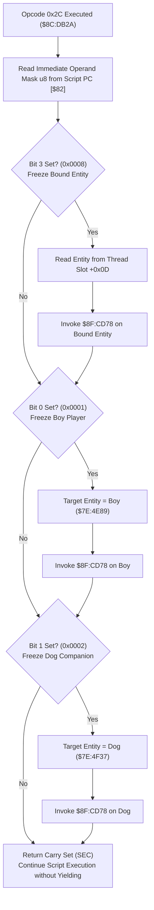

# Script Opcode 0x2C & Entity Freeze/Immobilization Subsystem

What each opcode does is described once, on its opcode page; this file keeps the routines' code: [`0x2A` freeze](soe://rom/assets/scripts/opcodes/2a.md), [`0x2B` unfreeze](soe://rom/assets/scripts/opcodes/2b.md), [`0x2C` freeze_mask](soe://rom/assets/scripts/opcodes/2c.md), [`0x2D` unfreeze_mask](soe://rom/assets/scripts/opcodes/2d.md), [`0xBC` freeze_boy](soe://rom/assets/scripts/opcodes/bc.md), [`0xBE` freeze_dog](soe://rom/assets/scripts/opcodes/be.md), [`0xC0` freeze_boy_and_dog](soe://rom/assets/scripts/opcodes/c0.md).

- **ROM Locations**:
  - `script_op_2c`: `$8C:DB2A` – `$8C:DB66`
  - `entity_freeze_immobilize`: `$8F:CD78` – `$8F:CD87`
- **CPU State**: 16-bit A/X (`REP #$30`), Data Bank `$7E` / `$8C` / `$8F`
- **WRAM Core Addresses**:
  - `$7E:4E89`: Boy player character entity record.
  - `$7E:4F37`: Dog companion character entity record.
  - DP `$4C`: Active entity pointer for engine routines.
  - DP `$7E`: Current executing script thread slot.
  - DP `$82`: Script instruction pointer (PC).
  - Thread Record Fields:
    - `+$0D`: Bound entity pointer associated with this script thread slot.
  - Entity Record Fields:
    - `+$10`: Entity state flags (bit 5 `0x0020`: immobilized / frozen).

---

## 1. Architectural Role & Cutscene Freeze Modes

Opcode `0x2C` is an instantaneous control instruction used heavily in cutscenes and dialogue sequences to halt entity movements and lock characters into place:

### Operand Bitmask Definition
| Bit | Hex Value | Target Entity Affected |
|:---:|:---:|---|
| `0` | `0x01` | Boy player character (`$7E:4E89`) |
| `1` | `0x02` | Dog companion character (`$7E:4F37`) |
| `2` | `0x04` | Unused / reserved |
| `3` | `0x08` | Bound entity attached to current thread (`thread->bound_entity` at `+$0D`) |
| `4..7` | `0xF0` | Unused |

### Freeze Execution Protocol (`$8F:CD78`)
1. **Motion & State Reset**: Calls `$8F:98FE` to cancel pending path steps, reset animation velocity, and clear step flags.
2. **Immobilization Flag**: Sets bit 5 (`0x0020`) in the entity's status word `entity->status_flags` at offset `+$10`. While bit 5 is asserted:
   - The entity ignores controller input (for players).
   - AI decision loops bypass movement planning (for enemies and companions).
   - Step physics integration skips displacement calculations.

---

## 2. Disassembly & Annotations

### Opcode Handler (`$8C:DB2A` – `$8C:DB66`)
> **Interactive 65816 Assembly**:
> Centralized comments infused at runtime.
> [View in VFS: soe://rom/code/8CDB2A](soe://rom/code/8CDB2A?asm=1&c=0)

### Entity Immobilization Routine (`$8F:CD78` – `$8F:CD87`)
> **Interactive 65816 Assembly**:
> Centralized comments infused at runtime.
> [View in VFS: soe://rom/code/8CDB2A](soe://rom/code/8CDB2A?asm=1&c=0)

---

## 3. Clean C Decompilation

> **Reconstructed C Decompilation**:
> Source moved to [`reconstructed-c/8C/8CDB2A_opcode_freeze.c`](../../../reconstructed-c/8C/8CDB2A_opcode_freeze.c).
> [View in VFS: soe://rom/code/8CDB2A](soe://rom/code/8CDB2A?c=1&asm=0)

---

## 4. One entity: opcodes 0x2A / 0x2B (`$8C:DB67`, `$8C:DB11`)

The single-entity forms call the same `$8F:CD78` (freeze) and `$8F:CD4D` (unfreeze) on the entity expression. (Merged from the former `opcode-freeze.md`.)

### Memory Map & Data Structures

### Entity Struct Offsets (`$7E:XXXX`)
- `+0x10`: `status_flags`
  - Bit 0 (`0x0001`): Incapacitated / Inactive / Dead
  - Bit 5 (`0x0020`): **Immobilized / Frozen**
  - Bit 13 (`0x2000`): Script lock / Cutscene override
- `+0x12`: `anim_state`
  - Bits 8-9 (`0x0300`): Movement transition state
- `+0x78`: `latch_timer` (16-bit countdown timer for grapples, paralysis, or scripted stalls)
- `+0x98`: Auxiliary attachment / default animation state index

---

### Decompiled C Code

> **Reconstructed C Decompilation**:
> Source moved to [`reconstructed-c/8C/8CDB2A_opcode_freeze.c`](../../../reconstructed-c/8C/8CDB2A_opcode_freeze.c).
> [View in VFS: soe://rom/code/8CDB2A](soe://rom/code/8CDB2A?c=1&asm=0)

