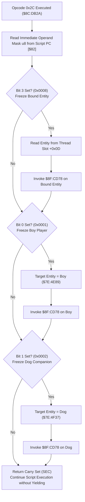

# Script Opcode 0x2C & Entity Freeze/Immobilization Subsystem

What each opcode does is described once, on its opcode page; this file keeps the routines' code: [`0x2A` freeze](soe://rom/assets/scripts/opcodes/2a.md), [`0x2B` unfreeze](soe://rom/assets/scripts/opcodes/2b.md), [`0x2C` freeze_mask](soe://rom/assets/scripts/opcodes/2c.md), [`0x2D` unfreeze_mask](soe://rom/assets/scripts/opcodes/2d.md), [`0xBC` freeze_boy](soe://rom/assets/scripts/opcodes/bc.md), [`0xBE` freeze_dog](soe://rom/assets/scripts/opcodes/be.md), [`0xC0` freeze_boy_and_dog](soe://rom/assets/scripts/opcodes/c0.md).

- **ROM Locations**:
  - `script_op_2c`: `$8C:DB2A` – `$8C:DB66`
  - `entity_freeze_immobilize`: `$8F:CD78` – `$8F:CD87`
- **CPU State**: 16-bit A/X (`REP #$30`), Data Bank `$7E` / `$8C` / `$8F`
- **WRAM Core Addresses**:
  - `$7E:4E89`: Boy player character entity record.
  - `$7E:4F37`: Dog companion character entity record.
  - DP `$4C`: Active entity pointer for engine routines.
  - DP `$7E`: Current executing script thread slot.
  - DP `$82`: Script instruction pointer (PC).
  - Thread Record Fields:
    - `+$0D`: Bound entity pointer associated with this script thread slot.
  - Entity Record Fields:
    - `+$10`: Entity state flags (bit 5 `0x0020`: immobilized / frozen).

---

## 1. Architectural Role & Cutscene Freeze Modes

Opcode `0x2C` is an instantaneous control instruction used heavily in cutscenes and dialogue sequences to halt entity movements and lock characters into place:



### Operand Bitmask Definition
| Bit | Hex Value | Target Entity Affected |
|:---:|:---:|---|
| `0` | `0x01` | Boy player character (`$7E:4E89`) |
| `1` | `0x02` | Dog companion character (`$7E:4F37`) |
| `2` | `0x04` | Unused / reserved |
| `3` | `0x08` | Bound entity attached to current thread (`thread->bound_entity` at `+$0D`) |
| `4..7` | `0xF0` | Unused |

### Freeze Execution Protocol (`$8F:CD78`)
1. **Motion & State Reset**: Calls `$8F:98FE` to cancel pending path steps, reset animation velocity, and clear step flags.
2. **Immobilization Flag**: Sets bit 5 (`0x0020`) in the entity's status word `entity->status_flags` at offset `+$10`. While bit 5 is asserted:
   - The entity ignores controller input (for players).
   - AI decision loops bypass movement planning (for enemies and companions).
   - Step physics integration skips displacement calculations.

---

## 2. Disassembly & Annotations

### Opcode Handler (`$8C:DB2A` – `$8C:DB66`)
```asm
; ==============================================================================
; script_op_2c ($8C:DB2A)
; Operand: u8 target_mask
; ==============================================================================
$8CDB2A  a7 82          lda [$82]          ; Read operand byte from script PC
$8CDB2C  e6 82          inc $82            ; Advance script PC
$8CDB2E  29 ff 00       and #$00FF         ; Mask 8-bit value
$8CDB31  89 08 00       bit #$0008         ; Bit 3: Freeze thread's bound entity
$8CDB34  f0 0f          beq $8CDB45

$8CDB36  a6 7e          ldx $7E            ; Current script thread slot
$8CDB38  bc 0d 00       ldy $000D,x        ; Y = thread->bound_entity
$8CDB3B  f0 08          beq $8CDB45        ; If none bound, skip
$8CDB3D  48             pha                ; Save mask
$8CDB3E  84 4c          sty $4C            ; DP $4C = target entity
$8CDB40  22 78 cd 8f    jsl $8FCD78        ; Freeze bound entity
$8CDB44  68             pla                ; Restore mask

$8CDB45  89 01 00       bit #$0001         ; Bit 0: Freeze Boy player
$8CDB48  f0 0b          beq $8CDB55
$8CDB4A  48             pha
$8CDB4B  a0 89 4e       ldy #$4E89         ; Y = Boy entity ($7E:4E89)
$8CDB4E  84 4c          sty $4C
$8CDB50  22 78 cd 8f    jsl $8FCD78        ; Freeze Boy
$8CDB54  68             pla

$8CDB55  89 02 00       bit #$0002         ; Bit 1: Freeze Dog companion
$8CDB58  f0 0b          beq $8CDB65
$8CDB5A  48             pha
$8CDB5B  a0 37 4f       ldy #$4F37         ; Y = Dog entity ($7E:4F37)
$8CDB5E  84 4c          sty $4C
$8CDB60  22 78 cd 8f    jsl $8FCD78        ; Freeze Dog
$8CDB64  68             pla

$8CDB65  38             sec                ; Continue script turn immediately
$8CDB66  60             rts
```

### Entity Immobilization Routine (`$8F:CD78` – `$8F:CD87`)
```asm
; ==============================================================================
; entity_freeze_immobilize ($8F:CD78)
; Arguments: DP $4C = Target entity pointer
; ==============================================================================
$8FCD78  a4 4c          ldy $4C            ; Y = Target entity pointer
$8FCD7A  22 fe 98 8f    jsl $8F98FE        ; Halt animation/physics motion
$8FCD7E  b9 10 00       lda $0010,y        ; Read status flags (+0x10)
$8FCD81  09 20 00       ora #$0020         ; Set bit 5 (0x0020: immobilized)
$8FCD84  99 10 00       sta $0010,y        ; Write back status flags
$8FCD87  6b             rtl
```

---

## 3. Clean C Decompilation

```c
#include <stdint.h>
#include <stdbool.h>

#define ENTITY_STATUS_IMMOBILIZED 0x0020

#define FREEZE_BOY_BIT   0x01
#define FREEZE_DOG_BIT   0x02
#define FREEZE_BOUND_BIT 0x08

typedef struct {
    uint8_t  _pad0[16];
    uint16_t status_flags; // +0x10: Status and mobility flags
} EntityMobilityRecord;

typedef struct {
    uint8_t  _pad0[13];
    uint16_t bound_entity; // +0x0D: Entity pointer bound to this script thread
} ScriptThreadContext;

// Global engine pointers
extern EntityMobilityRecord *g_boy_entity; // $7E:4E89
extern EntityMobilityRecord *g_dog_entity; // $7E:4F37
extern EntityMobilityRecord *g_target_entity; // DP $4C

// Engine motion reset routine
extern void entity_halt_motion(EntityMobilityRecord *entity); // $8F:98FE

/**
 * entity_freeze_immobilize ($8F:CD78)
 * Halts active motion/animation and asserts the immobilization flag on the entity.
 * 
 * @param entity Target entity to freeze.
 */
void entity_freeze_immobilize(EntityMobilityRecord *entity) {
    if (entity == NULL) return;

    // Reset physics velocity and path steps
    entity_halt_motion(entity);

    // Set bit 5 (0x0020) to freeze actor
    entity->status_flags |= ENTITY_STATUS_IMMOBILIZED;
}

/**
 * script_op_2c ($8C:DB2A)
 * Immobilizes party members or bound actors according to an 8-bit mask operand.
 * 
 * @param thread Pointer to active script thread slot.
 * @param script_pc Pointer to script instruction pointer ($82).
 * @return Always returns true (Carry Set) to continue execution in the same turn.
 */
bool script_op_2c(ScriptThreadContext *thread, const uint8_t **script_pc) {
    uint8_t mask = *(*script_pc)++;

    // Bit 3: Freeze thread's bound entity
    if (mask & FREEZE_BOUND_BIT) {
        if (thread->bound_entity != 0) {
            EntityMobilityRecord *bound = (EntityMobilityRecord *)(uintptr_t)thread->bound_entity;
            g_target_entity = bound;
            entity_freeze_immobilize(bound);
        }
    }

    // Bit 0: Freeze Boy player character
    if (mask & FREEZE_BOY_BIT) {
        g_target_entity = g_boy_entity;
        entity_freeze_immobilize(g_boy_entity);
    }

    // Bit 1: Freeze Dog companion character
    if (mask & FREEZE_DOG_BIT) {
        g_target_entity = g_dog_entity;
        entity_freeze_immobilize(g_dog_entity);
    }

    // Continue execution without yielding turn
    return true;
}
```

---

## 4. One entity: opcodes 0x2A / 0x2B (`$8C:DB67`, `$8C:DB11`)

The single-entity forms call the same `$8F:CD78` (freeze) and `$8F:CD4D` (unfreeze) on the entity expression. (Merged from the former `opcode-freeze.md`.)

### Memory Map & Data Structures

### Entity Struct Offsets (`$7E:XXXX`)
- `+0x10`: `status_flags`
  - Bit 0 (`0x0001`): Incapacitated / Inactive / Dead
  - Bit 5 (`0x0020`): **Immobilized / Frozen**
  - Bit 13 (`0x2000`): Script lock / Cutscene override
- `+0x12`: `anim_state`
  - Bits 8-9 (`0x0300`): Movement transition state
- `+0x78`: `latch_timer` (16-bit countdown timer for grapples, paralysis, or scripted stalls)
- `+0x98`: Auxiliary attachment / default animation state index

---

### Decompiled C Code

```c
#include <stdint.h>
#include <stdbool.h>

typedef struct {
    uint8_t  padding0[0x10];
    uint16_t status_flags;     // +0x10: Entity status and condition flags
    uint16_t anim_state;       // +0x12: Animation mode and direction bits
    uint8_t  padding1[0x64];
    uint16_t latch_timer;      // +0x78: Immobilization / latch duration timer
    uint8_t  padding2[0x1E];
    int16_t  anim_descriptor;  // +0x98: Default animation track / child entity slot
} Entity;

#define DP_TARGET_ENTITY (*(volatile Entity**)0x4C)
#define ENTITY_BOY_BASE  ((Entity*)0x4E89)

// External Subroutines
extern void* script_eval_entity(void);               // $8C:EC8E
extern void  entity_physics_halt_motion(void);        // $8F:98FE
extern void  entity_physics_resume_motion(void);      // $8F:A8E2
extern void  entity_anim_restore_neutral(int16_t id); // $8F:9937

/**
 * $8F:CD78 - Halts active momentum and asserts the immobilized bit.
 */
void entity_freeze_immobilize(Entity *entity) {
    if (!entity) return;

    // Reset current velocity and pending displacement vectors
    entity_physics_halt_motion();

    // Assert Bit 5: Immobilized
    entity->status_flags |= 0x0020;
}

/**
 * $8F:CD4D - Re-enables physics and clears immobilization and latch timers.
 */
void entity_unfreeze_mobilize(Entity *entity) {
    if (!entity) return;

    // Resume physics integration
    entity_physics_resume_motion();

    // Clear Bit 0 (0x0001), Bit 5 (0x0020: Frozen), and Bit 13 (0x2000: Script Lock)
    entity->status_flags &= (uint16_t)~0x2021; // Mask 0xDFDE

    // Clear animation transit bits 8 and 9
    entity->anim_state &= (uint16_t)~0x0300;   // Mask 0xFCFF

    // Clear latch duration timer
    entity->latch_timer = 0;

    // If the entity is a player or companion (address >= $4E89), restore neutral animation track
    if (entity >= ENTITY_BOY_BASE) {
        int16_t anim_id = entity->anim_descriptor;
        if (anim_id >= 0) {
            entity_anim_restore_neutral(anim_id);
        }
    }
}

/**
 * $8C:DB67 - Script VM Opcode 0x2A: freeze_entity(entity)
 * Reads entity expression from script bytecode and immobilizes it.
 */
bool script_op_freeze_entity(void) {
    Entity *entity = (Entity*)script_eval_entity();
    DP_TARGET_ENTITY = entity;

    entity_freeze_immobilize(entity);

    // SEC: Continue execution in the current turn
    return true;
}

/**
 * $8C:DB11 - Script VM Opcode 0x2B: unfreeze_entity(entity)
 * Reads entity expression from script bytecode and restores autonomous motion.
 */
bool script_op_unfreeze_entity(void) {
    Entity *entity = (Entity*)script_eval_entity();
    DP_TARGET_ENTITY = entity;

    entity_unfreeze_mobilize(entity);

    // SEC: Continue execution in the current turn
    return true;
}
```
