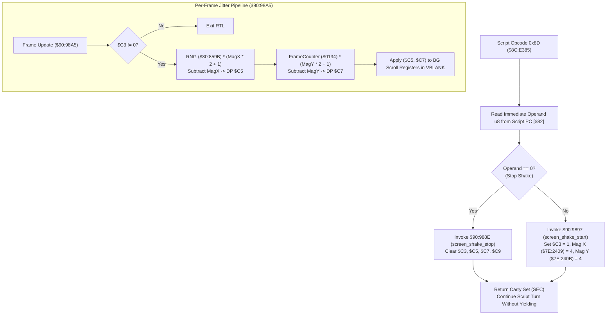

# Script Opcode 0x8D & Screen Shake Engine ($8C:E385, $90:988E, $90:9897, $90:98A5)

- **ROM Locations**:
  - `script_op_8d`: `$8C:E385` – `$8C:E399` (Opcode 0x8D: Screen shake control)
  - `screen_shake_stop`: `$90:988E` – `$90:9896` (Clear shake flags & offsets)
  - `screen_shake_start`: `$90:9897` – `$90:98A4` (Set magnitude 4 on both axes)
  - `screen_shake_jitter`: `$90:98A5` – `$90:98EC` (Per-frame hardware multiplication displacement)
- **CPU State**: Mixed 8-bit/16-bit A/X (`REP #$30` / `SEP #$20`), Data Bank `$7E` / `$8C` / `$90`
- **WRAM Core Addresses**:
  - DP `$C3`: Screen shake active flag (non-zero when shaking).
  - DP `$C5`: Horizontal jitter displacement offset ($[-4, +4]$ px).
  - DP `$C7`: Vertical jitter displacement offset ($[-4, +4]$ px).
  - DP `$C9`: Screen shake duration countdown timer.
  - `$7E:2409`: Horizontal shake magnitude ($4$ px).
  - `$7E:240B`: Vertical shake magnitude ($4$ px).
  - `$7E:0134`: Frame counter / pseudo-random seed word.
- **Hardware Registers**:
  - `$4202`: Hardware multiplicand A (`WRMPYA`).
  - `$4203`: Hardware multiplier B (`WRMPYB`).
  - `$4216`: Hardware product result high byte (`RDMPYH`).

---

## 1. Architectural Role & Screen Shake Lifecycle

Script opcode `0x8D` is used in dramatic cutscenes, boss intros, and explosion events to toggle ambient camera tremor:



### Jitter Calculation Math
To produce uniform pseudo-random jitter centered around zero:
$$\text{span}_x = (\text{magnitude}_x \times 2) + 1 = (4 \times 2) + 1 = 9$$
$$\text{raw}_x = \frac{\text{RNG} \times \text{span}_x}{256}$$
$$\Delta x = \text{raw}_x - \text{magnitude}_x \in [-4, +4]$$

The SNES 8-bit hardware multiplier (`$4202`/`$4203`) calculates $\text{RNG} \times \text{span}$, and the high byte in `$4216` yields the scaled integer $0..8$. Subtracting $4$ generates the signed displacement $\Delta x \in [-4, +4]$.

---

## 2. Disassembly & Annotations

### Opcode 0x8D Handler (`$8C:E385` – `$8C:E399`)
```asm
; ==============================================================================
; script_op_8d ($8C:E385)
; Operand: u8 state (0 = stop, != 0 = start)
; ==============================================================================
$8CE385  a7 82          lda [$82]          ; Read operand from script PC
$8CE387  e6 82          inc $82            ; Advance script PC
$8CE389  29 ff 00       and #$00FF
$8CE38C  f0 06          beq $8CE394        ; If 0: stop shake
$8CE38E  22 97 98 90    jsl $909897        ; If != 0: start shake (mag 4)
$8CE392  38             sec                ; Return Carry Set (continue turn)
$8CE393  60             rts

$8CE394  22 8e 98 90    jsl $90988E        ; Clear shake flags & offsets
$8CE398  38             sec                ; Return Carry Set
$8CE399  60             rts
```

### Screen Shake Activation & Termination (`$90:988E` – `$90:98A4`)
```asm
; ==============================================================================
; screen_shake_stop ($90:988E)
; ==============================================================================
$90988E  64 c3          stz $C3            ; Clear shake active flag
$909890  64 c5          stz $C5            ; Clear jitter offset X
$909892  64 c7          stz $C7            ; Clear jitter offset Y
$909894  64 c9          stz $C9            ; Clear shake timer
$909896  6b             rtl

; ==============================================================================
; screen_shake_start ($90:9897)
; ==============================================================================
$909897  e6 c3          inc $C3            ; Set shake active flag
$909899  a9 04 00       lda #$0004         ; Magnitude = 4 pixels
$90989C  8f 09 24 7e    sta $7E2409        ; Set horizontal magnitude
$9098A0  8f 0b 24 7e    sta $7E240B        ; Set vertical magnitude
$9098A4  6b             rtl
```

### Per-Frame Jitter Displacement Math (`$90:98A5` – `$90:98EC`)
```asm
; ==============================================================================
; screen_shake_jitter ($90:98A5)
; ==============================================================================
$9098A5  a5 c3          lda $C3            ; Is shake active?
$9098A7  f0 43          beq $9098EC        ; If 0: exit
$9098A9  22 9b 85 80    jsl $80859B        ; A = random word
$9098AD  e2 20          sep #$20           ; 8-bit accumulator
$9098AF  8d 02 42       sta $4202          ; WRMPYA = random byte
$9098B2  af 09 24 7e    lda $7E2409        ; Horizontal magnitude (4)
$9098B6  0a             asl a              ; 4 * 2 = 8
$9098B7  1a             inc a              ; 8 + 1 = 9
$9098B8  8d 03 42       sta $4203          ; WRMPYB = span (9)
$9098BB  c2 30          rep #$30           ; 16-bit A/X
$9098BD  a9 00 ff       lda #$FF00
$9098C0  2d 16 42       and $4216          ; Read high byte of product
$9098C3  eb             xba                ; Shift into low byte (0..8)
$9098C4  38             sec
$9098C5  ef 09 24 7e    sbc $7E2409        ; Subtract magnitude (4) -> [-4, +4]
$9098C9  85 c5          sta $C5            ; Store into jitter offset X

; Vertical Jitter Displacement
$9098CB  e2 20          sep #$20
$9098CD  ad 34 01       lda $0134          ; Frame counter byte
$9098D0  8d 02 42       sta $4202
$9098D3  af 0b 24 7e    lda $7E240B        ; Vertical magnitude (4)
$9098D7  0a             asl a
$9098D8  1a             inc a              ; Span = 9
$9098D9  8d 03 42       sta $4203
$9098DC  c2 30          rep #$30
$9098DE  a9 00 ff       lda #$FF00
$9098E1  2d 16 42       and $4216
$9098E4  eb             xba
$9098E5  38             sec
$9098E6  ef 0b 24 7e    sbc $7E240B        ; Subtract magnitude (4) -> [-4, +4]
$9098EA  85 c7          sta $C7            ; Store into jitter offset Y
$9098EC  6b             rtl
```

---

## 3. Clean C Decompilation

```c
#include <stdint.h>
#include <stdbool.h>

// Global direct page registers
extern uint8_t  g_shake_active_flag;      // DP $C3
extern int16_t  g_shake_jitter_offset_x;  // DP $C5
extern int16_t  g_shake_jitter_offset_y;  // DP $C7
extern uint16_t g_shake_duration_timer;   // DP $C9

// Extended WRAM registers
extern uint16_t g_shake_magnitude_x;      // $7E:2409
extern uint16_t g_shake_magnitude_y;      // $7E:240B
extern uint8_t  g_frame_counter_seed;     // $7E:0134

// Engine RNG
extern uint16_t rng_next_word(void);      // $80:859B

/**
 * screen_shake_stop ($90:988E)
 * Halts active screen tremors and zeroes all jitter offsets.
 */
void screen_shake_stop(void) {
    g_shake_active_flag = 0;
    g_shake_jitter_offset_x = 0;
    g_shake_jitter_offset_y = 0;
    g_shake_duration_timer = 0;
}

/**
 * screen_shake_start ($90:9897)
 * Starts screen tremor with a baseline magnitude of 4 pixels on both axes.
 */
void screen_shake_start(void) {
    g_shake_active_flag = 1;
    g_shake_magnitude_x = 4;
    g_shake_magnitude_y = 4;
}

/**
 * screen_shake_jitter ($90:98A5)
 * Runs per-frame hardware multiplication to generate random camera jitter
 * within [-magnitude, +magnitude].
 */
void screen_shake_jitter(void) {
    if (g_shake_active_flag == 0) {
        return;
    }

    // 1. Horizontal Jitter: RNG * (mag_x * 2 + 1) / 256 - mag_x
    uint8_t rng_val = (uint8_t)rng_next_word();
    uint8_t span_x = (uint8_t)((g_shake_magnitude_x << 1) + 1);
    uint16_t prod_x = (uint16_t)rng_val * (uint16_t)span_x;
    int16_t raw_x = (int16_t)(prod_x >> 8);
    g_shake_jitter_offset_x = raw_x - (int16_t)g_shake_magnitude_x;

    // 2. Vertical Jitter: FrameSeed * (mag_y * 2 + 1) / 256 - mag_y
    uint8_t span_y = (uint8_t)((g_shake_magnitude_y << 1) + 1);
    uint16_t prod_y = (uint16_t)g_frame_counter_seed * (uint16_t)span_y;
    int16_t raw_y = (int16_t)(prod_y >> 8);
    g_shake_jitter_offset_y = raw_y - (int16_t)g_shake_magnitude_y;
}

/**
 * script_op_8d ($8C:E385)
 * Script command to start or stop screen shake tremors.
 * 
 * @param script_pc Pointer to script instruction pointer.
 * @return Always returns true (Carry Set) to continue without yielding turn.
 */
bool script_op_8d(const uint8_t **script_pc) {
    uint8_t state = *(*script_pc)++;

    if (state == 0) {
        screen_shake_stop();
    } else {
        screen_shake_start();
    }

    return true; // Carry Set: continue turn
}
```
