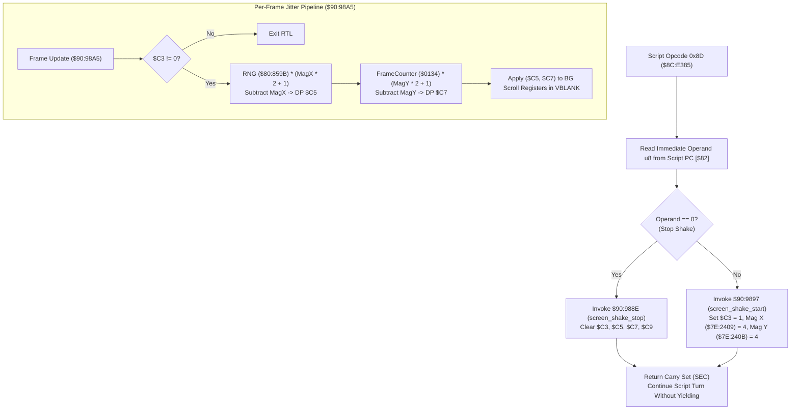

# Script Opcode 0x8D & Screen Shake Engine ($8C:E385, $90:988E, $90:9897, $90:98A5)

What each opcode does is described once, on its opcode page; this file keeps the routines' code: [`0x8D` shake_screen](soe://rom/assets/scripts/opcodes/8d.md).

- **ROM Locations**:
  - `script_op_8d`: `$8C:E385` – `$8C:E399` (Opcode 0x8D: Screen shake control)
  - `screen_shake_stop`: `$90:988E` – `$90:9896` (Clear shake flags & offsets)
  - `screen_shake_start`: `$90:9897` – `$90:98A4` (Set magnitude 4 on both axes)
  - `screen_shake_jitter`: `$90:98A5` – `$90:98EC` (Per-frame hardware multiplication displacement)
- **CPU State**: Mixed 8-bit/16-bit A/X (`REP #$30` / `SEP #$20`), Data Bank `$7E` / `$8C` / `$90`
- **WRAM Core Addresses**:
  - DP `$C3`: Screen shake active flag (non-zero when shaking).
  - DP `$C5`: Horizontal jitter displacement offset ($[-4, +4]$ px).
  - DP `$C7`: Vertical jitter displacement offset ($[-4, +4]$ px).
  - DP `$C9`: Screen shake duration countdown timer.
  - `$7E:2409`: Horizontal shake magnitude ($4$ px).
  - `$7E:240B`: Vertical shake magnitude ($4$ px).
  - `$7E:0134`: Frame counter / pseudo-random seed word.
- **Hardware Registers**:
  - `$4202`: Hardware multiplicand A (`WRMPYA`).
  - `$4203`: Hardware multiplier B (`WRMPYB`).
  - `$4216`: Hardware product result high byte (`RDMPYH`).

---

## 1. Architectural Role & Screen Shake Lifecycle

Script opcode `0x8D` is used in dramatic cutscenes, boss intros, and explosion events to toggle ambient camera tremor:

### Jitter Calculation Math
To produce uniform pseudo-random jitter centered around zero:
$$\text{span}_x = (\text{magnitude}_x \times 2) + 1 = (4 \times 2) + 1 = 9$$
$$\text{raw}_x = \frac{\text{RNG} \times \text{span}_x}{256}$$
$$\Delta x = \text{raw}_x - \text{magnitude}_x \in [-4, +4]$$

The SNES 8-bit hardware multiplier (`$4202`/`$4203`) calculates $\text{RNG} \times \text{span}$, and the high byte in `$4216` yields the scaled integer $0..8$. Subtracting $4$ generates the signed displacement $\Delta x \in [-4, +4]$.

---

## 2. Disassembly & Annotations

### Opcode 0x8D Handler (`$8C:E385` – `$8C:E399`)
> **Interactive 65816 Assembly**:
> Centralized comments infused at runtime.
> [View in VFS: soe://rom/code/8CE385](soe://rom/code/8CE385?asm=1&c=0)

### Screen Shake Activation & Termination (`$90:988E` – `$90:98A4`)
> **Interactive 65816 Assembly**:
> Centralized comments infused at runtime.
> [View in VFS: soe://rom/code/8CE385](soe://rom/code/8CE385?asm=1&c=0)

### Per-Frame Jitter Displacement Math (`$90:98A5` – `$90:98EC`)
> **Interactive 65816 Assembly**:
> Centralized comments infused at runtime.
> [View in VFS: soe://rom/code/8CE385](soe://rom/code/8CE385?asm=1&c=0)

---

## 3. Clean C Decompilation

> **Reconstructed C Decompilation**:
> Source moved to [`reconstructed-c/8C/8CE385_opcode_shake.c`](../../../reconstructed-c/8C/8CE385_opcode_shake.c).
> [View in VFS: soe://rom/code/8CE385](soe://rom/code/8CE385?c=1&asm=0)

