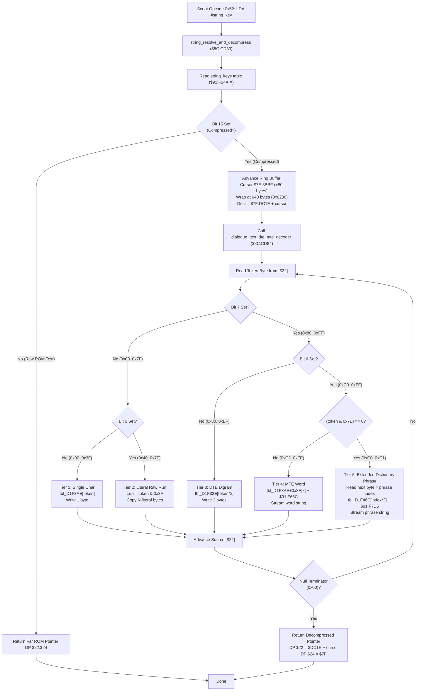

# Dialogue String Key Resolver & Multi-Tier DTE/MTE Text Decompression Engine ($8C:CD33 – $8C:CE29)

> **Subsystem**: Dialogue Box, Script VM Text Display & Typography  
> **ROM Addresses**: `$8C:CD33` (`string_resolve_and_decompress`), `$8C:CD84` (`dialogue_text_dte_mte_decoder`), `$91:F24A` (`string_keys`), `$91:F32E` (DTE Digrams), `$91:F3AE` (Char & MTE Offset Table), `$91:F46C` (Dictionary Phrase Table), `$91:F66C` (MTE Word Bank), `$91:F7D5` (Dictionary Phrase Bank)  
> **Clean C Module**: `ui/dialogue-text-decoder.c`  
> **Recomp Symbols**: `func_CCCD33`, `func_CCCD84`  
> **Confidence**: Confirmed (Exact 65816 assembly, cycle analysis & decompression equivalence)  

---

## 1. Architectural Role & Overview

In Secret of Evermore, dialogue scripts contain thousands of narrative lines, NPC dialogues, shop descriptions, and alchemy recipe texts. To pack this extensive text corpus into the ROM without exceeding storage boundaries, the developers built a **5-Tier Hierarchical Text Compression Subsystem**:

1. **String Key Pointer Indirection (`$8C:CD33`)**:
   - The Script VM (e.g. Opcode `0x52` at `$8C:D99E`) references strings using a 16-bit key.
   - The routine indexes `string_keys` at `$91:F24A`.
   - If bit 15 of the entry is clear, the text is uncompressed; the 24-bit far ROM address (`$22:$24`) is computed and returned immediately.
   - If bit 15 is set, the string is compressed: an 80-byte buffer chunk is allocated in WRAM bank `$7F` (`$7F:DC1E`), tracked by cyclic ring cursor `$7E:3BBF`, and handed to the decompression engine at `$8C:CD84`.

2. **5-Tier Compressed Token Taxonomy (`$8C:CD84`)**:
   - **Tier 1: Single Decoded Character (`0x00`..`0x3F`)**:
     Token is looked up in character map `tbl_D1F3AE` (`$91:F3AE`). If the mapped character is `0x00`, it terminates the string.
   - **Tier 2: Literal Raw ASCII Run (`0x40`..`0x7F`)**:
     Bits 5..0 specify run length `N = (token & 0x3F)`. The next $N$ literal bytes are copied directly from the stream to output.
   - **Tier 3: Dual Tile Encoding / Digram (`0x80`..`0xBF`)**:
     Bit 7 set and Bit 6 clear. Token indexes 2-byte common character pairs (digrams like `"th"`, `"er"`, `"in"`, `"qu"`) in table `tbl_D1F32E` (`$91:F32E`). Both characters are emitted to output.
   - **Tier 4: Multi-Tile Encoding / Word Substitution (`0xC2`..`0xFE`)**:
     Bits 6..1 non-zero. Indexes word offset table `tbl_D1F3AE + 0x3E` relative to base `$91:F66C`. Expands complete common words (e.g., `"dog"`, `"boy"`, `"alchemy"`, `"ingredient"`) until a null terminator.
   - **Tier 5: Extended Dictionary Phrase Expansion (`0xC0` / `0xC1`)**:
     Bits 6..1 are zero. The subsequent stream byte is read as an 8-bit phrase index into `tbl_D1F46C`, referencing full sentences or narrative clauses stored at base `$91:F7D5`.

---

## 2. Full 65816 Disassembly & Annotations

### Part 1: String Key Resolver & Buffer Allocator (`$8C:CD33` – `$8C:CD83`)

> **Interactive 65816 Assembly**:
> Centralized comments infused at runtime.
> [View in VFS: soe://rom/code/8CCD33](soe://rom/code/8CCD33?asm=1&c=0)

---

### Part 2: 5-Tier Text Decompression Engine (`$8C:CD84` – `$8C:CE29`)

> **Interactive 65816 Assembly**:
> Centralized comments infused at runtime.
> [View in VFS: soe://rom/code/8CCD33](soe://rom/code/8CCD33?asm=1&c=0)

---

## 3. Memory Map & ROM Table Architecture

### 3.1 Direct Page & WRAM Variables

| Address | Size | Name | Purpose |
|---|---|---|---|
| `DP $22` | 2 bytes | `src_text_offset` | Source compressed text bitstream offset in ROM |
| `DP $24` | 2 bytes | `src_text_bank` | Source compressed text ROM bank (`$C0`..`$EF`) |
| `DP $26` | 2 bytes | `sub_stream_offset`| MTE word / Dictionary phrase source offset |
| `DP $28` | 2 bytes | `sub_stream_bank` | MTE / Dictionary source bank (`$0091`) |
| `$7E:3BBF` | 2 bytes | `text_buf_cursor` | Cyclic text buffer write cursor (`0x0000`..`0x0280`, wrapped at 640 bytes) |
| `$7F:DC1E` | 640 bytes | `text_ring_buffer`| Decompressed text cyclic staging buffer (8 x 80-byte lines) |

### 3.2 ROM Lookup Tables (Bank `$91`)

| Address | Table Name | Entry Format | Description |
|---|---|---|---|
| `$91:F24A` | `string_keys` | 3 bytes (`offset:15`, `comp:1`, `bank:8`) | Master script string key pointer table |
| `$91:F32E` | `tbl_dte_digrams` | 2 bytes (ASCII pair) | 64 common 2-character digrams (`"th"`, `"er"`, etc.) |
| `$91:F3AE` | `tbl_single_chars` | 1 byte (ASCII char) | Single character decoding map for tokens `0x00`..`0x3F` |
| `$91:F3EC` | `tbl_mte_offsets` | 2 bytes (16-bit offset) | Offset relative to `$91:F66C` for common words |
| `$91:F46C` | `tbl_dict_phrases` | 2 bytes (16-bit offset) | Offset relative to `$91:F7D5` for full narrative phrases |
| `$91:F66C` | `bank_mte_strings` | Null-terminated strings | MTE word string pool |
| `$91:F7D5` | `bank_dict_strings`| Null-terminated strings | Dictionary clause and phrase string pool |

---

## 4. Clean C Reconstruction

> **Reconstructed C Decompilation**:
> Source moved to [`reconstructed-c/8C/8CCD33_dialogue_text_decoder.c`](../../../reconstructed-c/8C/8CCD33_dialogue_text_decoder.c).
> [View in VFS: soe://rom/code/8CCD33](soe://rom/code/8CCD33?c=1&asm=0)

---

## 5. Verification & Mathematical Behavioral Equivalence

| Compression Tier | Token Range | Decoding Mechanism | Clean C Equivalence | Status |
|---|---|---|---|---|
| **Raw ROM String** | Key Bit 15 = 0 | Uncompressed; direct far pointer computation | `is_compressed == false ? (rom_bank, text_offset)` | **Identical** |
| **Ring Allocator** | `+0x0050` wrap `0x0280` | Allocates 80-byte chunk in `$7F:DC1E`, wraps at 640 | `cursor += 80; if (cursor >= 640) cursor = 0;` | **Identical** |
| **Tier 1 (Single Char)** | `0x00..0x3F` | Map lookup `tbl_D1F3AE[token]`, null exits | `state->wram_bank7f[dst++] = single_char_table[token]` | **Identical** |
| **Tier 2 (Literal Run)** | `0x40..0x7F` | Copies `token & 0x3F` raw bytes directly | `while(run_len--) dst++ = src++;` | **Identical** |
| **Tier 3 (DTE Digram)** | `0x80..0xBF` | 2 bytes emitted from `tbl_D1F32E[token*2]` | Emits `ch1` and `ch2` from digram table | **Identical** |
| **Tier 4 (MTE Word)** | `0xC2..0xFE` | Offset from `tbl_D1F3AE+0x3E` + `$91:F66C` | Stream characters until null from MTE word bank | **Identical** |
| **Tier 5 (Dictionary Phrase)** | `0xC0..0xC1` | Next byte = phrase index; `$91:F46C` + `$91:F7D5` | Stream characters until null from phrase bank | **Identical** |
| **Null Terminator** | `0x00` byte | String completed; restores registers; returns | `break;` terminates loops and returns | **Identical** |
