# Dialogue Typewriter Stepper, Joypad Advance Poller & Glyph Positioning

- **ROM Locations**:
  - `dialogue_typewriter_step_and_poll_joypad`: `$8C:A800` – `$8C:A8AE`
  - `dialogue_glyph_commit_vram_pos`: `$8C:A8AE` – `$8C:A8E0`
  - `dialogue_glyph_decode_and_width_lookup`: `$8C:A928` – `$8C:A970`
- **CPU State**: 16-bit A/X (`REP #$30`), Data Bank `$7E` / `$8C`
- **WRAM Core Addresses**:
  - `$7E:0104`: Joypad 1 button state (checked against `#$DF00` and action buttons `#$0A00` for A/B/X/Y).
  - `$7E:061F,X`: Packed dialogue text cursor coordinates (low byte = row/line `$48`, high byte = column `$46`).
  - `$7E:0621,X`: Current dialogue character code / attribute word.
  - `$7E:008E`: Active dialogue text buffer index.
  - `$7F:A000`: 2bpp dialogue tile rasterization staging buffer.
- **Hardware Registers**:
  - `$4202`: Hardware 8-bit multiplier multiplicand (`WRMPYA`).
  - `$4203`: Hardware 8-bit multiplier multiplier (`WRMPYB`).
  - `$4216`: Hardware 16-bit multiplication product (`RDMPY`).

---

## 1. Architectural Architecture & Typewriter Loop

When dialogue boxes or shopkeeper text windows open, Secret of Evermore renders text with a progressive "typewriter" effect:

```mermaid
flowchart TD
    subgraph Typewriter_Loop["Dialogue Typewriter & Joypad Poller ($8C:A800)"]
        LoadGlyph["Load Char from $0621,X<br/>Load Buffer Index from $8E"] --> RenderGlyph["JSL $8C:A5A2 (Render 2bpp Glyph)"]
        RenderGlyph --> PushCoords["Save Cursor ($22, $24) to Stack"]
        PushCoords --> FrameTick["JSL $8E:E41E (Per-Frame Engine Tick)"]
        FrameTick --> PollJoypad["Read Joypad $0104 & #$DF00<br/>JSL $80:8838 (Edge Detector)"]
        PollJoypad --> BtnCheck{"Action Button Pressed?<br/>(A / B / X / Y)"}
        BtnCheck -->|"No (Waiting)"| FrameTick
        BtnCheck -->|"Yes (Confirmed)"| PlaySfx["Play Sound Effect #$0003<br/>JSL $8C:82DC (Text Click)"]
        PlaySfx --> CheckFastForward{"Fast-Forward Active?"}
        CheckFastForward -->|"Yes"| ClearActive["STZ $061F (Clear Typing Flag)<br/>Return CLC"]
        CheckFastForward -->|"No"| CalcVram["Hardware Multiplier $4202: Line * Stride<br/>JMP $A7EC (VRAM Tile Commit)"]
    end

    subgraph Glyph_Decode["Glyph Decode & Width Lookup ($8C:A928)"]
        SubSpace["SBC #$0020 (Subtract Space 0x20)"] --> IsSpace{"Char == ' '?"}
        IsSpace -->|"Yes"| SpaceWidth["Load Space Width: Return 4px"]
        IsSpace -->|"No"| FetchFont["Read Font Header: $C4:0000,X<br/>Extract Proportional Width"]
        FetchFont --> BlendShadow["Blend 1bpp Glyph into 2bpp Buffer<br/>Apply Foreground & Drop-Shadow"]
    end
```

### 1.1 The Paced Typewriter Protocol
1. **Per-Glyph Sound Feedback**: As each character renders, the engine triggers sound effect `#$0003` via `JSL $8C:82DC`, giving dialogue its signature click sound.
2. **Interactive Frame Tick**: The typewriter loop calls `JSL $8E:E41E` on every iteration, keeping background ambient weather, animated palette cycles, and music playing while dialogue is displayed.
3. **Hardware Multiplier Addressing**: The VRAM tilemap offset for the character's row is calculated using the SNES hardware multiplier registers `$4202` and `$4216`:
$$\text{Tilemap Address} = 4 + (\text{Row} \times \text{Stride})$$

---

## 2. Annotated 65816 Disassembly

> **Interactive 65816 Assembly**:
> Centralized comments infused at runtime.
> [View in VFS: soe://rom/code/8CA800](soe://rom/code/8CA800?asm=1&c=0)

---

## 3. Clean C Implementation

> **Reconstructed C Decompilation**:
> Source moved to [`reconstructed-c/8C/8CA800_dialogue_typewriter.c`](../../../reconstructed-c/8C/8CA800_dialogue_typewriter.c).
> [View in VFS: soe://rom/code/8CA800](soe://rom/code/8CA800?c=1&asm=0)

---

## 4. Verification & Behavioral Equivalence

| Test Condition | Observed Engine Trace | C Implementation Output | Status |
|---|---|---|---|
| **Typewriter Audio Click** | Calls `$8C:82DC` with `A = #$0003`. | `play_sound_effect_direct(SFX_DIALOGUE_CLICK)` (3). | ✅ Verified |
| **Interactive Frame Tick** | Calls `JSL $8E:E41E` while awaiting joypad advance. | Invokes `engine_frame_tick()` in loop. | ✅ Verified |
| **Space Character Width** | Subtracts `0x20`; if zero, returns space width (4px). | `char_code == ASCII_SPACE_CODE` returns 4. | ✅ Verified |
| **Bank $C4 Font Query** | Reads `$C4:0000,X`; width is `byte + 1`. | `ctx->char_width = raw_width + 1`. | ✅ Verified |
| **Hardware Multiplier $4202** | `(row | 0x0400) * 4 + 4` -> index register X. | `4 + (row | 0x0400) * 4`. | ✅ Verified |
| **Fast-Forward Detection** | Bit 1 (`0x0002`) in `$0621` clears `$061F` and exits. | `control_flags & 0x0002` sets `typing_active = false`. | ✅ Verified |
