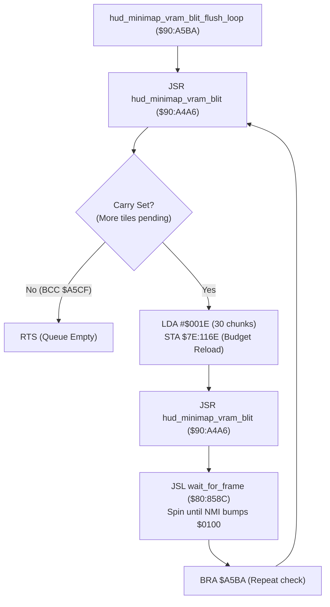

# Minimap Radar Blip Synchronization & VRAM Blit Flush Loop ($90:A5BA – $90:A5CF)

> **ROM Bank**: `$90` (`$90:A5BA` – `$90:A5CF`)  
> **Source Module**: `ui/minimap-blip-sync.c` / `ui/minimap-blip-sync.h`  
> **Recomp Symbol**: `bank_90_A5BA_M0X0`, `bank_90_A5BA`  
> **Confirmed Knowledge**: `rom/90a5ba.md`, `rom/90a4a6.md`, `rom/80858c.md`  
> **Core Subsystems**: Minimap Radar HUD Display, Hardware VRAM DMA Pacing, VBLANK Synchronization (`$80:858C`)  

---

## 1. Subsystem Architecture & Overview

During field exploration and cutscene progression, environmental mutations (such as cutting grass, felling obstacles, or progressing destructible map objects via `$90:A36D` / `$90:A3AC`) alter the underlying metatile layout. Because the on-screen minimap radar maintains a direct graphical representation of terrain tiles in VRAM, metatile mutations must be mirrored to the radar tile buffer.

The routine at `$90:A5BA` (`hud_minimap_vram_blit_flush_loop`) acts as a **synchronous transfer drain**. It coordinates with `hud_minimap_vram_blit` (`$90:A4A6`) and the vertical blanking frame synchronization engine (`wait_for_frame` at `$80:858C`):

```
+--------------------------------------------------------------------------------------------------+
|                           Minimap Radar VRAM Staging & Pacing Layout                             |
+--------------------------------------------------------------------------------------------------+
| $7E:116E             (2 bytes)  : Chunk Transfer Budget Counter (Reloaded with 0x001E = 30)      |
| $7E:0F3A             (2 bytes)  : VRAM Queue Mutation Lock / In-Flight Transfer Counter           |
| $7E:1170             (2 bytes)  : Tile Pattern Staging Buffer Write Cursor (0..127 bytes)        |
| $7E:0FC2             (2 bytes)  : DMA Commit Trigger Word (Bit 0 latches pending VRAM upload)    |
| $7E:0100             (2 bytes)  : NMI Master Frame Counter (Incremented every 60 Hz VBLANK)      |
+--------------------------------------------------------------------------------------------------+
```



---

## 2. Calling Context & Upstream Triggers

`hud_minimap_vram_blit_flush_loop` is invoked exclusively by the destructible map object state interpolator and frame dispatcher:
- **`$90:A3BF`**: Dispatched during forward state progression when `$7E:10CE,X < $7E:107E,X`.
- **`$90:A3E7`**: Dispatched during backward state progression when `$7E:10CE,X > $7E:107E,X`.
- **`$90:A3F3`**: Dispatched during secondary transition updates.
- **`$90:A417`**: Dispatched during final boundary confirmation before VRAM tile commit.

Before committing modified metatiles into field map memory and staging new graphics into the tile cache via `$90:A5D0`, the engine executes `JSR $A5BA` to guarantee that all previously queued radar blits have completely flushed to VRAM.

---

## 3. Disassembly & Instruction-Level Walkthrough

```assembly
; ==============================================================================
; hud_minimap_vram_blit_flush_loop ($90:A5BA - $90:A5CF)
; Synchronous flush loop for minimap radar tile blit queue.
; ==============================================================================
$90:A5BA 20 A6 A4    JSR $A4A6       ; Invoke hud_minimap_vram_blit to test / process staging
$90:A5BD 90 10       BCC $A5CF       ; If Carry == 0, blit queue is empty; return immediately
$90:A5BF A9 1E 00    LDA #$001E      ; Load 30 (0x1E) into Accumulator
$90:A5C2 8D 6E 11    STA $116E       ; Set remaining chunk budget register $7E:116E
$90:A5C5 20 A6 A4    JSR $A4A6       ; Process up to 30 chunks via hud_minimap_vram_blit
$90:A5C8 22 8C 85 80 JSL $80858C     ; JSL wait_for_frame (spin until NMI increments $0100)
$90:A5CC 80 EC       BRA $A5BA       ; Branch back to A5BA to re-verify queue status
$90:A5CF 60          RTS             ; Return to caller
```

### Detailed Operational Logic
1. **Initial Queue Query (`$90:A5BA` – `$90:A5BD`)**:
   `hud_minimap_vram_blit` at `$90:A4A6` tests whether any tile transfers remain in progress. If the queue is already clean, it returns with Carry clear (`CLC`). The branch instruction `BCC $A5CF` immediately returns, adding zero frame latency to normal execution.
2. **Quota Reload & Batch Staging (`$90:A5BF` – `$90:A5C5`)**:
   If transfers remain pending, Carry is returned set (`SEC`). The routine reloads the batch budget register `$7E:116E` with `0x001E` (30 chunks). Calling `$90:A4A6` a second time processes up to 30 tile chunks into the staging buffer `$7E:11F4`.
3. **Hardware Frame Sync (`$90:A5C8`)**:
   The engine calls `wait_for_frame` (`$80:858C`), entering a tight spinloop that halts CPU thread execution until the SNES NMI handler fires and advances the master frame counter at `$7E:0100`. During VBLANK, the NMI DMA queue commits the staged radar tiles into VRAM.
4. **Looping Guarantee (`$90:A5CC`)**:
   `BRA $A5BA` loops back to repeat the test until `hud_minimap_vram_blit` returns with Carry clear.

---

## 4. Clean C Decompilation

```c
#include <stdint.h>
#include <stdbool.h>

/**
 * WRAM layout relevant to the minimap radar subsystem.
 */
typedef struct {
    uint16_t vram_transfer_lock;    /* $7E:0F3A */
    uint16_t dma_commit_trigger;    /* $7E:0FC2 */
    uint16_t minimap_chunk_budget;  /* $7E:116E */
    uint16_t staging_buffer_cursor; /* $7E:1170 */
} MinimapState;

extern MinimapState g_minimap_state;

/**
 * Advances minimap radar tile blitting into staging buffers.
 *
 * @return true if additional chunks remain pending (Carry Set),
 *         false if the transfer queue is completely flushed (Carry Clear).
 */
extern bool hud_minimap_vram_blit(void);

/**
 * Halts CPU execution until the NMI interrupt increments the frame counter.
 * Synchronizes with vertical blanking DMA transfers.
 */
extern void wait_for_frame(void);

/**
 * Synchronously flushes all pending minimap radar VRAM tile blits.
 *
 * Ensures that tile staging and DMA transfers complete across vertical
 * blanking intervals before the caller proceeds with terrain mutations.
 */
void hud_minimap_vram_blit_flush_loop(void) {
    /* Step 1: Initial check - if queue is empty, exit immediately */
    while (hud_minimap_vram_blit()) {
        /* Step 2: Set burst chunk budget to 30 entries */
        g_minimap_state.minimap_chunk_budget = 0x001E;

        /* Step 3: Stage up to 30 chunks into VRAM upload buffers */
        hud_minimap_vram_blit();

        /* Step 4: Synchronize with next VBLANK to let DMA commit tiles */
        wait_for_frame();

        /* Step 5: Loop back until Carry is clear */
    }
}
```

---

## 5. Architectural Implications

- **Pacing & Teardown Protection**: Blitting entire radar tile blocks in a single frame could easily overrun the 128-byte staging buffer `$7E:1174` / `$7E:11F4` and exceed VBLANK DMA bandwidth. The 30-chunk pacing register `$7E:116E` ensures transfers are smoothly amortized across frames.
- **Race Condition Prevention**: By spinning on `wait_for_frame` before destructible object frame updates proceed, the engine prevents race conditions where an actor or camera accesses newly mutated metatiles before VRAM patterns are committed.
