# Minimap Radar Viewport Clipping & Dynamic POI Projection Engine

- **ROM Locations**:
  - `minimap_viewport_clip_and_render`: `$90:A4EC` – `$90:A5CF`
  - `minimap_cell_stride_and_palette_calc`: `$90:A5D0` – `$90:A64F`
  - `minimap_poi_blip_project`: `$90:A650` – `$90:A6B3`
  - `minimap_poi_slot_allocate_and_commit`: `$90:A6B4` – `$90:A6EE`
- **CPU State**: 16-bit A/X (`REP #$30`), Data Bank `$7E` / `$90`
- **WRAM Core Addresses**:
  - `$7E:0F8C`: Minimap viewport top window bound ($Y_{\text{min}}$).
  - `$7E:0F8E`: Minimap viewport bottom window bound ($Y_{\text{max}}$).
  - `$7E:0F90`: Minimap viewport left window bound ($X_{\text{min}}$).
  - `$7E:0F92`: Minimap viewport right window bound ($X_{\text{max}}$).
  - `$7E:0FB4`: Metatile palette attribute bits (shifted from `0x1F00`).
  - `$7E:0FB6`: Metatile screen buffer byte offset (`(X + Y * Stride) * 2`).
  - `$7E:0FB8`: Projected cell candidate X.
  - `$7E:0FBA`: Projected cell candidate Y.
  - `$7E:0FBE`: Projected cell right edge ($X + \text{width}$).
  - `$7E:0FC0`: Projected cell bottom edge ($Y + \text{height}$).
  - `$7E:0FC2`: VRAM DMA commit trigger flag.
  - `$7E:0FC6`: POI type table index.
  - `$7E:0FC8`: Metatile property threshold.
  - `$7E:0FCA`: POI entity table scan offset.
  - `$7E:0FCC`: POI world X translation offset.
  - `$7E:0FCE`: POI world Y translation offset.
  - `$7E:0FD2`–`$7E:0FDC`: Active dynamic POI tracking slots (up to 4 entries).
  - `$7E:1002`–`$7E:100C`: POI screen tile buffer offsets.
  - `$7E:1032`–`$7E:103C`: Packed POI coordinates (`X | (Y << 8)`).
  - `$7E:116E`: Remaining chunk counter.
  - `$7E:1174`: Raw tile pattern cache buffer.
  - `$7E:11F4`: VRAM DMA tile pattern staging buffer.
  - `$7F:0000`: Field map metatile grid array.

---

## 1. Architectural Architecture & Projection Pipeline

The Secret of Evermore minimap/radar subsystem extends beyond compass needle display to project active map geometry and dynamic POIs (points of interest, player companions, landmarks) into the on-screen radar display.

```mermaid
flowchart TD
    subgraph Viewport_Clipping["Metatile Viewport Window Clipper ($90:A4EC)"]
        FetchTile["Read Map Metatile ($7F:0000,X)"] --> KeyTest{"Tile == Key $12?"}
        KeyTest -->|"Yes"| SkipTile["Skip Tile"]
        KeyTest -->|"No"| Cache["Cache to $7E:1174,Y"]
        Cache --> CheckY{"$0F8C <= Y < $0F8E?"}
        CheckY -->|"No (Out of Bounds)"| NextCell["Advance to Sub-Cell"]
        CheckY -->|"Yes"| CheckX{"$0F90 <= X < $0F92?"}
        CheckX -->|"No (Out of Bounds)"| NextCell
        CheckX -->|"Yes"| MergePalette["(X & 0x1F) | Palette ($0FB4)"]
        MergePalette --> EmitVRAM["Emit Tile to Staging Buffer ($7E:11F4,Y)"]
    end

    subgraph Stride_Calc["Cell Stride & Palette Calculator ($90:A5D0)"]
        UnpackDesc["Unpack Object Descriptor [$AA],Y"] --> MultStride["Hardware Multiplier $4202: Y * Stride"]
        MultStride --> BoundingBox["Compute Bounds: X..X+W, Y..Y+H"]
        BoundingBox --> ScreenOffset["Offset = (X + Y*Stride) * 2"]
        ScreenOffset --> PaletteExtract["Extract Palette: (Attr & 0x1F00) >> 3"]
        PaletteExtract --> TriggerDMA["Set $0FC2 = 1"]
    end

    subgraph POI_Tracker["Dynamic POI Blip Scanner ($90:A650 - $90:A6EE)"]
        ReadPOI["Read POI Table ($90:0000,X)"] --> TermCheck{"X == 0x8000?"}
        TermCheck -->|"Yes"| EndScan["End POI Scan"]
        TermCheck -->|"No"| Downsample16["(X + OffX) >> 4, (Y + OffY) >> 4"]
        Downsample16 --> MapBound{"In Map Dimensions?"}
        MapBound -->|"No"| AdvancePOI["Next POI (X += 4)"]
        MapBound -->|"Yes"| AllocSlot["Allocate Free Tracking Slot ($0FD2)"]
        AllocSlot --> CommitSlot["Commit Type, Packed Coords & Buffer Offset"]
    end
```

### 1. Viewport Window Clamping
Radar cells are bounded by a strict 2D rectangular window:
- Vertical: `$0F8C \le Y < $0F8E`
- Horizontal: `$0F90 \le X < $0F92`

Cells falling outside this rectangular window are discarded, preventing radar wrap-around artifacts.

### 2. Palette Attribute Fusion
Valid metatiles combine their raw 5-bit metatile identifier with dynamic palette control bits:
$$\text{Output Metatile} = (X \ \& \ \text{0x001F}) \ | \ \text{Palette Mask} (\text{\$0FB4})$$

### 3. Dynamic POI Blip Registration
Dynamic POIs are scanned sequentially from `$90:0000`. Coordinates are downsampled 16:1, checked against map dimensions, and registered into one of 4 dedicated POI tracking slots (`$7E:0FD2`..`$7E:0FDC`).

---

## 2. Disassembly & Annotations

### Part 1: Minimap Viewport Clip and Tile Render (`$90:A4EC` – `$90:A5CF`)
> **Interactive 65816 Assembly**:
> Centralized comments infused at runtime.
> [View in VFS: soe://rom/code/90A4EC](soe://rom/code/90A4EC?asm=1&c=0)

### Part 2: Screen Stride Offset & Palette Calculator (`$90:A5D0` – `$90:A64F`)
> **Interactive 65816 Assembly**:
> Centralized comments infused at runtime.
> [View in VFS: soe://rom/code/90A4EC](soe://rom/code/90A4EC?asm=1&c=0)

### Part 3: Dynamic POI Scanner (`$90:A650` – `$90:A6B3`)
> **Interactive 65816 Assembly**:
> Centralized comments infused at runtime.
> [View in VFS: soe://rom/code/90A4EC](soe://rom/code/90A4EC?asm=1&c=0)

### Part 4: Dynamic POI Slot Allocator (`$90:A6B4` – `$90:A6EE`)
> **Interactive 65816 Assembly**:
> Centralized comments infused at runtime.
> [View in VFS: soe://rom/code/90A4EC](soe://rom/code/90A4EC?asm=1&c=0)

---

## 3. Reconstructed Clean C Implementation

> **Reconstructed C Decompilation**:
> Source moved to [`reconstructed-c/90/90A4EC_minimap_projection.c`](../../../reconstructed-c/90/90A4EC_minimap_projection.c).
> [View in VFS: soe://rom/code/90A4EC](soe://rom/code/90A4EC?c=1&asm=0)

---

## 4. Architectural Summary & Hardware Synergies

1. **Window-Level Pixel Clipping**:
   Rather than relying on hardware clipping windows (PPU Window 1 / Window 2), the radar subsystem applies software bounding box clamps (`$0F8C`..`$0F92`) directly at the metatile tile stage.
2. **Palette Masking**:
   The routine shifts high attribute bits `(attr & 0x1F00) >> 3` and merges them with the 5-bit metatile identifier (`metatile & 0x001F`), achieving instantaneous multi-palette coloration for landmarks, terrain types, and animated features without requiring multiple passes.
3. **Hardware Division and Multiplication**:
   SNES registers `$4202` (multiplicand) and `$4216` (16-bit multiplication result) are used to perform real-time row stride calculations $Y \times \text{Stride}$, minimizing CPU cycles during field traversal.
