# Minimap Radar Viewport Clipping & Dynamic POI Projection Engine

- **ROM Locations**:
  - `minimap_viewport_clip_and_render`: `$90:A4EC` – `$90:A5CF`
  - `minimap_cell_stride_and_palette_calc`: `$90:A5D0` – `$90:A64F`
  - `minimap_poi_blip_project`: `$90:A650` – `$90:A6B3`
  - `minimap_poi_slot_allocate_and_commit`: `$90:A6B4` – `$90:A6EE`
- **CPU State**: 16-bit A/X (`REP #$30`), Data Bank `$7E` / `$90`
- **WRAM Core Addresses**:
  - `$7E:0F8C`: Minimap viewport top window bound ($Y_{\text{min}}$).
  - `$7E:0F8E`: Minimap viewport bottom window bound ($Y_{\text{max}}$).
  - `$7E:0F90`: Minimap viewport left window bound ($X_{\text{min}}$).
  - `$7E:0F92`: Minimap viewport right window bound ($X_{\text{max}}$).
  - `$7E:0FB4`: Metatile palette attribute bits (shifted from `0x1F00`).
  - `$7E:0FB6`: Metatile screen buffer byte offset (`(X + Y * Stride) * 2`).
  - `$7E:0FB8`: Projected cell candidate X.
  - `$7E:0FBA`: Projected cell candidate Y.
  - `$7E:0FBE`: Projected cell right edge ($X + \text{width}$).
  - `$7E:0FC0`: Projected cell bottom edge ($Y + \text{height}$).
  - `$7E:0FC2`: VRAM DMA commit trigger flag.
  - `$7E:0FC6`: POI type table index.
  - `$7E:0FC8`: Metatile property threshold.
  - `$7E:0FCA`: POI entity table scan offset.
  - `$7E:0FCC`: POI world X translation offset.
  - `$7E:0FCE`: POI world Y translation offset.
  - `$7E:0FD2`–`$7E:0FDC`: Active dynamic POI tracking slots (up to 4 entries).
  - `$7E:1002`–`$7E:100C`: POI screen tile buffer offsets.
  - `$7E:1032`–`$7E:103C`: Packed POI coordinates (`X | (Y << 8)`).
  - `$7E:116E`: Remaining chunk counter.
  - `$7E:1174`: Raw tile pattern cache buffer.
  - `$7E:11F4`: VRAM DMA tile pattern staging buffer.
  - `$7F:0000`: Field map metatile grid array.

---

## 1. Architectural Architecture & Projection Pipeline

The Secret of Evermore minimap/radar subsystem extends beyond compass needle display to project active map geometry and dynamic POIs (points of interest, player companions, landmarks) into the on-screen radar display.

```mermaid
flowchart TD
    subgraph Viewport_Clipping["Metatile Viewport Window Clipper ($90:A4EC)"]
        FetchTile["Read Map Metatile ($7F:0000,X)"] --> KeyTest{"Tile == Key $12?"}
        KeyTest -->|"Yes"| SkipTile["Skip Tile"]
        KeyTest -->|"No"| Cache["Cache to $7E:1174,Y"]
        Cache --> CheckY{"$0F8C <= Y < $0F8E?"}
        CheckY -->|"No (Out of Bounds)"| NextCell["Advance to Sub-Cell"]
        CheckY -->|"Yes"| CheckX{"$0F90 <= X < $0F92?"}
        CheckX -->|"No (Out of Bounds)"| NextCell
        CheckX -->|"Yes"| MergePalette["(X & 0x1F) | Palette ($0FB4)"]
        MergePalette --> EmitVRAM["Emit Tile to Staging Buffer ($7E:11F4,Y)"]
    end

    subgraph Stride_Calc["Cell Stride & Palette Calculator ($90:A5D0)"]
        UnpackDesc["Unpack Object Descriptor [$AA],Y"] --> MultStride["Hardware Multiplier $4202: Y * Stride"]
        MultStride --> BoundingBox["Compute Bounds: X..X+W, Y..Y+H"]
        BoundingBox --> ScreenOffset["Offset = (X + Y*Stride) * 2"]
        ScreenOffset --> PaletteExtract["Extract Palette: (Attr & 0x1F00) >> 3"]
        PaletteExtract --> TriggerDMA["Set $0FC2 = 1"]
    end

    subgraph POI_Tracker["Dynamic POI Blip Scanner ($90:A650 - $90:A6EE)"]
        ReadPOI["Read POI Table ($90:0000,X)"] --> TermCheck{"X == 0x8000?"}
        TermCheck -->|"Yes"| EndScan["End POI Scan"]
        TermCheck -->|"No"| Downsample16["(X + OffX) >> 4, (Y + OffY) >> 4"]
        Downsample16 --> MapBound{"In Map Dimensions?"}
        MapBound -->|"No"| AdvancePOI["Next POI (X += 4)"]
        MapBound -->|"Yes"| AllocSlot["Allocate Free Tracking Slot ($0FD2)"]
        AllocSlot --> CommitSlot["Commit Type, Packed Coords & Buffer Offset"]
    end
```



### 1. Viewport Window Clamping
Radar cells are bounded by a strict 2D rectangular window:
- Vertical: `$0F8C \le Y < $0F8E`
- Horizontal: `$0F90 \le X < $0F92`

Cells falling outside this rectangular window are discarded, preventing radar wrap-around artifacts.

### 2. Palette Attribute Fusion
Valid metatiles combine their raw 5-bit metatile identifier with dynamic palette control bits:
$$\text{Output Metatile} = (X \ \& \ \text{0x001F}) \ | \ \text{Palette Mask} (\text{\$0FB4})$$

### 3. Dynamic POI Blip Registration
Dynamic POIs are scanned sequentially from `$90:0000`. Coordinates are downsampled 16:1, checked against map dimensions, and registered into one of 4 dedicated POI tracking slots (`$7E:0FD2`..`$7E:0FDC`).

---

## 2. Disassembly & Annotations

### Part 1: Minimap Viewport Clip and Tile Render (`$90:A4EC` – `$90:A5CF`)
```assembly
; ==============================================================================
; minimap_viewport_clip_and_render ($90:A4EC)
; Clips field metatiles to radar window and formats output tile buffer.
; ==============================================================================
$90A4EC  AD AA A5    LDA $A5AA
$90A4EF  B0 1A       BCS $90A50B
$90A4F1  1A          INC A
$90A4F2  85 B0       STA $B0           ; Advance buffer sequence
$90A4F4  BF 00 00 7F LDA $7F0000,X     ; Load field map metatile from Bank $7F
$90A4F8  C5 12       CMP $12           ; Compare with transparent key
$90A4FA  F0 33       BEQ $90A52F       ; Skip if transparent
$90A4FC  99 74 11    STA $1174,Y       ; Store raw metatile to cache buffer
$90A4FF  AD BA 0F    LDA $0FBA         ; Candidate cell Y
$90A502  CD 8C 0F    CMP $0F8C         ; Compare against radar top bound
$90A505  90 28       BCC $90A52F       ; If above top bound, cull
$90A507  CD 8E 0F    CMP $0F8E         ; Compare against radar bottom bound
$90A50A  B0 23       BCS $90A52F       ; If below bottom bound, cull
$90A50C  AD B8 0F    LDA $0FB8         ; Candidate cell X
$90A50F  CD 90 0F    CMP $0F90         ; Compare against radar left bound
$90A512  90 1B       BCC $90A52F       ; If left of left bound, cull
$90A514  CD 92 0F    CMP $0F92         ; Compare against radar right bound
$90A517  B0 16       BCS $90A52F       ; If right of right bound, cull

; Cell is visible: fuse low 5 bits with palette attribute mask
$90A519  29 1F 00    AND #$001F        ; Metatile low 5 bits
$90A51C  0D B4 0F    ORA $0FB4         ; Merge palette bits ($0FB4)
$90A51F  99 F4 11    STA $11F4,Y       ; Store projected radar cell tile into staging buffer
$90A522  C8          INY
$90A523  C8          INY
$90A524  C0 80 00    CPY #$0080        ; Check buffer capacity (128 bytes)
$90A527  D0 03       BNE $90A52C
$90A529  A0 00 00    LDY #$0000        ; Wrap ring buffer pointer
$90A52C  CE 6E 11    DEC $116E         ; Decrement remaining chunk counter

; Secondary sub-tile test (stride step)
$90A52F  BF 02 00 7F LDA $7F0002,X     ; Load adjacent metatile
$90A533  C5 14       CMP $14
$90A535  F0 36       BEQ $90A56D
$90A537  99 74 11    STA $1174,Y
$90A53A  AD BA 0F    LDA $0FBA
$90A53D  CD 94 0F    CMP $0F94
$90A540  90 2B       BCC $90A56D
$90A542  CD 96 0F    CMP $0F96
$90A545  B0 26       BCS $90A56D
$90A547  AD B8 0F    LDA $0FB8
$90A54A  CD 98 0F    CMP $0F98
$90A54D  90 1E       BCC $90A56D
$90A54F  CD 9A 0F    CMP $0F9A
$90A552  B0 19       BCS $90A56D
$90A554  29 1F 00    AND #$001F
$90A557  0D B4 0F    ORA $0FB4
$90A55A  09 00 04    ORA #$0400        ; Secondary layer priority bit
$90A55D  99 F4 11    STA $11F4,Y
$90A560  C8          INY
$90A561  C8          INY
$90A562  C0 80 00    CPY #$0080
$90A565  D0 03       BNE $90A56A
$90A567  A0 00 00    LDY #$0000
$90A56A  CE 6E 11    DEC $116E
$90A56D  60          RTS
```

### Part 2: Screen Stride Offset & Palette Calculator (`$90:A5D0` – `$90:A64F`)
```assembly
; ==============================================================================
; minimap_cell_stride_and_palette_calc ($90:A5D0)
; Computes screen buffer destination address and extracts palette bits.
; ==============================================================================
$90A5D0  29 FF 00    AND #$00FF
$90A5D3  09 00 05    ORA #$0500        ; Base multiplication factor
$90A5D6  8D 02 42    STA $4202         ; Hardware Multiplicand A ($4202)
$90A5D9  A5 8C       LDA $8C
$90A5DB  85 B1       STA $B1
$90A5DD  8A          TXA
$90A5DE  0A          ASL A             ; X * 2
$90A5DF  6D A2 0F    ADC $0FA2         ; Table offset
$90A5E2  A8          TAY
$90A5E3  B7 8B       LDA [$8B],Y       ; Load base index
$90A5E5  38          SEC
$90A5E6  6D 16 42    ADC $4216         ; Add hardware multiplier result
$90A5E9  A8          TAY
$90A5EA  5A          PHY               ; Save descriptor base pointer
$90A5EB  C8          INY
$90A5EC  B7 AA       LDA [$AA],Y       ; Read X coordinate
$90A5EE  C8          INY
$90A5EF  29 FF 00    AND #$00FF
$90A5F2  8D BC 0F    STA $0FBC
$90A5F5  8D B8 0F    STA $0FB8         ; Target Cell X
$90A5F8  B7 AA       LDA [$AA],Y       ; Read Y coordinate
$90A5FA  C8          INY
$90A5FB  29 FF 00    AND #$00FF
$90A5FE  8D BA 0F    STA $0FBA         ; Target Cell Y
$90A601  EB          XBA
$90A602  0D EE 08    ORA $08EE         ; Map row stride ($7E:08EE)
$90A605  8D 02 42    STA $4202         ; Hardware Multiplier = Y * Stride
$90A608  B7 AA       LDA [$AA],Y       ; Read Width
$90A60A  A8          TAY
$90A60B  B7 AA       LDA [$AA],Y
$90A60D  C8          INY
$90A60E  29 FF 00    AND #$00FF
$90A611  18          CLC
$90A612  6D B8 0F    ADC $0FB8         ; X + Width
$90A615  8D BE 0F    STA $0FBE         ; Right edge ($0FBE)
$90A618  B7 AA       LDA [$AA],Y       ; Read Height
$90A61A  29 FF 00    AND #$00FF
$90A61D  18          CLC
$90A61E  6D BA 0F    ADC $0FBA         ; Y + Height
$90A621  8D C0 0F    STA $0FC0         ; Bottom edge ($0FC0)
$90A624  98          TYA
$90A625  38          SEC
$90A626  65 AA       ADC $AA
$90A628  85 B0       STA $B0
$90A62A  A9 00 7F    LDA #$7F00        ; Bank $7F
$90A62D  85 AE       STA $AE
$90A62F  AD B8 0F    LDA $0FB8         ; Cell X
$90A632  18          CLC
$90A633  6D 16 42    ADC $4216         ; Add row offset (Y * Stride)
$90A636  0A          ASL A             ; 2 bytes per metatile
$90A637  85 AD       STA $AD           ; DP $AD = Screen tile address
$90A639  8D B6 0F    STA $0FB6         ; Buffer destination offset
$90A63C  AD B9 0F    LDA $0FB9
$90A63F  29 00 1F    AND #$1F00        ; Isolate palette bits
$90A642  4A          LSR A
$90A643  4A          LSR A
$90A644  4A          LSR A             ; Shift to standard bits 10..12
$90A645  8D B4 0F    STA $0FB4         ; Store palette attribute mask
$90A648  A9 01 00    LDA #$0001
$90A64B  8D C2 0F    STA $0FC2         ; Trigger VRAM commit flag
$90A64E  7A          PLY
$90A64F  60          RTS
```

### Part 3: Dynamic POI Scanner (`$90:A650` – `$90:A6B3`)
```assembly
; ==============================================================================
; minimap_poi_blip_project ($90:A650)
; Scans POI descriptors, downsamples coordinates 16:1, and validates map bounds.
; ==============================================================================
$90A650  AE CA 0F    LDX $0FCA         ; Load current POI table scan index
$90A653  F0 35       BEQ $90A68A       ; If zero, end scan
$90A655  BF 00 00 90 LDA $900000,X     ; Read POI World X
$90A659  C9 00 80    CMP #$8000        ; Check sentinel terminator
$90A65C  F0 29       BEQ $90A687       ; End of table
$90A65E  18          CLC
$90A65F  6D CC 0F    ADC $0FCC         ; Add horizontal translation offset
$90A662  4A          LSR A
$90A663  4A          LSR A
$90A664  4A          LSR A
$90A665  4A          LSR A             ; X >> 4 (16:1 downsampling)
$90A666  29 FF 00    AND #$00FF
$90A669  85 46       STA $46           ; DP $46 = Radar cell X
$90A66B  BF 02 00 90 LDA $900002,X     ; Read POI World Y
$90A66F  18          CLC
$90A670  6D CE 0F    ADC $0FCE         ; Add vertical translation offset
$90A673  4A          LSR A
$90A674  4A          LSR A
$90A675  4A          LSR A
$90A676  4A          LSR A             ; Y >> 4 (16:1 downsampling)
$90A677  29 FF 00    AND #$00FF
$90A67A  85 48       STA $48           ; DP $48 = Radar cell Y
$90A67C  8A          TXA
$90A67D  18          CLC
$90A67E  69 04 00    ADC #$0004        ; Advance POI descriptor index by 4 bytes
$90A681  8D CA 0F    STA $0FCA
$90A684  4C 8B A6    JMP $90A68B

; Map Boundary & Threshold Test:
$90A68B  A5 46       LDA $46           ; Radar cell X
$90A68D  CD EE 08    CMP $08EE         ; Compare against map width
$90A690  B0 21       BCS $90A6B3       ; Out of bounds -> exit
$90A692  A5 48       LDA $48           ; Radar cell Y
$90A694  CD F0 08    CMP $08F0         ; Compare against map height
$90A697  B0 1A       BCS $90A6B3       ; Out of bounds -> exit
$90A699  EB          XBA
$90A69A  0D EE 08    ORA $08EE
$90A69D  8F 02 42 00 STA $004202       ; Hardware Multiply: Y * Stride
$90A6A1  A5 46       LDA $46
$90A6A3  18          CLC
$90A6A4  6F 16 42 00 ADC $004216       ; X + (Y * Stride)
$90A6A8  0A          ASL A             ; 2 bytes per cell
$90A6A9  AA          TAX
$90A6AA  BF 00 00 7F LDA $7F0000,X     ; Load map metatile
$90A6AE  CD C8 0F    CMP $0FC8         ; Compare against tile property threshold
$90A6B1  90 01       BCC $90A6B4       ; If <= threshold, proceed to allocate slot
$90A6B3  6B          RTL
```

### Part 4: Dynamic POI Slot Allocator (`$90:A6B4` – `$90:A6EE`)
```assembly
; ==============================================================================
; minimap_poi_slot_allocate_and_commit ($90:A6B4)
; Finds open tracking slot ($0FD2..$0FDC) and commits POI coordinates.
; ==============================================================================
$90A6B4  86 04       STX $04           ; Store screen buffer offset
$90A6B6  AC C6 0F    LDY $0FC6         ; Load POI type index
$90A6B9  C8          INY
$90A6BA  AA          TAX
$90A6BB  C8          INY
$90A6BC  D7 8B       CMP [$8B],Y       ; Compare with type match table
$90A6BE  F0 0B       BEQ $90A6CB       ; Match found!
$90A6C0  C8          INY
$90A6C1  C8          INY
$90A6C2  B7 8B       LDA [$8B],Y
$90A6C4  D0 FA       BNE $90A6C0       ; Continue table search
$90A6C6  C8          INY
$90A6C7  C8          INY
$90A6C8  8A          TXA
$90A6C9  80 F0       BRA $90A6BB

; Allocate Free Tracking Slot:
$90A6CB  5A          PHY               ; Save matched type ID
$90A6CC  AE D0 0F    LDX $0FD0         ; Load active POI slot index (0..6)
$90A6CF  A0 04 00    LDY #$0004        ; Up to 4 active tracking slots
$90A6D2  BD D2 0F    LDA $0FD2,X       ; Check if slot is occupied
$90A6D5  F0 07       BEQ $90A6DE       ; Free slot found!
$90A6D7  E8          INX
$90A6D8  E8          INX               ; Next 2-byte slot
$90A6D9  88          DEY
$90A6DA  D0 F6       BNE $90A6D2
$90A6DC  7A          PLY
$90A6DD  6B          RTL               ; All slots full -> discard

; Commit to Active Slot:
$90A6DE  68          PLA               ; Restore POI Type ID
$90A6DF  9D D2 0F    STA $0FD2,X       ; Store POI Type ID in active slot
$90A6E2  A5 46       LDA $46           ; Radar Cell X
$90A6E4  05 47       ORA $47           ; Pack Radar Cell Y into high byte
$90A6E6  9D 32 10    STA $1032,X       ; Store packed coordinates (X | Y<<8)
$90A6E9  A5 04       LDA $04           ; Stored buffer offset
$90A6EB  9D 02 10    STA $1002,X       ; Store screen buffer offset
$90A6EE  6B          RTL
```

---

## 3. Reconstructed Clean C Implementation

```c
#include <stdint.h>
#include <stdbool.h>

#define RADAR_WINDOW_CAPACITY 128
#define MAX_RADAR_POI_SLOTS   4
#define RADAR_SENTINEL_COORD  0x8000

typedef struct {
    // Radar Viewport Window Clamps
    uint16_t window_top;         // $7E:0F8C ($Y_min)
    uint16_t window_bottom;      // $7E:0F8E ($Y_max)
    uint16_t window_left;        // $7E:0F90 ($X_min)
    uint16_t window_right;       // $7E:0F92 ($X_max)

    // Cell Attributes & Stride
    uint16_t palette_mask;       // $7E:0FB4
    uint16_t screen_dest_offset; // $7E:0FB6
    uint16_t target_cell_x;      // $7E:0FB8
    uint16_t target_cell_y;      // $7E:0FBA
    uint16_t target_right_edge;  // $7E:0FBE
    uint16_t target_bottom_edge; // $7E:0FC0
    uint16_t vram_dma_trigger;   // $7E:0FC2

    // POI Tracking & Matching
    uint16_t poi_scan_offset;    // $7E:0FCA
    uint16_t poi_offset_x;       // $7E:0FCC
    uint16_t poi_offset_y;       // $7E:0FCE
    uint16_t tile_prop_thresh;   // $7E:0FC8
    uint16_t active_poi_slot_idx;// $7E:0FD0

    // POI Registered Slots
    uint16_t poi_slot_type[MAX_RADAR_POI_SLOTS];   // $7E:0FD2..$7E:0FDC
    uint16_t poi_buffer_offset[MAX_RADAR_POI_SLOTS]; // $7E:1002..$7E:100C
    uint16_t poi_packed_coords[MAX_RADAR_POI_SLOTS]; // $7E:1032..$7E:103C

    // Ring Buffer & Chunk Counters
    int16_t  remaining_chunks;   // $7E:116E
    uint16_t raw_cache_buf[RADAR_WINDOW_CAPACITY / 2]; // $7E:1174
    uint16_t vram_staging_buf[RADAR_WINDOW_CAPACITY / 2]; // $7E:11F4
} MinimapProjectionState;

extern MinimapProjectionState g_minimap_proj;
extern uint16_t g_map_tile_width;  // $7E:08EE
extern uint16_t g_map_tile_height; // $7E:08F0
extern const uint16_t g_field_map_metatiles[65536]; // Bank $7F

/**
 * Clips field map metatiles to the active radar window bounds
 * and formats the output tile buffer with palette attribute bits.
 * Corresponds to $90:A4EC.
 */
void minimap_viewport_clip_and_render(uint16_t *buffer_ptr, uint16_t map_index, uint16_t transparent_key) {
    uint16_t tile = g_field_map_metatiles[map_index];
    if (tile == transparent_key) {
        return;
    }

    uint16_t y = *buffer_ptr;
    g_minimap_proj.raw_cache_buf[y] = tile;

    // 2D Viewport Window Clamping
    if (g_minimap_proj.target_cell_y < g_minimap_proj.window_top ||
        g_minimap_proj.target_cell_y >= g_minimap_proj.window_bottom) {
        return;
    }

    if (g_minimap_proj.target_cell_x < g_minimap_proj.window_left ||
        g_minimap_proj.target_cell_x >= g_minimap_proj.window_right) {
        return;
    }

    // Fuse 5-bit metatile identifier with palette attribute mask
    uint16_t formatted_tile = (g_minimap_proj.target_cell_x & 0x001F) | g_minimap_proj.palette_mask;
    g_minimap_proj.vram_staging_buf[y] = formatted_tile;

    y++;
    if (y >= (RADAR_WINDOW_CAPACITY / 2)) {
        y = 0; // Wrap ring buffer pointer
    }
    *buffer_ptr = y;
    g_minimap_proj.remaining_chunks--;
}

/**
 * Computes screen buffer destination address via hardware multiplication (Y * Stride)
 * and extracts palette attribute bits.
 * Corresponds to $90:A5D0.
 */
void minimap_cell_stride_and_palette_calc(const uint8_t *desc_ptr) {
    g_minimap_proj.target_cell_x = desc_ptr[0];
    g_minimap_proj.target_cell_y = desc_ptr[1];

    uint8_t width = desc_ptr[2];
    uint8_t height = desc_ptr[3];

    // Bounding box edges
    g_minimap_proj.target_right_edge = g_minimap_proj.target_cell_x + width;
    g_minimap_proj.target_bottom_edge = g_minimap_proj.target_cell_y + height;

    // Screen destination offset = (X + Y * Stride) * 2
    uint32_t stride_offset = (uint32_t)g_minimap_proj.target_cell_y * g_map_tile_width;
    g_minimap_proj.screen_dest_offset = (g_minimap_proj.target_cell_x + (uint16_t)stride_offset) * 2;

    // Extract palette attributes: bits 8..12 shifted to bits 5..9
    uint16_t raw_attr = desc_ptr[4] | (desc_ptr[5] << 8);
    g_minimap_proj.palette_mask = (raw_attr & 0x1F00) >> 3;

    // Raise VRAM DMA transfer flag
    g_minimap_proj.vram_dma_trigger = 1;
}

/**
 * Scans POI descriptors, downsamples coordinates 16:1, and registers free tracking slots.
 * Corresponds to $90:A650 - $90:A6EE.
 */
bool minimap_poi_blip_project(const uint16_t *poi_table, uint16_t poi_type) {
    uint16_t idx = g_minimap_proj.poi_scan_offset;
    if (idx == 0) {
        return false;
    }

    uint16_t world_x = poi_table[idx];
    if (world_x == RADAR_SENTINEL_COORD) {
        return false;
    }

    // Downsample coordinates 16:1
    uint16_t radar_x = ((world_x + g_minimap_proj.poi_offset_x) >> 4) & 0x00FF;
    uint16_t radar_y = ((poi_table[idx + 1] + g_minimap_proj.poi_offset_y) >> 4) & 0x00FF;

    // Advance descriptor index
    g_minimap_proj.poi_scan_offset += 2;

    // Validate map bounds
    if (radar_x >= g_map_tile_width || radar_y >= g_map_tile_height) {
        return false;
    }

    // Check map tile property threshold
    uint32_t cell_offset = (radar_x + (radar_y * g_map_tile_width)) * 2;
    uint16_t map_tile = g_field_map_metatiles[cell_offset / 2];
    if (map_tile > g_minimap_proj.tile_prop_thresh) {
        return false;
    }

    // Allocate open tracking slot
    for (int s = 0; s < MAX_RADAR_POI_SLOTS; s++) {
        if (g_minimap_proj.poi_slot_type[s] == 0) {
            g_minimap_proj.poi_slot_type[s] = poi_type;
            g_minimap_proj.poi_packed_coords[s] = radar_x | (radar_y << 8);
            g_minimap_proj.poi_buffer_offset[s] = (uint16_t)cell_offset;
            return true;
        }
    }

    return false; // All 4 POI slots occupied
}
```

---

## 4. Architectural Summary & Hardware Synergies

1. **Window-Level Pixel Clipping**:
   Rather than relying on hardware clipping windows (PPU Window 1 / Window 2), the radar subsystem applies software bounding box clamps (`$0F8C`..`$0F92`) directly at the metatile tile stage.
2. **Palette Masking**:
   The routine shifts high attribute bits `(attr & 0x1F00) >> 3` and merges them with the 5-bit metatile identifier (`metatile & 0x001F`), achieving instantaneous multi-palette coloration for landmarks, terrain types, and animated features without requiring multiple passes.
3. **Hardware Division and Multiplication**:
   SNES registers `$4202` (multiplicand) and `$4216` (16-bit multiplication result) are used to perform real-time row stride calculations $Y \times \text{Stride}$, minimizing CPU cycles during field traversal.
