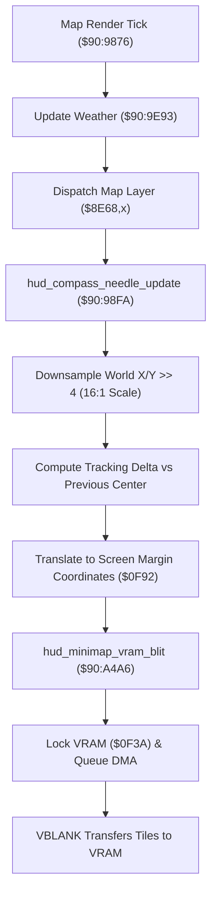

# Minimap Radar & Compass HUD Projection Engine

- **ROM Locations**:
  - `render_map_overlay_compass_hud`: `$90:9876` – `$90:988D`
  - `hud_compass_needle_update`: `$90:98FA` – `$90:9940`
  - `hud_minimap_vram_blit`: `$90:A4A6` – `$90:A4EA`
- **CPU State**: 16-bit A/X (`REP #$30`), Data Bank `$7E` / `$90`
- **WRAM Core Addresses**:
  - `$7E:010E`: Player/vehicle world coordinate X.
  - `$7E:0110`: Player/vehicle world coordinate Y.
  - `$7E:0F90`: Previous minimap radar cell X.
  - `$7E:0F8C`: Previous minimap radar cell Y.
  - `$7E:0F92`: Projected HUD screen blip target X.
  - `$7E:0FAC`: Radar screen margin offset X.
  - `$7E:0F3A`: VRAM DMA upload lock (incremented on entry, decremented on exit).
  - `$7E:241F`: Current field environment / weather category index.
  - DP `$46` & DP `$48`: Downsampled radar metatile coordinates.

---

## 1. Architectural Architecture & Coordinate Translation

The Secret of Evermore HUD renders an on-screen mini-radar and compass heading indicator during exploration and overworld flight.

### 1. 16:1 Coordinate Downsampling
World coordinates are measured in pixel resolution ($0 \dots 4096\text{px}$). The radar projects these coordinates down to a 16:1 scale:
$$\text{Radar}_X = \lfloor X / 16 \rfloor, \quad \text{Radar}_Y = \lfloor Y / 16 \rfloor$$
This mapping translates each $16 \times 16$ world metatile into a single pixel/tile element on the minimap HUD.

### 2. Relative Center Tracking
The engine computes relative delta movements:
$$\Delta X = \text{Radar}_X - \text{Radar}_{\text{prev}, X}, \quad \Delta Y = \text{Radar}_Y - \text{Radar}_{\text{prev}, Y}$$
Screen blip targets are derived by applying the margin anchor `$0FAC`:
$$\text{Screen}_X = \text{Radar}_X + \text{Anchor}_X$$

### 3. VRAM DMA Safety (`$7E:0F3A`)
Before updating the minimap tile pattern buffers, the engine increments `$7E:0F3A` to lock the VRAM transfer queue. After the tile buffer blit is constructed, `$0F3A` is decremented, allowing NMI VBLANK DMA to commit the updated radar tiles into VRAM safely.

---

## 2. Disassembly & Annotations

### Part 1: Top-Level Overlay Dispatcher (`$90:9876`)
> **Interactive 65816 Assembly**:
> Centralized comments infused at runtime.
> [View in VFS: soe://rom/code/909876](soe://rom/code/909876?asm=1&c=0)

### Part 2: Compass & Radar Coordinate Translation (`$90:98FA`)
> **Interactive 65816 Assembly**:
> Centralized comments infused at runtime.
> [View in VFS: soe://rom/code/909876](soe://rom/code/909876?asm=1&c=0)

### Part 3: Minimap VRAM Tile Blit (`$90:A4A6`)
> **Interactive 65816 Assembly**:
> Centralized comments infused at runtime.
> [View in VFS: soe://rom/code/909876](soe://rom/code/909876?asm=1&c=0)

---

## 3. Reconstructed Clean C Implementation

> **Reconstructed C Decompilation**:
> Source moved to [`reconstructed-c/90/909876_minimap_radar.c`](../../../reconstructed-c/90/909876_minimap_radar.c).
> [View in VFS: soe://rom/code/909876](soe://rom/code/909876?c=1&asm=0)

