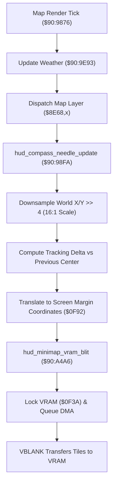

# Minimap Radar & Compass HUD Projection Engine

- **ROM Locations**:
  - `render_map_overlay_compass_hud`: `$90:9876` – `$90:988D`
  - `hud_compass_needle_update`: `$90:98FA` – `$90:9940`
  - `hud_minimap_vram_blit`: `$90:A4A6` – `$90:A4EA`
- **CPU State**: 16-bit A/X (`REP #$30`), Data Bank `$7E` / `$90`
- **WRAM Core Addresses**:
  - `$7E:010E`: Player/vehicle world coordinate X.
  - `$7E:0110`: Player/vehicle world coordinate Y.
  - `$7E:0F90`: Previous minimap radar cell X.
  - `$7E:0F8C`: Previous minimap radar cell Y.
  - `$7E:0F92`: Projected HUD screen blip target X.
  - `$7E:0FAC`: Radar screen margin offset X.
  - `$7E:0F3A`: VRAM DMA upload lock (incremented on entry, decremented on exit).
  - `$7E:241F`: Current field environment / weather category index.
  - DP `$46` & DP `$48`: Downsampled radar metatile coordinates.

---

## 1. Architectural Architecture & Coordinate Translation

The Secret of Evermore HUD renders an on-screen mini-radar and compass heading indicator during exploration and overworld flight.



### 1. 16:1 Coordinate Downsampling
World coordinates are measured in pixel resolution ($0 \dots 4096\text{px}$). The radar projects these coordinates down to a 16:1 scale:
$$\text{Radar}_X = \lfloor X / 16 \rfloor, \quad \text{Radar}_Y = \lfloor Y / 16 \rfloor$$
This mapping translates each $16 \times 16$ world metatile into a single pixel/tile element on the minimap HUD.

### 2. Relative Center Tracking
The engine computes relative delta movements:
$$\Delta X = \text{Radar}_X - \text{Radar}_{\text{prev}, X}, \quad \Delta Y = \text{Radar}_Y - \text{Radar}_{\text{prev}, Y}$$
Screen blip targets are derived by applying the margin anchor `$0FAC`:
$$\text{Screen}_X = \text{Radar}_X + \text{Anchor}_X$$

### 3. VRAM DMA Safety (`$7E:0F3A`)
Before updating the minimap tile pattern buffers, the engine increments `$7E:0F3A` to lock the VRAM transfer queue. After the tile buffer blit is constructed, `$0F3A` is decremented, allowing NMI VBLANK DMA to commit the updated radar tiles into VRAM safely.

---

## 2. Disassembly & Annotations

### Part 1: Top-Level Overlay Dispatcher (`$90:9876`)
```assembly
; ==============================================================================
; render_map_overlay_compass_hud ($90:9876)
; ==============================================================================
$909876  64 C5       STZ $C5
$909878  64 C7       STZ $C7
$90987A  22 93 9E 90 JSL $909E93       ; Weather & animated particle update
$90987E  AF 1F 24 7E LDA $7E241F       ; Environment / layer category index
$909882  0A          ASL A
$909883  AA          TAX
$909884  7C 68 8E    JMP ($8E68,X)     ; Dispatch layer-specific renderer
$909887  20 FA 98    JSR $98FA         ; Compass needle position & rotation
$90988A  20 A6 A4    JSR $A4A6         ; Minimap VRAM tile blit
$90988D  6B          RTL
```

### Part 2: Compass & Radar Coordinate Translation (`$90:98FA`)
```assembly
; ==============================================================================
; hud_compass_needle_update ($90:98FA)
; ==============================================================================
$9098FA  AD 0E 01    LDA $010E         ; Player World X
$9098FD  4A          LSR A
$9098FE  4A          LSR A
$9098FF  4A          LSR A
$909900  4A          LSR A             ; X >> 4 (16:1 downsampling)
$909901  85 46       STA $46           ; DP $46 = Radar cell X
$909903  38          SEC
$909904  ED 90 0F    SBC $0F90         ; Subtract previous radar X
$909907  85 0A       STA $0A           ; DP $0A = Delta X
$909909  A5 46       LDA $46
$90990B  8D 90 0F    STA $0F90         ; Update previous radar X
$90990E  18          CLC
$90990F  6D AC 0F    ADC $0FAC         ; Add radar screen margin offset
$909912  8D 92 0F    STA $0F92         ; Store Screen Target X

$909915  AD 10 01    LDA $0110         ; Player World Y
$909918  1A          INC A
$909919  4A          LSR A
$90991A  4A          LSR A
$90991B  4A          LSR A
$90991C  4A          LSR A             ; Y >> 4 (16:1 downsampling)
$90991D  85 48       STA $48           ; DP $48 = Radar cell Y
$90991F  38          SEC
$909920  ED 8C 0F    SBC $0F8C         ; Subtract previous radar Y
$909923  85 0C       STA $0C           ; DP $0C = Delta Y
$909925  A5 48       LDA $48
$909927  8D 8C 0F    STA $0F8C         ; Update previous radar Y
```

### Part 3: Minimap VRAM Tile Blit (`$90:A4A6`)
```assembly
; ==============================================================================
; hud_minimap_vram_blit ($90:A4A6)
; ==============================================================================
$90A4A6  A5 B0       LDA $B0           ; Check active blit request flag
$90A4A8  D0 0D       BNE $90A4B7       ; If busy, proceed to transfer
$90A4AA  18          CLC
$90A4AB  60          RTS

$90A4B7  EE 3A 0F    INC $0F3A         ; Lock VRAM transfers ($0F3A++)
$90A4BA  BC 70 11    LDY $1170         ; Load tile cache transfer pointer
$90A4BD  AD 6E 11    LDA $116E         ; Check pending chunks
$90A4C0  30 EA       BMI $90A4AC
$90A4C9  A5 B0       LDA $B0
$90A4CB  E6 B0       INC $B0           ; Increment transfer sequence
$90A4D0  09 00 01    ORA #$0100        ; Set VRAM commit mask
$90A4D3  4A          LSR A
$90A4D4  8D C2 0F    STA $0FC2         ; Store VRAM DMA trigger word
$90A4E5  CE 3A 0F    DEC $0F3A         ; Unlock VRAM transfers ($0F3A--)
$90A4E8  38          SEC
$90A4E9  60          RTS
```

---

## 3. Reconstructed Clean C Implementation

```c
#include <stdint.h>
#include <stdbool.h>

#define DOWNSAMPLE_SHIFT 4 // 16:1 world to radar downsampling

typedef struct {
    int16_t world_x;             // $7E:010E
    int16_t world_y;             // $7E:0110
    int16_t prev_radar_x;        // $7E:0F90
    int16_t prev_radar_y;        // $7E:0F8C
    int16_t screen_blip_x;       // $7E:0F92
    int16_t screen_margin_x;     // $7E:0FAC
    uint16_t vram_lock;          // $7E:0F3A
    uint16_t vram_dma_trigger;   // $7E:0FC2
    uint8_t  active_blit_flag;   // DP $B0
} MinimapRadarState;

extern MinimapRadarState g_minimap_radar;
extern uint16_t g_environment_type; // $7E:241F

extern void update_weather_particles(void);
extern void dispatch_map_layer_render(uint16_t env_type);

/**
 * Translates 16-bit world coordinates to 16:1 downsampled radar cells
 * and computes screen blip target coordinates.
 * Corresponds to $90:98FA.
 */
void hud_compass_needle_update(int16_t *out_delta_x, int16_t *out_delta_y) {
    // 1. Downsample World X by 16:1
    int16_t radar_x = g_minimap_radar.world_x >> DOWNSAMPLE_SHIFT;
    *out_delta_x = radar_x - g_minimap_radar.prev_radar_x;
    g_minimap_radar.prev_radar_x = radar_x;

    // Projected screen blip target X
    g_minimap_radar.screen_blip_x = radar_x + g_minimap_radar.screen_margin_x;

    // 2. Downsample World Y by 16:1
    int16_t radar_y = (g_minimap_radar.world_y + 1) >> DOWNSAMPLE_SHIFT;
    *out_delta_y = radar_y - g_minimap_radar.prev_radar_y;
    g_minimap_radar.prev_radar_y = radar_y;
}

/**
 * Safely commits prepared radar tile buffers into VRAM with DMA locking.
 * Corresponds to $90:A4A6.
 */
bool hud_minimap_vram_blit(void) {
    if (g_minimap_radar.active_blit_flag == 0) {
        return false; // No blit requested
    }

    // Lock VRAM transfer queue
    g_minimap_radar.vram_lock++;

    // Increment transfer sequence and queue DMA commit mask
    g_minimap_radar.active_blit_flag++;
    g_minimap_radar.vram_dma_trigger = ((uint16_t)g_minimap_radar.active_blit_flag | 0x0100) >> 1;

    // Unlock VRAM transfer queue
    g_minimap_radar.vram_lock--;

    return true;
}

/**
 * Top-level map overlay, compass needle, and minimap HUD tick.
 * Corresponds to $90:9876.
 */
void render_map_overlay_compass_hud(void) {
    // 1. Weather and ambient particle simulation
    update_weather_particles();

    // 2. Dispatch layer-specific renderer
    dispatch_map_layer_render(g_environment_type);

    // 3. Update compass heading needle and radar position
    int16_t dx, dy;
    hud_compass_needle_update(&dx, &dy);

    // 4. Commit updated radar tiles to VRAM
    hud_minimap_vram_blit();
}
```
